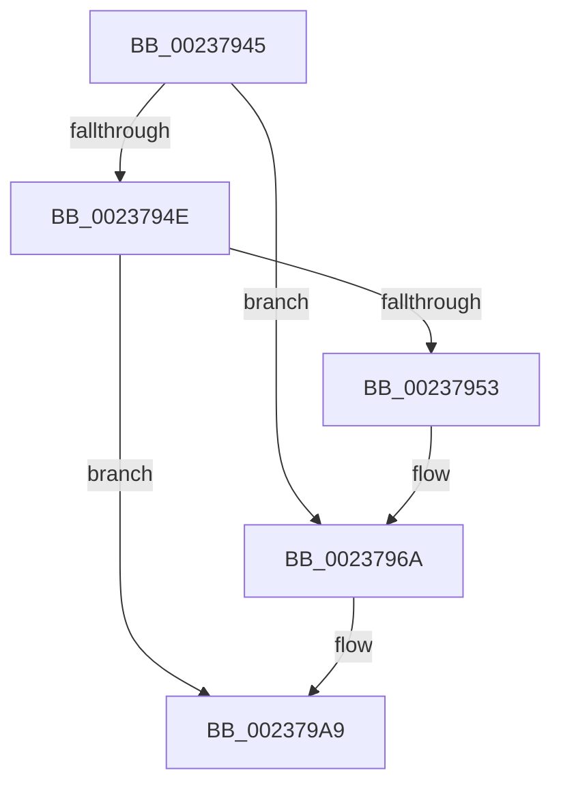

# sub_00237945

- RVA: `0x00237945`–`0x002379B4` (길이 `111` bytes)
- VA: `0x0000000140237945`
- 실행 섹션: `.text`
- PDB 이름 있음: `아니요`; PDB Function 태그: `아니요`
- unwind 정보 RVA: `0x0006099C`
- 디코드: `30`개 명령, `111/111` bytes 표시
- 미해석 바이트: `0` (있으면 어셈블리에 `.byte`로 보존)

> 이 문서는 커널 이미지의 기계어와 PDB 기호를 분석해 생성했습니다. 4번과 5번은 함수 원형과 자료형을 바이너리 사용 방식에서 추정한 C 해석이며 원본 소스 복구 결과는 아닙니다.

## 1. Dependencies

- 직접 호출 지점: **3**; 고유 호출 대상: **2**
- 직접 호출자로 확인된 함수: **0**
- RIP 상대 이미지 참조: **2**

### Outgoing calls
- `0x00237964` → [KeBugCheckEx](../4F/KeBugCheckEx_function_004FD660.md) (function, `0x004FD660`)
- `0x002379A3` → [KeBugCheckEx](../4F/KeBugCheckEx_function_004FD660.md) (function, `0x004FD660`)
- `0x002379AD` → [ObpDeferObjectDeletion](../3A/ObpDeferObjectDeletion_function_003A2394.md) (function, `0x003A2394`)

### Direct callers
- 이 함수 시작 RVA로 연결되는 직접 call은 확인되지 않았습니다. 간접 호출은 완전히 역산할 수 없습니다.

### Static image references
- `0x0023798E` → RVA `0x00FC6E4C` (`ALMOSTRO`; read)
- `0x00237998` → RVA `0x00FC7800` (`ALMOSTRO`; read)

## 2. Other-region calls and transfers

- 다른 실행 섹션으로 향하는 call: **0**
- call이 아닌 외부 분기/꼬리 이동: **1**
  - `0x002379B2` → [sub_00237912 + 0x2C](Unknown_function_00237912.md) (`tail-transfer`)

## 3. Assembly (complete function range)

```asm
00237945  48 8B 4B D8                     mov rcx, qword ptr [rbx - 0x28]
00237949  48 85 C9                        test rcx, rcx
0023794C  75 1C                           jne 0x14023796a
0023794E  48 85 C0                        test rax, rax
00237951  79 56                           jns 0x1402379a9
00237953  33 D2                           xor edx, edx
00237955  48 89 44 24 20                  mov qword ptr [rsp + 0x20], rax
0023795A  44 8D 49 04                     lea r9d, [rcx + 4]
0023795E  4C 8B C3                        mov r8, rbx
00237961  8D 4A 18                        lea ecx, [rdx + 0x18]
00237964  E8 F7 5C 2C 00                  call 0x1404fd660
00237969  CC                              int3
0023796A  41 B9 03 00 00 00               mov r9d, 3
00237970  48 89 4C 24 20                  mov qword ptr [rsp + 0x20], rcx
00237975  48 8D 43 D0                     lea rax, [rbx - 0x30]
00237979  4C 8B C3                        mov r8, rbx
0023797C  48 C1 E8 08                     shr rax, 8
00237980  0F B6 D0                        movzx edx, al
00237983  0F B6 43 E8                     movzx eax, byte ptr [rbx - 0x18]
00237987  41 8D 49 15                     lea ecx, [r9 + 0x15]
0023798B  48 33 D0                        xor rdx, rax
0023798E  0F B6 05 B7 F4 D8 00            movzx eax, byte ptr [rip + 0xd8f4b7]
00237995  48 33 D0                        xor rdx, rax
00237998  48 8D 05 61 FE D8 00            lea rax, [rip + 0xd8fe61]
0023799F  48 8B 14 D0                     mov rdx, qword ptr [rax + rdx*8]
002379A3  E8 B8 5C 2C 00                  call 0x1404fd660
002379A8  CC                              int3
002379A9  48 8D 4B D0                     lea rcx, [rbx - 0x30]
002379AD  E8 E2 A9 16 00                  call 0x1403a2394
002379B2  EB 8A                           jmp 0x14023793e
```

## 4. C-style interpretation (structured pseudocode)

```c
__int64 __fastcall sub_00237945(__int64 a1, int a2)
{
    __int64 result;
    unsigned __int64 v_stack_p20;

    if (*(unsigned __int64 *)(v_rbx - 40) != 0) goto loc_0023796A;
    if (!sign_flag) goto loc_002379A9;
    a2 = 0;
    v_stack_p20 = result;
    result = KeBugCheckEx(a2 + 24, a2, v_rbx, *(unsigned __int64 *)(v_rbx - 40) + 4);
loc_0023796A:
    v_stack_p20 = a2 + 24;
    result = (v_rbx - 48) >> (8);
    a2 = ((unsigned __int8)(result)) ^ (*(unsigned __int8 *)(v_rbx - 24));
    a2 = (a2) ^ (*(unsigned __int8 *)(v_rip + 14218423));
    result = KeBugCheckEx(3 + 21, *(unsigned __int64 *)(v_rip + 14220897 + a2 * 8), v_rbx, 3);
loc_002379A9:
    result = ObpDeferObjectDeletion(v_rbx - 48, *(unsigned __int64 *)(v_rip + 14220897 + a2 * 8), v_rbx, 3);
}
```

## 5. (Beta) C Style

```c
int64_t sub_00237945(int64_t Arg1, int32_t Arg2)
{
    int64_t result;
    uint64_t v_stack_p20;

    if (*(uint64_t *)(local_rbx - 0x28) != 0) goto loc_0023796A;
    if (!sign_flag) goto loc_002379A9;
    Arg2 = 0;
    v_stack_p20 = result;
    result = KeBugCheckEx(Arg2 + 24, Arg2, local_rbx, *(uint64_t *)(local_rbx - 0x28) + 4);
loc_0023796A:
    v_stack_p20 = Arg2 + 24;
    result = (local_rbx - 48) >> (8);
    Arg2 = ((uint8_t)(result)) ^ (*(uint8_t *)(local_rbx - 0x18));
    Arg2 = (Arg2) ^ (*(uint8_t *)(v_rip + 0xD8F4B7));
    result = KeBugCheckEx(3 + 21, *(uint64_t *)(v_rip + 0xD8FE61 + Arg2 * 8), local_rbx, 3);
loc_002379A9:
    result = ObpDeferObjectDeletion(local_rbx - 48, *(uint64_t *)(v_rip + 0xD8FE61 + Arg2 * 8), local_rbx, 3);
}
```

## 6. Execution-region graph

[열기: 2D/3D 그래프와 함수 탐색 컨트롤 패널](../../../control-panel.html?section=text&rva=0x00237945&view=graph)

- 2D 그래프는 위에서 아래로 흐르고, 3D 그래프는 빈 공간을 드래그해 회전합니다. Shift+드래그는 이동, 휠은 확대·축소, 함수 노드 선택은 대상 보고서 이동입니다.

### Static fallback


