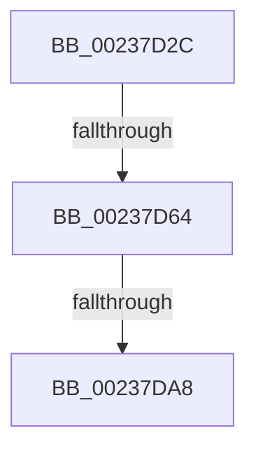

# sub_00237D2C

- RVA: `0x00237D2C`–`0x00237DC5` (길이 `153` bytes)
- VA: `0x0000000140237D2C`
- 실행 섹션: `.text`
- PDB 이름 있음: `아니요`; PDB Function 태그: `아니요`
- unwind 정보 RVA: `0x000609F0`
- 디코드: `32`개 명령, `153/153` bytes 표시
- 미해석 바이트: `0` (있으면 어셈블리에 `.byte`로 보존)

> 이 문서는 커널 이미지의 기계어와 PDB 기호를 분석해 생성했습니다. 4번과 5번은 함수 원형과 자료형을 바이너리 사용 방식에서 추정한 C 해석이며 원본 소스 복구 결과는 아닙니다.

## 1. Dependencies

- 직접 호출 지점: **0**; 고유 호출 대상: **0**
- 직접 호출자로 확인된 함수: **0**
- RIP 상대 이미지 참조: **0**

### Outgoing calls
- 직접 디코드된 call 명령이 없습니다.

### Direct callers
- 이 함수 시작 RVA로 연결되는 직접 call은 확인되지 않았습니다. 간접 호출은 완전히 역산할 수 없습니다.

### Static image references
- 디코드된 RIP-relative 메모리 참조가 없습니다.

## 2. Other-region calls and transfers

- 다른 실행 섹션으로 향하는 call: **0**
- call이 아닌 외부 분기/꼬리 이동: **2**
  - `0x00237D5E` → [sub_00238595 + 0xC](Unknown_function_00238595.md) (`tail-transfer`)
  - `0x00237DA6` → [sub_00237DE0](Unknown_function_00237DE0.md) (`tail-transfer`)

## 3. Assembly (complete function range)

```asm
00237D2C  4C 89 A4 24 B0 01 00 00         mov qword ptr [rsp + 0x1b0], r12
00237D34  4C 89 AC 24 68 01 00 00         mov qword ptr [rsp + 0x168], r13
00237D3C  45 33 ED                        xor r13d, r13d
00237D3F  4C 89 B4 24 60 01 00 00         mov qword ptr [rsp + 0x160], r14
00237D47  45 33 F6                        xor r14d, r14d
00237D4A  48 C1 E8 10                     shr rax, 0x10
00237D4E  44 8D 49 01                     lea r9d, [rcx + 1]
00237D52  48 89 4C 24 40                  mov qword ptr [rsp + 0x40], rcx
00237D57  44 89 6C 24 30                  mov dword ptr [rsp + 0x30], r13d
00237D5C  85 DB                           test ebx, ebx
00237D5E  0F 85 3D 08 00 00               jne 0x1402385a1
00237D64  45 8B E9                        mov r13d, r9d
00237D67  44 89 4C 24 30                  mov dword ptr [rsp + 0x30], r9d
00237D6C  89 4C 24 38                     mov dword ptr [rsp + 0x38], ecx
00237D70  45 8B D6                        mov r10d, r14d
00237D73  41 8B 4F 28                     mov ecx, dword ptr [r15 + 0x28]
00237D77  41 BC 10 00 00 00               mov r12d, 0x10
00237D7D  41 85 C9                        test r9d, ecx
00237D80  44 0F 44 D6                     cmove r10d, esi
00237D84  4D 0F 44 E1                     cmove r12, r9
00237D88  33 D2                           xor edx, edx
00237D8A  44 89 54 24 34                  mov dword ptr [rsp + 0x34], r10d
00237D8F  49 F7 F4                        div r12
00237D92  4C 89 64 24 60                  mov qword ptr [rsp + 0x60], r12
00237D97  48 89 44 24 68                  mov qword ptr [rsp + 0x68], rax
00237D9C  41 BB 00 FE FF FF               mov r11d, 0xfffffe00
00237DA2  41 83 FD 02                     cmp r13d, 2
00237DA6  72 38                           jb 0x140237de0
00237DA8  48 8B 44 24 40                  mov rax, qword ptr [rsp + 0x40]
00237DAD  4C 8B AC 24 68 01 00 00         mov r13, qword ptr [rsp + 0x168]
00237DB5  4C 8B A4 24 B0 01 00 00         mov r12, qword ptr [rsp + 0x1b0]
00237DBD  4C 8B B4 24 60 01 00 00         mov r14, qword ptr [rsp + 0x160]
```

## 4. C-style interpretation (structured pseudocode)

```c
__int64 __fastcall sub_00237D2C(__int64 a1, int a2, __int64 a3, __int64 a4, __int64 a5, __int64 a6, __int64 a7, __int64 a8, __int64 a9, __int64 a10, __int64 a11, __int64 a12, __int64 a13, __int64 a14, __int64 a15, __int64 a16, __int64 a17, __int64 a18, __int64 a19, __int64 a20, __int64 a21, __int64 a22, __int64 a23, __int64 a24, __int64 a25, __int64 a26, __int64 a27, __int64 a28, __int64 a29, __int64 a30, __int64 a31, __int64 a32, __int64 a33, __int64 a34, __int64 a35, __int64 a36, __int64 a37, __int64 a38, __int64 a39, __int64 a40, __int64 a41, __int64 a42, __int64 a43, __int64 a44, __int64 a45, __int64 a46, __int64 a47, __int64 a48, __int64 a49, __int64 a50, __int64 a51, __int64 a52, __int64 a53, __int64 a54)
{
    __int64 result;
    __int64 v_r10;
    __int64 v_r12;
    __int64 v_r13;
    __int64 v_r14;
    unsigned __int64 v_stack_p160;
    unsigned __int64 v_stack_p168;
    unsigned __int64 v_stack_p1B0;
    unsigned int v_stack_p30;
    unsigned int v_stack_p34;
    unsigned int v_stack_p38;
    unsigned __int64 v_stack_p40;
    unsigned __int64 v_stack_p60;
    unsigned __int64 v_stack_p68;

    v_stack_p1B0 = v_r12;
    v_stack_p168 = v_r13;
    v_r13 = 0;
    v_stack_p160 = v_r14;
    v_r14 = 0;
    result = (result) >> (16);
    v_stack_p40 = a1;
    v_stack_p30 = 0;
    v_stack_p30 = (unsigned int)(a1 + 1);
    v_stack_p38 = (unsigned int)(a1);
    v_r10 = 0;
    if ((((unsigned int)(a1 + 1)) & ((unsigned int)((unsigned int)(*(unsigned int *)(v_r15 + 40))))) == 0) { v_r10 = (unsigned int)(v_rsi); }
    v_r12 = 16;
    if ((((unsigned int)(a1 + 1)) & ((unsigned int)((unsigned int)(*(unsigned int *)(v_r15 + 40))))) == 0) { v_r12 = a1 + 1; }
    a2 = 0;
    v_stack_p34 = (unsigned int)(v_r10);
    v_stack_p60 = v_r12;
    v_stack_p68 = result;
    return a8;
}
```

## 5. (Beta) C Style

```c
int64_t sub_00237D2C(void *Arg1, int32_t Arg2, int64_t Arg3, int64_t Arg4, uint64_t Arg5, uint64_t Arg6, uint64_t Arg7, int64_t Arg8, uint64_t Arg9, uint64_t Arg10, uint64_t Arg11, uint64_t Arg12, uint64_t Arg13, uint64_t Arg14, uint64_t Arg15, uint64_t Arg16, uint64_t Arg17, uint64_t Arg18, uint64_t Arg19, uint64_t Arg20, uint64_t Arg21, uint64_t Arg22, uint64_t Arg23, uint64_t Arg24, uint64_t Arg25, uint64_t Arg26, uint64_t Arg27, uint64_t Arg28, uint64_t Arg29, uint64_t Arg30, uint64_t Arg31, uint64_t Arg32, uint64_t Arg33, uint64_t Arg34, uint64_t Arg35, uint64_t Arg36, uint64_t Arg37, uint64_t Arg38, uint64_t Arg39, uint64_t Arg40, uint64_t Arg41, uint64_t Arg42, uint64_t Arg43, int64_t Arg44, int64_t Arg45, uint64_t Arg46, uint64_t Arg47, uint64_t Arg48, uint64_t Arg49, uint64_t Arg50, uint64_t Arg51, uint64_t Arg52, uint64_t Arg53, int64_t Arg54)
{
    uint8_t *arg1 = (uint8_t *)Arg1;

    int64_t result;
    int64_t local_r10;
    int64_t local_r12;
    int64_t local_r13;
    int64_t local_r14;
    uint64_t v_stack_p160;
    uint64_t v_stack_p168;
    uint64_t v_stack_p1B0;
    uint32_t v_stack_p30;
    uint32_t v_stack_p34;
    uint32_t v_stack_p38;
    uint64_t v_stack_p40;
    uint64_t v_stack_p60;
    uint64_t v_stack_p68;

    v_stack_p1B0 = local_r12;
    v_stack_p168 = local_r13;
    local_r13 = 0;
    v_stack_p160 = local_r14;
    local_r14 = 0;
    result = (result) >> (16);
    v_stack_p40 = Arg1;
    v_stack_p30 = 0;
    v_stack_p30 = (uint32_t)(Arg1 + 1);
    v_stack_p38 = (uint32_t)(Arg1);
    local_r10 = 0;
    if ((((uint32_t)(Arg1 + 1)) & ((uint32_t)((uint32_t)(*(uint32_t *)(local_r15 + 0x28))))) == 0) { local_r10 = (uint32_t)(local_rsi); }
    local_r12 = 16;
    if ((((uint32_t)(Arg1 + 1)) & ((uint32_t)((uint32_t)(*(uint32_t *)(local_r15 + 0x28))))) == 0) { local_r12 = Arg1 + 1; }
    Arg2 = 0;
    v_stack_p34 = (uint32_t)(local_r10);
    v_stack_p60 = local_r12;
    v_stack_p68 = result;
    return Arg8;
}
```

### 관측된 메모리 오프셋

구조체 형식이 확인되지 않은 접근은 인자 기준의 오프셋으로만 기록했습니다.

| 기준 인자 | 오프셋 표현 | 폭 (bit) | 접근 |
|---|---:|---:|---|
| `Arg1` | `+ 0x1` | `32` | `R` |

## 6. Execution-region graph

[열기: 2D/3D 그래프와 함수 탐색 컨트롤 패널](../../../control-panel.html?section=text&rva=0x00237D2C&view=graph)

- 2D 그래프는 위에서 아래로 흐르고, 3D 그래프는 빈 공간을 드래그해 회전합니다. Shift+드래그는 이동, 휠은 확대·축소, 함수 노드 선택은 대상 보고서 이동입니다.

### Static fallback


