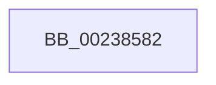

# sub_00238582

- RVA: `0x00238582`–`0x00238595` (길이 `19` bytes)
- VA: `0x0000000140238582`
- 실행 섹션: `.text`
- PDB 이름 있음: `아니요`; PDB Function 태그: `아니요`
- unwind 정보 RVA: `0x00060A3C`
- 디코드: `5`개 명령, `19/19` bytes 표시
- 미해석 바이트: `0` (있으면 어셈블리에 `.byte`로 보존)

> 이 문서는 커널 이미지의 기계어와 PDB 기호를 분석해 생성했습니다. 4번과 5번은 함수 원형과 자료형을 바이너리 사용 방식에서 추정한 C 해석이며 원본 소스 복구 결과는 아닙니다.

## 1. Dependencies

- 직접 호출 지점: **1**; 고유 호출 대상: **1**
- 직접 호출자로 확인된 함수: **0**
- RIP 상대 이미지 참조: **0**

### Outgoing calls
- `0x0023858B` → [MiReleaseLargePdeMappings](../49/MiReleaseLargePdeMappings_function_0049D0B0.md) (function, `0x0049D0B0`)

### Direct callers
- 이 함수 시작 RVA로 연결되는 직접 call은 확인되지 않았습니다. 간접 호출은 완전히 역산할 수 없습니다.

### Static image references
- 디코드된 RIP-relative 메모리 참조가 없습니다.

## 2. Other-region calls and transfers

- 다른 실행 섹션으로 향하는 call: **0**
- call이 아닌 외부 분기/꼬리 이동: **1**
  - `0x00238590` → [sub_00237DC5](Unknown_function_00237DC5.md) (`tail-transfer`)

## 3. Assembly (complete function range)

```asm
00238582  44 8B C3                        mov r8d, ebx
00238585  48 8B D7                        mov rdx, rdi
00238588  49 8B CF                        mov rcx, r15
0023858B  E8 20 4B 26 00                  call 0x14049d0b0
00238590  E9 30 F8 FF FF                  jmp 0x140237dc5
```

## 4. C-style interpretation (structured pseudocode)

```c
__int64 __fastcall sub_00238582(void)
{
    __int64 result;

    result = MiReleaseLargePdeMappings(v_r15, v_rdi, (unsigned int)((unsigned int)(v_rbx)), a4);
}
```

## 5. (Beta) C Style

```c
void sub_00238582(void)
{
    int64_t result;

    result = MiReleaseLargePdeMappings(local_r15, local_rdi, (uint32_t)((uint32_t)(local_rbx)), a4);
}
```

## 6. Execution-region graph

[열기: 2D/3D 그래프와 함수 탐색 컨트롤 패널](../../../control-panel.html?section=text&rva=0x00238582&view=graph)

- 2D 그래프는 위에서 아래로 흐르고, 3D 그래프는 빈 공간을 드래그해 회전합니다. Shift+드래그는 이동, 휠은 확대·축소, 함수 노드 선택은 대상 보고서 이동입니다.

### Static fallback


