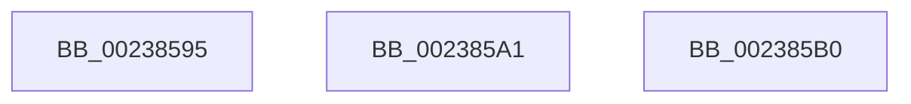

# sub_00238595

- RVA: `0x00238595`–`0x002385B9` (길이 `36` bytes)
- VA: `0x0000000140238595`
- 실행 섹션: `.text`
- PDB 이름 있음: `아니요`; PDB Function 태그: `아니요`
- unwind 정보 RVA: `0x00060A4C`
- 디코드: `8`개 명령, `36/36` bytes 표시
- 미해석 바이트: `0` (있으면 어셈블리에 `.byte`로 보존)

> 이 문서는 커널 이미지의 기계어와 PDB 기호를 분석해 생성했습니다. 4번과 5번은 함수 원형과 자료형을 바이너리 사용 방식에서 추정한 C 해석이며 원본 소스 복구 결과는 아닙니다.

## 1. Dependencies

- 직접 호출 지점: **0**; 고유 호출 대상: **0**
- 직접 호출자로 확인된 함수: **0**
- RIP 상대 이미지 참조: **1**

### Outgoing calls
- 직접 디코드된 call 명령이 없습니다.

### Direct callers
- 이 함수 시작 RVA로 연결되는 직접 call은 확인되지 않았습니다. 간접 호출은 완전히 역산할 수 없습니다.

### Static image references
- `0x002385A5` → RVA `0x00FCF080` (`CACHEALI`; read)

## 2. Other-region calls and transfers

- 다른 실행 섹션으로 향하는 call: **0**
- call이 아닌 외부 분기/꼬리 이동: **3**
  - `0x0023859C` → [sub_00237DE0 + 0x668](Unknown_function_00237DE0.md) (`tail-transfer`)
  - `0x002385AB` → [sub_00237D2C + 0x40](Unknown_function_00237D2C.md) (`tail-transfer`)
  - `0x002385B4` → [sub_00237DE0 + 0x6D8](Unknown_function_00237DE0.md) (`tail-transfer`)

## 3. Assembly (complete function range)

```asm
00238595  B8 09 00 00 00                  mov eax, 9
0023859A  33 C9                           xor ecx, ecx
0023859C  E9 A7 FE FF FF                  jmp 0x140238448
002385A1  F0 09 0C 24                     lock or dword ptr [rsp], ecx
002385A5  8B 0D D5 6A D9 00               mov ecx, dword ptr [rip + 0xd96ad5]
002385AB  E9 BC F7 FF FF                  jmp 0x140237d6c
002385B0  C6 45 9A 01                     mov byte ptr [rbp - 0x66], 1
002385B4  E9 FF FE FF FF                  jmp 0x1402384b8
```

## 4. C-style interpretation (structured pseudocode)

```c
__int64 __fastcall sub_00238595(int a1)
{
    unsigned int v_stack_p0;

    a1 = 0;
}
```

## 5. (Beta) C Style

```c
int64_t sub_00238595(int32_t Arg1)
{
    uint32_t v_stack_p0;

    Arg1 = 0;
}
```

## 6. Execution-region graph

[열기: 2D/3D 그래프와 함수 탐색 컨트롤 패널](../../../control-panel.html?section=text&rva=0x00238595&view=graph)

- 2D 그래프는 위에서 아래로 흐르고, 3D 그래프는 빈 공간을 드래그해 회전합니다. Shift+드래그는 이동, 휠은 확대·축소, 함수 노드 선택은 대상 보고서 이동입니다.

### Static fallback


