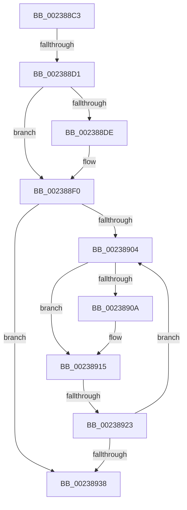

# sub_002388C3

- RVA: `0x002388C3`–`0x00238945` (길이 `130` bytes)
- VA: `0x00000001402388C3`
- 실행 섹션: `.text`
- PDB 이름 있음: `아니요`; PDB Function 태그: `아니요`
- unwind 정보 RVA: `0x00060AB4`
- 디코드: `28`개 명령, `130/130` bytes 표시
- 미해석 바이트: `0` (있으면 어셈블리에 `.byte`로 보존)

> 이 문서는 커널 이미지의 기계어와 PDB 기호를 분석해 생성했습니다. 4번과 5번은 함수 원형과 자료형을 바이너리 사용 방식에서 추정한 C 해석이며 원본 소스 복구 결과는 아닙니다.

## 1. Dependencies

- 직접 호출 지점: **1**; 고유 호출 대상: **1**
- 직접 호출자로 확인된 함수: **0**
- RIP 상대 이미지 참조: **3**

### Outgoing calls
- `0x002388E9` → [ExpWaitForSpinLockExclusiveAndAcquire](../32/ExpWaitForSpinLockExclusiveAndAcquire_function_003239A0.md) (function, `0x003239A0`)

### Direct callers
- 이 함수 시작 RVA로 연결되는 직접 call은 확인되지 않았습니다. 간접 호출은 완전히 역산할 수 없습니다.

### Static image references
- `0x002388D3` → RVA `0x00E2F3B8` (`.data`; read/write)
- `0x002388E2` → RVA `0x00E2F3B8` (`.data`; read)
- `0x00238917` → RVA `0x00FC52AC` (`ALMOSTRO`; reference)

## 2. Other-region calls and transfers

- 다른 실행 섹션으로 향하는 call: **0**
- call이 아닌 외부 분기/꼬리 이동: **3**
  - `0x002388CB` → [sub_00238C4F](Unknown_function_00238C4F.md) (`tail-transfer`)
  - `0x0023891D` → [sub_00238C83 + 0x27](Unknown_function_00238C83.md) (`tail-transfer`)
  - `0x0023893F` → [sub_00238C83](Unknown_function_00238C83.md) (`tail-transfer`)

## 3. Assembly (complete function range)

```asm
002388C3  48 89 9C 24 88 00 00 00         mov qword ptr [rsp + 0x88], rbx
002388CB  0F 85 7E 03 00 00               jne 0x140238c4f
002388D1  33 DB                           xor ebx, ebx
002388D3  F0 0F BA 2D DC 6A BF 00 1F      lock bts dword ptr [rip + 0xbf6adc], 0x1f
002388DC  73 12                           jae 0x1402388f0
002388DE  41 0F B6 D7                     movzx edx, r15b
002388E2  48 8D 0D CF 6A BF 00            lea rcx, [rip + 0xbf6acf]
002388E9  E8 B2 B0 0E 00                  call 0x1403239a0
002388EE  8B D8                           mov ebx, eax
002388F0  8B 15 C2 6A BF 00               mov edx, dword ptr [rip + 0xbf6ac2]
002388F6  8B CA                           mov ecx, edx
002388F8  0F BA F1 1E                     btr ecx, 0x1e
002388FC  81 F9 00 00 00 80               cmp ecx, 0x80000000
00238902  74 34                           je 0x140238938
00238904  0F BA E2 1E                     bt edx, 0x1e
00238908  72 0B                           jb 0x140238915
0023890A  F0 81 0D A3 6A BF 00 00 00 00 40  lock or dword ptr [rip + 0xbf6aa3], 0x40000000
00238915  FF C3                           inc ebx
00238917  85 1D 8F C9 D8 00               test dword ptr [rip + 0xd8c98f], ebx
0023891D  0F 84 87 03 00 00               je 0x140238caa
00238923  F3 90                           pause
00238925  8B 15 8D 6A BF 00               mov edx, dword ptr [rip + 0xbf6a8d]
0023892B  8B C2                           mov eax, edx
0023892D  0F BA F0 1E                     btr eax, 0x1e
00238931  3D 00 00 00 80                  cmp eax, 0x80000000
00238936  75 CC                           jne 0x140238904
00238938  45 38 A6 5C 48 00 00            cmp byte ptr [r14 + 0x485c], r12b
0023893F  0F 84 3E 03 00 00               je 0x140238c83
```

## 4. C-style interpretation (structured pseudocode)

```c
__int64 __fastcall sub_002388C3(void)
{
    __int64 result;
    __int64 v_rbx;
    unsigned __int64 v_stack_p88;

    v_stack_p88 = v_rbx;
    v_rbx = 0;
    if (!(condition_is_above_or_equal)) {
        a2 = (unsigned __int8)(v_r15);
        a1 = v_rip + 12544719;
        result = ExpWaitForSpinLockExclusiveAndAcquire(a1, a2, a3, a4);
        v_rbx = (unsigned int)(result);
    }
    if (((unsigned int)((unsigned int)((unsigned int)((unsigned int)(*(unsigned int *)(v_rip + 12544706)))))) == 0x80000000ULL) goto loc_00238938;
loc_00238904:
    if (((unsigned int)((unsigned int)((unsigned int)((unsigned int)(*(unsigned int *)(v_rip + 12544706)))))) >= 0x80000000ULL) {
    }
    v_rbx = (unsigned int)((v_rbx) + 1);
    if (((unsigned int)((unsigned int)((unsigned int)((unsigned int)(*(unsigned int *)(v_rip + 12544653)))))) != 0x80000000ULL) goto loc_00238904;
loc_00238938:
}
```

## 5. (Beta) C Style

```c
void sub_002388C3(void)
{
    int64_t result;
    int64_t local_rbx;
    uint64_t v_stack_p88;

    v_stack_p88 = local_rbx;
    local_rbx = 0;
    if (!(condition_is_above_or_equal)) {
        a2 = (uint8_t)(local_r15);
        a1 = v_rip + 12544719;
        result = ExpWaitForSpinLockExclusiveAndAcquire(a1, a2, a3, a4);
        local_rbx = (uint32_t)(result);
    }
    if (((uint32_t)((uint32_t)((uint32_t)((uint32_t)(*(uint32_t *)(v_rip + 0xBF6AC2)))))) == 0x80000000ULL) goto loc_00238938;
loc_00238904:
    if (((uint32_t)((uint32_t)((uint32_t)((uint32_t)(*(uint32_t *)(v_rip + 0xBF6AC2)))))) >= 0x80000000ULL) {
    }
    local_rbx = (uint32_t)((local_rbx) + 1);
    if (((uint32_t)((uint32_t)((uint32_t)((uint32_t)(*(uint32_t *)(v_rip + 0xBF6A8D)))))) != 0x80000000ULL) goto loc_00238904;
loc_00238938:
}
```

## 6. Execution-region graph

[열기: 2D/3D 그래프와 함수 탐색 컨트롤 패널](../../../control-panel.html?section=text&rva=0x002388C3&view=graph)

- 2D 그래프는 위에서 아래로 흐르고, 3D 그래프는 빈 공간을 드래그해 회전합니다. Shift+드래그는 이동, 휠은 확대·축소, 함수 노드 선택은 대상 보고서 이동입니다.

### Static fallback


