# sub_00238945

- RVA: `0x00238945`–`0x00238B34` (길이 `495` bytes)
- VA: `0x0000000140238945`
- 실행 섹션: `.text`
- PDB 이름 있음: `아니요`; PDB Function 태그: `아니요`
- unwind 정보 RVA: `0x00060AC8`
- 디코드: `107`개 명령, `495/495` bytes 표시
- 미해석 바이트: `0` (있으면 어셈블리에 `.byte`로 보존)

> 이 문서는 커널 이미지의 기계어와 PDB 기호를 분석해 생성했습니다. 4번과 5번은 함수 원형과 자료형을 바이너리 사용 방식에서 추정한 C 해석이며 원본 소스 복구 결과는 아닙니다.

## 1. Dependencies

- 직접 호출 지점: **6**; 고유 호출 대상: **6**
- 직접 호출자로 확인된 함수: **0**
- RIP 상대 이미지 참조: **4**

### Outgoing calls
- `0x00238A3A` → [KiLowerIrqlProcessIrqlFlags](../4F/KiLowerIrqlProcessIrqlFlags_function_004F5698.md) (function, `0x004F5698`)
- `0x00238AD5` → [MiLockWorkingSetOptimal](MiLockWorkingSetOptimal_function_00238FC0.md) (function, `0x00238FC0`)
- `0x00238AE3` → [MiSetSystemCacheReverseMap](MiSetSystemCacheReverseMap_function_00238F58.md) (function, `0x00238F58`)
- `0x00238AF7` → [MiUnlockWorkingSetOptimal](MiUnlockWorkingSetOptimal_function_00238DFC.md) (function, `0x00238DFC`)
- `0x00238B14` → [MiReturnSystemVa](MiReturnSystemVa_function_002394C4.md) (function, `0x002394C4`)
- `0x00238B1E` → [ExFreePoolWithTag](../../poolcode/B8/ExFreePoolWithTag_function_00B82870.md) (function, `0x00B82870`)

### Direct callers
- 이 함수 시작 RVA로 연결되는 직접 call은 확인되지 않았습니다. 간접 호출은 완전히 역산할 수 없습니다.

### Static image references
- `0x0023894F` → RVA `0x00FCF080` (`CACHEALI`; read)
- `0x00238A15` → RVA `0x00FC6B06` (`ALMOSTRO`; read)
- `0x00238A22` → RVA `0x00E2F3B8` (`.data`; write)
- `0x00238A29` → RVA `0x00FC6D20` (`ALMOSTRO`; read)

## 2. Other-region calls and transfers

- 다른 실행 섹션으로 향하는 call: **1**
  - `0x00238B1E` → [ExFreePoolWithTag](../../poolcode/B8/ExFreePoolWithTag_function_00B82870.md) (`.text` → `POOLCODE`)
- call이 아닌 외부 분기/꼬리 이동: **14**
  - `0x00238960` → [sub_00238B4C](Unknown_function_00238B4C.md) (`tail-transfer`)
  - `0x0023896A` → [sub_00238B4C + 0x2E](Unknown_function_00238B4C.md) (`tail-transfer`)
  - `0x00238974` → [sub_00238B4C + 0x5D](Unknown_function_00238B4C.md) (`tail-transfer`)
  - `0x0023897E` → [sub_00238B4C + 0x8C](Unknown_function_00238B4C.md) (`tail-transfer`)
  - `0x00238988` → [sub_00238CD1](Unknown_function_00238CD1.md) (`tail-transfer`)
  - `0x00238995` → [sub_00238B4C + 0xFC](Unknown_function_00238B4C.md) (`tail-transfer`)
  - `0x002389A2` → [sub_00238B4C + 0xFC](Unknown_function_00238B4C.md) (`tail-transfer`)
  - `0x002389FA` → [sub_00238B4C + 0xD1](Unknown_function_00238B4C.md) (`tail-transfer`)
  - `0x00238A05` → [sub_00238B4C + 0xD1](Unknown_function_00238B4C.md) (`tail-transfer`)
  - `0x00238A0F` → [sub_00238B4C + 0xB8](Unknown_function_00238B4C.md) (`tail-transfer`)
  - `0x00238A1C` → [sub_00238CD1 + 0x8D](Unknown_function_00238CD1.md) (`tail-transfer`)
  - `0x00238A53` → [sub_00238DB5](Unknown_function_00238DB5.md) (`tail-transfer`)
  - `0x00238A97` → [sub_00238B4C + 0xFC](Unknown_function_00238B4C.md) (`tail-transfer`)
  - `0x00238AA4` → [sub_00238B4C + 0xFC](Unknown_function_00238B4C.md) (`tail-transfer`)

## 3. Assembly (complete function range)

```asm
00238945  48 89 7C 24 30                  mov qword ptr [rsp + 0x30], rdi
0023894A  F0 44 09 24 24                  lock or dword ptr [rsp], r12d
0023894F  8B 3D 2B 67 D9 00               mov edi, dword ptr [rip + 0xd9672b]
00238955  49 8D 9E 80 08 00 00            lea rbx, [r14 + 0x880]
0023895C  4C 39 63 10                     cmp qword ptr [rbx + 0x10], r12
00238960  0F 85 E6 01 00 00               jne 0x140238b4c
00238966  4C 39 63 30                     cmp qword ptr [rbx + 0x30], r12
0023896A  0F 85 0A 02 00 00               jne 0x140238b7a
00238970  4C 39 63 50                     cmp qword ptr [rbx + 0x50], r12
00238974  0F 85 2F 02 00 00               jne 0x140238ba9
0023897A  4C 39 63 70                     cmp qword ptr [rbx + 0x70], r12
0023897E  0F 85 54 02 00 00               jne 0x140238bd8
00238984  4C 39 66 10                     cmp qword ptr [rsi + 0x10], r12
00238988  0F 84 43 03 00 00               je 0x140238cd1
0023898E  48 8B 1E                        mov rbx, qword ptr [rsi]
00238991  48 39 73 08                     cmp qword ptr [rbx + 8], rsi
00238995  0F 85 AD 02 00 00               jne 0x140238c48
0023899B  48 8B 03                        mov rax, qword ptr [rbx]
0023899E  48 39 58 08                     cmp qword ptr [rax + 8], rbx
002389A2  0F 85 A0 02 00 00               jne 0x140238c48
002389A8  48 89 06                        mov qword ptr [rsi], rax
002389AB  48 B9 FF FF FF FF FF FF FF 3F   movabs rcx, 0x3fffffffffffffff
002389B5  48 89 70 08                     mov qword ptr [rax + 8], rsi
002389B9  48 8B 43 20                     mov rax, qword ptr [rbx + 0x20]
002389BD  48 23 C1                        and rax, rcx
002389C0  48 B9 00 00 00 00 00 00 00 80   movabs rcx, 0x8000000000000000
002389CA  48 0B C1                        or rax, rcx
002389CD  48 89 43 20                     mov qword ptr [rbx + 0x20], rax
002389D1  48 FF 4E 10                     dec qword ptr [rsi + 0x10]
002389D5  41 8B 46 04                     mov eax, dword ptr [r14 + 4]
002389D9  48 8D 4D E8                     lea rcx, [rbp - 0x18]
002389DD  48 89 4D F0                     mov qword ptr [rbp - 0x10], rcx
002389E1  48 8D 4D E8                     lea rcx, [rbp - 0x18]
002389E5  48 89 4D E8                     mov qword ptr [rbp - 0x18], rcx
002389E9  49 8D 8E 20 09 00 00            lea rcx, [r14 + 0x920]
002389F0  4C 8B 01                        mov r8, qword ptr [rcx]
002389F3  4C 3B C1                        cmp r8, rcx
002389F6  74 13                           je 0x140238a0b
002389F8  A8 01                           test al, 1
002389FA  0F 85 1D 02 00 00               jne 0x140238c1d
00238A00  48 83 79 10 20                  cmp qword ptr [rcx + 0x10], 0x20
00238A05  0F 87 12 02 00 00               ja 0x140238c1d
00238A0B  41 80 FF 11                     cmp r15b, 0x11
00238A0F  0F 84 EF 01 00 00               je 0x140238c04
00238A15  F6 05 EA E0 D8 00 01            test byte ptr [rip + 0xd8e0ea], 1
00238A1C  0F 85 3C 03 00 00               jne 0x140238d5e
00238A22  44 89 2D 8F 69 BF 00            mov dword ptr [rip + 0xbf698f], r13d
00238A29  44 39 2D F0 E2 D8 00            cmp dword ptr [rip + 0xd8e2f0], r13d
00238A30  74 0D                           je 0x140238a3f
00238A32  44 0F 20 C1                     mov rcx, cr8
00238A36  41 0F B6 D7                     movzx edx, r15b
00238A3A  E8 59 CC 2B 00                  call 0x1404f5698
00238A3F  41 0F B6 C7                     movzx eax, r15b
00238A43  44 0F 22 C0                     mov cr8, rax
00238A47  48 85 DB                        test rbx, rbx
00238A4A  74 04                           je 0x140238a50
00238A4C  4C 8B 6B 10                     mov r13, qword ptr [rbx + 0x10]
00238A50  45 85 E4                        test r12d, r12d
00238A53  0F 85 5C 03 00 00               jne 0x140238db5
00238A59  48 8B 5D E8                     mov rbx, qword ptr [rbp - 0x18]
00238A5D  48 8D 45 E8                     lea rax, [rbp - 0x18]
00238A61  48 3B D8                        cmp rbx, rax
00238A64  0F 84 C2 00 00 00               je 0x140238b2c
00238A6A  C6 45 38 00                     mov byte ptr [rbp + 0x38], 0
00238A6E  49 BC 00 00 00 00 80 F6 FF FF   movabs r12, 0xfffff68000000000
00238A78  48 8D 45 E8                     lea rax, [rbp - 0x18]
00238A7C  49 B8 F8 FF FF FF 7F 00 00 00   movabs r8, 0x7ffffffff8
00238A86  48 3B D8                        cmp rbx, rax
00238A89  0F 84 9D 00 00 00               je 0x140238b2c
00238A8F  48 8D 45 E8                     lea rax, [rbp - 0x18]
00238A93  48 39 43 08                     cmp qword ptr [rbx + 8], rax
00238A97  0F 85 AB 01 00 00               jne 0x140238c48
00238A9D  48 8B 03                        mov rax, qword ptr [rbx]
00238AA0  48 39 58 08                     cmp qword ptr [rax + 8], rbx
00238AA4  0F 85 9E 01 00 00               jne 0x140238c48
00238AAA  48 89 45 E8                     mov qword ptr [rbp - 0x18], rax
00238AAE  48 8D 4D E8                     lea rcx, [rbp - 0x18]
00238AB2  48 89 48 08                     mov qword ptr [rax + 8], rcx
00238AB6  48 8B 73 10                     mov rsi, qword ptr [rbx + 0x10]
00238ABA  48 8B D6                        mov rdx, rsi
00238ABD  48 C1 EA 09                     shr rdx, 9
00238AC1  49 23 D0                        and rdx, r8
00238AC4  49 8B C4                        mov rax, r12
00238AC7  48 03 D0                        add rdx, rax
00238ACA  4C 8D 45 38                     lea r8, [rbp + 0x38]
00238ACE  49 8D 8E 80 49 00 00            lea rcx, [r14 + 0x4980]
00238AD5  E8 E6 04 00 00                  call 0x140238fc0
00238ADA  45 33 C0                        xor r8d, r8d
00238ADD  48 8B D6                        mov rdx, rsi
00238AE0  48 8B F8                        mov rdi, rax
00238AE3  E8 70 04 00 00                  call 0x140238f58
00238AE8  44 0F B6 45 38                  movzx r8d, byte ptr [rbp + 0x38]
00238AED  49 8D 8E 80 49 00 00            lea rcx, [r14 + 0x4980]
00238AF4  48 8B D7                        mov rdx, rdi
00238AF7  E8 00 03 00 00                  call 0x140238dfc
00238AFC  F0 41 FF 8E 78 09 00 00         lock dec dword ptr [r14 + 0x978]
00238B04  48 8D 96 00 00 20 00            lea rdx, [rsi + 0x200000]
00238B0B  41 B8 07 00 00 00               mov r8d, 7
00238B11  48 8B CE                        mov rcx, rsi
00238B14  E8 AB 09 00 00                  call 0x1402394c4
00238B19  33 D2                           xor edx, edx
00238B1B  48 8B CB                        mov rcx, rbx
00238B1E  E8 4D 9D 94 00                  call 0x140b82870
00238B23  48 8B 5D E8                     mov rbx, qword ptr [rbp - 0x18]
00238B27  E9 4C FF FF FF                  jmp 0x140238a78
00238B2C  48 8B 7C 24 30                  mov rdi, qword ptr [rsp + 0x30]
00238B31  49 8B C5                        mov rax, r13
```

## 4. C-style interpretation (structured pseudocode)

```c
__int64 __fastcall sub_00238945(__int64 a1, __int64 a2, __int64 a3, __int64 a4, __int64 a5, __int64 a6)
{
    __int64 result;
    __int64 v_r13;
    unsigned int v_stack_p0;
    unsigned __int64 v_stack_p30;

    v_stack_p30 = v_rdi;
    *(unsigned __int64 *)(v_rsi) = *(unsigned __int64 *)(*(unsigned __int64 *)(v_rsi));
    *(unsigned __int64 *)(*(unsigned __int64 *)(*(unsigned __int64 *)(v_rsi)) + 8) = v_rsi;
    result = (*(unsigned __int64 *)(*(unsigned __int64 *)(v_rsi) + 32)) & (a1);
    result = (result) | (a1);
    *(unsigned __int64 *)(*(unsigned __int64 *)(v_rsi) + 32) = result;
    *(unsigned __int64 *)(v_rbp - 16) = v_rbp - 24;
    *(unsigned __int64 *)(v_rbp - 24) = v_rbp - 24;
    if ((*(unsigned __int64 *)(v_r14 + 2336)) == (v_r14 + 2336)) goto loc_00238A0B;
loc_00238A0B:
    *(unsigned int *)(v_rip + 12544399) = (unsigned int)(v_r13);
    result = (unsigned int)(*(unsigned int *)(v_r14 + 4));
    if ((*(unsigned int *)(v_rip + 14213872)) != ((unsigned int)(v_r13))) {
        a1 = v_cr8;
        a2 = (unsigned __int8)(v_r15);
        result = KiLowerIrqlProcessIrqlFlags(a1, a2, *(unsigned __int64 *)(v_r14 + 2336), a4);
    }
    if (*(unsigned __int64 *)(v_rsi) != 0) {
        v_r13 = *(unsigned __int64 *)(*(unsigned __int64 *)(v_rsi) + 16);
    }
    if ((*(unsigned __int64 *)(v_rbp - 24)) == (v_rbp - 24)) goto loc_00238B2C;
    *(unsigned __int8 *)(v_rbp + 56) = 0;
loc_00238A78:
    if ((*(unsigned __int64 *)(v_rbp - 24)) == (v_rbp - 24)) goto loc_00238B2C;
    *(unsigned __int64 *)(v_rbp - 24) = *(unsigned __int64 *)(*(unsigned __int64 *)(v_rbp - 24));
    *(unsigned __int64 *)(*(unsigned __int64 *)(*(unsigned __int64 *)(v_rbp - 24)) + 8) = v_rbp - 24;
    a2 = (*(unsigned __int64 *)(*(unsigned __int64 *)(v_rbp - 24) + 16)) >> (9);
    a2 = (a2) & (*(unsigned __int64 *)(v_r14 + 2336));
    a2 = (a2) + (v_r12);
    result = MiLockWorkingSetOptimal(v_r14 + 18816, a2, v_rbp + 56, a4);
    a3 = 0;
    result = MiSetSystemCacheReverseMap(v_r14 + 18816, *(unsigned __int64 *)(*(unsigned __int64 *)(v_rbp - 24) + 16), a3, a4);
    result = MiUnlockWorkingSetOptimal(v_r14 + 18816, result, *(unsigned __int8 *)(v_rbp + 56), a4);
    result = MiReturnSystemVa(*(unsigned __int64 *)(*(unsigned __int64 *)(v_rbp - 24) + 16), *(unsigned __int64 *)(*(unsigned __int64 *)(v_rbp - 24) + 16) + 2097152, 7, a4);
    a2 = 0;
    result = ExFreePoolWithTag(*(unsigned __int64 *)(v_rbp - 24), a2, 7, a4);
    goto loc_00238A78;
loc_00238B2C:
    return v_r13;
}
```

## 5. (Beta) C Style

```c
int64_t sub_00238945(int64_t Arg1, int64_t Arg2, int64_t Arg3, int64_t Arg4, uint64_t Arg5, int64_t Arg6)
{
    int64_t result;
    int64_t local_r13;
    uint32_t v_stack_p0;
    uint64_t v_stack_p30;

    v_stack_p30 = local_rdi;
    *(uint64_t *)(local_rsi) = *(uint64_t *)(*(uint64_t *)(local_rsi));
    *(uint64_t *)(*(uint64_t *)(*(uint64_t *)(local_rsi)) + 0x8) = local_rsi;
    result = (*(uint64_t *)(*(uint64_t *)(local_rsi) + 0x20)) & (Arg1);
    result = (result) | (Arg1);
    *(uint64_t *)(*(uint64_t *)(local_rsi) + 0x20) = result;
    *(uint64_t *)(local_rbp - 0x10) = local_rbp - 24;
    *(uint64_t *)(local_rbp - 0x18) = local_rbp - 24;
    if ((*(uint64_t *)(local_r14 + 0x920)) == (local_r14 + 2336)) goto loc_00238A0B;
loc_00238A0B:
    *(uint32_t *)(v_rip + 0xBF698F) = (uint32_t)(local_r13);
    result = (uint32_t)(*(uint32_t *)(local_r14 + 0x4));
    if ((*(uint32_t *)(v_rip + 0xD8E2F0)) != ((uint32_t)(local_r13))) {
        Arg1 = v_cr8;
        Arg2 = (uint8_t)(local_r15);
        result = KiLowerIrqlProcessIrqlFlags(Arg1, Arg2, *(uint64_t *)(local_r14 + 0x920), Arg4);
    }
    if (*(uint64_t *)(local_rsi) != 0) {
        local_r13 = *(uint64_t *)(*(uint64_t *)(local_rsi) + 0x10);
    }
    if ((*(uint64_t *)(local_rbp - 0x18)) == (local_rbp - 24)) goto loc_00238B2C;
    *(uint8_t *)(local_rbp + 0x38) = 0;
loc_00238A78:
    if ((*(uint64_t *)(local_rbp - 0x18)) == (local_rbp - 24)) goto loc_00238B2C;
    *(uint64_t *)(local_rbp - 0x18) = *(uint64_t *)(*(uint64_t *)(local_rbp - 0x18));
    *(uint64_t *)(*(uint64_t *)(*(uint64_t *)(local_rbp - 0x18)) + 0x8) = local_rbp - 24;
    Arg2 = (*(uint64_t *)(*(uint64_t *)(local_rbp - 0x18) + 0x10)) >> (9);
    Arg2 = (Arg2) & (*(uint64_t *)(local_r14 + 0x920));
    Arg2 = (Arg2) + (local_r12);
    result = MiLockWorkingSetOptimal(local_r14 + 18816, Arg2, local_rbp + 56, Arg4);
    Arg3 = 0;
    result = MiSetSystemCacheReverseMap(local_r14 + 18816, *(uint64_t *)(*(uint64_t *)(local_rbp - 0x18) + 0x10), Arg3, Arg4);
    result = MiUnlockWorkingSetOptimal(local_r14 + 18816, result, *(uint8_t *)(local_rbp + 0x38), Arg4);
    result = MiReturnSystemVa(*(uint64_t *)(*(uint64_t *)(local_rbp - 0x18) + 0x10), *(uint64_t *)(*(uint64_t *)(local_rbp - 0x18) + 0x10) + 2097152, 7, Arg4);
    Arg2 = 0;
    result = ExFreePoolWithTag(*(uint64_t *)(local_rbp - 0x18), Arg2, 7, Arg4);
    goto loc_00238A78;
loc_00238B2C:
    return local_r13;
}
```

## 6. Execution-region graph

[열기: 2D/3D 그래프와 함수 탐색 컨트롤 패널](../../../control-panel.html?section=text&rva=0x00238945&view=graph)

- 2D 그래프는 위에서 아래로 흐르고, 3D 그래프는 빈 공간을 드래그해 회전합니다. Shift+드래그는 이동, 휠은 확대·축소, 함수 노드 선택은 대상 보고서 이동입니다.

### Static fallback

```mermaid
flowchart TD
  bb_00238945[BB_00238945]
  bb_00238966[BB_00238966]
  bb_00238970[BB_00238970]
  bb_0023897A[BB_0023897A]
  bb_00238984[BB_00238984]
  bb_0023898E[BB_0023898E]
  bb_0023899B[BB_0023899B]
  bb_002389A8[BB_002389A8]
  bb_002389F8[BB_002389F8]
  bb_00238A00[BB_00238A00]
  bb_00238A0B[BB_00238A0B]
  bb_00238A15[BB_00238A15]
  bb_00238A22[BB_00238A22]
  bb_00238A32[BB_00238A32]
  bb_00238A3F[BB_00238A3F]
  bb_00238A4C[BB_00238A4C]
  bb_00238A50[BB_00238A50]
  bb_00238A59[BB_00238A59]
  bb_00238A6A[BB_00238A6A]
  bb_00238A78[BB_00238A78]
  bb_00238A8F[BB_00238A8F]
  bb_00238A9D[BB_00238A9D]
  bb_00238AAA[BB_00238AAA]
  bb_00238B2C[BB_00238B2C]
  bb_00238945 -->|fallthrough| bb_00238966
  bb_00238966 -->|fallthrough| bb_00238970
  bb_00238970 -->|fallthrough| bb_0023897A
  bb_0023897A -->|fallthrough| bb_00238984
  bb_00238984 -->|fallthrough| bb_0023898E
  bb_0023898E -->|fallthrough| bb_0023899B
  bb_0023899B -->|fallthrough| bb_002389A8
  bb_002389A8 -->|branch| bb_00238A0B
  bb_002389A8 -->|fallthrough| bb_002389F8
  bb_002389F8 -->|fallthrough| bb_00238A00
  bb_00238A00 -->|fallthrough| bb_00238A0B
  bb_00238A0B -->|fallthrough| bb_00238A15
  bb_00238A15 -->|fallthrough| bb_00238A22
  bb_00238A22 -->|branch| bb_00238A3F
  bb_00238A22 -->|fallthrough| bb_00238A32
  bb_00238A32 -->|flow| bb_00238A3F
  bb_00238A3F -->|branch| bb_00238A50
  bb_00238A3F -->|fallthrough| bb_00238A4C
  bb_00238A4C -->|flow| bb_00238A50
  bb_00238A50 -->|fallthrough| bb_00238A59
  bb_00238A59 -->|branch| bb_00238B2C
  bb_00238A59 -->|fallthrough| bb_00238A6A
  bb_00238A6A -->|flow| bb_00238A78
  bb_00238A78 -->|branch| bb_00238B2C
  bb_00238A78 -->|fallthrough| bb_00238A8F
  bb_00238A8F -->|fallthrough| bb_00238A9D
  bb_00238A9D -->|fallthrough| bb_00238AAA
  bb_00238AAA -->|branch| bb_00238A78
```


