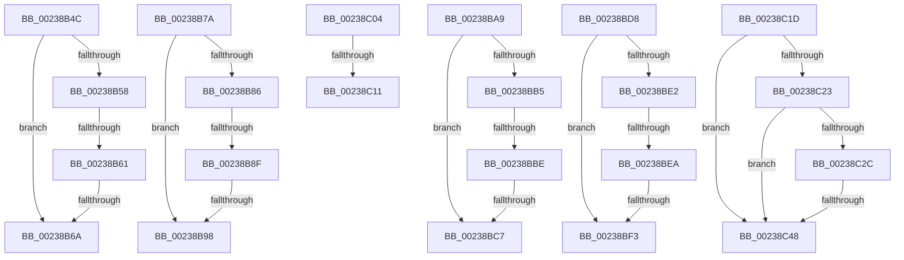

# sub_00238B4C

- RVA: `0x00238B4C`–`0x00238C4F` (길이 `259` bytes)
- VA: `0x0000000140238B4C`
- 실행 섹션: `.text`
- PDB 이름 있음: `아니요`; PDB Function 태그: `아니요`
- unwind 정보 RVA: `0x00060AF0`
- 디코드: `69`개 명령, `259/259` bytes 표시
- 미해석 바이트: `0` (있으면 어셈블리에 `.byte`로 보존)

> 이 문서는 커널 이미지의 기계어와 PDB 기호를 분석해 생성했습니다. 4번과 5번은 함수 원형과 자료형을 바이너리 사용 방식에서 추정한 C 해석이며 원본 소스 복구 결과는 아닙니다.

## 1. Dependencies

- 직접 호출 지점: **4**; 고유 호출 대상: **1**
- 직접 호출자로 확인된 함수: **0**
- RIP 상대 이미지 참조: **2**

### Outgoing calls
- `0x00238B70` → [MiInsertReadiedSystemCacheViews](../41/MiInsertReadiedSystemCacheViews_function_00419734.md) (function, `0x00419734`)
- `0x00238B9F` → [MiInsertReadiedSystemCacheViews](../41/MiInsertReadiedSystemCacheViews_function_00419734.md) (function, `0x00419734`)
- `0x00238BCE` → [MiInsertReadiedSystemCacheViews](../41/MiInsertReadiedSystemCacheViews_function_00419734.md) (function, `0x00419734`)
- `0x00238BFA` → [MiInsertReadiedSystemCacheViews](../41/MiInsertReadiedSystemCacheViews_function_00419734.md) (function, `0x00419734`)

### Direct callers
- 이 함수 시작 RVA로 연결되는 직접 call은 확인되지 않았습니다. 간접 호출은 완전히 역산할 수 없습니다.

### Static image references
- `0x00238C04` → RVA `0x00FC6B06` (`ALMOSTRO`; read)
- `0x00238C11` → RVA `0x00E2F3B8` (`.data`; write)

## 2. Other-region calls and transfers

- 다른 실행 섹션으로 향하는 call: **0**
- call이 아닌 외부 분기/꼬리 이동: **15**
  - `0x00238B5B` → [sub_00238945 + 0x21](Unknown_function_00238945.md) (`tail-transfer`)
  - `0x00238B64` → [sub_00238945 + 0x21](Unknown_function_00238945.md) (`tail-transfer`)
  - `0x00238B75` → [sub_00238945 + 0x21](Unknown_function_00238945.md) (`tail-transfer`)
  - `0x00238B89` → [sub_00238945 + 0x2B](Unknown_function_00238945.md) (`tail-transfer`)
  - `0x00238B92` → [sub_00238945 + 0x2B](Unknown_function_00238945.md) (`tail-transfer`)
  - `0x00238BA4` → [sub_00238945 + 0x2B](Unknown_function_00238945.md) (`tail-transfer`)
  - `0x00238BB8` → [sub_00238945 + 0x35](Unknown_function_00238945.md) (`tail-transfer`)
  - `0x00238BC1` → [sub_00238945 + 0x35](Unknown_function_00238945.md) (`tail-transfer`)
  - `0x00238BD3` → [sub_00238945 + 0x35](Unknown_function_00238945.md) (`tail-transfer`)
  - `0x00238BE4` → [sub_00238945 + 0x3F](Unknown_function_00238945.md) (`tail-transfer`)
  - `0x00238BED` → [sub_00238945 + 0x3F](Unknown_function_00238945.md) (`tail-transfer`)
  - `0x00238BFF` → [sub_00238945 + 0x3F](Unknown_function_00238945.md) (`tail-transfer`)
  - `0x00238C0B` → [sub_00238CD1 + 0xB0](Unknown_function_00238CD1.md) (`tail-transfer`)
  - `0x00238C18` → [sub_00238945 + 0x102](Unknown_function_00238945.md) (`tail-transfer`)
  - `0x00238C42` → [sub_00238CD1 + 0x76](Unknown_function_00238CD1.md) (`tail-transfer`)

## 3. Assembly (complete function range)

```asm
00238B4C  8B 4B 18                        mov ecx, dword ptr [rbx + 0x18]
00238B4F  8B C7                           mov eax, edi
00238B51  2B C1                           sub eax, ecx
00238B53  83 F8 02                        cmp eax, 2
00238B56  77 12                           ja 0x140238b6a
00238B58  F6 C1 01                        test cl, 1
00238B5B  0F 85 05 FE FF FF               jne 0x140238966
00238B61  83 F8 02                        cmp eax, 2
00238B64  0F 82 FC FD FF FF               jb 0x140238966
00238B6A  48 8B D3                        mov rdx, rbx
00238B6D  49 8B CE                        mov rcx, r14
00238B70  E8 BF 0B 1E 00                  call 0x140419734
00238B75  E9 EC FD FF FF                  jmp 0x140238966
00238B7A  8B 4B 38                        mov ecx, dword ptr [rbx + 0x38]
00238B7D  8B C7                           mov eax, edi
00238B7F  2B C1                           sub eax, ecx
00238B81  83 F8 02                        cmp eax, 2
00238B84  77 12                           ja 0x140238b98
00238B86  F6 C1 01                        test cl, 1
00238B89  0F 85 E1 FD FF FF               jne 0x140238970
00238B8F  83 F8 02                        cmp eax, 2
00238B92  0F 82 D8 FD FF FF               jb 0x140238970
00238B98  48 8D 53 20                     lea rdx, [rbx + 0x20]
00238B9C  49 8B CE                        mov rcx, r14
00238B9F  E8 90 0B 1E 00                  call 0x140419734
00238BA4  E9 C7 FD FF FF                  jmp 0x140238970
00238BA9  8B 4B 58                        mov ecx, dword ptr [rbx + 0x58]
00238BAC  8B C7                           mov eax, edi
00238BAE  2B C1                           sub eax, ecx
00238BB0  83 F8 02                        cmp eax, 2
00238BB3  77 12                           ja 0x140238bc7
00238BB5  F6 C1 01                        test cl, 1
00238BB8  0F 85 BC FD FF FF               jne 0x14023897a
00238BBE  83 F8 02                        cmp eax, 2
00238BC1  0F 82 B3 FD FF FF               jb 0x14023897a
00238BC7  48 8D 53 40                     lea rdx, [rbx + 0x40]
00238BCB  49 8B CE                        mov rcx, r14
00238BCE  E8 61 0B 1E 00                  call 0x140419734
00238BD3  E9 A2 FD FF FF                  jmp 0x14023897a
00238BD8  8B 43 78                        mov eax, dword ptr [rbx + 0x78]
00238BDB  2B F8                           sub edi, eax
00238BDD  83 FF 02                        cmp edi, 2
00238BE0  77 11                           ja 0x140238bf3
00238BE2  A8 01                           test al, 1
00238BE4  0F 85 9A FD FF FF               jne 0x140238984
00238BEA  83 FF 02                        cmp edi, 2
00238BED  0F 82 91 FD FF FF               jb 0x140238984
00238BF3  48 8D 53 60                     lea rdx, [rbx + 0x60]
00238BF7  49 8B CE                        mov rcx, r14
00238BFA  E8 35 0B 1E 00                  call 0x140419734
00238BFF  E9 80 FD FF FF                  jmp 0x140238984
00238C04  F6 05 FB DE D8 00 01            test byte ptr [rip + 0xd8defb], 1
00238C0B  0F 85 70 01 00 00               jne 0x140238d81
00238C11  44 89 2D A0 67 BF 00            mov dword ptr [rip + 0xbf67a0], r13d
00238C18  E9 2A FE FF FF                  jmp 0x140238a47
00238C1D  49 39 48 08                     cmp qword ptr [r8 + 8], rcx
00238C21  75 25                           jne 0x140238c48
00238C23  4D 8B 08                        mov r9, qword ptr [r8]
00238C26  4D 39 41 08                     cmp qword ptr [r9 + 8], r8
00238C2A  75 1C                           jne 0x140238c48
00238C2C  4C 89 09                        mov qword ptr [rcx], r9
00238C2F  4C 8D 55 E8                     lea r10, [rbp - 0x18]
00238C33  49 89 49 08                     mov qword ptr [r9 + 8], rcx
00238C37  4C 8B 4D F0                     mov r9, qword ptr [rbp - 0x10]
00238C3B  48 FF 49 10                     dec qword ptr [rcx + 0x10]
00238C3F  4D 39 11                        cmp qword ptr [r9], r10
00238C42  0F 84 FF 00 00 00               je 0x140238d47
00238C48  B9 03 00 00 00                  mov ecx, 3
00238C4D  CD 29                           int 0x29
```

## 4. C-style interpretation (structured pseudocode)

```c
__int64 __fastcall sub_00238B4C(__int64 a1, __int64 a2, __int64 a3)
{
    __int64 result;

    result = (unsigned int)(((unsigned int)((unsigned int)(v_rdi))) - ((unsigned int)((unsigned int)(*(unsigned int *)(v_rbx + 24)))));
    if (((unsigned int)(result)) > 2) goto loc_00238B6A;
loc_00238B6A:
    result = MiInsertReadiedSystemCacheViews(v_r14, v_rbx, a3, a4);
}
```

## 5. (Beta) C Style

```c
int64_t sub_00238B4C(int64_t Arg1, int64_t Arg2, int64_t Arg3)
{
    int64_t result;

    result = (uint32_t)(((uint32_t)((uint32_t)(local_rdi))) - ((uint32_t)((uint32_t)(*(uint32_t *)(local_rbx + 0x18)))));
    if (((uint32_t)(result)) > 2) goto loc_00238B6A;
loc_00238B6A:
    result = MiInsertReadiedSystemCacheViews(local_r14, local_rbx, Arg3, a4);
}
```

## 6. Execution-region graph

[열기: 2D/3D 그래프와 함수 탐색 컨트롤 패널](../../../control-panel.html?section=text&rva=0x00238B4C&view=graph)

- 2D 그래프는 위에서 아래로 흐르고, 3D 그래프는 빈 공간을 드래그해 회전합니다. Shift+드래그는 이동, 휠은 확대·축소, 함수 노드 선택은 대상 보고서 이동입니다.

### Static fallback


