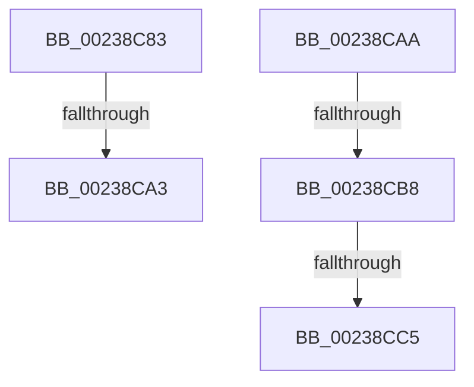

# sub_00238C83

- RVA: `0x00238C83`–`0x00238CD1` (길이 `78` bytes)
- VA: `0x0000000140238C83`
- 실행 섹션: `.text`
- PDB 이름 있음: `아니요`; PDB Function 태그: `아니요`
- unwind 정보 RVA: `0x00060B24`
- 디코드: `18`개 명령, `78/78` bytes 표시
- 미해석 바이트: `0` (있으면 어셈블리에 `.byte`로 보존)

> 이 문서는 커널 이미지의 기계어와 PDB 기호를 분석해 생성했습니다. 4번과 5번은 함수 원형과 자료형을 바이너리 사용 방식에서 추정한 C 해석이며 원본 소스 복구 결과는 아닙니다.

## 1. Dependencies

- 직접 호출 지점: **4**; 고유 호출 대상: **4**
- 직접 호출자로 확인된 함수: **0**
- RIP 상대 이미지 참조: **2**

### Outgoing calls
- `0x00238C8E` → [MiReleaseSpinLockExclusive](../24/MiReleaseSpinLockExclusive_function_002482C0.md) (function, `0x002482C0`)
- `0x00238C96` → [MiLateInitializeSystemCache](../4C/MiLateInitializeSystemCache_function_004C8104.md) (function, `0x004C8104`)
- `0x00238CB8` → [KiCheckVpBackingLongSpinWaitHypercall](../30/KiCheckVpBackingLongSpinWaitHypercall_function_0030F490.md) (function, `0x0030F490`)
- `0x00238CC7` → [HvlNotifyLongSpinWait](../30/HvlNotifyLongSpinWait_function_0030F460.md) (function, `0x0030F460`)

### Direct callers
- 이 함수 시작 RVA로 연결되는 직접 call은 확인되지 않았습니다. 간접 호출은 완전히 역산할 수 없습니다.

### Static image references
- `0x00238C87` → RVA `0x00E2F3B8` (`.data`; read)
- `0x00238CAA` → RVA `0x00FC6AB8` (`ALMOSTRO`; read)

## 2. Other-region calls and transfers

- 다른 실행 섹션으로 향하는 call: **0**
- call이 아닌 외부 분기/꼬리 이동: **5**
  - `0x00238C9D` → [sub_00238DA4](Unknown_function_00238DA4.md) (`tail-transfer`)
  - `0x00238CA5` → [sub_00238B34](Unknown_function_00238B34.md) (`tail-transfer`)
  - `0x00238CB2` → [sub_002388C3 + 0x60](Unknown_function_002388C3.md) (`tail-transfer`)
  - `0x00238CBF` → [sub_002388C3 + 0x60](Unknown_function_002388C3.md) (`tail-transfer`)
  - `0x00238CCC` → [sub_002388C3 + 0x62](Unknown_function_002388C3.md) (`tail-transfer`)

## 3. Assembly (complete function range)

```asm
00238C83  41 0F B6 D7                     movzx edx, r15b
00238C87  48 8D 0D 2A 67 BF 00            lea rcx, [rip + 0xbf672a]
00238C8E  E8 2D F6 00 00                  call 0x1402482c0
00238C93  49 8B CE                        mov rcx, r14
00238C96  E8 69 F4 28 00                  call 0x1404c8104
00238C9B  85 C0                           test eax, eax
00238C9D  0F 85 01 01 00 00               jne 0x140238da4
00238CA3  33 C0                           xor eax, eax
00238CA5  E9 8A FE FF FF                  jmp 0x140238b34
00238CAA  8B 05 08 DE D8 00               mov eax, dword ptr [rip + 0xd8de08]
00238CB0  A8 40                           test al, 0x40
00238CB2  0F 84 6B FC FF FF               je 0x140238923
00238CB8  E8 D3 67 0D 00                  call 0x14030f490
00238CBD  84 C0                           test al, al
00238CBF  0F 84 5E FC FF FF               je 0x140238923
00238CC5  8B CB                           mov ecx, ebx
00238CC7  E8 94 67 0D 00                  call 0x14030f460
00238CCC  E9 54 FC FF FF                  jmp 0x140238925
```

## 4. C-style interpretation (structured pseudocode)

```c
__int64 __fastcall sub_00238C83(void)
{
    __int64 result;

    result = MiReleaseSpinLockExclusive(v_rip + 12543786, (unsigned __int8)(v_r15), a3, a4);
    result = MiLateInitializeSystemCache(v_r14, (unsigned __int8)(v_r15), a3, a4);
    result = 0;
}
```

## 5. (Beta) C Style

```c
void sub_00238C83(void)
{
    int64_t result;

    result = MiReleaseSpinLockExclusive(v_rip + 12543786, (uint8_t)(local_r15), a3, a4);
    result = MiLateInitializeSystemCache(local_r14, (uint8_t)(local_r15), a3, a4);
    result = 0;
}
```

## 6. Execution-region graph

[열기: 2D/3D 그래프와 함수 탐색 컨트롤 패널](../../../control-panel.html?section=text&rva=0x00238C83&view=graph)

- 2D 그래프는 위에서 아래로 흐르고, 3D 그래프는 빈 공간을 드래그해 회전합니다. Shift+드래그는 이동, 휠은 확대·축소, 함수 노드 선택은 대상 보고서 이동입니다.

### Static fallback


