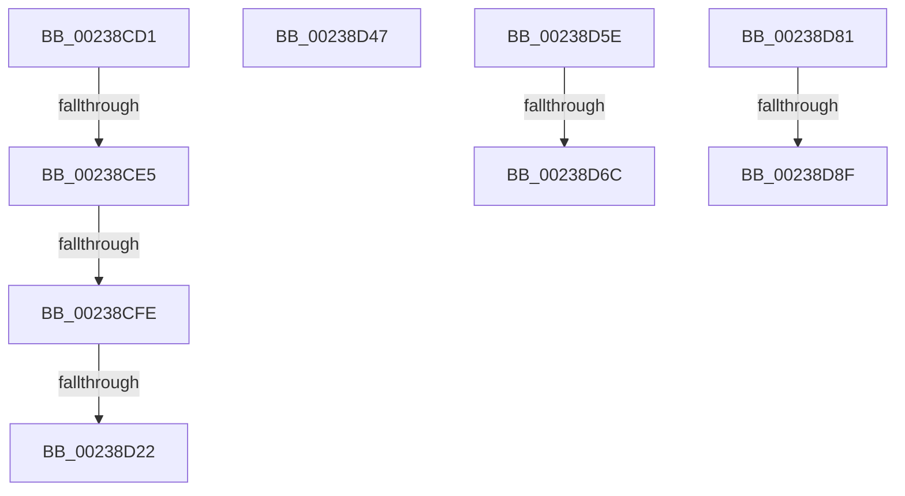

# sub_00238CD1

- RVA: `0x00238CD1`–`0x00238DA4` (길이 `211` bytes)
- VA: `0x0000000140238CD1`
- 실행 섹션: `.text`
- PDB 이름 있음: `아니요`; PDB Function 태그: `아니요`
- unwind 정보 RVA: `0x00060B38`
- 디코드: `47`개 명령, `211/211` bytes 표시
- 미해석 바이트: `0` (있으면 어셈블리에 `.byte`로 보존)

> 이 문서는 커널 이미지의 기계어와 PDB 기호를 분석해 생성했습니다. 4번과 5번은 함수 원형과 자료형을 바이너리 사용 방식에서 추정한 C 해석이며 원본 소스 복구 결과는 아닙니다.

## 1. Dependencies

- 직접 호출 지점: **8**; 고유 호출 대상: **6**
- 직접 호출자로 확인된 함수: **0**
- RIP 상대 이미지 참조: **2**

### Outgoing calls
- `0x00238CD4` → [MiConsumeSystemCachePde](../47/MiConsumeSystemCachePde_function_00474B40.md) (function, `0x00474B40`)
- `0x00238CED` → [MiConsumeSystemCacheTbFlushNeededView](../41/MiConsumeSystemCacheTbFlushNeededView_function_004193B4.md) (function, `0x004193B4`)
- `0x00238D09` → [MiReleaseSpinLockExclusive](../24/MiReleaseSpinLockExclusive_function_002482C0.md) (function, `0x002482C0`)
- `0x00238D11` → [MiExpandSystemCache](../3B/MiExpandSystemCache_function_003B3DC8.md) (function, `0x003B3DC8`)
- `0x00238D29` → [ExAcquireSpinLockExclusive](../24/ExAcquireSpinLockExclusive_function_00248690.md) (function, `0x00248690`)
- `0x00238D3A` → [MiConsumeSystemCacheTbFlushNeededView](../41/MiConsumeSystemCacheTbFlushNeededView_function_004193B4.md) (function, `0x004193B4`)
- `0x00238D77` → [ExpReleaseSpinLockExclusiveFromDpcLevelInstrumented](../2C/ExpReleaseSpinLockExclusiveFromDpcLevelInstrumented_function_002C0F44.md) (function, `0x002C0F44`)
- `0x00238D9A` → [ExpReleaseSpinLockExclusiveFromDpcLevelInstrumented](../2C/ExpReleaseSpinLockExclusiveFromDpcLevelInstrumented_function_002C0F44.md) (function, `0x002C0F44`)

### Direct callers
- 이 함수 시작 RVA로 연결되는 직접 call은 확인되지 않았습니다. 간접 호출은 완전히 역산할 수 없습니다.

### Static image references
- `0x00238D02` → RVA `0x00E2F3B8` (`.data`; read)
- `0x00238D5E` → RVA `0x00F0DE58` (`.data`; read)

## 2. Other-region calls and transfers

- 다른 실행 섹션으로 향하는 call: **0**
- call이 아닌 외부 분기/꼬리 이동: **9**
  - `0x00238CDF` → [sub_00238945 + 0x90](Unknown_function_00238945.md) (`tail-transfer`)
  - `0x00238CF8` → [sub_00238945 + 0x90](Unknown_function_00238945.md) (`tail-transfer`)
  - `0x00238D1C` → [sub_00238945 + 0x107](Unknown_function_00238945.md) (`tail-transfer`)
  - `0x00238D42` → [sub_00238945 + 0x90](Unknown_function_00238945.md) (`tail-transfer`)
  - `0x00238D59` → [sub_00238945 + 0xAB](Unknown_function_00238945.md) (`tail-transfer`)
  - `0x00238D66` → [sub_00238945 + 0xDD](Unknown_function_00238945.md) (`tail-transfer`)
  - `0x00238D7C` → [sub_00238945 + 0xE4](Unknown_function_00238945.md) (`tail-transfer`)
  - `0x00238D89` → [sub_00238B4C + 0xC5](Unknown_function_00238B4C.md) (`tail-transfer`)
  - `0x00238D9F` → [sub_00238945 + 0x102](Unknown_function_00238945.md) (`tail-transfer`)

## 3. Assembly (complete function range)

```asm
00238CD1  49 8B CE                        mov rcx, r14
00238CD4  E8 67 BE 23 00                  call 0x140474b40
00238CD9  48 8B D8                        mov rbx, rax
00238CDC  48 85 C0                        test rax, rax
00238CDF  0F 85 F0 FC FF FF               jne 0x1402389d5
00238CE5  BA 00 04 00 00                  mov edx, 0x400
00238CEA  49 8B CE                        mov rcx, r14
00238CED  E8 C2 06 1E 00                  call 0x1404193b4
00238CF2  48 8B D8                        mov rbx, rax
00238CF5  48 85 C0                        test rax, rax
00238CF8  0F 85 D7 FC FF FF               jne 0x1402389d5
00238CFE  41 0F B6 D7                     movzx edx, r15b
00238D02  48 8D 0D AF 66 BF 00            lea rcx, [rip + 0xbf66af]
00238D09  E8 B2 F5 00 00                  call 0x1402482c0
00238D0E  49 8B CE                        mov rcx, r14
00238D11  E8 B2 B0 17 00                  call 0x1403b3dc8
00238D16  48 8B D8                        mov rbx, rax
00238D19  48 85 C0                        test rax, rax
00238D1C  0F 85 2A FD FF FF               jne 0x140238a4c
00238D22  48 8D 0D 8F 66 BF 00            lea rcx, [rip + 0xbf668f]
00238D29  E8 62 F9 00 00                  call 0x140248690
00238D2E  41 BC 01 00 00 00               mov r12d, 1
00238D34  49 8B CE                        mov rcx, r14
00238D37  41 8B D4                        mov edx, r12d
00238D3A  E8 75 06 1E 00                  call 0x1404193b4
00238D3F  48 8B D8                        mov rbx, rax
00238D42  E9 8E FC FF FF                  jmp 0x1402389d5
00238D47  4D 89 48 08                     mov qword ptr [r8 + 8], r9
00238D4B  4C 8D 55 E8                     lea r10, [rbp - 0x18]
00238D4F  4D 89 10                        mov qword ptr [r8], r10
00238D52  4D 89 01                        mov qword ptr [r9], r8
00238D55  4C 89 45 F0                     mov qword ptr [rbp - 0x10], r8
00238D59  E9 92 FC FF FF                  jmp 0x1402389f0
00238D5E  8B 05 F4 50 CD 00               mov eax, dword ptr [rip + 0xcd50f4]
00238D64  85 C0                           test eax, eax
00238D66  0F 85 B6 FC FF FF               jne 0x140238a22
00238D6C  48 8B 55 30                     mov rdx, qword ptr [rbp + 0x30]
00238D70  48 8D 0D 41 66 BF 00            lea rcx, [rip + 0xbf6641]
00238D77  E8 C8 81 08 00                  call 0x1402c0f44
00238D7C  E9 A8 FC FF FF                  jmp 0x140238a29
00238D81  8B 05 D1 50 CD 00               mov eax, dword ptr [rip + 0xcd50d1]
00238D87  85 C0                           test eax, eax
00238D89  0F 85 82 FE FF FF               jne 0x140238c11
00238D8F  48 8B 55 30                     mov rdx, qword ptr [rbp + 0x30]
00238D93  48 8D 0D 1E 66 BF 00            lea rcx, [rip + 0xbf661e]
00238D9A  E8 A5 81 08 00                  call 0x1402c0f44
00238D9F  E9 A3 FC FF FF                  jmp 0x140238a47
```

## 4. C-style interpretation (structured pseudocode)

```c
__int64 __fastcall sub_00238CD1(__int64 a1, __int64 a2, __int64 a3, __int64 a4)
{
    __int64 result;

    result = MiConsumeSystemCachePde(v_r14, a2, a3, a4);
    result = MiConsumeSystemCacheTbFlushNeededView(v_r14, (unsigned int)(0x400ULL), a3, a4);
    result = MiReleaseSpinLockExclusive(v_rip + 12543663, (unsigned __int8)(v_r15), a3, a4);
    result = MiExpandSystemCache(v_r14, (unsigned __int8)(v_r15), a3, a4);
    result = ExAcquireSpinLockExclusive(v_rip + 12543631, (unsigned __int8)(v_r15), a3, a4);
    result = MiConsumeSystemCacheTbFlushNeededView(v_r14, 1, a3, a4);
}
```

## 5. (Beta) C Style

```c
int64_t sub_00238CD1(int64_t Arg1, int64_t Arg2, int64_t Arg3, int64_t Arg4)
{
    int64_t result;

    result = MiConsumeSystemCachePde(local_r14, Arg2, Arg3, Arg4);
    result = MiConsumeSystemCacheTbFlushNeededView(local_r14, (uint32_t)(0x400ULL), Arg3, Arg4);
    result = MiReleaseSpinLockExclusive(v_rip + 12543663, (uint8_t)(local_r15), Arg3, Arg4);
    result = MiExpandSystemCache(local_r14, (uint8_t)(local_r15), Arg3, Arg4);
    result = ExAcquireSpinLockExclusive(v_rip + 12543631, (uint8_t)(local_r15), Arg3, Arg4);
    result = MiConsumeSystemCacheTbFlushNeededView(local_r14, 1, Arg3, Arg4);
}
```

## 6. Execution-region graph

[열기: 2D/3D 그래프와 함수 탐색 컨트롤 패널](../../../control-panel.html?section=text&rva=0x00238CD1&view=graph)

- 2D 그래프는 위에서 아래로 흐르고, 3D 그래프는 빈 공간을 드래그해 회전합니다. Shift+드래그는 이동, 휠은 확대·축소, 함수 노드 선택은 대상 보고서 이동입니다.

### Static fallback


