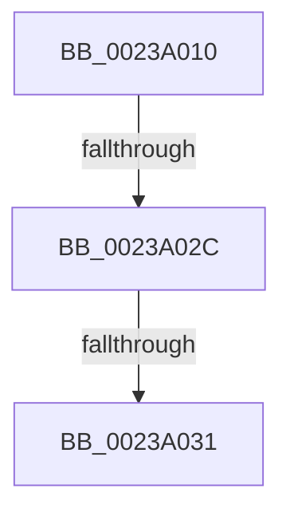

# sub_0023A010

- RVA: `0x0023A010`–`0x0023A03C` (길이 `44` bytes)
- VA: `0x000000014023A010`
- 실행 섹션: `.text`
- PDB 이름 있음: `아니요`; PDB Function 태그: `아니요`
- unwind 정보 RVA: `0x00060C58`
- 디코드: `11`개 명령, `44/44` bytes 표시
- 미해석 바이트: `0` (있으면 어셈블리에 `.byte`로 보존)

> 이 문서는 커널 이미지의 기계어와 PDB 기호를 분석해 생성했습니다. 4번과 5번은 함수 원형과 자료형을 바이너리 사용 방식에서 추정한 C 해석이며 원본 소스 복구 결과는 아닙니다.

## 1. Dependencies

- 직접 호출 지점: **0**; 고유 호출 대상: **0**
- 직접 호출자로 확인된 함수: **0**
- RIP 상대 이미지 참조: **0**

### Outgoing calls
- 직접 디코드된 call 명령이 없습니다.

### Direct callers
- 이 함수 시작 RVA로 연결되는 직접 call은 확인되지 않았습니다. 간접 호출은 완전히 역산할 수 없습니다.

### Static image references
- 디코드된 RIP-relative 메모리 참조가 없습니다.

## 2. Other-region calls and transfers

- 다른 실행 섹션으로 향하는 call: **0**
- call이 아닌 외부 분기/꼬리 이동: **3**
  - `0x0023A02A` → [sub_0023A03C](Unknown_function_0023A03C.md) (`tail-transfer`)
  - `0x0023A02F` → [sub_0023A03C + 0x9](Unknown_function_0023A03C.md) (`tail-transfer`)
  - `0x0023A03A` → [MiReleaseWalkLocks + 0x1A](MiReleaseWalkLocks_function_00239FD0.md) (`tail-transfer`)

## 3. Assembly (complete function range)

```asm
0023A010  48 89 74 24 30                  mov qword ptr [rsp + 0x30], rsi
0023A015  33 F6                           xor esi, esi
0023A017  48 B8 68 DF BE 7D FB F6 FF FF   movabs rax, 0xfffff6fb7dbedf68
0023A021  48 8B C0                        mov rax, rax
0023A024  F7 01 00 10 00 00               test dword ptr [rcx], 0x1000
0023A02A  74 10                           je 0x14023a03c
0023A02C  48 3B D0                        cmp rdx, rax
0023A02F  75 14                           jne 0x14023a045
0023A031  48 89 73 38                     mov qword ptr [rbx + 0x38], rsi
0023A035  48 8B 74 24 30                  mov rsi, qword ptr [rsp + 0x30]
0023A03A  EB AE                           jmp 0x140239fea
```

## 4. C-style interpretation (structured pseudocode)

```c
__int64 __fastcall sub_0023A010(__int64 a1, __int64 a2, __int64 a3, __int64 a4, __int64 a5, __int64 a6)
{
    __int64 v_rsi;
    unsigned __int64 v_stack_p30;

    v_stack_p30 = v_rsi;
    v_rsi = 0;
    *(unsigned __int64 *)(v_rbx + 56) = 0;
}
```

## 5. (Beta) C Style

```c
int64_t sub_0023A010(void *Arg1, int64_t Arg2, int64_t Arg3, int64_t Arg4, uint64_t Arg5, int64_t Arg6)
{
    uint8_t *arg1 = (uint8_t *)Arg1;

    int64_t local_rsi;
    uint64_t v_stack_p30;

    v_stack_p30 = local_rsi;
    local_rsi = 0;
    *(uint64_t *)(local_rbx + 0x38) = 0;
}
```

### 관측된 메모리 오프셋

구조체 형식이 확인되지 않은 접근은 인자 기준의 오프셋으로만 기록했습니다.

| 기준 인자 | 오프셋 표현 | 폭 (bit) | 접근 |
|---|---:|---:|---|
| `Arg1` | `+ 0x0` | `32` | `R` |

## 6. Execution-region graph

[열기: 2D/3D 그래프와 함수 탐색 컨트롤 패널](../../../control-panel.html?section=text&rva=0x0023A010&view=graph)

- 2D 그래프는 위에서 아래로 흐르고, 3D 그래프는 빈 공간을 드래그해 회전합니다. Shift+드래그는 이동, 휠은 확대·축소, 함수 노드 선택은 대상 보고서 이동입니다.

### Static fallback


