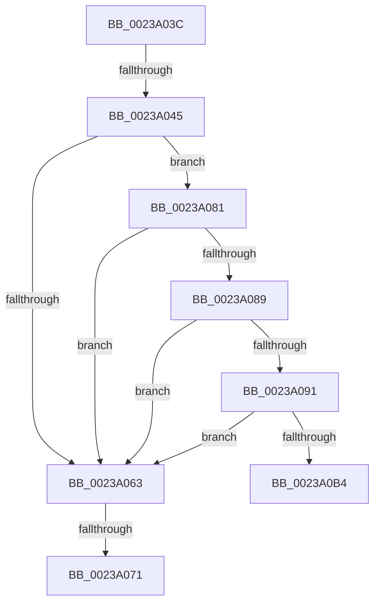

# sub_0023A03C

- RVA: `0x0023A03C`–`0x0023A0D5` (길이 `153` bytes)
- VA: `0x000000014023A03C`
- 실행 섹션: `.text`
- PDB 이름 있음: `아니요`; PDB Function 태그: `아니요`
- unwind 정보 RVA: `0x00060C6C`
- 디코드: `32`개 명령, `153/153` bytes 표시
- 미해석 바이트: `0` (있으면 어셈블리에 `.byte`로 보존)

> 이 문서는 커널 이미지의 기계어와 PDB 기호를 분석해 생성했습니다. 4번과 5번은 함수 원형과 자료형을 바이너리 사용 방식에서 추정한 C 해석이며 원본 소스 복구 결과는 아닙니다.

## 1. Dependencies

- 직접 호출 지점: **1**; 고유 호출 대상: **1**
- 직접 호출자로 확인된 함수: **0**
- RIP 상대 이미지 참조: **0**

### Outgoing calls
- `0x0023A0C2` → [ExReleaseSpinLockRegardlessFromDpcLevel](ExReleaseSpinLockRegardlessFromDpcLevel_function_0023A330.md) (function, `0x0023A330`)

### Direct callers
- 이 함수 시작 RVA로 연결되는 직접 call은 확인되지 않았습니다. 간접 호출은 완전히 역산할 수 없습니다.

### Static image references
- 디코드된 RIP-relative 메모리 참조가 없습니다.

## 2. Other-region calls and transfers

- 다른 실행 섹션으로 향하는 call: **0**
- call이 아닌 외부 분기/꼬리 이동: **4**
  - `0x0023A03F` → [sub_0023A0D5](Unknown_function_0023A0D5.md) (`tail-transfer`)
  - `0x0023A06B` → [sub_0023A10E](Unknown_function_0023A10E.md) (`tail-transfer`)
  - `0x0023A07F` → [sub_0023A010 + 0x21](Unknown_function_0023A010.md) (`tail-transfer`)
  - `0x0023A0D0` → [MiReleaseWalkLocks + 0x1A](MiReleaseWalkLocks_function_00239FD0.md) (`tail-transfer`)

## 3. Assembly (complete function range)

```asm
0023A03C  48 3B D0                        cmp rdx, rax
0023A03F  0F 84 90 00 00 00               je 0x14023a0d5
0023A045  8B 87 B8 00 00 00               mov eax, dword ptr [rdi + 0xb8]
0023A04B  49 B8 00 D0 BE 7D FB F6 FF FF   movabs r8, 0xfffff6fb7dbed000
0023A055  49 B9 FF DF BE 7D FB F6 FF FF   movabs r9, 0xfffff6fb7dbedfff
0023A05F  A8 0F                           test al, 0xf
0023A061  74 1E                           je 0x14023a081
0023A063  8B 87 B8 00 00 00               mov eax, dword ptr [rdi + 0xb8]
0023A069  A8 0F                           test al, 0xf
0023A06B  0F 85 9D 00 00 00               jne 0x14023a10e
0023A071  48 B8 FF FF FF FF FF FF FF CF   movabs rax, 0xcfffffffffffffff
0023A07B  F0 48 21 02                     lock and qword ptr [rdx], rax
0023A07F  EB B0                           jmp 0x14023a031
0023A081  49 8B C0                        mov rax, r8
0023A084  48 3B D0                        cmp rdx, rax
0023A087  72 DA                           jb 0x14023a063
0023A089  49 8B C1                        mov rax, r9
0023A08C  48 3B D0                        cmp rdx, rax
0023A08F  77 D2                           ja 0x14023a063
0023A091  65 48 8B 04 25 88 01 00 00      mov rax, qword ptr gs:[0x188]
0023A09A  48 8B 88 B8 00 00 00            mov rcx, qword ptr [rax + 0xb8]
0023A0A1  48 8B 81 10 04 00 00            mov rax, qword ptr [rcx + 0x410]
0023A0A8  48 8B 88 68 05 00 00            mov rcx, qword ptr [rax + 0x568]
0023A0AF  48 85 C9                        test rcx, rcx
0023A0B2  74 AF                           je 0x14023a063
0023A0B4  48 C1 EA 03                     shr rdx, 3
0023A0B8  81 E2 FF 01 00 00               and edx, 0x1ff
0023A0BE  48 8D 0C 91                     lea rcx, [rcx + rdx*4]
0023A0C2  E8 69 02 00 00                  call 0x14023a330
0023A0C7  48 89 73 38                     mov qword ptr [rbx + 0x38], rsi
0023A0CB  48 8B 74 24 30                  mov rsi, qword ptr [rsp + 0x30]
0023A0D0  E9 15 FF FF FF                  jmp 0x140239fea
```

## 4. C-style interpretation (structured pseudocode)

```c
__int64 __fastcall sub_0023A03C(__int64 a1, __int64 a2, __int64 a3, __int64 a4, __int64 a5, __int64 a6)
{
    __int64 result;

    if ((((unsigned __int8)((unsigned int)(*(unsigned int *)(v_rdi + 184)))) & (15)) == 0) goto loc_0023A081;
loc_0023A063:
loc_0023A081:
    if (a2 < a3) goto loc_0023A063;
    if (a2 > a4) goto loc_0023A063;
    if (*(unsigned __int64 *)(*(unsigned __int64 *)(*(unsigned __int64 *)(*(unsigned __int64 *)(gs_base + (0 + 392)) + 184) + 1040) + 1384) == 0) goto loc_0023A063;
    a2 = (a2) >> (3);
    a2 = (unsigned int)((a2) & (511));
    result = ExReleaseSpinLockRegardlessFromDpcLevel(*(unsigned __int64 *)(*(unsigned __int64 *)(*(unsigned __int64 *)(*(unsigned __int64 *)(gs_base + (0 + 392)) + 184) + 1040) + 1384) + a2 * 4, a2, a3, a4);
    *(unsigned __int64 *)(v_rbx + 56) = v_rsi;
}
```

## 5. (Beta) C Style

```c
int64_t sub_0023A03C(int64_t Arg1, int64_t Arg2, int64_t Arg3, int64_t Arg4, uint64_t Arg5, int64_t Arg6)
{
    int64_t result;

    if ((((uint8_t)((uint32_t)(*(uint32_t *)(local_rdi + 0xB8)))) & (15)) == 0) goto loc_0023A081;
loc_0023A063:
loc_0023A081:
    if (Arg2 < Arg3) goto loc_0023A063;
    if (Arg2 > Arg4) goto loc_0023A063;
    if (*(uint64_t *)(*(uint64_t *)(*(uint64_t *)(*(uint64_t *)(gs_base + (0 + 0x188)) + 0xB8) + 0x410) + 0x568) == 0) goto loc_0023A063;
    Arg2 = (Arg2) >> (3);
    Arg2 = (uint32_t)((Arg2) & (511));
    result = ExReleaseSpinLockRegardlessFromDpcLevel(*(uint64_t *)(*(uint64_t *)(*(uint64_t *)(*(uint64_t *)(gs_base + (0 + 0x188)) + 0xB8) + 0x410) + 0x568) + Arg2 * 4, Arg2, Arg3, Arg4);
    *(uint64_t *)(local_rbx + 0x38) = local_rsi;
}
```

## 6. Execution-region graph

[열기: 2D/3D 그래프와 함수 탐색 컨트롤 패널](../../../control-panel.html?section=text&rva=0x0023A03C&view=graph)

- 2D 그래프는 위에서 아래로 흐르고, 3D 그래프는 빈 공간을 드래그해 회전합니다. Shift+드래그는 이동, 휠은 확대·축소, 함수 노드 선택은 대상 보고서 이동입니다.

### Static fallback


