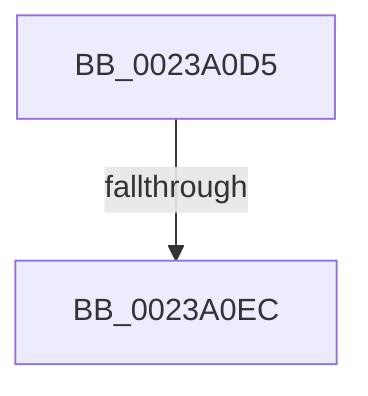

# sub_0023A0D5

- RVA: `0x0023A0D5`–`0x0023A10E` (길이 `57` bytes)
- VA: `0x000000014023A0D5`
- 실행 섹션: `.text`
- PDB 이름 있음: `아니요`; PDB Function 태그: `아니요`
- unwind 정보 RVA: `0x00060C80`
- 디코드: `11`개 명령, `57/57` bytes 표시
- 미해석 바이트: `0` (있으면 어셈블리에 `.byte`로 보존)

> 이 문서는 커널 이미지의 기계어와 PDB 기호를 분석해 생성했습니다. 4번과 5번은 함수 원형과 자료형을 바이너리 사용 방식에서 추정한 C 해석이며 원본 소스 복구 결과는 아닙니다.

## 1. Dependencies

- 직접 호출 지점: **1**; 고유 호출 대상: **1**
- 직접 호출자로 확인된 함수: **0**
- RIP 상대 이미지 참조: **0**

### Outgoing calls
- `0x0023A0FB` → [KeReleaseInStackQueuedSpinLockFromDpcLevel](../21/KeReleaseInStackQueuedSpinLockFromDpcLevel_function_002171B0.md) (function, `0x002171B0`)

### Direct callers
- 이 함수 시작 RVA로 연결되는 직접 call은 확인되지 않았습니다. 간접 호출은 완전히 역산할 수 없습니다.

### Static image references
- 디코드된 RIP-relative 메모리 참조가 없습니다.

## 2. Other-region calls and transfers

- 다른 실행 섹션으로 향하는 call: **0**
- call이 아닌 외부 분기/꼬리 이동: **2**
  - `0x0023A0E6` → [sub_0023A16C](Unknown_function_0023A16C.md) (`tail-transfer`)
  - `0x0023A109` → [MiReleaseWalkLocks + 0x1A](MiReleaseWalkLocks_function_00239FD0.md) (`tail-transfer`)

## 3. Assembly (complete function range)

```asm
0023A0D5  65 48 8B 14 25 20 00 00 00      mov rdx, qword ptr gs:[0x20]
0023A0DE  8B 87 B8 00 00 00               mov eax, dword ptr [rdi + 0xb8]
0023A0E4  24 0F                           and al, 0xf
0023A0E6  0F 85 80 00 00 00               jne 0x14023a16c
0023A0EC  B9 30 00 00 00                  mov ecx, 0x30
0023A0F1  48 81 C2 40 9C 00 00            add rdx, 0x9c40
0023A0F8  48 03 CA                        add rcx, rdx
0023A0FB  E8 B0 D0 FD FF                  call 0x1402171b0
0023A100  48 89 73 38                     mov qword ptr [rbx + 0x38], rsi
0023A104  48 8B 74 24 30                  mov rsi, qword ptr [rsp + 0x30]
0023A109  E9 DC FE FF FF                  jmp 0x140239fea
```

## 4. C-style interpretation (structured pseudocode)

```c
__int64 __fastcall sub_0023A0D5(__int64 a1, __int64 a2, __int64 a3, __int64 a4, __int64 a5, __int64 a6)
{
    __int64 result;

    result = (unsigned __int8)(((unsigned int)(*(unsigned int *)(v_rdi + 184))) & (15));
    a2 = (*(unsigned __int64 *)(gs_base + (0 + 32))) + (0x9C40ULL);
    a1 = (48) + (a2);
    result = KeReleaseInStackQueuedSpinLockFromDpcLevel(a1, a2, a3, a4);
    *(unsigned __int64 *)(v_rbx + 56) = v_rsi;
}
```

## 5. (Beta) C Style

```c
int64_t sub_0023A0D5(int64_t Arg1, int64_t Arg2, int64_t Arg3, int64_t Arg4, uint64_t Arg5, int64_t Arg6)
{
    int64_t result;

    result = (uint8_t)(((uint32_t)(*(uint32_t *)(local_rdi + 0xB8))) & (15));
    Arg2 = (*(uint64_t *)(gs_base + (0 + 0x20))) + (0x9C40ULL);
    Arg1 = (48) + (Arg2);
    result = KeReleaseInStackQueuedSpinLockFromDpcLevel(Arg1, Arg2, Arg3, Arg4);
    *(uint64_t *)(local_rbx + 0x38) = local_rsi;
}
```

## 6. Execution-region graph

[열기: 2D/3D 그래프와 함수 탐색 컨트롤 패널](../../../control-panel.html?section=text&rva=0x0023A0D5&view=graph)

- 2D 그래프는 위에서 아래로 흐르고, 3D 그래프는 빈 공간을 드래그해 회전합니다. Shift+드래그는 이동, 휠은 확대·축소, 함수 노드 선택은 대상 보고서 이동입니다.

### Static fallback


