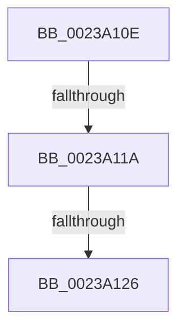

# sub_0023A10E

- RVA: `0x0023A10E`–`0x0023A16C` (길이 `94` bytes)
- VA: `0x000000014023A10E`
- 실행 섹션: `.text`
- PDB 이름 있음: `아니요`; PDB Function 태그: `아니요`
- unwind 정보 RVA: `0x00060C94`
- 디코드: `24`개 명령, `94/94` bytes 표시
- 미해석 바이트: `0` (있으면 어셈블리에 `.byte`로 보존)

> 이 문서는 커널 이미지의 기계어와 PDB 기호를 분석해 생성했습니다. 4번과 5번은 함수 원형과 자료형을 바이너리 사용 방식에서 추정한 C 해석이며 원본 소스 복구 결과는 아닙니다.

## 1. Dependencies

- 직접 호출 지점: **0**; 고유 호출 대상: **0**
- 직접 호출자로 확인된 함수: **0**
- RIP 상대 이미지 참조: **1**

### Outgoing calls
- 직접 디코드된 call 명령이 없습니다.

### Direct callers
- 이 함수 시작 RVA로 연결되는 직접 call은 확인되지 않았습니다. 간접 호출은 완전히 역산할 수 없습니다.

### Static image references
- `0x0023A153` → RVA `0x00E2F1AC` (`.data`; read)

## 2. Other-region calls and transfers

- 다른 실행 섹션으로 향하는 call: **0**
- call이 아닌 외부 분기/꼬리 이동: **3**
  - `0x0023A114` → [sub_0023A03C + 0x35](Unknown_function_0023A03C.md) (`tail-transfer`)
  - `0x0023A120` → [sub_0023A03C + 0x35](Unknown_function_0023A03C.md) (`tail-transfer`)
  - `0x0023A167` → [MiReleaseWalkLocks + 0x1A](MiReleaseWalkLocks_function_00239FD0.md) (`tail-transfer`)

## 3. Assembly (complete function range)

```asm
0023A10E  49 8B C0                        mov rax, r8
0023A111  48 3B D0                        cmp rdx, rax
0023A114  0F 82 57 FF FF FF               jb 0x14023a071
0023A11A  49 8B C1                        mov rax, r9
0023A11D  48 3B D0                        cmp rdx, rax
0023A120  0F 87 4B FF FF FF               ja 0x14023a071
0023A126  49 8B C0                        mov rax, r8
0023A129  48 2B D0                        sub rdx, rax
0023A12C  8B 87 B8 00 00 00               mov eax, dword ptr [rdi + 0xb8]
0023A132  48 C1 FA 03                     sar rdx, 3
0023A136  44 8D 04 12                     lea r8d, [rdx + rdx]
0023A13A  BA 02 00 00 00                  mov edx, 2
0023A13F  41 8B C8                        mov ecx, r8d
0023A142  41 8B C0                        mov eax, r8d
0023A145  83 E1 1F                        and ecx, 0x1f
0023A148  D3 E2                           shl edx, cl
0023A14A  F7 D2                           not edx
0023A14C  0F B3 CA                        btr edx, ecx
0023A14F  48 C1 E8 05                     shr rax, 5
0023A153  48 8D 0D 52 50 BF 00            lea rcx, [rip + 0xbf5052]
0023A15A  F0 21 14 81                     lock and dword ptr [rcx + rax*4], edx
0023A15E  48 89 73 38                     mov qword ptr [rbx + 0x38], rsi
0023A162  48 8B 74 24 30                  mov rsi, qword ptr [rsp + 0x30]
0023A167  E9 7E FE FF FF                  jmp 0x140239fea
```

## 4. C-style interpretation (structured pseudocode)

```c
__int64 __fastcall sub_0023A10E(__int64 a1, __int64 a2, __int64 a3, __int64 a4, __int64 a5, __int64 a6)
{
    __int64 result;

    a2 = (a2) - (a3);
    a2 = (a2) >> (3);
    a1 = (unsigned int)(((unsigned int)((unsigned int)(a2 + a2 * 1))) & (31));
    a2 = (unsigned int)((2) << ((unsigned __int8)(a1)));
    a2 = (unsigned int)(~(a2));
    result = ((unsigned int)((unsigned int)(a2 + a2 * 1))) >> (5);
    *(unsigned __int64 *)(v_rbx + 56) = v_rsi;
}
```

## 5. (Beta) C Style

```c
int64_t sub_0023A10E(int64_t Arg1, int64_t Arg2, int64_t Arg3, int64_t Arg4, uint64_t Arg5, int64_t Arg6)
{
    int64_t result;

    Arg2 = (Arg2) - (Arg3);
    Arg2 = (Arg2) >> (3);
    Arg1 = (uint32_t)(((uint32_t)((uint32_t)(Arg2 + Arg2 * 1))) & (31));
    Arg2 = (uint32_t)((2) << ((uint8_t)(Arg1)));
    Arg2 = (uint32_t)(~(Arg2));
    result = ((uint32_t)((uint32_t)(Arg2 + Arg2 * 1))) >> (5);
    *(uint64_t *)(local_rbx + 0x38) = local_rsi;
}
```

## 6. Execution-region graph

[열기: 2D/3D 그래프와 함수 탐색 컨트롤 패널](../../../control-panel.html?section=text&rva=0x0023A10E&view=graph)

- 2D 그래프는 위에서 아래로 흐르고, 3D 그래프는 빈 공간을 드래그해 회전합니다. Shift+드래그는 이동, 휠은 확대·축소, 함수 노드 선택은 대상 보고서 이동입니다.

### Static fallback


