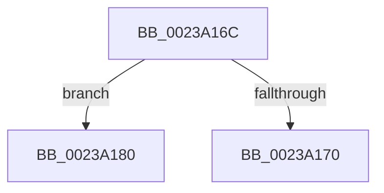

# sub_0023A16C

- RVA: `0x0023A16C`–`0x0023A18A` (길이 `30` bytes)
- VA: `0x000000014023A16C`
- 실행 섹션: `.text`
- PDB 이름 있음: `아니요`; PDB Function 태그: `아니요`
- unwind 정보 RVA: `0x00060CA8`
- 디코드: `8`개 명령, `30/30` bytes 표시
- 미해석 바이트: `0` (있으면 어셈블리에 `.byte`로 보존)

> 이 문서는 커널 이미지의 기계어와 PDB 기호를 분석해 생성했습니다. 4번과 5번은 함수 원형과 자료형을 바이너리 사용 방식에서 추정한 C 해석이며 원본 소스 복구 결과는 아닙니다.

## 1. Dependencies

- 직접 호출 지점: **0**; 고유 호출 대상: **0**
- 직접 호출자로 확인된 함수: **0**
- RIP 상대 이미지 참조: **0**

### Outgoing calls
- 직접 디코드된 call 명령이 없습니다.

### Direct callers
- 이 함수 시작 RVA로 연결되는 직접 call은 확인되지 않았습니다. 간접 호출은 완전히 역산할 수 없습니다.

### Static image references
- 디코드된 RIP-relative 메모리 참조가 없습니다.

## 2. Other-region calls and transfers

- 다른 실행 섹션으로 향하는 call: **0**
- call이 아닌 외부 분기/꼬리 이동: **2**
  - `0x0023A17B` → [sub_0023A0D5 + 0x1C](Unknown_function_0023A0D5.md) (`tail-transfer`)
  - `0x0023A185` → [sub_0023A0D5 + 0x1C](Unknown_function_0023A0D5.md) (`tail-transfer`)

## 3. Assembly (complete function range)

```asm
0023A16C  3C 07                           cmp al, 7
0023A16E  74 10                           je 0x14023a180
0023A170  3C 05                           cmp al, 5
0023A172  B9 48 00 00 00                  mov ecx, 0x48
0023A177  48 0F 44 CE                     cmove rcx, rsi
0023A17B  E9 71 FF FF FF                  jmp 0x14023a0f1
0023A180  B9 18 00 00 00                  mov ecx, 0x18
0023A185  E9 67 FF FF FF                  jmp 0x14023a0f1
```

## 4. C-style interpretation (structured pseudocode)

```c
void __fastcall sub_0023A16C(void)
{
    if (((unsigned __int8)(result)) == 7) goto loc_0023A180;
    a1 = 72;
    if (((unsigned __int8)(result)) == 5) { a1 = v_rsi; }
loc_0023A180:
}
```

## 5. (Beta) C Style

```c
void sub_0023A16C(void)
{
    if (((uint8_t)(result)) == 7) goto loc_0023A180;
    a1 = 72;
    if (((uint8_t)(result)) == 5) { a1 = local_rsi; }
loc_0023A180:
}
```

## 6. Execution-region graph

[열기: 2D/3D 그래프와 함수 탐색 컨트롤 패널](../../../control-panel.html?section=text&rva=0x0023A16C&view=graph)

- 2D 그래프는 위에서 아래로 흐르고, 3D 그래프는 빈 공간을 드래그해 회전합니다. Shift+드래그는 이동, 휠은 확대·축소, 함수 노드 선택은 대상 보고서 이동입니다.

### Static fallback


