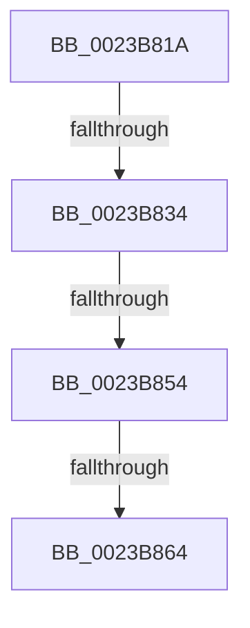

# sub_0023B81A

- RVA: `0x0023B81A`–`0x0023B87B` (길이 `97` bytes)
- VA: `0x000000014023B81A`
- 실행 섹션: `.text`
- PDB 이름 있음: `아니요`; PDB Function 태그: `아니요`
- unwind 정보 RVA: `0x00060DCC`
- 디코드: `17`개 명령, `97/97` bytes 표시
- 미해석 바이트: `0` (있으면 어셈블리에 `.byte`로 보존)

> 이 문서는 커널 이미지의 기계어와 PDB 기호를 분석해 생성했습니다. 4번과 5번은 함수 원형과 자료형을 바이너리 사용 방식에서 추정한 C 해석이며 원본 소스 복구 결과는 아닙니다.

## 1. Dependencies

- 직접 호출 지점: **0**; 고유 호출 대상: **0**
- 직접 호출자로 확인된 함수: **0**
- RIP 상대 이미지 참조: **0**

### Outgoing calls
- 직접 디코드된 call 명령이 없습니다.

### Direct callers
- 이 함수 시작 RVA로 연결되는 직접 call은 확인되지 않았습니다. 간접 호출은 완전히 역산할 수 없습니다.

### Static image references
- 디코드된 RIP-relative 메모리 참조가 없습니다.

## 2. Other-region calls and transfers

- 다른 실행 섹션으로 향하는 call: **0**
- call이 아닌 외부 분기/꼬리 이동: **3**
  - `0x0023B82E` → [sub_0023B894 + 0x47](Unknown_function_0023B894.md) (`tail-transfer`)
  - `0x0023B852` → [sub_0023B894](Unknown_function_0023B894.md) (`tail-transfer`)
  - `0x0023B85E` → [sub_0023B894 + 0x74](Unknown_function_0023B894.md) (`tail-transfer`)

## 3. Assembly (complete function range)

```asm
0023B81A  48 89 74 24 30                  mov qword ptr [rsp + 0x30], rsi
0023B81F  48 B9 68 DF BE 7D FB F6 FF FF   movabs rcx, 0xfffff6fb7dbedf68
0023B829  33 F6                           xor esi, esi
0023B82B  48 3B C1                        cmp rax, rcx
0023B82E  0F 84 A7 00 00 00               je 0x14023b8db
0023B834  41 8B 89 B8 00 00 00            mov ecx, dword ptr [r9 + 0xb8]
0023B83B  49 B8 00 D0 BE 7D FB F6 FF FF   movabs r8, 0xfffff6fb7dbed000
0023B845  49 BA FF DF BE 7D FB F6 FF FF   movabs r10, 0xfffff6fb7dbedfff
0023B84F  F6 C1 0F                        test cl, 0xf
0023B852  74 40                           je 0x14023b894
0023B854  41 8B 89 B8 00 00 00            mov ecx, dword ptr [r9 + 0xb8]
0023B85B  F6 C1 0F                        test cl, 0xf
0023B85E  0F 85 A4 00 00 00               jne 0x14023b908
0023B864  48 B9 FF FF FF FF FF FF FF CF   movabs rcx, 0xcfffffffffffffff
0023B86E  F0 48 21 08                     lock and qword ptr [rax], rcx
0023B872  48 89 73 28                     mov qword ptr [rbx + 0x28], rsi
0023B876  48 8B 74 24 30                  mov rsi, qword ptr [rsp + 0x30]
```

## 4. C-style interpretation (structured pseudocode)

```c
void __fastcall sub_0023B81A(__int64 a1, __int64 a2, __int64 a3, __int64 a4, __int64 a5, __int64 a6)
{
    __int64 v_rsi;
    unsigned __int64 v_stack_p30;

    v_stack_p30 = v_rsi;
    v_rsi = 0;
    *(unsigned __int64 *)(v_rbx + 40) = 0;
    return;
}
```

## 5. (Beta) C Style

```c
void sub_0023B81A(int64_t Arg1, int64_t Arg2, int64_t Arg3, void *Arg4, uint64_t Arg5, int64_t Arg6)
{
    uint8_t *arg4 = (uint8_t *)Arg4;

    int64_t local_rsi;
    uint64_t v_stack_p30;

    v_stack_p30 = local_rsi;
    local_rsi = 0;
    *(uint64_t *)(local_rbx + 0x28) = 0;
    return;
}
```

### 관측된 메모리 오프셋

구조체 형식이 확인되지 않은 접근은 인자 기준의 오프셋으로만 기록했습니다.

| 기준 인자 | 오프셋 표현 | 폭 (bit) | 접근 |
|---|---:|---:|---|
| `Arg4` | `+ 0xB8` | `32` | `R` |

## 6. Execution-region graph

[열기: 2D/3D 그래프와 함수 탐색 컨트롤 패널](../../../control-panel.html?section=text&rva=0x0023B81A&view=graph)

- 2D 그래프는 위에서 아래로 흐르고, 3D 그래프는 빈 공간을 드래그해 회전합니다. Shift+드래그는 이동, 휠은 확대·축소, 함수 노드 선택은 대상 보고서 이동입니다.

### Static fallback


