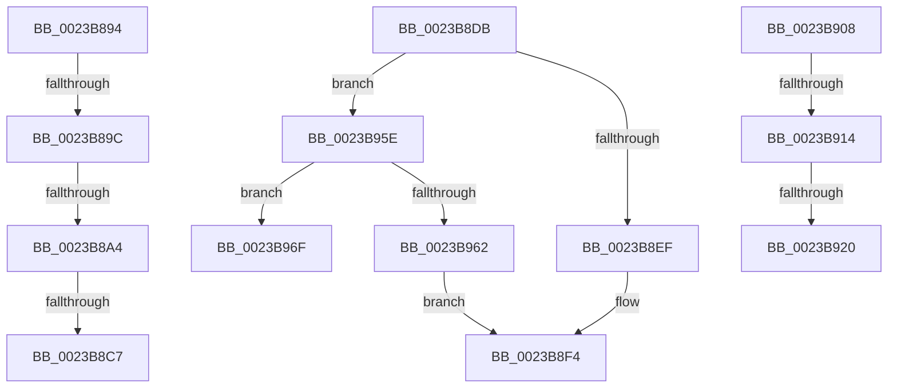

# sub_0023B894

- RVA: `0x0023B894`–`0x0023B988` (길이 `244` bytes)
- VA: `0x000000014023B894`
- 실행 섹션: `.text`
- PDB 이름 있음: `아니요`; PDB Function 태그: `아니요`
- unwind 정보 RVA: `0x00060DF4`
- 디코드: `59`개 명령, `244/244` bytes 표시
- 미해석 바이트: `0` (있으면 어셈블리에 `.byte`로 보존)

> 이 문서는 커널 이미지의 기계어와 PDB 기호를 분석해 생성했습니다. 4번과 5번은 함수 원형과 자료형을 바이너리 사용 방식에서 추정한 C 해석이며 원본 소스 복구 결과는 아닙니다.

## 1. Dependencies

- 직접 호출 지점: **3**; 고유 호출 대상: **2**
- 직접 호출자로 확인된 함수: **0**
- RIP 상대 이미지 참조: **1**

### Outgoing calls
- `0x0023B8D4` → [ExReleaseSpinLockRegardlessFromDpcLevel](ExReleaseSpinLockRegardlessFromDpcLevel_function_0023A330.md) (function, `0x0023A330`)
- `0x0023B8FE` → [KeReleaseInStackQueuedSpinLockFromDpcLevel](../21/KeReleaseInStackQueuedSpinLockFromDpcLevel_function_002171B0.md) (function, `0x002171B0`)
- `0x0023B97E` → [KeReleaseInStackQueuedSpinLockFromDpcLevel](../21/KeReleaseInStackQueuedSpinLockFromDpcLevel_function_002171B0.md) (function, `0x002171B0`)

### Direct callers
- 이 함수 시작 RVA로 연결되는 직접 call은 확인되지 않았습니다. 간접 호출은 완전히 역산할 수 없습니다.

### Static image references
- `0x0023B94E` → RVA `0x00E2F1AC` (`.data`; read)

## 2. Other-region calls and transfers

- 다른 실행 섹션으로 향하는 call: **0**
- call이 아닌 외부 분기/꼬리 이동: **9**
  - `0x0023B89A` → [sub_0023B81A + 0x3A](Unknown_function_0023B81A.md) (`tail-transfer`)
  - `0x0023B8A2` → [sub_0023B81A + 0x3A](Unknown_function_0023B81A.md) (`tail-transfer`)
  - `0x0023B8C5` → [sub_0023B81A + 0x3A](Unknown_function_0023B81A.md) (`tail-transfer`)
  - `0x0023B8D9` → [sub_0023B81A + 0x58](Unknown_function_0023B81A.md) (`tail-transfer`)
  - `0x0023B903` → [sub_0023B81A + 0x58](Unknown_function_0023B81A.md) (`tail-transfer`)
  - `0x0023B90E` → [sub_0023B81A + 0x4A](Unknown_function_0023B81A.md) (`tail-transfer`)
  - `0x0023B91A` → [sub_0023B81A + 0x4A](Unknown_function_0023B81A.md) (`tail-transfer`)
  - `0x0023B959` → [sub_0023B81A + 0x58](Unknown_function_0023B81A.md) (`tail-transfer`)
  - `0x0023B983` → [sub_0023B81A + 0x58](Unknown_function_0023B81A.md) (`tail-transfer`)

## 3. Assembly (complete function range)

```asm
0023B894  49 8B C8                        mov rcx, r8
0023B897  48 3B C1                        cmp rax, rcx
0023B89A  72 B8                           jb 0x14023b854
0023B89C  49 8B CA                        mov rcx, r10
0023B89F  48 3B C1                        cmp rax, rcx
0023B8A2  77 B0                           ja 0x14023b854
0023B8A4  65 48 8B 0C 25 88 01 00 00      mov rcx, qword ptr gs:[0x188]
0023B8AD  48 8B 91 B8 00 00 00            mov rdx, qword ptr [rcx + 0xb8]
0023B8B4  48 8B 8A 10 04 00 00            mov rcx, qword ptr [rdx + 0x410]
0023B8BB  48 8B 91 68 05 00 00            mov rdx, qword ptr [rcx + 0x568]
0023B8C2  48 85 D2                        test rdx, rdx
0023B8C5  74 8D                           je 0x14023b854
0023B8C7  48 C1 E8 03                     shr rax, 3
0023B8CB  25 FF 01 00 00                  and eax, 0x1ff
0023B8D0  48 8D 0C 82                     lea rcx, [rdx + rax*4]
0023B8D4  E8 57 EA FF FF                  call 0x14023a330
0023B8D9  EB 97                           jmp 0x14023b872
0023B8DB  65 48 8B 0C 25 20 00 00 00      mov rcx, qword ptr gs:[0x20]
0023B8E4  41 8B 81 B8 00 00 00            mov eax, dword ptr [r9 + 0xb8]
0023B8EB  24 0F                           and al, 0xf
0023B8ED  75 6F                           jne 0x14023b95e
0023B8EF  BA 30 00 00 00                  mov edx, 0x30
0023B8F4  48 81 C1 40 9C 00 00            add rcx, 0x9c40
0023B8FB  48 03 CA                        add rcx, rdx
0023B8FE  E8 AD B8 FD FF                  call 0x1402171b0
0023B903  E9 6A FF FF FF                  jmp 0x14023b872
0023B908  49 8B C8                        mov rcx, r8
0023B90B  48 3B C1                        cmp rax, rcx
0023B90E  0F 82 50 FF FF FF               jb 0x14023b864
0023B914  49 8B CA                        mov rcx, r10
0023B917  48 3B C1                        cmp rax, rcx
0023B91A  0F 87 44 FF FF FF               ja 0x14023b864
0023B920  49 8B C8                        mov rcx, r8
0023B923  48 2B C1                        sub rax, rcx
0023B926  BA 02 00 00 00                  mov edx, 2
0023B92B  48 C1 F8 03                     sar rax, 3
0023B92F  44 8D 04 00                     lea r8d, [rax + rax]
0023B933  41 8B 81 B8 00 00 00            mov eax, dword ptr [r9 + 0xb8]
0023B93A  41 8B C8                        mov ecx, r8d
0023B93D  41 8B C0                        mov eax, r8d
0023B940  83 E1 1F                        and ecx, 0x1f
0023B943  D3 E2                           shl edx, cl
0023B945  F7 D2                           not edx
0023B947  0F B3 CA                        btr edx, ecx
0023B94A  48 C1 E8 05                     shr rax, 5
0023B94E  48 8D 0D 57 38 BF 00            lea rcx, [rip + 0xbf3857]
0023B955  F0 21 14 81                     lock and dword ptr [rcx + rax*4], edx
0023B959  E9 14 FF FF FF                  jmp 0x14023b872
0023B95E  3C 07                           cmp al, 7
0023B960  74 0D                           je 0x14023b96f
0023B962  3C 05                           cmp al, 5
0023B964  BA 48 00 00 00                  mov edx, 0x48
0023B969  48 0F 44 D6                     cmove rdx, rsi
0023B96D  EB 85                           jmp 0x14023b8f4
0023B96F  BA 18 00 00 00                  mov edx, 0x18
0023B974  48 81 C1 40 9C 00 00            add rcx, 0x9c40
0023B97B  48 03 CA                        add rcx, rdx
0023B97E  E8 2D B8 FD FF                  call 0x1402171b0
0023B983  E9 EA FE FF FF                  jmp 0x14023b872
```

## 4. C-style interpretation (structured pseudocode)

```c
__int64 __fastcall sub_0023B894(__int64 a1, __int64 a2, __int64 a3, __int64 a4)
{
    __int64 result;

    result = (result) >> (3);
    result = (unsigned int)((result) & (511));
    result = ExReleaseSpinLockRegardlessFromDpcLevel(*(unsigned __int64 *)(*(unsigned __int64 *)(*(unsigned __int64 *)(*(unsigned __int64 *)(gs_base + (0 + 392)) + 184) + 1040) + 1384) + result * 4, *(unsigned __int64 *)(*(unsigned __int64 *)(*(unsigned __int64 *)(*(unsigned __int64 *)(gs_base + (0 + 392)) + 184) + 1040) + 1384), a3, a4);
}
```

## 5. (Beta) C Style

```c
int64_t sub_0023B894(int64_t Arg1, int64_t Arg2, int64_t Arg3, int64_t Arg4)
{
    int64_t result;

    result = (result) >> (3);
    result = (uint32_t)((result) & (511));
    result = ExReleaseSpinLockRegardlessFromDpcLevel(*(uint64_t *)(*(uint64_t *)(*(uint64_t *)(*(uint64_t *)(gs_base + (0 + 0x188)) + 0xB8) + 0x410) + 0x568) + result * 4, *(uint64_t *)(*(uint64_t *)(*(uint64_t *)(*(uint64_t *)(gs_base + (0 + 0x188)) + 0xB8) + 0x410) + 0x568), Arg3, Arg4);
}
```

## 6. Execution-region graph

[열기: 2D/3D 그래프와 함수 탐색 컨트롤 패널](../../../control-panel.html?section=text&rva=0x0023B894&view=graph)

- 2D 그래프는 위에서 아래로 흐르고, 3D 그래프는 빈 공간을 드래그해 회전합니다. Shift+드래그는 이동, 휠은 확대·축소, 함수 노드 선택은 대상 보고서 이동입니다.

### Static fallback


