# sub_0023C21A

- RVA: `0x0023C21A`–`0x0023C4C9` (길이 `687` bytes)
- VA: `0x000000014023C21A`
- 실행 섹션: `.text`
- PDB 이름 있음: `아니요`; PDB Function 태그: `아니요`
- unwind 정보 RVA: `0x00060E8C`
- 디코드: `157`개 명령, `687/687` bytes 표시
- 미해석 바이트: `0` (있으면 어셈블리에 `.byte`로 보존)

> 이 문서는 커널 이미지의 기계어와 PDB 기호를 분석해 생성했습니다. 4번과 5번은 함수 원형과 자료형을 바이너리 사용 방식에서 추정한 C 해석이며 원본 소스 복구 결과는 아닙니다.

## 1. Dependencies

- 직접 호출 지점: **0**; 고유 호출 대상: **0**
- 직접 호출자로 확인된 함수: **0**
- RIP 상대 이미지 참조: **2**

### Outgoing calls
- 직접 디코드된 call 명령이 없습니다.

### Direct callers
- 이 함수 시작 RVA로 연결되는 직접 call은 확인되지 않았습니다. 간접 호출은 완전히 역산할 수 없습니다.

### Static image references
- `0x0023C366` → RVA `0x00E30088` (`.data`; read)
- `0x0023C378` → RVA `0x00E38D00` (`.data`; read)

## 2. Other-region calls and transfers

- 다른 실행 섹션으로 향하는 call: **0**
- call이 아닌 외부 분기/꼬리 이동: **17**
  - `0x0023C237` → [sub_0023C5C6](Unknown_function_0023C5C6.md) (`tail-transfer`)
  - `0x0023C265` → [sub_0023C4F0](Unknown_function_0023C4F0.md) (`tail-transfer`)
  - `0x0023C273` → [sub_0023C79B](Unknown_function_0023C79B.md) (`tail-transfer`)
  - `0x0023C27F` → [sub_0023C79B](Unknown_function_0023C79B.md) (`tail-transfer`)
  - `0x0023C29F` → [sub_0023C62B + 0x65](Unknown_function_0023C62B.md) (`tail-transfer`)
  - `0x0023C2F5` → [sub_0023C50F + 0x95](Unknown_function_0023C50F.md) (`tail-transfer`)
  - `0x0023C2FE` → [sub_0023C62B + 0x84](Unknown_function_0023C62B.md) (`tail-transfer`)
  - `0x0023C319` → [sub_0023C62B](Unknown_function_0023C62B.md) (`tail-transfer`)
  - `0x0023C35C` → [sub_0023C62B + 0x10](Unknown_function_0023C62B.md) (`tail-transfer`)
  - `0x0023C382` → [sub_0023C6E5 + 0x31](Unknown_function_0023C6E5.md) (`tail-transfer`)
  - `0x0023C39D` → [sub_0023C6E5 + 0x31](Unknown_function_0023C6E5.md) (`tail-transfer`)
  - `0x0023C3DB` → [sub_0023C62B + 0x65](Unknown_function_0023C62B.md) (`tail-transfer`)
  - `0x0023C3E8` → [sub_0023C6E5 + 0x66](Unknown_function_0023C6E5.md) (`tail-transfer`)
  - `0x0023C473` → [sub_0023C50F + 0x36](Unknown_function_0023C50F.md) (`tail-transfer`)
  - `0x0023C48C` → [sub_0023C50F](Unknown_function_0023C50F.md) (`tail-transfer`)
  - `0x0023C4A2` → [sub_0023C4C9](Unknown_function_0023C4C9.md) (`tail-transfer`)
  - `0x0023C4C4` → [MiProbeLockFrame + 0x5D](MiProbeLockFrame_function_0023C1B0.md) (`tail-transfer`)

## 3. Assembly (complete function range)

```asm
0023C21A  48 89 5C 24 68                  mov qword ptr [rsp + 0x68], rbx
0023C21F  24 0F                           and al, 0xf
0023C221  48 89 6C 24 70                  mov qword ptr [rsp + 0x70], rbp
0023C226  4C 89 64 24 78                  mov qword ptr [rsp + 0x78], r12
0023C22B  48 BB 00 00 00 00 80 F6 FF FF   movabs rbx, 0xfffff68000000000
0023C235  3C 04                           cmp al, 4
0023C237  0F 84 89 03 00 00               je 0x14023c5c6
0023C23D  48 8B 87 88 00 00 00            mov rax, qword ptr [rdi + 0x88]
0023C244  49 BC 00 00 00 00 00 DE FF FF   movabs r12, 0xffffde0000000000
0023C24E  48 8D 1C 40                     lea rbx, [rax + rax*2]
0023C252  48 C1 E3 04                     shl rbx, 4
0023C256  49 8B C4                        mov rax, r12
0023C259  48 03 D8                        add rbx, rax
0023C25C  8B EE                           mov ebp, esi
0023C25E  F0 48 0F BA 6B 18 3F            lock bts qword ptr [rbx + 0x18], 0x3f
0023C265  0F 82 85 02 00 00               jb 0x14023c4f0
0023C26B  0F B6 43 22                     movzx eax, byte ptr [rbx + 0x22]
0023C26F  24 07                           and al, 7
0023C271  3C 01                           cmp al, 1
0023C273  0F 86 22 05 00 00               jbe 0x14023c79b
0023C279  8B 43 20                        mov eax, dword ptr [rbx + 0x20]
0023C27C  66 85 C0                        test ax, ax
0023C27F  0F 84 16 05 00 00               je 0x14023c79b
0023C285  8B 43 20                        mov eax, dword ptr [rbx + 0x20]
0023C288  B9 FF 7F 00 00                  mov ecx, 0x7fff
0023C28D  4C 89 6C 24 40                  mov qword ptr [rsp + 0x40], r13
0023C292  4C 89 74 24 38                  mov qword ptr [rsp + 0x38], r14
0023C297  4C 89 7C 24 30                  mov qword ptr [rsp + 0x30], r15
0023C29C  66 3B C1                        cmp ax, cx
0023C29F  0F 83 EB 03 00 00               jae 0x14023c690
0023C2A5  48 8B 43 28                     mov rax, qword ptr [rbx + 0x28]
0023C2A9  49 BE 00 00 00 00 00 01 00 00   movabs r14, 0x10000000000
0023C2B3  41 BF 01 00 00 00               mov r15d, 1
0023C2B9  BD FF 03 00 00                  mov ebp, 0x3ff
0023C2BE  45 8B C7                        mov r8d, r15d
0023C2C1  49 BD FF FF FF FF FF FF FF 3F   movabs r13, 0x3fffffffffffffff
0023C2CB  49 85 C6                        test r14, rax
0023C2CE  0F 85 EE 00 00 00               jne 0x14023c3c2
0023C2D4  48 0F BA 63 28 35               bt qword ptr [rbx + 0x28], 0x35
0023C2DA  0F 82 E2 00 00 00               jb 0x14023c3c2
0023C2E0  8B 53 20                        mov edx, dword ptr [rbx + 0x20]
0023C2E3  8B CE                           mov ecx, esi
0023C2E5  48 8B 43 18                     mov rax, qword ptr [rbx + 0x18]
0023C2E9  49 23 C5                        and rax, r13
0023C2EC  66 85 D2                        test dx, dx
0023C2EF  74 1E                           je 0x14023c30f
0023C2F1  66 41 3B D7                     cmp dx, r15w
0023C2F5  0F 85 A9 02 00 00               jne 0x14023c5a4
0023C2FB  48 85 C0                        test rax, rax
0023C2FE  0F 84 AB 03 00 00               je 0x14023c6af
0023C304  41 8B CF                        mov ecx, r15d
0023C307  85 C9                           test ecx, ecx
0023C309  0F 84 B3 00 00 00               je 0x14023c3c2
0023C30F  48 8B 43 28                     mov rax, qword ptr [rbx + 0x28]
0023C313  45 32 F6                        xor r14b, r14b
0023C316  48 85 C0                        test rax, rax
0023C319  0F 88 0C 03 00 00               js 0x14023c62b
0023C31F  48 8B 4B 08                     mov rcx, qword ptr [rbx + 8]
0023C323  49 B8 00 00 00 00 80 F6 FF FF   movabs r8, 0xfffff68000000000
0023C32D  49 8B C0                        mov rax, r8
0023C330  48 BA 78 FF FF FF 3F 00 00 00   movabs rdx, 0x3fffffff78
0023C33A  48 03 C2                        add rax, rdx
0023C33D  48 BA 00 00 00 00 00 00 00 80   movabs rdx, 0x8000000000000000
0023C347  48 0B CA                        or rcx, rdx
0023C34A  48 3B C8                        cmp rcx, rax
0023C34D  77 13                           ja 0x14023c362
0023C34F  48 8B 4B 08                     mov rcx, qword ptr [rbx + 8]
0023C353  48 0B CA                        or rcx, rdx
0023C356  49 8B C0                        mov rax, r8
0023C359  48 3B C8                        cmp rcx, rax
0023C35C  0F 83 D9 02 00 00               jae 0x14023c63b
0023C362  48 8B 4B 28                     mov rcx, qword ptr [rbx + 0x28]
0023C366  48 8B 05 1B 3D BF 00            mov rax, qword ptr [rip + 0xbf3d1b]
0023C36D  48 C1 E9 2B                     shr rcx, 0x2b
0023C371  48 23 CD                        and rcx, rbp
0023C374  48 8B 2C C8                     mov rbp, qword ptr [rax + rcx*8]
0023C378  48 8D 05 81 C9 BF 00            lea rax, [rip + 0xbfc981]
0023C37F  48 3B E8                        cmp rbp, rax
0023C382  0F 85 8E 03 00 00               jne 0x14023c716
0023C388  65 48 8B 14 25 20 00 00 00      mov rdx, qword ptr gs:[0x20]
0023C391  8B 82 9C 8B 00 00               mov eax, dword ptr [rdx + 0x8b9c]
0023C397  8D 48 FF                        lea ecx, [rax - 1]
0023C39A  83 F9 FD                        cmp ecx, -3
0023C39D  0F 87 73 03 00 00               ja 0x14023c716
0023C3A3  8D 48 FF                        lea ecx, [rax - 1]
0023C3A6  F0 0F B1 8A 9C 8B 00 00         lock cmpxchg dword ptr [rdx + 0x8b9c], ecx
0023C3AE  75 E7                           jne 0x14023c397
0023C3B0  45 8B C7                        mov r8d, r15d
0023C3B3  49 BE 00 00 00 00 00 01 00 00   movabs r14, 0x10000000000
0023C3BD  BD FF 03 00 00                  mov ebp, 0x3ff
0023C3C2  8B 43 20                        mov eax, dword ptr [rbx + 0x20]
0023C3C5  89 44 24 60                     mov dword ptr [rsp + 0x60], eax
0023C3C9  66 FF C0                        inc ax
0023C3CC  66 89 44 24 60                  mov word ptr [rsp + 0x60], ax
0023C3D1  8B 44 24 60                     mov eax, dword ptr [rsp + 0x60]
0023C3D5  89 43 20                        mov dword ptr [rbx + 0x20], eax
0023C3D8  45 85 C0                        test r8d, r8d
0023C3DB  0F 84 AF 02 00 00               je 0x14023c690
0023C3E1  48 8B 43 18                     mov rax, qword ptr [rbx + 0x18]
0023C3E5  49 85 C5                        test r13, rax
0023C3E8  0F 84 5D 03 00 00               je 0x14023c74b
0023C3EE  8B 43 20                        mov eax, dword ptr [rbx + 0x20]
0023C3F1  C1 E8 10                        shr eax, 0x10
0023C3F4  A8 20                           test al, 0x20
0023C3F6  74 18                           je 0x14023c410
0023C3F8  A8 08                           test al, 8
0023C3FA  75 14                           jne 0x14023c410
0023C3FC  48 8B 43 18                     mov rax, qword ptr [rbx + 0x18]
0023C400  49 85 C5                        test r13, rax
0023C403  75 0B                           jne 0x14023c410
0023C405  48 8B 03                        mov rax, qword ptr [rbx]
0023C408  F0 48 FF 80 E8 00 00 00         lock inc qword ptr [rax + 0xe8]
0023C410  48 BD FF FF FF FF FF FF FF 7F   movabs rbp, 0x7fffffffffffffff
0023C41A  F0 48 21 6B 18                  lock and qword ptr [rbx + 0x18], rbp
0023C41F  8B 47 48                        mov eax, dword ptr [rdi + 0x48]
0023C422  24 0F                           and al, 0xf
0023C424  41 3A C7                        cmp al, r15b
0023C427  75 50                           jne 0x14023c479
0023C429  48 8B 43 28                     mov rax, qword ptr [rbx + 0x28]
0023C42D  49 85 C6                        test r14, rax
0023C430  75 47                           jne 0x14023c479
0023C432  48 8B 43 28                     mov rax, qword ptr [rbx + 0x28]
0023C436  48 C1 E8 3C                     shr rax, 0x3c
0023C43A  24 07                           and al, 7
0023C43C  41 3A C7                        cmp al, r15b
0023C43F  74 38                           je 0x14023c479
0023C441  48 8B 43 28                     mov rax, qword ptr [rbx + 0x28]
0023C445  49 BE FF FF FF FF FF 00 00 00   movabs r14, 0xffffffffff
0023C44F  49 23 C6                        and rax, r14
0023C452  48 B9 FE FF FF FF 3F 00 00 00   movabs rcx, 0x3ffffffffe
0023C45C  48 3B C1                        cmp rax, rcx
0023C45F  74 18                           je 0x14023c479
0023C461  48 8B 43 28                     mov rax, qword ptr [rbx + 0x28]
0023C465  48 8B 43 28                     mov rax, qword ptr [rbx + 0x28]
0023C469  49 23 C6                        and rax, r14
0023C46C  48 39 87 90 00 00 00            cmp qword ptr [rdi + 0x90], rax
0023C473  0F 85 CC 00 00 00               jne 0x14023c545
0023C479  48 8B 47 40                     mov rax, qword ptr [rdi + 0x40]
0023C47D  0F B6 48 0A                     movzx ecx, byte ptr [rax + 0xa]
0023C481  84 C9                           test cl, cl
0023C483  79 0D                           jns 0x14023c492
0023C485  48 8B 43 28                     mov rax, qword ptr [rbx + 0x28]
0023C489  48 85 C0                        test rax, rax
0023C48C  0F 88 7D 00 00 00               js 0x14023c50f
0023C492  48 8B 43 28                     mov rax, qword ptr [rbx + 0x28]
0023C496  B9 FF 03 00 00                  mov ecx, 0x3ff
0023C49B  48 C1 E8 2B                     shr rax, 0x2b
0023C49F  66 85 C1                        test cx, ax
0023C4A2  75 25                           jne 0x14023c4c9
0023C4A4  33 C0                           xor eax, eax
0023C4A6  4C 8B 74 24 38                  mov r14, qword ptr [rsp + 0x38]
0023C4AB  4C 8B 6C 24 40                  mov r13, qword ptr [rsp + 0x40]
0023C4B0  4C 8B 7C 24 30                  mov r15, qword ptr [rsp + 0x30]
0023C4B5  48 8B 6C 24 70                  mov rbp, qword ptr [rsp + 0x70]
0023C4BA  4C 8B 64 24 78                  mov r12, qword ptr [rsp + 0x78]
0023C4BF  48 8B 5C 24 68                  mov rbx, qword ptr [rsp + 0x68]
0023C4C4  E9 44 FD FF FF                  jmp 0x14023c20d
```

## 4. C-style interpretation (structured pseudocode)

```c
__int64 __fastcall sub_0023C21A(__int64 a1, __int64 a2, __int64 a3, __int64 a4, __int64 a5, __int64 a6, __int64 a7, __int64 a8, __int64 a9, __int64 a10, __int64 a11, unsigned int a12, __int64 a13, __int64 a14, __int64 a15)
{
    __int64 result;
    __int64 v_r14;
    __int64 v_rbx;
    unsigned __int64 v_stack_p30;
    unsigned __int64 v_stack_p38;
    unsigned __int64 v_stack_p40;
    unsigned int v_stack_p60;
    unsigned __int64 v_stack_p68;
    unsigned __int64 v_stack_p70;
    unsigned __int64 v_stack_p78;

    v_stack_p68 = v_rbx;
    result = (unsigned __int8)((result) & (15));
    v_stack_p70 = v_rbp;
    v_stack_p78 = v_r12;
    v_rbx = (*(unsigned __int64 *)(v_rdi + 136) + *(unsigned __int64 *)(v_rdi + 136) * 2) << (4);
    v_rbx = (v_rbx) + (v_r12);
    result = (unsigned __int8)((*(unsigned __int8 *)(v_rbx + 34)) & (7));
    v_stack_p40 = v_r13;
    v_stack_p38 = v_r14;
    v_stack_p30 = v_r15;
    if (((v_r14) & (*(unsigned __int64 *)(v_rbx + 40))) != 0) goto loc_0023C3C2;
    if (condition_is_below) goto loc_0023C3C2;
    result = (*(unsigned __int64 *)(v_rbx + 24)) & (v_r13);
    if ((unsigned __int16)((unsigned int)(*(unsigned int *)(v_rbx + 32))) == 0) goto loc_0023C30F;
    if (1 == 0) goto loc_0023C3C2;
loc_0023C30F:
    v_r14 = 0;
    result = (1) + ((unsigned int)(*(unsigned int *)(v_rbx + 32)));
    a1 = (*(unsigned __int64 *)(v_rbx + 8)) | ((unsigned int)(*(unsigned int *)(v_rbx + 32)));
    if (a1 > result) goto loc_0023C362;
    a1 = (*(unsigned __int64 *)(v_rbx + 8)) | ((unsigned int)(*(unsigned int *)(v_rbx + 32)));
loc_0023C362:
    a1 = (*(unsigned __int64 *)(v_rbx + 40)) >> (43);
    a1 = (a1) & ((unsigned int)(0x3FFULL));
loc_0023C397:
    if (((unsigned int)((unsigned int)(*(unsigned int *)(*(unsigned __int64 *)(gs_base + (0 + 32)) + 35740)) - 1)) != -3) goto loc_0023C397;
loc_0023C3C2:
    v_stack_p60 = (unsigned int)((unsigned int)(*(unsigned int *)(v_rbx + 32)));
    result = (unsigned __int16)(((unsigned int)(*(unsigned int *)(v_rbx + 32))) + 1);
    v_stack_p60 = (unsigned __int16)(result);
    *(unsigned int *)(v_rbx + 32) = (unsigned int)((unsigned int)(a12));
    result = (unsigned int)(((unsigned int)(*(unsigned int *)(v_rbx + 32))) >> (16));
    if ((((unsigned __int8)(result)) & (32)) == 0) goto loc_0023C410;
    if ((((unsigned __int8)(result)) & (8)) != 0) goto loc_0023C410;
    result = *(unsigned __int64 *)(v_rbx + 24);
    if (((v_r13) & (*(unsigned __int64 *)(v_rbx + 24))) == 0) {
        result = *(unsigned __int64 *)(v_rbx);
    }
    result = (unsigned __int8)(((unsigned int)(*(unsigned int *)(v_rdi + 72))) & (15));
    if (((unsigned __int8)(result)) != 1) goto loc_0023C479;
    if (((0) & (*(unsigned __int64 *)(v_rbx + 40))) != 0) goto loc_0023C479;
    result = (*(unsigned __int64 *)(v_rbx + 40)) >> (60);
    result = (unsigned __int8)((result) & (7));
    if (((unsigned __int8)(result)) == 1) goto loc_0023C479;
    result = (*(unsigned __int64 *)(v_rbx + 40)) & (0);
    if (result == ((unsigned int)(*(unsigned int *)(*(unsigned __int64 *)(gs_base + (0 + 32)) + 35740)) - 1)) goto loc_0023C479;
    result = (*(unsigned __int64 *)(v_rbx + 40)) & (0);
loc_0023C479:
    if (!sign_flag) goto loc_0023C492;
loc_0023C492:
    result = (*(unsigned __int64 *)(v_rbx + 40)) >> (43);
    result = 0;
}
```

## 5. (Beta) C Style

```c
int64_t sub_0023C21A(int64_t Arg1, int64_t Arg2, int64_t Arg3, int64_t Arg4, uint64_t Arg5, int64_t Arg6, int64_t Arg7, int64_t Arg8, uint64_t Arg9, uint64_t Arg10, uint64_t Arg11, uint32_t Arg12, int64_t Arg13, int64_t Arg14, int64_t Arg15)
{
    int64_t result;
    int64_t local_r14;
    int64_t local_rbx;
    uint64_t v_stack_p30;
    uint64_t v_stack_p38;
    uint64_t v_stack_p40;
    uint32_t v_stack_p60;
    uint64_t v_stack_p68;
    uint64_t v_stack_p70;
    uint64_t v_stack_p78;

    v_stack_p68 = local_rbx;
    result = (uint8_t)((result) & (15));
    v_stack_p70 = local_rbp;
    v_stack_p78 = local_r12;
    local_rbx = (*(uint64_t *)(local_rdi + 0x88) + *(uint64_t *)(local_rdi + 0x88) * 2) << (4);
    local_rbx = (local_rbx) + (local_r12);
    result = (uint8_t)((*(uint8_t *)(local_rbx + 0x22)) & (7));
    v_stack_p40 = local_r13;
    v_stack_p38 = local_r14;
    v_stack_p30 = local_r15;
    if (((local_r14) & (*(uint64_t *)(local_rbx + 0x28))) != 0) goto loc_0023C3C2;
    if (condition_is_below) goto loc_0023C3C2;
    result = (*(uint64_t *)(local_rbx + 0x18)) & (local_r13);
    if ((uint16_t)((uint32_t)(*(uint32_t *)(local_rbx + 0x20))) == 0) goto loc_0023C30F;
    if (1 == 0) goto loc_0023C3C2;
loc_0023C30F:
    local_r14 = 0;
    result = (1) + ((uint32_t)(*(uint32_t *)(local_rbx + 0x20)));
    Arg1 = (*(uint64_t *)(local_rbx + 0x8)) | ((uint32_t)(*(uint32_t *)(local_rbx + 0x20)));
    if (Arg1 > result) goto loc_0023C362;
    Arg1 = (*(uint64_t *)(local_rbx + 0x8)) | ((uint32_t)(*(uint32_t *)(local_rbx + 0x20)));
loc_0023C362:
    Arg1 = (*(uint64_t *)(local_rbx + 0x28)) >> (43);
    Arg1 = (Arg1) & ((uint32_t)(0x3FFULL));
loc_0023C397:
    if (((uint32_t)((uint32_t)(*(uint32_t *)(*(uint64_t *)(gs_base + (0 + 0x20)) + 0x8B9C)) - 1)) != -3) goto loc_0023C397;
loc_0023C3C2:
    v_stack_p60 = (uint32_t)((uint32_t)(*(uint32_t *)(local_rbx + 0x20)));
    result = (uint16_t)(((uint32_t)(*(uint32_t *)(local_rbx + 0x20))) + 1);
    v_stack_p60 = (uint16_t)(result);
    *(uint32_t *)(local_rbx + 0x20) = (uint32_t)((uint32_t)(Arg12));
    result = (uint32_t)(((uint32_t)(*(uint32_t *)(local_rbx + 0x20))) >> (16));
    if ((((uint8_t)(result)) & (32)) == 0) goto loc_0023C410;
    if ((((uint8_t)(result)) & (8)) != 0) goto loc_0023C410;
    result = *(uint64_t *)(local_rbx + 0x18);
    if (((local_r13) & (*(uint64_t *)(local_rbx + 0x18))) == 0) {
        result = *(uint64_t *)(local_rbx);
    }
    result = (uint8_t)(((uint32_t)(*(uint32_t *)(local_rdi + 0x48))) & (15));
    if (((uint8_t)(result)) != 1) goto loc_0023C479;
    if (((0) & (*(uint64_t *)(local_rbx + 0x28))) != 0) goto loc_0023C479;
    result = (*(uint64_t *)(local_rbx + 0x28)) >> (60);
    result = (uint8_t)((result) & (7));
    if (((uint8_t)(result)) == 1) goto loc_0023C479;
    result = (*(uint64_t *)(local_rbx + 0x28)) & (0);
    if (result == ((uint32_t)(*(uint32_t *)(*(uint64_t *)(gs_base + (0 + 0x20)) + 0x8B9C)) - 1)) goto loc_0023C479;
    result = (*(uint64_t *)(local_rbx + 0x28)) & (0);
loc_0023C479:
    if (!sign_flag) goto loc_0023C492;
loc_0023C492:
    result = (*(uint64_t *)(local_rbx + 0x28)) >> (43);
    result = 0;
}
```

## 6. Execution-region graph

[열기: 2D/3D 그래프와 함수 탐색 컨트롤 패널](../../../control-panel.html?section=text&rva=0x0023C21A&view=graph)

- 2D 그래프는 위에서 아래로 흐르고, 3D 그래프는 빈 공간을 드래그해 회전합니다. Shift+드래그는 이동, 휠은 확대·축소, 함수 노드 선택은 대상 보고서 이동입니다.

### Static fallback

```mermaid
flowchart TD
  bb_0023C21A[BB_0023C21A]
  bb_0023C23D[BB_0023C23D]
  bb_0023C26B[BB_0023C26B]
  bb_0023C279[BB_0023C279]
  bb_0023C285[BB_0023C285]
  bb_0023C2A5[BB_0023C2A5]
  bb_0023C2D4[BB_0023C2D4]
  bb_0023C2E0[BB_0023C2E0]
  bb_0023C2F1[BB_0023C2F1]
  bb_0023C2FB[BB_0023C2FB]
  bb_0023C304[BB_0023C304]
  bb_0023C30F[BB_0023C30F]
  bb_0023C31F[BB_0023C31F]
  bb_0023C34F[BB_0023C34F]
  bb_0023C362[BB_0023C362]
  bb_0023C388[BB_0023C388]
  bb_0023C397[BB_0023C397]
  bb_0023C3A3[BB_0023C3A3]
  bb_0023C3B0[BB_0023C3B0]
  bb_0023C3C2[BB_0023C3C2]
  bb_0023C3E1[BB_0023C3E1]
  bb_0023C3EE[BB_0023C3EE]
  bb_0023C3F8[BB_0023C3F8]
  bb_0023C3FC[BB_0023C3FC]
  bb_0023C405[BB_0023C405]
  bb_0023C410[BB_0023C410]
  bb_0023C429[BB_0023C429]
  bb_0023C432[BB_0023C432]
  bb_0023C441[BB_0023C441]
  bb_0023C461[BB_0023C461]
  bb_0023C479[BB_0023C479]
  bb_0023C485[BB_0023C485]
  bb_0023C492[BB_0023C492]
  bb_0023C4A4[BB_0023C4A4]
  bb_0023C21A -->|fallthrough| bb_0023C23D
  bb_0023C23D -->|fallthrough| bb_0023C26B
  bb_0023C26B -->|fallthrough| bb_0023C279
  bb_0023C279 -->|fallthrough| bb_0023C285
  bb_0023C285 -->|fallthrough| bb_0023C2A5
  bb_0023C2A5 -->|branch| bb_0023C3C2
  bb_0023C2A5 -->|fallthrough| bb_0023C2D4
  bb_0023C2D4 -->|branch| bb_0023C3C2
  bb_0023C2D4 -->|fallthrough| bb_0023C2E0
  bb_0023C2E0 -->|branch| bb_0023C30F
  bb_0023C2E0 -->|fallthrough| bb_0023C2F1
  bb_0023C2F1 -->|fallthrough| bb_0023C2FB
  bb_0023C2FB -->|fallthrough| bb_0023C304
  bb_0023C304 -->|branch| bb_0023C3C2
  bb_0023C304 -->|fallthrough| bb_0023C30F
  bb_0023C30F -->|fallthrough| bb_0023C31F
  bb_0023C31F -->|branch| bb_0023C362
  bb_0023C31F -->|fallthrough| bb_0023C34F
  bb_0023C34F -->|fallthrough| bb_0023C362
  bb_0023C362 -->|fallthrough| bb_0023C388
  bb_0023C388 -->|flow| bb_0023C397
  bb_0023C397 -->|fallthrough| bb_0023C3A3
  bb_0023C3A3 -->|branch| bb_0023C397
  bb_0023C3A3 -->|fallthrough| bb_0023C3B0
  bb_0023C3B0 -->|flow| bb_0023C3C2
  bb_0023C3C2 -->|fallthrough| bb_0023C3E1
  bb_0023C3E1 -->|fallthrough| bb_0023C3EE
  bb_0023C3EE -->|branch| bb_0023C410
  bb_0023C3EE -->|fallthrough| bb_0023C3F8
  bb_0023C3F8 -->|branch| bb_0023C410
  bb_0023C3F8 -->|fallthrough| bb_0023C3FC
  bb_0023C3FC -->|branch| bb_0023C410
  bb_0023C3FC -->|fallthrough| bb_0023C405
  bb_0023C405 -->|flow| bb_0023C410
  bb_0023C410 -->|branch| bb_0023C479
  bb_0023C410 -->|fallthrough| bb_0023C429
  bb_0023C429 -->|branch| bb_0023C479
  bb_0023C429 -->|fallthrough| bb_0023C432
  bb_0023C432 -->|branch| bb_0023C479
  bb_0023C432 -->|fallthrough| bb_0023C441
  bb_0023C441 -->|branch| bb_0023C479
  bb_0023C441 -->|fallthrough| bb_0023C461
  bb_0023C461 -->|fallthrough| bb_0023C479
  bb_0023C479 -->|branch| bb_0023C492
  bb_0023C479 -->|fallthrough| bb_0023C485
  bb_0023C485 -->|fallthrough| bb_0023C492
  bb_0023C492 -->|fallthrough| bb_0023C4A4
```


