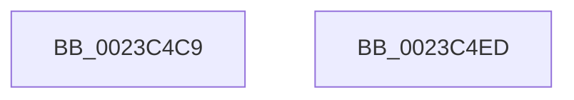

# sub_0023C4C9

- RVA: `0x0023C4C9`–`0x0023C4F0` (길이 `39` bytes)
- VA: `0x000000014023C4C9`
- 실행 섹션: `.text`
- PDB 이름 있음: `아니요`; PDB Function 태그: `아니요`
- unwind 정보 RVA: `0x00060EB4`
- 디코드: `9`개 명령, `39/39` bytes 표시
- 미해석 바이트: `0` (있으면 어셈블리에 `.byte`로 보존)

> 이 문서는 커널 이미지의 기계어와 PDB 기호를 분석해 생성했습니다. 4번과 5번은 함수 원형과 자료형을 바이너리 사용 방식에서 추정한 C 해석이며 원본 소스 복구 결과는 아닙니다.

## 1. Dependencies

- 직접 호출 지점: **1**; 고유 호출 대상: **1**
- 직접 호출자로 확인된 함수: **0**
- RIP 상대 이미지 참조: **1**

### Outgoing calls
- `0x0023C4E6` → [ExAcquireRundownProtectionCacheAware](ExAcquireRundownProtectionCacheAware_function_0023D110.md) (function, `0x0023D110`)

### Direct callers
- 이 함수 시작 RVA로 연결되는 직접 call은 확인되지 않았습니다. 간접 호출은 완전히 역산할 수 없습니다.

### Static image references
- `0x0023C4D4` → RVA `0x00E30088` (`.data`; read)

## 2. Other-region calls and transfers

- 다른 실행 섹션으로 향하는 call: **0**
- call이 아닌 외부 분기/꼬리 이동: **1**
  - `0x0023C4EB` → [sub_0023C21A + 0x28A](Unknown_function_0023C21A.md) (`tail-transfer`)

## 3. Assembly (complete function range)

```asm
0023C4C9  48 8B 43 28                     mov rax, qword ptr [rbx + 0x28]
0023C4CD  48 C1 E8 2B                     shr rax, 0x2b
0023C4D1  48 23 C1                        and rax, rcx
0023C4D4  48 8B 0D AD 3B BF 00            mov rcx, qword ptr [rip + 0xbf3bad]
0023C4DB  48 8B 0C C1                     mov rcx, qword ptr [rcx + rax*8]
0023C4DF  48 8B 89 F0 0A 00 00            mov rcx, qword ptr [rcx + 0xaf0]
0023C4E6  E8 25 0C 00 00                  call 0x14023d110
0023C4EB  EB B7                           jmp 0x14023c4a4
0023C4ED  0F 1F 00                        nop dword ptr [rax]
```

## 4. C-style interpretation (structured pseudocode)

```c
__int64 __fastcall sub_0023C4C9(__int64 a1)
{
    __int64 result;

    result = (*(unsigned __int64 *)(v_rbx + 40)) >> (43);
    result = (result) & (a1);
    result = ExAcquireRundownProtectionCacheAware(*(unsigned __int64 *)(*(unsigned __int64 *)(*(unsigned __int64 *)(v_rip + 12532653) + result * 8) + 2800), a2, a3, a4);
}
```

## 5. (Beta) C Style

```c
int64_t sub_0023C4C9(int64_t Arg1)
{
    int64_t result;

    result = (*(uint64_t *)(local_rbx + 0x28)) >> (43);
    result = (result) & (Arg1);
    result = ExAcquireRundownProtectionCacheAware(*(uint64_t *)(*(uint64_t *)(*(uint64_t *)(v_rip + 0xBF3BAD) + result * 8) + 0xAF0), a2, a3, a4);
}
```

## 6. Execution-region graph

[열기: 2D/3D 그래프와 함수 탐색 컨트롤 패널](../../../control-panel.html?section=text&rva=0x0023C4C9&view=graph)

- 2D 그래프는 위에서 아래로 흐르고, 3D 그래프는 빈 공간을 드래그해 회전합니다. Shift+드래그는 이동, 휠은 확대·축소, 함수 노드 선택은 대상 보고서 이동입니다.

### Static fallback


