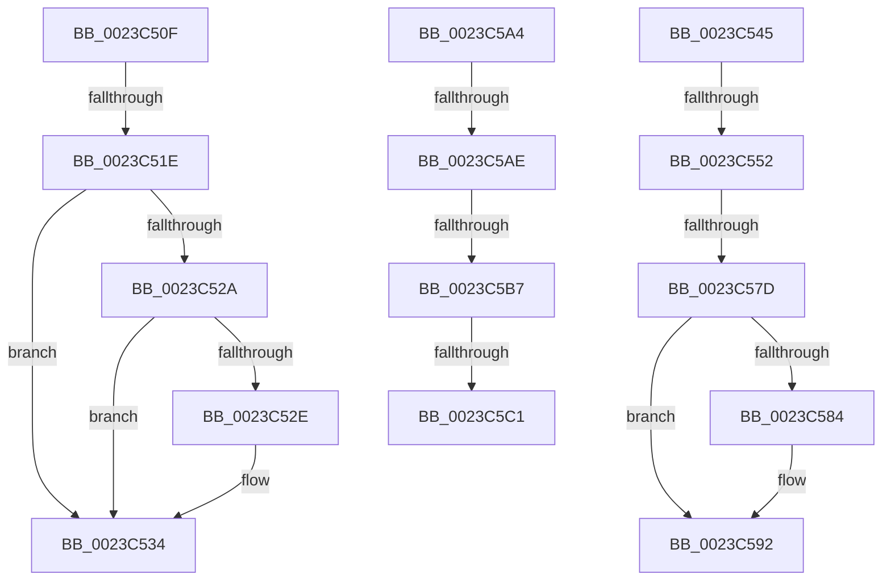

# sub_0023C50F

- RVA: `0x0023C50F`–`0x0023C5C6` (길이 `183` bytes)
- VA: `0x000000014023C50F`
- 실행 섹션: `.text`
- PDB 이름 있음: `아니요`; PDB Function 태그: `아니요`
- unwind 정보 RVA: `0x00060EF8`
- 디코드: `45`개 명령, `183/183` bytes 표시
- 미해석 바이트: `0` (있으면 어셈블리에 `.byte`로 보존)

> 이 문서는 커널 이미지의 기계어와 PDB 기호를 분석해 생성했습니다. 4번과 5번은 함수 원형과 자료형을 바이너리 사용 방식에서 추정한 C 해석이며 원본 소스 복구 결과는 아닙니다.

## 1. Dependencies

- 직접 호출 지점: **1**; 고유 호출 대상: **1**
- 직접 호출자로 확인된 함수: **0**
- RIP 상대 이미지 참조: **1**

### Outgoing calls
- `0x0023C570` → [MiLockPageTablePage](MiLockPageTablePage_function_0023E120.md) (function, `0x0023E120`)

### Direct callers
- 이 함수 시작 RVA로 연결되는 직접 call은 확인되지 않았습니다. 간접 호출은 완전히 역산할 수 없습니다.

### Static image references
- `0x0023C51E` → RVA `0x00E2DC80` (`.data`; read)

## 2. Other-region calls and transfers

- 다른 실행 섹션으로 향하는 call: **0**
- call이 아닌 외부 분기/꼬리 이동: **9**
  - `0x0023C518` → [sub_0023C21A + 0x278](Unknown_function_0023C21A.md) (`tail-transfer`)
  - `0x0023C540` → [sub_0023C21A + 0x278](Unknown_function_0023C21A.md) (`tail-transfer`)
  - `0x0023C54C` → [sub_0023C6E5](Unknown_function_0023C6E5.md) (`tail-transfer`)
  - `0x0023C577` → [sub_0023C6E5 + 0xB](Unknown_function_0023C6E5.md) (`tail-transfer`)
  - `0x0023C59F` → [sub_0023C21A + 0x25F](Unknown_function_0023C21A.md) (`tail-transfer`)
  - `0x0023C5A8` → [sub_0023C21A + 0x1A8](Unknown_function_0023C21A.md) (`tail-transfer`)
  - `0x0023C5B1` → [sub_0023C21A + 0x1A8](Unknown_function_0023C21A.md) (`tail-transfer`)
  - `0x0023C5BB` → [sub_0023C21A + 0x1A8](Unknown_function_0023C21A.md) (`tail-transfer`)
  - `0x0023C5C1` → [sub_0023C21A + 0xF5](Unknown_function_0023C21A.md) (`tail-transfer`)

## 3. Assembly (complete function range)

```asm
0023C50F  48 8B 43 10                     mov rax, qword ptr [rbx + 0x10]
0023C513  48 0F BA E0 0A                  bt rax, 0xa
0023C518  0F 83 74 FF FF FF               jae 0x14023c492
0023C51E  48 8B 0D 5B 17 BF 00            mov rcx, qword ptr [rip + 0xbf175b]
0023C525  48 85 C9                        test rcx, rcx
0023C528  74 0A                           je 0x14023c534
0023C52A  A8 10                           test al, 0x10
0023C52C  75 06                           jne 0x14023c534
0023C52E  48 F7 D1                        not rcx
0023C531  48 23 C1                        and rax, rcx
0023C534  48 C1 F8 10                     sar rax, 0x10
0023C538  48 8B 08                        mov rcx, qword ptr [rax]
0023C53B  F0 48 FF 41 70                  lock inc qword ptr [rcx + 0x70]
0023C540  E9 4D FF FF FF                  jmp 0x14023c492
0023C545  48 8B 43 28                     mov rax, qword ptr [rbx + 0x28]
0023C549  48 85 C0                        test rax, rax
0023C54C  0F 88 93 01 00 00               js 0x14023c6e5
0023C552  48 8B 43 28                     mov rax, qword ptr [rbx + 0x28]
0023C556  49 23 C6                        and rax, r14
0023C559  48 8D 0C 40                     lea rcx, [rax + rax*2]
0023C55D  48 C1 E1 04                     shl rcx, 4
0023C561  49 8B C4                        mov rax, r12
0023C564  48 03 C8                        add rcx, rax
0023C567  41 BF 02 00 00 00               mov r15d, 2
0023C56D  41 8B D7                        mov edx, r15d
0023C570  E8 AB 1B 00 00                  call 0x14023e120
0023C575  85 C0                           test eax, eax
0023C577  0F 84 73 01 00 00               je 0x14023c6f0
0023C57D  8B 47 48                        mov eax, dword ptr [rdi + 0x48]
0023C580  A8 40                           test al, 0x40
0023C582  75 0E                           jne 0x14023c592
0023C584  48 8B 43 28                     mov rax, qword ptr [rbx + 0x28]
0023C588  49 23 C6                        and rax, r14
0023C58B  48 89 87 90 00 00 00            mov qword ptr [rdi + 0x90], rax
0023C592  48 8B 47 40                     mov rax, qword ptr [rdi + 0x40]
0023C596  B9 00 01 00 00                  mov ecx, 0x100
0023C59B  66 09 48 0A                     or word ptr [rax + 0xa], cx
0023C59F  E9 D5 FE FF FF                  jmp 0x14023c479
0023C5A4  66 83 FA 02                     cmp dx, 2
0023C5A8  0F 85 14 FE FF FF               jne 0x14023c3c2
0023C5AE  48 85 C0                        test rax, rax
0023C5B1  0F 84 0B FE FF FF               je 0x14023c3c2
0023C5B7  F6 43 22 08                     test byte ptr [rbx + 0x22], 8
0023C5BB  0F 84 01 FE FF FF               je 0x14023c3c2
0023C5C1  E9 49 FD FF FF                  jmp 0x14023c30f
```

## 4. C-style interpretation (structured pseudocode)

```c
__int64 __fastcall sub_0023C50F(void)
{
    __int64 result;

    if (*(unsigned __int64 *)(v_rip + 12523355) == 0) goto loc_0023C534;
    result = *(unsigned __int64 *)(v_rbx + 16);
    if ((((unsigned __int8)(*(unsigned __int64 *)(v_rbx + 16))) & (16)) == 0) {
        a1 = ~(*(unsigned __int64 *)(v_rip + 12523355));
        result = (*(unsigned __int64 *)(v_rbx + 16)) & (a1);
    }
    result = (result) >> (16);
}
```

## 5. (Beta) C Style

```c
void sub_0023C50F(void)
{
    int64_t result;

    if (*(uint64_t *)(v_rip + 0xBF175B) == 0) goto loc_0023C534;
    result = *(uint64_t *)(local_rbx + 0x10);
    if ((((uint8_t)(*(uint64_t *)(local_rbx + 0x10))) & (16)) == 0) {
        a1 = ~(*(uint64_t *)(v_rip + 0xBF175B));
        result = (*(uint64_t *)(local_rbx + 0x10)) & (a1);
    }
    result = (result) >> (16);
}
```

## 6. Execution-region graph

[열기: 2D/3D 그래프와 함수 탐색 컨트롤 패널](../../../control-panel.html?section=text&rva=0x0023C50F&view=graph)

- 2D 그래프는 위에서 아래로 흐르고, 3D 그래프는 빈 공간을 드래그해 회전합니다. Shift+드래그는 이동, 휠은 확대·축소, 함수 노드 선택은 대상 보고서 이동입니다.

### Static fallback


