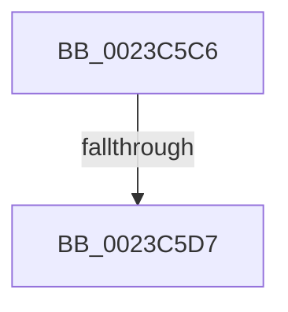

# sub_0023C5C6

- RVA: `0x0023C5C6`–`0x0023C62B` (길이 `101` bytes)
- VA: `0x000000014023C5C6`
- 실행 섹션: `.text`
- PDB 이름 있음: `아니요`; PDB Function 태그: `아니요`
- unwind 정보 RVA: `0x00060F20`
- 디코드: `21`개 명령, `101/101` bytes 표시
- 미해석 바이트: `0` (있으면 어셈블리에 `.byte`로 보존)

> 이 문서는 커널 이미지의 기계어와 PDB 기호를 분석해 생성했습니다. 4번과 5번은 함수 원형과 자료형을 바이너리 사용 방식에서 추정한 C 해석이며 원본 소스 복구 결과는 아닙니다.

## 1. Dependencies

- 직접 호출 지점: **2**; 고유 호출 대상: **2**
- 직접 호출자로 확인된 함수: **0**
- RIP 상대 이미지 참조: **0**

### Outgoing calls
- `0x0023C5CA` → [MI_IS_PHYSICAL_ADDRESS](MI_IS_PHYSICAL_ADDRESS_function_0023B3A0.md) (function, `0x0023B3A0`)
- `0x0023C5F2` → [MiLockNonPagedPoolPte](../44/MiLockNonPagedPoolPte_function_004450EC.md) (function, `0x004450EC`)

### Direct callers
- 이 함수 시작 RVA로 연결되는 직접 call은 확인되지 않았습니다. 간접 호출은 완전히 역산할 수 없습니다.

### Static image references
- 디코드된 RIP-relative 메모리 참조가 없습니다.

## 2. Other-region calls and transfers

- 다른 실행 섹션으로 향하는 call: **0**
- call이 아닌 외부 분기/꼬리 이동: **2**
  - `0x0023C5D1` → [sub_0023C21A + 0x23](Unknown_function_0023C21A.md) (`tail-transfer`)
  - `0x0023C626` → [sub_0023C21A + 0x51](Unknown_function_0023C21A.md) (`tail-transfer`)

## 3. Assembly (complete function range)

```asm
0023C5C6  48 8B 4F 08                     mov rcx, qword ptr [rdi + 8]
0023C5CA  E8 D1 ED FF FF                  call 0x14023b3a0
0023C5CF  85 C0                           test eax, eax
0023C5D1  0F 85 66 FC FF FF               jne 0x14023c23d
0023C5D7  48 8B 4F 08                     mov rcx, qword ptr [rdi + 8]
0023C5DB  48 B8 F8 FF FF FF 7F 00 00 00   movabs rax, 0x7ffffffff8
0023C5E5  48 C1 E9 09                     shr rcx, 9
0023C5E9  48 23 C8                        and rcx, rax
0023C5EC  48 8B C3                        mov rax, rbx
0023C5EF  48 03 C8                        add rcx, rax
0023C5F2  E8 F5 8A 20 00                  call 0x1404450ec
0023C5F7  48 8B D8                        mov rbx, rax
0023C5FA  49 BC 00 00 00 00 00 DE FF FF   movabs r12, 0xffffde0000000000
0023C604  49 8B C4                        mov rax, r12
0023C607  48 8B CB                        mov rcx, rbx
0023C60A  48 2B C8                        sub rcx, rax
0023C60D  48 B8 AB AA AA AA AA AA AA AA   movabs rax, 0xaaaaaaaaaaaaaaab
0023C617  48 C1 F9 04                     sar rcx, 4
0023C61B  48 0F AF C8                     imul rcx, rax
0023C61F  48 89 8F 88 00 00 00            mov qword ptr [rdi + 0x88], rcx
0023C626  E9 40 FC FF FF                  jmp 0x14023c26b
```

## 4. C-style interpretation (structured pseudocode)

```c
__int64 __fastcall sub_0023C5C6(void)
{
    __int64 result;

    result = MI_IS_PHYSICAL_ADDRESS(*(unsigned __int64 *)(v_rdi + 8), a2, a3, a4);
    a1 = (*(unsigned __int64 *)(v_rdi + 8)) >> (9);
    a1 = (a1) & (result);
    a1 = (a1) + (v_rbx);
    result = MiLockNonPagedPoolPte(a1, a2, a3, a4);
    a1 = (result) - (v_r12);
    a1 = (a1) >> (4);
    a1 = (a1) * (v_r12);
    *(unsigned __int64 *)(v_rdi + 136) = a1;
}
```

## 5. (Beta) C Style

```c
void sub_0023C5C6(void)
{
    int64_t result;

    result = MI_IS_PHYSICAL_ADDRESS(*(uint64_t *)(local_rdi + 0x8), a2, a3, a4);
    a1 = (*(uint64_t *)(local_rdi + 0x8)) >> (9);
    a1 = (a1) & (result);
    a1 = (a1) + (local_rbx);
    result = MiLockNonPagedPoolPte(a1, a2, a3, a4);
    a1 = (result) - (local_r12);
    a1 = (a1) >> (4);
    a1 = (a1) * (local_r12);
    *(uint64_t *)(local_rdi + 0x88) = a1;
}
```

## 6. Execution-region graph

[열기: 2D/3D 그래프와 함수 탐색 컨트롤 패널](../../../control-panel.html?section=text&rva=0x0023C5C6&view=graph)

- 2D 그래프는 위에서 아래로 흐르고, 3D 그래프는 빈 공간을 드래그해 회전합니다. Shift+드래그는 이동, 휠은 확대·축소, 함수 노드 선택은 대상 보고서 이동입니다.

### Static fallback


