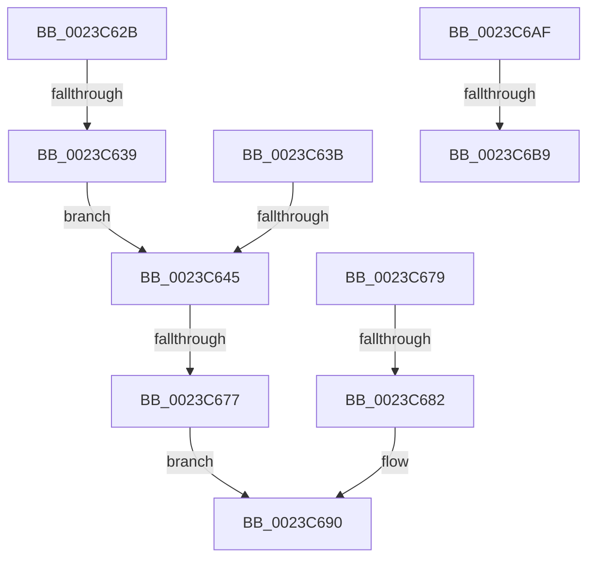

# sub_0023C62B

- RVA: `0x0023C62B`–`0x0023C6BE` (길이 `147` bytes)
- VA: `0x000000014023C62B`
- 실행 섹션: `.text`
- PDB 이름 있음: `아니요`; PDB Function 태그: `아니요`
- unwind 정보 RVA: `0x00060F3C`
- 디코드: `33`개 명령, `147/147` bytes 표시
- 미해석 바이트: `0` (있으면 어셈블리에 `.byte`로 보존)

> 이 문서는 커널 이미지의 기계어와 PDB 기호를 분석해 생성했습니다. 4번과 5번은 함수 원형과 자료형을 바이너리 사용 방식에서 추정한 C 해석이며 원본 소스 복구 결과는 아닙니다.

## 1. Dependencies

- 직접 호출 지점: **2**; 고유 호출 대상: **2**
- 직접 호출자로 확인된 함수: **0**
- RIP 상대 이미지 참조: **2**

### Outgoing calls
- `0x0023C66A` → [MiChargeCommit](../28/MiChargeCommit_function_00286EB0.md) (function, `0x00286EB0`)
- `0x0023C68B` → [MiReturnCommit](../24/MiReturnCommit_function_00248410.md) (function, `0x00248410`)

### Direct callers
- 이 함수 시작 RVA로 연결되는 직접 call은 확인되지 않았습니다. 간접 호출은 완전히 역산할 수 없습니다.

### Static image references
- `0x0023C64F` → RVA `0x00E30088` (`.data`; read)
- `0x0023C69F` → RVA `0x00E30218` (`.data`; read/write)

## 2. Other-region calls and transfers

- 다른 실행 섹션으로 향하는 call: **0**
- call이 아닌 외부 분기/꼬리 이동: **7**
  - `0x0023C633` → [sub_0023C21A + 0x105](Unknown_function_0023C21A.md) (`tail-transfer`)
  - `0x0023C63F` → [sub_0023C7D3 + 0xD](Unknown_function_0023C7D3.md) (`tail-transfer`)
  - `0x0023C671` → [sub_0023C21A + 0x15E](Unknown_function_0023C21A.md) (`tail-transfer`)
  - `0x0023C67C` → [sub_0023C7D3](Unknown_function_0023C7D3.md) (`tail-transfer`)
  - `0x0023C6AA` → [sub_0023C21A + 0x28C](Unknown_function_0023C21A.md) (`tail-transfer`)
  - `0x0023C6B3` → [sub_0023C21A + 0xED](Unknown_function_0023C21A.md) (`tail-transfer`)
  - `0x0023C6B9` → [sub_0023C21A + 0xEA](Unknown_function_0023C21A.md) (`tail-transfer`)

## 3. Assembly (complete function range)

```asm
0023C62B  8B 43 10                        mov eax, dword ptr [rbx + 0x10]
0023C62E  48 0F BA E0 0A                  bt rax, 0xa
0023C633  0F 83 E6 FC FF FF               jae 0x14023c31f
0023C639  EB 0A                           jmp 0x14023c645
0023C63B  F6 43 23 20                     test byte ptr [rbx + 0x23], 0x20
0023C63F  0F 84 9B 01 00 00               je 0x14023c7e0
0023C645  48 8B 4B 28                     mov rcx, qword ptr [rbx + 0x28]
0023C649  41 B8 08 00 00 00               mov r8d, 8
0023C64F  48 8B 05 32 3A BF 00            mov rax, qword ptr [rip + 0xbf3a32]
0023C656  49 8B D7                        mov rdx, r15
0023C659  48 C1 E9 2B                     shr rcx, 0x2b
0023C65D  41 B6 01                        mov r14b, 1
0023C660  48 23 CD                        and rcx, rbp
0023C663  48 8B 2C C8                     mov rbp, qword ptr [rax + rcx*8]
0023C667  48 8B CD                        mov rcx, rbp
0023C66A  E8 41 A8 04 00                  call 0x140286eb0
0023C66F  85 C0                           test eax, eax
0023C671  0F 85 01 FD FF FF               jne 0x14023c378
0023C677  EB 17                           jmp 0x14023c690
0023C679  45 84 F6                        test r14b, r14b
0023C67C  0F 84 51 01 00 00               je 0x14023c7d3
0023C682  45 33 C0                        xor r8d, r8d
0023C685  49 8B D7                        mov rdx, r15
0023C688  48 8B CD                        mov rcx, rbp
0023C68B  E8 80 BD 00 00                  call 0x140248410
0023C690  48 BD FF FF FF FF FF FF FF 7F   movabs rbp, 0x7fffffffffffffff
0023C69A  F0 48 21 6B 18                  lock and qword ptr [rbx + 0x18], rbp
0023C69F  FF 05 73 3B BF 00               inc dword ptr [rip + 0xbf3b73]
0023C6A5  B8 A1 00 00 C0                  mov eax, 0xc00000a1
0023C6AA  E9 F7 FD FF FF                  jmp 0x14023c4a6
0023C6AF  F6 43 22 08                     test byte ptr [rbx + 0x22], 8
0023C6B3  0F 84 4E FC FF FF               je 0x14023c307
0023C6B9  E9 46 FC FF FF                  jmp 0x14023c304
```

## 4. C-style interpretation (structured pseudocode)

```c
__int64 __fastcall sub_0023C62B(void)
{
    __int64 result;

    goto loc_0023C645;
loc_0023C645:
    a1 = (*(unsigned __int64 *)(v_rbx + 40)) >> (43);
    a1 = (a1) & (v_rbp);
    result = MiChargeCommit(*(unsigned __int64 *)(*(unsigned __int64 *)(v_rip + 12532274) + a1 * 8), v_r15, 8, a4);
    goto loc_0023C690;
loc_0023C690:
}
```

## 5. (Beta) C Style

```c
void sub_0023C62B(void)
{
    int64_t result;

    goto loc_0023C645;
loc_0023C645:
    a1 = (*(uint64_t *)(local_rbx + 0x28)) >> (43);
    a1 = (a1) & (local_rbp);
    result = MiChargeCommit(*(uint64_t *)(*(uint64_t *)(v_rip + 0xBF3A32) + a1 * 8), local_r15, 8, a4);
    goto loc_0023C690;
loc_0023C690:
}
```

## 6. Execution-region graph

[열기: 2D/3D 그래프와 함수 탐색 컨트롤 패널](../../../control-panel.html?section=text&rva=0x0023C62B&view=graph)

- 2D 그래프는 위에서 아래로 흐르고, 3D 그래프는 빈 공간을 드래그해 회전합니다. Shift+드래그는 이동, 휠은 확대·축소, 함수 노드 선택은 대상 보고서 이동입니다.

### Static fallback


