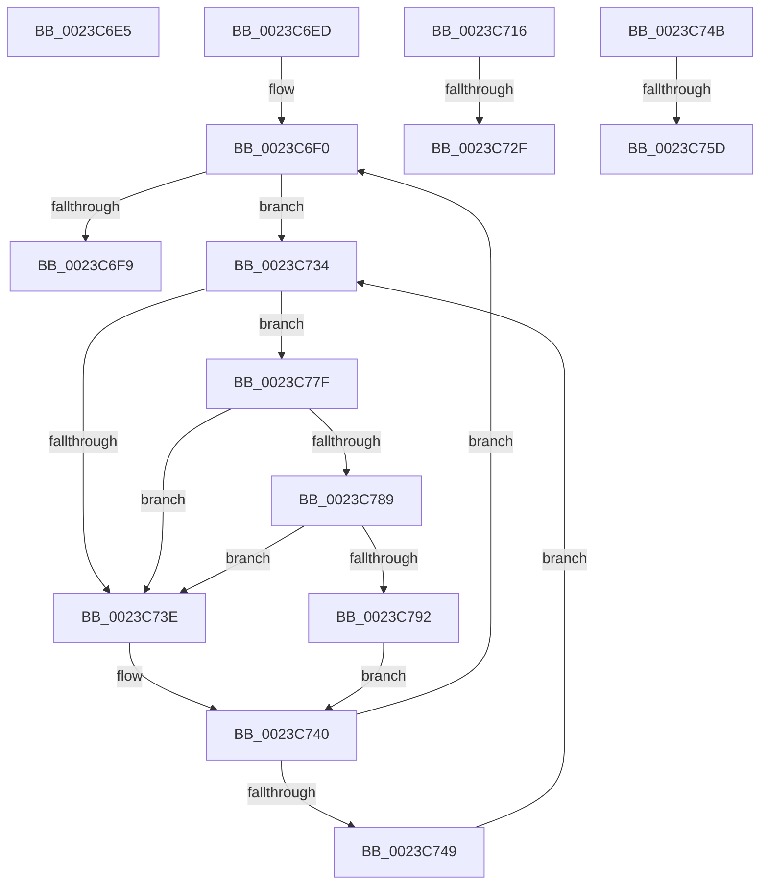

# sub_0023C6E5

- RVA: `0x0023C6E5`–`0x0023C79B` (길이 `182` bytes)
- VA: `0x000000014023C6E5`
- 실행 섹션: `.text`
- PDB 이름 있음: `아니요`; PDB Function 태그: `아니요`
- unwind 정보 RVA: `0x00060F80`
- 디코드: `47`개 명령, `182/182` bytes 표시
- 미해석 바이트: `0` (있으면 어셈블리에 `.byte`로 보존)

> 이 문서는 커널 이미지의 기계어와 PDB 기호를 분석해 생성했습니다. 4번과 5번은 함수 원형과 자료형을 바이너리 사용 방식에서 추정한 C 해석이며 원본 소스 복구 결과는 아닙니다.

## 1. Dependencies

- 직접 호출 지점: **4**; 고유 호출 대상: **4**
- 직접 호출자로 확인된 함수: **0**
- RIP 상대 이미지 참조: **4**

### Outgoing calls
- `0x0023C6FC` → [MiRemoveLockedPageChargeAndDecRef](../24/MiRemoveLockedPageChargeAndDecRef_function_002459D0.md) (function, `0x002459D0`)
- `0x0023C71F` → [MiChargePartitionResidentAvailable](../28/MiChargePartitionResidentAvailable_function_0028B000.md) (function, `0x0028B000`)
- `0x0023C789` → [KiCheckVpBackingLongSpinWaitHypercall](../30/KiCheckVpBackingLongSpinWaitHypercall_function_0030F490.md) (function, `0x0030F490`)
- `0x0023C794` → [HvlNotifyLongSpinWait](../30/HvlNotifyLongSpinWait_function_0030F460.md) (function, `0x0030F460`)

### Direct callers
- 이 함수 시작 RVA로 연결되는 직접 call은 확인되지 않았습니다. 간접 호출은 완전히 역산할 수 없습니다.

### Static image references
- `0x0023C706` → RVA `0x00E3021C` (`.data`; read/write)
- `0x0023C736` → RVA `0x00FC52AC` (`ALMOSTRO`; reference)
- `0x0023C761` → RVA `0x00E30088` (`.data`; read)
- `0x0023C77F` → RVA `0x00FC6AB8` (`ALMOSTRO`; read)

## 2. Other-region calls and transfers

- 다른 실행 섹션으로 향하는 call: **0**
- call이 아닌 외부 분기/꼬리 이동: **6**
  - `0x0023C6E8` → [sub_0023C50F + 0x5E](Unknown_function_0023C50F.md) (`tail-transfer`)
  - `0x0023C711` → [sub_0023C21A + 0x28C](Unknown_function_0023C21A.md) (`tail-transfer`)
  - `0x0023C729` → [sub_0023C21A + 0x199](Unknown_function_0023C21A.md) (`tail-transfer`)
  - `0x0023C72F` → [sub_0023C62B + 0x4E](Unknown_function_0023C62B.md) (`tail-transfer`)
  - `0x0023C757` → [sub_0023C21A + 0x1D4](Unknown_function_0023C21A.md) (`tail-transfer`)
  - `0x0023C77A` → [sub_0023C21A + 0x1D4](Unknown_function_0023C21A.md) (`tail-transfer`)

## 3. Assembly (complete function range)

```asm
0023C6E5  48 8B CB                        mov rcx, rbx
0023C6E8  E9 80 FE FF FF                  jmp 0x14023c56d
0023C6ED  0F 1F 00                        nop dword ptr [rax]
0023C6F0  F0 48 0F BA 6B 18 3F            lock bts qword ptr [rbx + 0x18], 0x3f
0023C6F7  72 3B                           jb 0x14023c734
0023C6F9  48 8B CB                        mov rcx, rbx
0023C6FC  E8 CF 92 00 00                  call 0x1402459d0
0023C701  F0 48 21 6B 18                  lock and qword ptr [rbx + 0x18], rbp
0023C706  FF 05 10 3B BF 00               inc dword ptr [rip + 0xbf3b10]
0023C70C  B8 A1 00 00 C0                  mov eax, 0xc00000a1
0023C711  E9 90 FD FF FF                  jmp 0x14023c4a6
0023C716  45 33 C0                        xor r8d, r8d
0023C719  49 8B D7                        mov rdx, r15
0023C71C  48 8B CD                        mov rcx, rbp
0023C71F  E8 DC E8 04 00                  call 0x14028b000
0023C724  44 8B C0                        mov r8d, eax
0023C727  85 C0                           test eax, eax
0023C729  0F 85 84 FC FF FF               jne 0x14023c3b3
0023C72F  E9 45 FF FF FF                  jmp 0x14023c679
0023C734  FF C6                           inc esi
0023C736  85 35 70 8B D8 00               test dword ptr [rip + 0xd88b70], esi
0023C73C  74 41                           je 0x14023c77f
0023C73E  F3 90                           pause
0023C740  48 8B 43 18                     mov rax, qword ptr [rbx + 0x18]
0023C744  48 85 C0                        test rax, rax
0023C747  79 A7                           jns 0x14023c6f0
0023C749  EB E9                           jmp 0x14023c734
0023C74B  8B 43 10                        mov eax, dword ptr [rbx + 0x10]
0023C74E  25 04 04 00 00                  and eax, 0x404
0023C753  48 83 F8 04                     cmp rax, 4
0023C757  0F 85 91 FC FF FF               jne 0x14023c3ee
0023C75D  48 8B 43 28                     mov rax, qword ptr [rbx + 0x28]
0023C761  48 8B 0D 20 39 BF 00            mov rcx, qword ptr [rip + 0xbf3920]
0023C768  48 C1 E8 2B                     shr rax, 0x2b
0023C76C  48 23 C5                        and rax, rbp
0023C76F  48 8B 14 C1                     mov rdx, qword ptr [rcx + rax*8]
0023C773  44 88 BA D3 02 00 00            mov byte ptr [rdx + 0x2d3], r15b
0023C77A  E9 6F FC FF FF                  jmp 0x14023c3ee
0023C77F  8B 05 33 A3 D8 00               mov eax, dword ptr [rip + 0xd8a333]
0023C785  A8 40                           test al, 0x40
0023C787  74 B5                           je 0x14023c73e
0023C789  E8 02 2D 0D 00                  call 0x14030f490
0023C78E  84 C0                           test al, al
0023C790  74 AC                           je 0x14023c73e
0023C792  8B CE                           mov ecx, esi
0023C794  E8 C7 2C 0D 00                  call 0x14030f460
0023C799  EB A5                           jmp 0x14023c740
```

## 4. C-style interpretation (structured pseudocode)

```c
__int64 __fastcall sub_0023C6E5(__int64 a1, __int64 a2, int a3)
{
}
```

## 5. (Beta) C Style

```c
int64_t sub_0023C6E5(int64_t Arg1, int64_t Arg2, int32_t Arg3)
{
}
```

## 6. Execution-region graph

[열기: 2D/3D 그래프와 함수 탐색 컨트롤 패널](../../../control-panel.html?section=text&rva=0x0023C6E5&view=graph)

- 2D 그래프는 위에서 아래로 흐르고, 3D 그래프는 빈 공간을 드래그해 회전합니다. Shift+드래그는 이동, 휠은 확대·축소, 함수 노드 선택은 대상 보고서 이동입니다.

### Static fallback


