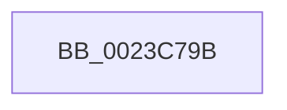

# sub_0023C79B

- RVA: `0x0023C79B`–`0x0023C7C9` (길이 `46` bytes)
- VA: `0x000000014023C79B`
- 실행 섹션: `.text`
- PDB 이름 있음: `아니요`; PDB Function 태그: `아니요`
- unwind 정보 RVA: `0x00060FA8`
- 디코드: `8`개 명령, `46/46` bytes 표시
- 미해석 바이트: `0` (있으면 어셈블리에 `.byte`로 보존)

> 이 문서는 커널 이미지의 기계어와 PDB 기호를 분석해 생성했습니다. 4번과 5번은 함수 원형과 자료형을 바이너리 사용 방식에서 추정한 C 해석이며 원본 소스 복구 결과는 아닙니다.

## 1. Dependencies

- 직접 호출 지점: **0**; 고유 호출 대상: **0**
- 직접 호출자로 확인된 함수: **0**
- RIP 상대 이미지 참조: **1**

### Outgoing calls
- 직접 디코드된 call 명령이 없습니다.

### Direct callers
- 이 함수 시작 RVA로 연결되는 직접 call은 확인되지 않았습니다. 간접 호출은 완전히 역산할 수 없습니다.

### Static image references
- `0x0023C7AA` → RVA `0x00E30214` (`.data`; read/write)

## 2. Other-region calls and transfers

- 다른 실행 섹션으로 향하는 call: **0**
- call이 아닌 외부 분기/꼬리 이동: **1**
  - `0x0023C7C4` → [MiProbeLockFrame + 0x5D](MiProbeLockFrame_function_0023C1B0.md) (`tail-transfer`)

## 3. Assembly (complete function range)

```asm
0023C79B  48 BD FF FF FF FF FF FF FF 7F   movabs rbp, 0x7fffffffffffffff
0023C7A5  F0 48 21 6B 18                  lock and qword ptr [rbx + 0x18], rbp
0023C7AA  FF 05 64 3A BF 00               inc dword ptr [rip + 0xbf3a64]
0023C7B0  B8 05 00 00 C0                  mov eax, 0xc0000005
0023C7B5  48 8B 6C 24 70                  mov rbp, qword ptr [rsp + 0x70]
0023C7BA  4C 8B 64 24 78                  mov r12, qword ptr [rsp + 0x78]
0023C7BF  48 8B 5C 24 68                  mov rbx, qword ptr [rsp + 0x68]
0023C7C4  E9 44 FA FF FF                  jmp 0x14023c20d
```

## 4. C-style interpretation (structured pseudocode)

```c
__int64 __fastcall sub_0023C79B(__int64 a1, __int64 a2, __int64 a3, __int64 a4, __int64 a5, __int64 a6, __int64 a7, __int64 a8, __int64 a9, __int64 a10, __int64 a11, __int64 a12, __int64 a13, __int64 a14, __int64 a15)
{
}
```

## 5. (Beta) C Style

```c
int64_t sub_0023C79B(int64_t Arg1, int64_t Arg2, int64_t Arg3, int64_t Arg4, uint64_t Arg5, uint64_t Arg6, uint64_t Arg7, uint64_t Arg8, uint64_t Arg9, uint64_t Arg10, uint64_t Arg11, uint64_t Arg12, int64_t Arg13, int64_t Arg14, int64_t Arg15)
{
}
```

## 6. Execution-region graph

[열기: 2D/3D 그래프와 함수 탐색 컨트롤 패널](../../../control-panel.html?section=text&rva=0x0023C79B&view=graph)

- 2D 그래프는 위에서 아래로 흐르고, 3D 그래프는 빈 공간을 드래그해 회전합니다. Shift+드래그는 이동, 휠은 확대·축소, 함수 노드 선택은 대상 보고서 이동입니다.

### Static fallback


