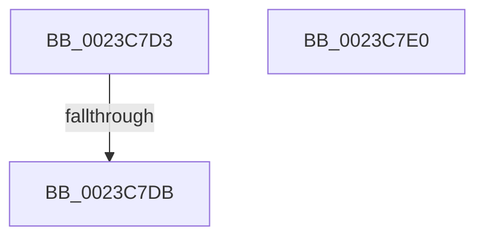

# sub_0023C7D3

- RVA: `0x0023C7D3`–`0x0023C7FB` (길이 `40` bytes)
- VA: `0x000000014023C7D3`
- 실행 섹션: `.text`
- PDB 이름 있음: `아니요`; PDB Function 태그: `아니요`
- unwind 정보 RVA: `0x00060FD8`
- 디코드: `9`개 명령, `40/40` bytes 표시
- 미해석 바이트: `0` (있으면 어셈블리에 `.byte`로 보존)

> 이 문서는 커널 이미지의 기계어와 PDB 기호를 분석해 생성했습니다. 4번과 5번은 함수 원형과 자료형을 바이너리 사용 방식에서 추정한 C 해석이며 원본 소스 복구 결과는 아닙니다.

## 1. Dependencies

- 직접 호출 지점: **0**; 고유 호출 대상: **0**
- 직접 호출자로 확인된 함수: **0**
- RIP 상대 이미지 참조: **1**

### Outgoing calls
- 직접 디코드된 call 명령이 없습니다.

### Direct callers
- 이 함수 시작 RVA로 연결되는 직접 call은 확인되지 않았습니다. 간접 호출은 완전히 역산할 수 없습니다.

### Static image references
- `0x0023C7E4` → RVA `0x00E30088` (`.data`; read)

## 2. Other-region calls and transfers

- 다른 실행 섹션으로 향하는 call: **0**
- call이 아닌 외부 분기/꼬리 이동: **3**
  - `0x0023C7D5` → [sub_0023C21A + 0x199](Unknown_function_0023C21A.md) (`tail-transfer`)
  - `0x0023C7DB` → [sub_0023C62B + 0x65](Unknown_function_0023C62B.md) (`tail-transfer`)
  - `0x0023C7F6` → [sub_0023C21A + 0x15E](Unknown_function_0023C21A.md) (`tail-transfer`)

## 3. Assembly (complete function range)

```asm
0023C7D3  85 C0                           test eax, eax
0023C7D5  0F 85 D8 FB FF FF               jne 0x14023c3b3
0023C7DB  E9 B0 FE FF FF                  jmp 0x14023c690
0023C7E0  48 8B 43 28                     mov rax, qword ptr [rbx + 0x28]
0023C7E4  48 8B 0D 9D 38 BF 00            mov rcx, qword ptr [rip + 0xbf389d]
0023C7EB  48 C1 E8 2B                     shr rax, 0x2b
0023C7EF  48 23 C5                        and rax, rbp
0023C7F2  48 8B 2C C1                     mov rbp, qword ptr [rcx + rax*8]
0023C7F6  E9 7D FB FF FF                  jmp 0x14023c378
```

## 4. C-style interpretation (structured pseudocode)

```c
__int64 __fastcall sub_0023C7D3(void)
{
}
```

## 5. (Beta) C Style

```c
void sub_0023C7D3(void)
{
}
```

## 6. Execution-region graph

[열기: 2D/3D 그래프와 함수 탐색 컨트롤 패널](../../../control-panel.html?section=text&rva=0x0023C7D3&view=graph)

- 2D 그래프는 위에서 아래로 흐르고, 3D 그래프는 빈 공간을 드래그해 회전합니다. Shift+드래그는 이동, 휠은 확대·축소, 함수 노드 선택은 대상 보고서 이동입니다.

### Static fallback


