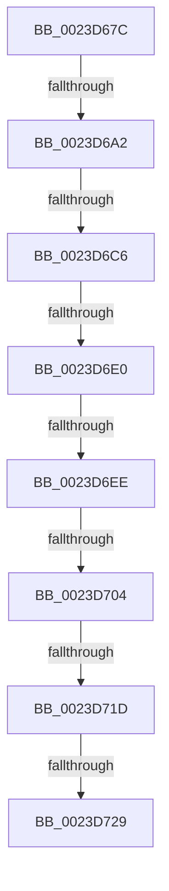

# sub_0023D67C

- RVA: `0x0023D67C`–`0x0023D74A` (길이 `206` bytes)
- VA: `0x000000014023D67C`
- 실행 섹션: `.text`
- PDB 이름 있음: `아니요`; PDB Function 태그: `아니요`
- unwind 정보 RVA: `0x0006106C`
- 디코드: `48`개 명령, `206/206` bytes 표시
- 미해석 바이트: `0` (있으면 어셈블리에 `.byte`로 보존)

> 이 문서는 커널 이미지의 기계어와 PDB 기호를 분석해 생성했습니다. 4번과 5번은 함수 원형과 자료형을 바이너리 사용 방식에서 추정한 C 해석이며 원본 소스 복구 결과는 아닙니다.

## 1. Dependencies

- 직접 호출 지점: **0**; 고유 호출 대상: **0**
- 직접 호출자로 확인된 함수: **0**
- RIP 상대 이미지 참조: **3**

### Outgoing calls
- 직접 디코드된 call 명령이 없습니다.

### Direct callers
- 이 함수 시작 RVA로 연결되는 직접 call은 확인되지 않았습니다. 간접 호출은 완전히 역산할 수 없습니다.

### Static image references
- `0x0023D695` → RVA `0x00E2DCE0` (`.data`; read)
- `0x0023D6D0` → RVA `0x00E375B8` (`.data`; read)
- `0x0023D729` → RVA `0x00E3023C` (`.data`; read/write)

## 2. Other-region calls and transfers

- 다른 실행 섹션으로 향하는 call: **0**
- call이 아닌 외부 분기/꼬리 이동: **7**
  - `0x0023D69C` → [sub_0023D893](Unknown_function_0023D893.md) (`tail-transfer`)
  - `0x0023D6C0` → [sub_0023D893](Unknown_function_0023D893.md) (`tail-transfer`)
  - `0x0023D6DE` → [sub_0023D74B + 0x9](Unknown_function_0023D74B.md) (`tail-transfer`)
  - `0x0023D6EC` → [sub_0023D74B + 0x9](Unknown_function_0023D74B.md) (`tail-transfer`)
  - `0x0023D702` → [sub_0023D74B + 0x9](Unknown_function_0023D74B.md) (`tail-transfer`)
  - `0x0023D717` → [sub_0023DBE8](Unknown_function_0023DBE8.md) (`tail-transfer`)
  - `0x0023D727` → [sub_0023D74B](Unknown_function_0023D74B.md) (`tail-transfer`)

## 3. Assembly (complete function range)

```asm
0023D67C  48 89 BC 24 80 00 00 00         mov qword ptr [rsp + 0x80], rdi
0023D684  48 C1 E8 0C                     shr rax, 0xc
0023D688  48 B9 FF FF FF FF FF 00 00 00   movabs rcx, 0xffffffffff
0023D692  48 23 C1                        and rax, rcx
0023D695  48 3B 05 44 06 BF 00            cmp rax, qword ptr [rip + 0xbf0644]
0023D69C  0F 87 F1 01 00 00               ja 0x14023d893
0023D6A2  48 8D 14 40                     lea rdx, [rax + rax*2]
0023D6A6  48 C1 E2 04                     shl rdx, 4
0023D6AA  48 B8 28 00 00 00 00 DE FF FF   movabs rax, 0xffffde0000000028
0023D6B4  48 8B 04 02                     mov rax, qword ptr [rdx + rax]
0023D6B8  48 C1 E8 36                     shr rax, 0x36
0023D6BC  0F BA E0 00                     bt eax, 0
0023D6C0  0F 83 CD 01 00 00               jae 0x14023d893
0023D6C6  48 B8 00 00 00 00 00 DE FF FF   movabs rax, 0xffffde0000000000
0023D6D0  48 8B 0D E1 9E BF 00            mov rcx, qword ptr [rip + 0xbf9ee1]
0023D6D7  48 8D 3C 02                     lea rdi, [rdx + rax]
0023D6DB  48 85 C9                        test rcx, rcx
0023D6DE  74 74                           je 0x14023d754
0023D6E0  48 8B 47 28                     mov rax, qword ptr [rdi + 0x28]
0023D6E4  48 C1 E8 3C                     shr rax, 0x3c
0023D6E8  24 07                           and al, 7
0023D6EA  3C 01                           cmp al, 1
0023D6EC  75 66                           jne 0x14023d754
0023D6EE  48 B8 AB AA AA AA AA AA AA AA   movabs rax, 0xaaaaaaaaaaaaaaab
0023D6F8  48 F7 E2                        mul rdx
0023D6FB  48 C1 EA 05                     shr rdx, 5
0023D6FF  48 85 C9                        test rcx, rcx
0023D702  74 50                           je 0x14023d754
0023D704  0F 1F 40 00                     nop dword ptr [rax]
0023D708  0F 1F 84 00 00 00 00 00         nop dword ptr [rax + rax]
0023D710  4C 8B 41 18                     mov r8, qword ptr [rcx + 0x18]
0023D714  49 3B D0                        cmp rdx, r8
0023D717  0F 82 CB 04 00 00               jb 0x14023dbe8
0023D71D  48 8B C2                        mov rax, rdx
0023D720  49 2B C0                        sub rax, r8
0023D723  48 3B 41 20                     cmp rax, qword ptr [rcx + 0x20]
0023D727  73 22                           jae 0x14023d74b
0023D729  FF 05 0D 2B BF 00               inc dword ptr [rip + 0xbf2b0d]
0023D72F  B8 05 00 00 C0                  mov eax, 0xc0000005
0023D734  48 8B BC 24 80 00 00 00         mov rdi, qword ptr [rsp + 0x80]
0023D73C  48 83 C4 38                     add rsp, 0x38
0023D740  41 5F                           pop r15
0023D742  41 5E                           pop r14
0023D744  41 5D                           pop r13
0023D746  5E                              pop rsi
0023D747  5D                              pop rbp
0023D748  5B                              pop rbx
0023D749  C3                              ret
```

## 4. C-style interpretation (structured pseudocode)

```c
__int64 __fastcall sub_0023D67C(__int64 a1, __int64 a2, __int64 a3, __int64 a4, __int64 a5, __int64 a6, __int64 a7, __int64 a8, __int64 a9, __int64 a10, __int64 a11, __int64 a12, __int64 a13, __int64 a14, __int64 a15, __int64 a16)
{
    __int64 result;
    __int64 v_rsp;
    unsigned __int64 v_stack_p80;

    v_stack_p80 = v_rdi;
    result = (result) >> (12);
    result = (result) & (a1);
    a2 = (result + result * 2) << (4);
    result = (*(unsigned __int64 *)(a2 + result * 1)) >> (54);
    result = (*(unsigned __int64 *)(a2 + result * 1 + 40)) >> (60);
    result = (unsigned __int8)((result) & (7));
    a2 = (a2) >> (5);
    result = (a2) - (*(unsigned __int64 *)(*(unsigned __int64 *)(v_rip + 12558049) + 24));
    v_rsp = (v_rsp) + (56);
    return (unsigned int)(0xC0000005ULL);
}
```

## 5. (Beta) C Style

```c
int64_t sub_0023D67C(int64_t Arg1, int64_t Arg2, int64_t Arg3, int64_t Arg4, uint64_t Arg5, uint64_t Arg6, uint64_t Arg7, uint64_t Arg8, uint64_t Arg9, uint64_t Arg10, uint64_t Arg11, uint64_t Arg12, uint64_t Arg13, uint64_t Arg14, uint64_t Arg15, int64_t Arg16)
{
    int64_t result;
    int64_t local_rsp;
    uint64_t v_stack_p80;

    v_stack_p80 = local_rdi;
    result = (result) >> (12);
    result = (result) & (Arg1);
    Arg2 = (result + result * 2) << (4);
    result = (*(uint64_t *)(Arg2 + result * 1)) >> (54);
    result = (*(uint64_t *)(Arg2 + result * 1 + 0x28)) >> (60);
    result = (uint8_t)((result) & (7));
    Arg2 = (Arg2) >> (5);
    result = (Arg2) - (*(uint64_t *)(*(uint64_t *)(v_rip + 0xBF9EE1) + 0x18));
    local_rsp = (local_rsp) + (56);
    return (uint32_t)(0xC0000005ULL);
}
```

## 6. Execution-region graph

[열기: 2D/3D 그래프와 함수 탐색 컨트롤 패널](../../../control-panel.html?section=text&rva=0x0023D67C&view=graph)

- 2D 그래프는 위에서 아래로 흐르고, 3D 그래프는 빈 공간을 드래그해 회전합니다. Shift+드래그는 이동, 휠은 확대·축소, 함수 노드 선택은 대상 보고서 이동입니다.

### Static fallback


