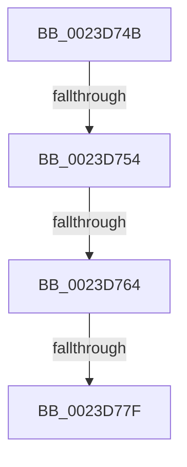

# sub_0023D74B

- RVA: `0x0023D74B`–`0x0023D7AA` (길이 `95` bytes)
- VA: `0x000000014023D74B`
- 실행 섹션: `.text`
- PDB 이름 있음: `아니요`; PDB Function 태그: `아니요`
- unwind 정보 RVA: `0x00061094`
- 디코드: `21`개 명령, `95/95` bytes 표시
- 미해석 바이트: `0` (있으면 어셈블리에 `.byte`로 보존)

> 이 문서는 커널 이미지의 기계어와 PDB 기호를 분석해 생성했습니다. 4번과 5번은 함수 원형과 자료형을 바이너리 사용 방식에서 추정한 C 해석이며 원본 소스 복구 결과는 아닙니다.

## 1. Dependencies

- 직접 호출 지점: **1**; 고유 호출 대상: **1**
- 직접 호출자로 확인된 함수: **0**
- RIP 상대 이미지 참조: **1**

### Outgoing calls
- `0x0023D757` → [MiLegitimatePageForDriversToMap](MiLegitimatePageForDriversToMap_function_0023ECE0.md) (function, `0x0023ECE0`)

### Direct callers
- 이 함수 시작 RVA로 연결되는 직접 call은 확인되지 않았습니다. 간접 호출은 완전히 역산할 수 없습니다.

### Static image references
- `0x0023D782` → RVA `0x00E38AA8` (`.data`; read)

## 2. Other-region calls and transfers

- 다른 실행 섹션으로 향하는 call: **0**
- call이 아닌 외부 분기/꼬리 이동: **4**
  - `0x0023D752` → [sub_0023D67C + 0x94](Unknown_function_0023D67C.md) (`tail-transfer`)
  - `0x0023D75E` → [sub_0023DA06](Unknown_function_0023DA06.md) (`tail-transfer`)
  - `0x0023D779` → [sub_0023D914](Unknown_function_0023D914.md) (`tail-transfer`)
  - `0x0023D7A4` → [sub_0023DB08](Unknown_function_0023DB08.md) (`tail-transfer`)

## 3. Assembly (complete function range)

```asm
0023D74B  48 8B 49 08                     mov rcx, qword ptr [rcx + 8]
0023D74F  48 85 C9                        test rcx, rcx
0023D752  75 BC                           jne 0x14023d710
0023D754  48 8B CF                        mov rcx, rdi
0023D757  E8 84 15 00 00                  call 0x14023ece0
0023D75C  85 C0                           test eax, eax
0023D75E  0F 88 A2 02 00 00               js 0x14023da06
0023D764  4C 8B 44 24 78                  mov r8, qword ptr [rsp + 0x78]
0023D769  48 B8 00 00 00 00 00 80 FF FF   movabs rax, 0xffff800000000000
0023D773  41 8B CE                        mov ecx, r14d
0023D776  4C 3B E8                        cmp r13, rax
0023D779  0F 82 95 01 00 00               jb 0x14023d914
0023D77F  49 8B C5                        mov rax, r13
0023D782  48 8D 15 1F B3 BF 00            lea rdx, [rip + 0xbfb31f]
0023D789  48 C1 E8 27                     shr rax, 0x27
0023D78D  25 FF 01 00 00                  and eax, 0x1ff
0023D792  2D 00 01 00 00                  sub eax, 0x100
0023D797  0F B6 04 10                     movzx eax, byte ptr [rax + rdx]
0023D79B  41 BB 01 00 00 00               mov r11d, 1
0023D7A1  83 FD 06                        cmp ebp, 6
0023D7A4  0F 84 5E 03 00 00               je 0x14023db08
```

## 4. C-style interpretation (structured pseudocode)

```c
__int64 __fastcall sub_0023D74B(__int64 a1, __int64 a2, __int64 a3, __int64 a4, __int64 a5, __int64 a6, __int64 a7, __int64 a8, __int64 a9, __int64 a10, __int64 a11, __int64 a12, __int64 a13, __int64 a14, __int64 a15)
{
    __int64 result;

    result = MiLegitimatePageForDriversToMap(v_rdi, a2, a3, a4);
    result = (v_r13) >> (39);
    result = (unsigned int)((result) & (511));
    result = (unsigned int)((result) - (256));
}
```

## 5. (Beta) C Style

```c
int64_t sub_0023D74B(void *Arg1, int64_t Arg2, int64_t Arg3, int64_t Arg4, uint64_t Arg5, uint64_t Arg6, uint64_t Arg7, uint64_t Arg8, uint64_t Arg9, uint64_t Arg10, uint64_t Arg11, uint64_t Arg12, uint64_t Arg13, uint64_t Arg14, int64_t Arg15)
{
    uint8_t *arg1 = (uint8_t *)Arg1;

    int64_t result;

    result = MiLegitimatePageForDriversToMap(local_rdi, Arg2, Arg3, Arg4);
    result = (local_r13) >> (39);
    result = (uint32_t)((result) & (511));
    result = (uint32_t)((result) - (256));
}
```

### 관측된 메모리 오프셋

구조체 형식이 확인되지 않은 접근은 인자 기준의 오프셋으로만 기록했습니다.

| 기준 인자 | 오프셋 표현 | 폭 (bit) | 접근 |
|---|---:|---:|---|
| `Arg1` | `+ 0x8` | `64` | `R` |

## 6. Execution-region graph

[열기: 2D/3D 그래프와 함수 탐색 컨트롤 패널](../../../control-panel.html?section=text&rva=0x0023D74B&view=graph)

- 2D 그래프는 위에서 아래로 흐르고, 3D 그래프는 빈 공간을 드래그해 회전합니다. Shift+드래그는 이동, 휠은 확대·축소, 함수 노드 선택은 대상 보고서 이동입니다.

### Static fallback


