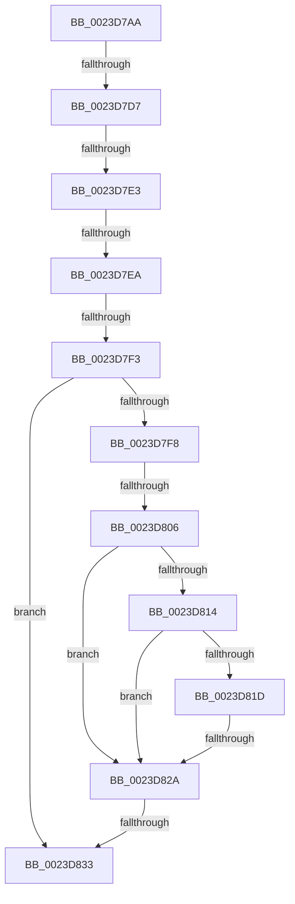

# sub_0023D7AA

- RVA: `0x0023D7AA`–`0x0023D83F` (길이 `149` bytes)
- VA: `0x000000014023D7AA`
- 실행 섹션: `.text`
- PDB 이름 있음: `아니요`; PDB Function 태그: `아니요`
- unwind 정보 RVA: `0x000610A8`
- 디코드: `35`개 명령, `149/149` bytes 표시
- 미해석 바이트: `0` (있으면 어셈블리에 `.byte`로 보존)

> 이 문서는 커널 이미지의 기계어와 PDB 기호를 분석해 생성했습니다. 4번과 5번은 함수 원형과 자료형을 바이너리 사용 방식에서 추정한 C 해석이며 원본 소스 복구 결과는 아닙니다.

## 1. Dependencies

- 직접 호출 지점: **0**; 고유 호출 대상: **0**
- 직접 호출자로 확인된 함수: **0**
- RIP 상대 이미지 참조: **0**

### Outgoing calls
- 직접 디코드된 call 명령이 없습니다.

### Direct callers
- 이 함수 시작 RVA로 연결되는 직접 call은 확인되지 않았습니다. 간접 호출은 완전히 역산할 수 없습니다.

### Static image references
- 디코드된 RIP-relative 메모리 참조가 없습니다.

## 2. Other-region calls and transfers

- 다른 실행 섹션으로 향하는 call: **0**
- call이 아닌 외부 분기/꼬리 이동: **8**
  - `0x0023D7D1` → [sub_0023DA16](Unknown_function_0023DA16.md) (`tail-transfer`)
  - `0x0023D7DD` → [sub_0023D97B](Unknown_function_0023D97B.md) (`tail-transfer`)
  - `0x0023D7E8` → [sub_0023D83F](Unknown_function_0023D83F.md) (`tail-transfer`)
  - `0x0023D7ED` → [sub_0023D89B](Unknown_function_0023D89B.md) (`tail-transfer`)
  - `0x0023D800` → [sub_0023D89B + 0x55](Unknown_function_0023D89B.md) (`tail-transfer`)
  - `0x0023D824` → [sub_0023DB14 + 0x8D](Unknown_function_0023DB14.md) (`tail-transfer`)
  - `0x0023D82D` → [sub_0023D91C](Unknown_function_0023D91C.md) (`tail-transfer`)
  - `0x0023D83A` → [sub_0023D67C + 0xB8](Unknown_function_0023D67C.md) (`tail-transfer`)

## 3. Assembly (complete function range)

```asm
0023D7AA  4C 89 64 24 30                  mov qword ptr [rsp + 0x30], r12
0023D7AF  48 BA 00 00 00 00 00 00 00 80   movabs rdx, 0x8000000000000000
0023D7B9  49 BA 00 00 00 00 00 00 00 10   movabs r10, 0x1000000000000000
0023D7C3  49 B9 00 00 00 00 00 01 00 00   movabs r9, 0x10000000000
0023D7CD  41 83 FF 03                     cmp r15d, 3
0023D7D1  0F 84 3F 02 00 00               je 0x14023da16
0023D7D7  45 8B E6                        mov r12d, r14d
0023D7DA  45 85 FF                        test r15d, r15d
0023D7DD  0F 84 98 01 00 00               je 0x14023d97b
0023D7E3  48 0F BA E3 0B                  bt rbx, 0xb
0023D7E8  73 55                           jae 0x14023d83f
0023D7EA  F6 C3 42                        test bl, 0x42
0023D7ED  0F 84 A8 00 00 00               je 0x14023d89b
0023D7F3  48 85 FF                        test rdi, rdi
0023D7F6  74 3B                           je 0x14023d833
0023D7F8  8B 47 20                        mov eax, dword ptr [rdi + 0x20]
0023D7FB  C1 E8 10                        shr eax, 0x10
0023D7FE  A8 20                           test al, 0x20
0023D800  0F 85 EA 00 00 00               jne 0x14023d8f0
0023D806  48 8B 47 28                     mov rax, qword ptr [rdi + 0x28]
0023D80A  48 C1 E8 3C                     shr rax, 0x3c
0023D80E  24 07                           and al, 7
0023D810  3C 01                           cmp al, 1
0023D812  74 16                           je 0x14023d82a
0023D814  48 8B 47 28                     mov rax, qword ptr [rdi + 0x28]
0023D818  49 85 C1                        test r9, rax
0023D81B  75 0D                           jne 0x14023d82a
0023D81D  48 8B 47 08                     mov rax, qword ptr [rdi + 8]
0023D821  48 85 C0                        test rax, rax
0023D824  0F 89 77 03 00 00               jns 0x14023dba1
0023D82A  45 85 FF                        test r15d, r15d
0023D82D  0F 84 E9 00 00 00               je 0x14023d91c
0023D833  33 C0                           xor eax, eax
0023D835  4C 8B 64 24 30                  mov r12, qword ptr [rsp + 0x30]
0023D83A  E9 F5 FE FF FF                  jmp 0x14023d734
```

## 4. C-style interpretation (structured pseudocode)

```c
__int64 __fastcall sub_0023D7AA(__int64 a1, __int64 a2, __int64 a3, __int64 a4, __int64 a5, __int64 a6)
{
    __int64 result;
    unsigned __int64 v_stack_p30;

    v_stack_p30 = v_r12;
    if (v_rdi == 0) goto loc_0023D833;
    result = (unsigned int)(((unsigned int)(*(unsigned int *)(v_rdi + 32))) >> (16));
    result = (*(unsigned __int64 *)(v_rdi + 40)) >> (60);
    result = (unsigned __int8)((result) & (7));
    if (((unsigned __int8)(result)) == 1) goto loc_0023D82A;
    if (((a4) & (*(unsigned __int64 *)(v_rdi + 40))) != 0) goto loc_0023D82A;
loc_0023D82A:
loc_0023D833:
    result = 0;
}
```

## 5. (Beta) C Style

```c
int64_t sub_0023D7AA(int64_t Arg1, int64_t Arg2, int64_t Arg3, int64_t Arg4, uint64_t Arg5, int64_t Arg6)
{
    int64_t result;
    uint64_t v_stack_p30;

    v_stack_p30 = local_r12;
    if (local_rdi == 0) goto loc_0023D833;
    result = (uint32_t)(((uint32_t)(*(uint32_t *)(local_rdi + 0x20))) >> (16));
    result = (*(uint64_t *)(local_rdi + 0x28)) >> (60);
    result = (uint8_t)((result) & (7));
    if (((uint8_t)(result)) == 1) goto loc_0023D82A;
    if (((Arg4) & (*(uint64_t *)(local_rdi + 0x28))) != 0) goto loc_0023D82A;
loc_0023D82A:
loc_0023D833:
    result = 0;
}
```

## 6. Execution-region graph

[열기: 2D/3D 그래프와 함수 탐색 컨트롤 패널](../../../control-panel.html?section=text&rva=0x0023D7AA&view=graph)

- 2D 그래프는 위에서 아래로 흐르고, 3D 그래프는 빈 공간을 드래그해 회전합니다. Shift+드래그는 이동, 휠은 확대·축소, 함수 노드 선택은 대상 보고서 이동입니다.

### Static fallback


