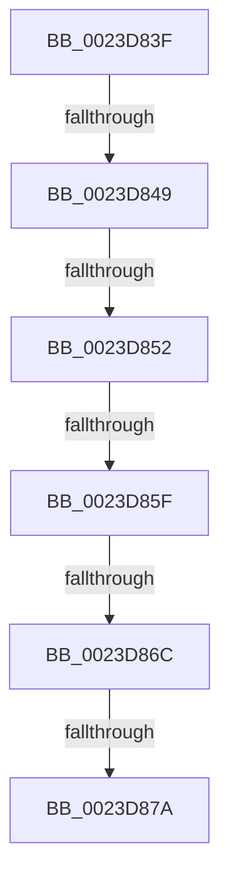

# sub_0023D83F

- RVA: `0x0023D83F`–`0x0023D893` (길이 `84` bytes)
- VA: `0x000000014023D83F`
- 실행 섹션: `.text`
- PDB 이름 있음: `아니요`; PDB Function 태그: `아니요`
- unwind 정보 RVA: `0x000610BC`
- 디코드: `20`개 명령, `84/84` bytes 표시
- 미해석 바이트: `0` (있으면 어셈블리에 `.byte`로 보존)

> 이 문서는 커널 이미지의 기계어와 PDB 기호를 분석해 생성했습니다. 4번과 5번은 함수 원형과 자료형을 바이너리 사용 방식에서 추정한 C 해석이며 원본 소스 복구 결과는 아닙니다.

## 1. Dependencies

- 직접 호출 지점: **1**; 고유 호출 대상: **1**
- 직접 호출자로 확인된 함수: **0**
- RIP 상대 이미지 참조: **1**

### Outgoing calls
- `0x0023D882` → [MiClearPfnImageVerified](../40/MiClearPfnImageVerified_function_00407000.md) (function, `0x00407000`)

### Direct callers
- 이 함수 시작 RVA로 연결되는 직접 call은 확인되지 않았습니다. 간접 호출은 완전히 역산할 수 없습니다.

### Static image references
- `0x0023D85F` → RVA `0x00FC6A88` (`ALMOSTRO`; read)

## 2. Other-region calls and transfers

- 다른 실행 섹션으로 향하는 call: **0**
- call이 아닌 외부 분기/꼬리 이동: **6**
  - `0x0023D843` → [sub_0023DAE8](Unknown_function_0023DAE8.md) (`tail-transfer`)
  - `0x0023D84C` → [sub_0023DBE0](Unknown_function_0023DBE0.md) (`tail-transfer`)
  - `0x0023D859` → [sub_0023DBE0](Unknown_function_0023DBE0.md) (`tail-transfer`)
  - `0x0023D86A` → [sub_0023D7AA + 0x89](Unknown_function_0023D7AA.md) (`tail-transfer`)
  - `0x0023D878` → [sub_0023D7AA + 0x89](Unknown_function_0023D7AA.md) (`tail-transfer`)
  - `0x0023D88E` → [sub_0023D67C + 0xB8](Unknown_function_0023D67C.md) (`tail-transfer`)

## 3. Assembly (complete function range)

```asm
0023D83F  41 83 FF 03                     cmp r15d, 3
0023D843  0F 85 9F 02 00 00               jne 0x14023dae8
0023D849  48 85 FF                        test rdi, rdi
0023D84C  0F 84 8E 03 00 00               je 0x14023dbe0
0023D852  48 8B 47 28                     mov rax, qword ptr [rdi + 0x28]
0023D856  48 85 C0                        test rax, rax
0023D859  0F 88 81 03 00 00               js 0x14023dbe0
0023D85F  48 F7 05 1E 92 D8 00 00 40 00 00  test qword ptr [rip + 0xd8921e], 0x4000
0023D86A  74 C7                           je 0x14023d833
0023D86C  48 8B 47 28                     mov rax, qword ptr [rdi + 0x28]
0023D870  48 C1 E8 3C                     shr rax, 0x3c
0023D874  24 07                           and al, 7
0023D876  3C 03                           cmp al, 3
0023D878  75 B9                           jne 0x14023d833
0023D87A  BA 49 00 00 00                  mov edx, 0x49
0023D87F  48 8B CF                        mov rcx, rdi
0023D882  E8 79 97 1C 00                  call 0x140407000
0023D887  4C 8B 64 24 30                  mov r12, qword ptr [rsp + 0x30]
0023D88C  33 C0                           xor eax, eax
0023D88E  E9 A1 FE FF FF                  jmp 0x14023d734
```

## 4. C-style interpretation (structured pseudocode)

```c
__int64 __fastcall sub_0023D83F(__int64 a1, __int64 a2, __int64 a3, __int64 a4, __int64 a5, __int64 a6)
{
    __int64 result;

    result = (*(unsigned __int64 *)(v_rdi + 40)) >> (60);
    result = (unsigned __int8)((result) & (7));
    result = MiClearPfnImageVerified(v_rdi, 73, a3, a4);
    result = 0;
}
```

## 5. (Beta) C Style

```c
int64_t sub_0023D83F(int64_t Arg1, int64_t Arg2, int64_t Arg3, int64_t Arg4, uint64_t Arg5, int64_t Arg6)
{
    int64_t result;

    result = (*(uint64_t *)(local_rdi + 0x28)) >> (60);
    result = (uint8_t)((result) & (7));
    result = MiClearPfnImageVerified(local_rdi, 73, Arg3, Arg4);
    result = 0;
}
```

## 6. Execution-region graph

[열기: 2D/3D 그래프와 함수 탐색 컨트롤 패널](../../../control-panel.html?section=text&rva=0x0023D83F&view=graph)

- 2D 그래프는 위에서 아래로 흐르고, 3D 그래프는 빈 공간을 드래그해 회전합니다. Shift+드래그는 이동, 휠은 확대·축소, 함수 노드 선택은 대상 보고서 이동입니다.

### Static fallback


