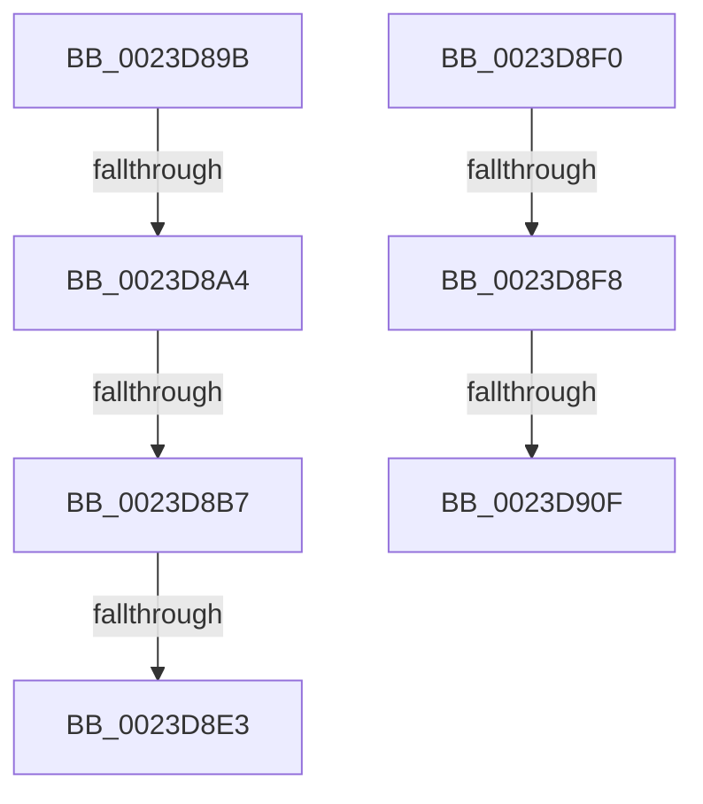

# sub_0023D89B

- RVA: `0x0023D89B`–`0x0023D914` (길이 `121` bytes)
- VA: `0x000000014023D89B`
- 실행 섹션: `.text`
- PDB 이름 있음: `아니요`; PDB Function 태그: `아니요`
- unwind 정보 RVA: `0x000610E0`
- 디코드: `29`개 명령, `121/121` bytes 표시
- 미해석 바이트: `0` (있으면 어셈블리에 `.byte`로 보존)

> 이 문서는 커널 이미지의 기계어와 PDB 기호를 분석해 생성했습니다. 4번과 5번은 함수 원형과 자료형을 바이너리 사용 방식에서 추정한 C 해석이며 원본 소스 복구 결과는 아닙니다.

## 1. Dependencies

- 직접 호출 지점: **4**; 고유 호출 대상: **4**
- 직접 호출자로 확인된 함수: **0**
- RIP 상대 이미지 참조: **1**

### Outgoing calls
- `0x0023D8AA` → [MiOkToSetPteDirtyForNotValidFault](../43/MiOkToSetPteDirtyForNotValidFault_function_00437820.md) (function, `0x00437820`)
- `0x0023D8BA` → [MiUnlockProbePacketWorkingSet](MiUnlockProbePacketWorkingSet_function_0023B800.md) (function, `0x0023B800`)
- `0x0023D8CC` → [MmAccessFault](../27/MmAccessFault_function_0027EE80.md) (function, `0x0027EE80`)
- `0x0023D8D6` → [MiLockProbePacketWorkingSet](../40/MiLockProbePacketWorkingSet_function_0040E500.md) (function, `0x0040E500`)

### Direct callers
- 이 함수 시작 RVA로 연결되는 직접 call은 확인되지 않았습니다. 간접 호출은 완전히 역산할 수 없습니다.

### Static image references
- `0x0023D8E3` → RVA `0x00E30208` (`.data`; read/write)

## 2. Other-region calls and transfers

- 다른 실행 섹션으로 향하는 call: **0**
- call이 아닌 외부 분기/꼬리 이동: **7**
  - `0x0023D89E` → [sub_0023D7AA + 0x49](Unknown_function_0023D7AA.md) (`tail-transfer`)
  - `0x0023D8B1` → [sub_0023D7AA + 0x49](Unknown_function_0023D7AA.md) (`tail-transfer`)
  - `0x0023D8DD` → [sub_0023DB14 + 0x5D](Unknown_function_0023DB14.md) (`tail-transfer`)
  - `0x0023D8EB` → [sub_0023D7AA + 0x8B](Unknown_function_0023D7AA.md) (`tail-transfer`)
  - `0x0023D8F2` → [sub_0023D7AA + 0x5C](Unknown_function_0023D7AA.md) (`tail-transfer`)
  - `0x0023D909` → [sub_0023D7AA + 0x5C](Unknown_function_0023D7AA.md) (`tail-transfer`)
  - `0x0023D90F` → [sub_0023D7AA + 0x89](Unknown_function_0023D7AA.md) (`tail-transfer`)

## 3. Assembly (complete function range)

```asm
0023D89B  41 3B EB                        cmp ebp, r11d
0023D89E  0F 85 4F FF FF FF               jne 0x14023d7f3
0023D8A4  49 8B D5                        mov rdx, r13
0023D8A7  48 8B CB                        mov rcx, rbx
0023D8AA  E8 71 9F 1F 00                  call 0x140437820
0023D8AF  85 C0                           test eax, eax
0023D8B1  0F 85 3C FF FF FF               jne 0x14023d7f3
0023D8B7  48 8B CE                        mov rcx, rsi
0023D8BA  E8 41 DF FF FF                  call 0x14023b800
0023D8BF  45 33 C9                        xor r9d, r9d
0023D8C2  45 33 C0                        xor r8d, r8d
0023D8C5  49 8B D5                        mov rdx, r13
0023D8C8  41 8D 49 02                     lea ecx, [r9 + 2]
0023D8CC  E8 AF 15 04 00                  call 0x14027ee80
0023D8D1  48 8B CE                        mov rcx, rsi
0023D8D4  8B D8                           mov ebx, eax
0023D8D6  E8 25 0C 1D 00                  call 0x14040e500
0023D8DB  85 DB                           test ebx, ebx
0023D8DD  0F 89 8E 02 00 00               jns 0x14023db71
0023D8E3  FF 05 1F 29 BF 00               inc dword ptr [rip + 0xbf291f]
0023D8E9  8B C3                           mov eax, ebx
0023D8EB  E9 45 FF FF FF                  jmp 0x14023d835
0023D8F0  A8 08                           test al, 8
0023D8F2  0F 85 0E FF FF FF               jne 0x14023d806
0023D8F8  48 8B 47 18                     mov rax, qword ptr [rdi + 0x18]
0023D8FC  48 B9 FF FF FF FF FF FF FF 3F   movabs rcx, 0x3fffffffffffffff
0023D906  48 85 C1                        test rcx, rax
0023D909  0F 85 F7 FE FF FF               jne 0x14023d806
0023D90F  E9 1F FF FF FF                  jmp 0x14023d833
```

## 4. C-style interpretation (structured pseudocode)

```c
__int64 __fastcall sub_0023D89B(__int64 a1, __int64 a2, int a3, int a4)
{
    __int64 result;

    result = MiOkToSetPteDirtyForNotValidFault(v_rbx, v_r13, a3, a4);
    result = MiUnlockProbePacketWorkingSet(v_rsi, v_r13, a3, a4);
    a4 = 0;
    a3 = 0;
    result = MmAccessFault(a4 + 2, v_r13, a3, a4);
    result = MiLockProbePacketWorkingSet(v_rsi, v_r13, a3, a4);
}
```

## 5. (Beta) C Style

```c
int64_t sub_0023D89B(int64_t Arg1, int64_t Arg2, int32_t Arg3, int32_t Arg4)
{
    int64_t result;

    result = MiOkToSetPteDirtyForNotValidFault(local_rbx, local_r13, Arg3, Arg4);
    result = MiUnlockProbePacketWorkingSet(local_rsi, local_r13, Arg3, Arg4);
    Arg4 = 0;
    Arg3 = 0;
    result = MmAccessFault(Arg4 + 2, local_r13, Arg3, Arg4);
    result = MiLockProbePacketWorkingSet(local_rsi, local_r13, Arg3, Arg4);
}
```

## 6. Execution-region graph

[열기: 2D/3D 그래프와 함수 탐색 컨트롤 패널](../../../control-panel.html?section=text&rva=0x0023D89B&view=graph)

- 2D 그래프는 위에서 아래로 흐르고, 3D 그래프는 빈 공간을 드래그해 회전합니다. Shift+드래그는 이동, 휠은 확대·축소, 함수 노드 선택은 대상 보고서 이동입니다.

### Static fallback


