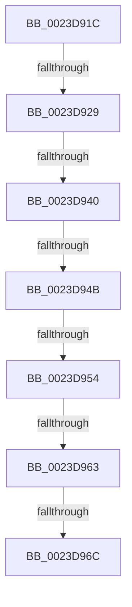

# sub_0023D91C

- RVA: `0x0023D91C`–`0x0023D97B` (길이 `95` bytes)
- VA: `0x000000014023D91C`
- 실행 섹션: `.text`
- PDB 이름 있음: `아니요`; PDB Function 태그: `아니요`
- unwind 정보 RVA: `0x00061104`
- 디코드: `20`개 명령, `95/95` bytes 표시
- 미해석 바이트: `0` (있으면 어셈블리에 `.byte`로 보존)

> 이 문서는 커널 이미지의 기계어와 PDB 기호를 분석해 생성했습니다. 4번과 5번은 함수 원형과 자료형을 바이너리 사용 방식에서 추정한 C 해석이며 원본 소스 복구 결과는 아닙니다.

## 1. Dependencies

- 직접 호출 지점: **0**; 고유 호출 대상: **0**
- 직접 호출자로 확인된 함수: **0**
- RIP 상대 이미지 참조: **0**

### Outgoing calls
- 직접 디코드된 call 명령이 없습니다.

### Direct callers
- 이 함수 시작 RVA로 연결되는 직접 call은 확인되지 않았습니다. 간접 호출은 완전히 역산할 수 없습니다.

### Static image references
- 디코드된 RIP-relative 메모리 참조가 없습니다.

## 2. Other-region calls and transfers

- 다른 실행 섹션으로 향하는 call: **0**
- call이 아닌 외부 분기/꼬리 이동: **7**
  - `0x0023D923` → [sub_0023D7AA + 0x89](Unknown_function_0023D7AA.md) (`tail-transfer`)
  - `0x0023D93A` → [sub_0023DA90](Unknown_function_0023DA90.md) (`tail-transfer`)
  - `0x0023D945` → [sub_0023DBF0 + 0x8](Unknown_function_0023DBF0.md) (`tail-transfer`)
  - `0x0023D94E` → [sub_0023D7AA + 0x89](Unknown_function_0023D7AA.md) (`tail-transfer`)
  - `0x0023D95D` → [sub_0023DB14 + 0x30](Unknown_function_0023DB14.md) (`tail-transfer`)
  - `0x0023D966` → [sub_0023DB14 + 0x6D](Unknown_function_0023DB14.md) (`tail-transfer`)
  - `0x0023D976` → [sub_0023D67C + 0xB8](Unknown_function_0023D67C.md) (`tail-transfer`)

## 3. Assembly (complete function range)

```asm
0023D91C  48 8B 47 28                     mov rax, qword ptr [rdi + 0x28]
0023D920  48 85 C0                        test rax, rax
0023D923  0F 89 0A FF FF FF               jns 0x14023d833
0023D929  48 8B 4E 58                     mov rcx, qword ptr [rsi + 0x58]
0023D92D  49 B8 00 00 00 00 00 00 00 80   movabs r8, 0x8000000000000000
0023D937  48 85 C9                        test rcx, rcx
0023D93A  0F 85 50 01 00 00               jne 0x14023da90
0023D940  8B 46 48                        mov eax, dword ptr [rsi + 0x48]
0023D943  A8 40                           test al, 0x40
0023D945  0F 85 AD 02 00 00               jne 0x14023dbf8
0023D94B  45 85 E4                        test r12d, r12d
0023D94E  0F 84 DF FE FF FF               je 0x14023d833
0023D954  4C 89 74 24 70                  mov qword ptr [rsp + 0x70], r14
0023D959  41 83 FF 03                     cmp r15d, 3
0023D95D  0F 85 E1 01 00 00               jne 0x14023db44
0023D963  48 85 DB                        test rbx, rbx
0023D966  0F 89 15 02 00 00               jns 0x14023db81
0023D96C  4C 8B 64 24 30                  mov r12, qword ptr [rsp + 0x30]
0023D971  B8 45 00 00 C0                  mov eax, 0xc0000045
0023D976  E9 B9 FD FF FF                  jmp 0x14023d734
```

## 4. C-style interpretation (structured pseudocode)

```c
__int64 __fastcall sub_0023D91C(__int64 a1, __int64 a2, __int64 a3, __int64 a4, __int64 a5, __int64 a6)
{
    unsigned __int64 v_stack_p70;

    v_stack_p70 = v_r14;
}
```

## 5. (Beta) C Style

```c
int64_t sub_0023D91C(int64_t Arg1, int64_t Arg2, int64_t Arg3, int64_t Arg4, uint64_t Arg5, int64_t Arg6)
{
    uint64_t v_stack_p70;

    v_stack_p70 = local_r14;
}
```

## 6. Execution-region graph

[열기: 2D/3D 그래프와 함수 탐색 컨트롤 패널](../../../control-panel.html?section=text&rva=0x0023D91C&view=graph)

- 2D 그래프는 위에서 아래로 흐르고, 3D 그래프는 빈 공간을 드래그해 회전합니다. Shift+드래그는 이동, 휠은 확대·축소, 함수 노드 선택은 대상 보고서 이동입니다.

### Static fallback


