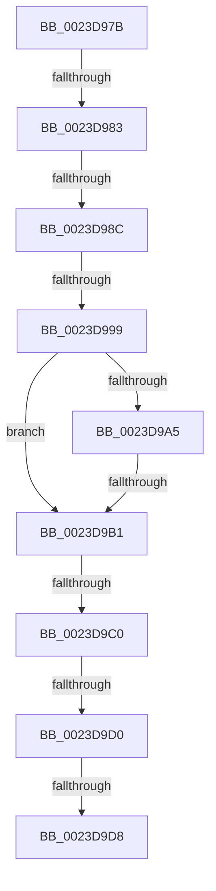

# sub_0023D97B

- RVA: `0x0023D97B`–`0x0023D9E3` (길이 `104` bytes)
- VA: `0x000000014023D97B`
- 실행 섹션: `.text`
- PDB 이름 있음: `아니요`; PDB Function 태그: `아니요`
- unwind 정보 RVA: `0x00061118`
- 디코드: `24`개 명령, `104/104` bytes 표시
- 미해석 바이트: `0` (있으면 어셈블리에 `.byte`로 보존)

> 이 문서는 커널 이미지의 기계어와 PDB 기호를 분석해 생성했습니다. 4번과 5번은 함수 원형과 자료형을 바이너리 사용 방식에서 추정한 C 해석이며 원본 소스 복구 결과는 아닙니다.

## 1. Dependencies

- 직접 호출 지점: **1**; 고유 호출 대상: **1**
- 직접 호출자로 확인된 함수: **0**
- RIP 상대 이미지 참조: **1**

### Outgoing calls
- `0x0023D99C` → [MiCanPageMove](../38/MiCanPageMove_function_00383710.md) (function, `0x00383710`)

### Direct callers
- 이 함수 시작 RVA로 연결되는 직접 call은 확인되지 않았습니다. 간접 호출은 완전히 역산할 수 없습니다.

### Static image references
- `0x0023D9C0` → RVA `0x00E2DC80` (`.data`; read)

## 2. Other-region calls and transfers

- 다른 실행 섹션으로 향하는 call: **0**
- call이 아닌 외부 분기/꼬리 이동: **8**
  - `0x0023D97D` → [sub_0023D7AA + 0x49](Unknown_function_0023D7AA.md) (`tail-transfer`)
  - `0x0023D986` → [sub_0023D7AA + 0x89](Unknown_function_0023D7AA.md) (`tail-transfer`)
  - `0x0023D993` → [sub_0023D7AA + 0x4E](Unknown_function_0023D7AA.md) (`tail-transfer`)
  - `0x0023D9AB` → [sub_0023D7AA + 0x4E](Unknown_function_0023D7AA.md) (`tail-transfer`)
  - `0x0023D9BA` → [sub_006D7AEE + 0x12](../6D/Unknown_function_006D7AEE.md) (`tail-transfer`)
  - `0x0023D9CA` → [sub_006D7AEE](../6D/Unknown_function_006D7AEE.md) (`tail-transfer`)
  - `0x0023D9D2` → [sub_006D7AEE](../6D/Unknown_function_006D7AEE.md) (`tail-transfer`)
  - `0x0023D9DE` → [sub_006D7AEE](../6D/Unknown_function_006D7AEE.md) (`tail-transfer`)

## 3. Assembly (complete function range)

```asm
0023D97B  85 C9                           test ecx, ecx
0023D97D  0F 84 70 FE FF FF               je 0x14023d7f3
0023D983  48 85 FF                        test rdi, rdi
0023D986  0F 84 A7 FE FF FF               je 0x14023d833
0023D98C  48 8B 47 28                     mov rax, qword ptr [rdi + 0x28]
0023D990  48 85 C0                        test rax, rax
0023D993  0F 89 5F FE FF FF               jns 0x14023d7f8
0023D999  48 8B CF                        mov rcx, rdi
0023D99C  E8 6F 5D 14 00                  call 0x140383710
0023D9A1  85 C0                           test eax, eax
0023D9A3  75 0C                           jne 0x14023d9b1
0023D9A5  48 0F BA 67 28 35               bt qword ptr [rdi + 0x28], 0x35
0023D9AB  0F 83 47 FE FF FF               jae 0x14023d7f8
0023D9B1  48 8B 47 10                     mov rax, qword ptr [rdi + 0x10]
0023D9B5  48 0F BA E0 0A                  bt rax, 0xa
0023D9BA  0F 83 40 A1 49 00               jae 0x1406d7b00
0023D9C0  48 8B 0D B9 02 BF 00            mov rcx, qword ptr [rip + 0xbf02b9]
0023D9C7  48 85 C9                        test rcx, rcx
0023D9CA  0F 84 1E A1 49 00               je 0x1406d7aee
0023D9D0  A8 10                           test al, 0x10
0023D9D2  0F 85 16 A1 49 00               jne 0x1406d7aee
0023D9D8  48 F7 D1                        not rcx
0023D9DB  48 23 C1                        and rax, rcx
0023D9DE  E9 0B A1 49 00                  jmp 0x1406d7aee
```

## 4. C-style interpretation (structured pseudocode)

```c
__int64 __fastcall sub_0023D97B(int a1)
{
    __int64 result;

    result = MiCanPageMove(v_rdi, a2, a3, a4);
    if ((unsigned int)(result) != 0) goto loc_0023D9B1;
loc_0023D9B1:
    a1 = ~(*(unsigned __int64 *)(v_rip + 12518073));
    result = (*(unsigned __int64 *)(v_rdi + 16)) & (a1);
}
```

## 5. (Beta) C Style

```c
int64_t sub_0023D97B(int32_t Arg1)
{
    int64_t result;

    result = MiCanPageMove(local_rdi, a2, a3, a4);
    if ((uint32_t)(result) != 0) goto loc_0023D9B1;
loc_0023D9B1:
    Arg1 = ~(*(uint64_t *)(v_rip + 0xBF02B9));
    result = (*(uint64_t *)(local_rdi + 0x10)) & (Arg1);
}
```

## 6. Execution-region graph

[열기: 2D/3D 그래프와 함수 탐색 컨트롤 패널](../../../control-panel.html?section=text&rva=0x0023D97B&view=graph)

- 2D 그래프는 위에서 아래로 흐르고, 3D 그래프는 빈 공간을 드래그해 회전합니다. Shift+드래그는 이동, 휠은 확대·축소, 함수 노드 선택은 대상 보고서 이동입니다.

### Static fallback


