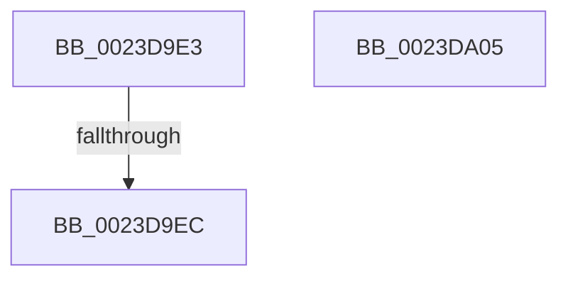

# sub_0023D9E3

- RVA: `0x0023D9E3`–`0x0023DA06` (길이 `35` bytes)
- VA: `0x000000014023D9E3`
- 실행 섹션: `.text`
- PDB 이름 있음: `아니요`; PDB Function 태그: `아니요`
- unwind 정보 RVA: `0x0006112C`
- 디코드: `13`개 명령, `35/35` bytes 표시
- 미해석 바이트: `0` (있으면 어셈블리에 `.byte`로 보존)

> 이 문서는 커널 이미지의 기계어와 PDB 기호를 분석해 생성했습니다. 4번과 5번은 함수 원형과 자료형을 바이너리 사용 방식에서 추정한 C 해석이며 원본 소스 복구 결과는 아닙니다.

## 1. Dependencies

- 직접 호출 지점: **0**; 고유 호출 대상: **0**
- 직접 호출자로 확인된 함수: **0**
- RIP 상대 이미지 참조: **1**

### Outgoing calls
- 직접 디코드된 call 명령이 없습니다.

### Direct callers
- 이 함수 시작 RVA로 연결되는 직접 call은 확인되지 않았습니다. 간접 호출은 완전히 역산할 수 없습니다.

### Static image references
- `0x0023D9EC` → RVA `0x00E30210` (`.data`; read/write)

## 2. Other-region calls and transfers

- 다른 실행 섹션으로 향하는 call: **0**
- call이 아닌 외부 분기/꼬리 이동: **1**
  - `0x0023D9E6` → [MiProbeLeafPteAccess + 0x39](MiProbeLeafPteAccess_function_0023D640.md) (`tail-transfer`)

## 3. Assembly (complete function range)

```asm
0023D9E3  83 FD 01                        cmp ebp, 1
0023D9E6  0F 85 8D FC FF FF               jne 0x14023d679
0023D9EC  FF 05 1E 28 BF 00               inc dword ptr [rip + 0xbf281e]
0023D9F2  B8 05 00 00 C0                  mov eax, 0xc0000005
0023D9F7  48 83 C4 38                     add rsp, 0x38
0023D9FB  41 5F                           pop r15
0023D9FD  41 5E                           pop r14
0023D9FF  41 5D                           pop r13
0023DA01  5E                              pop rsi
0023DA02  5D                              pop rbp
0023DA03  5B                              pop rbx
0023DA04  C3                              ret
0023DA05  CC                              int3
```

## 4. C-style interpretation (structured pseudocode)

```c
__int64 __fastcall sub_0023D9E3(void)
{
    __int64 v_rsp;

    v_rsp = (v_rsp) + (56);
    return (unsigned int)(0xC0000005ULL);
}
```

## 5. (Beta) C Style

```c
void sub_0023D9E3(void)
{
    int64_t local_rsp;

    local_rsp = (local_rsp) + (56);
    return (uint32_t)(0xC0000005ULL);
}
```

## 6. Execution-region graph

[열기: 2D/3D 그래프와 함수 탐색 컨트롤 패널](../../../control-panel.html?section=text&rva=0x0023D9E3&view=graph)

- 2D 그래프는 위에서 아래로 흐르고, 3D 그래프는 빈 공간을 드래그해 회전합니다. Shift+드래그는 이동, 휠은 확대·축소, 함수 노드 선택은 대상 보고서 이동입니다.

### Static fallback


