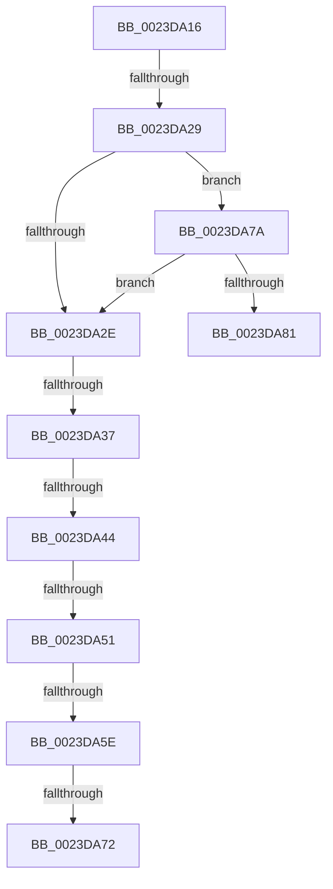

# sub_0023DA16

- RVA: `0x0023DA16`–`0x0023DA90` (길이 `122` bytes)
- VA: `0x000000014023DA16`
- 실행 섹션: `.text`
- PDB 이름 있음: `아니요`; PDB Function 태그: `아니요`
- unwind 정보 RVA: `0x00061154`
- 디코드: `28`개 명령, `122/122` bytes 표시
- 미해석 바이트: `0` (있으면 어셈블리에 `.byte`로 보존)

> 이 문서는 커널 이미지의 기계어와 PDB 기호를 분석해 생성했습니다. 4번과 5번은 함수 원형과 자료형을 바이너리 사용 방식에서 추정한 C 해석이며 원본 소스 복구 결과는 아닙니다.

## 1. Dependencies

- 직접 호출 지점: **0**; 고유 호출 대상: **0**
- 직접 호출자로 확인된 함수: **0**
- RIP 상대 이미지 참조: **0**

### Outgoing calls
- 직접 디코드된 call 명령이 없습니다.

### Direct callers
- 이 함수 시작 RVA로 연결되는 직접 call은 확인되지 않았습니다. 간접 호출은 완전히 역산할 수 없습니다.

### Static image references
- 디코드된 RIP-relative 메모리 참조가 없습니다.

## 2. Other-region calls and transfers

- 다른 실행 섹션으로 향하는 call: **0**
- call이 아닌 외부 분기/꼬리 이동: **8**
  - `0x0023DA23` → [sub_0023DB14 + 0xBD](Unknown_function_0023DB14.md) (`tail-transfer`)
  - `0x0023DA31` → [sub_0023D7AA + 0x2D](Unknown_function_0023D7AA.md) (`tail-transfer`)
  - `0x0023DA3E` → [sub_0023D7AA + 0x2D](Unknown_function_0023D7AA.md) (`tail-transfer`)
  - `0x0023DA4B` → [sub_0023D7AA + 0x2D](Unknown_function_0023D7AA.md) (`tail-transfer`)
  - `0x0023DA58` → [sub_0023D7AA + 0x2D](Unknown_function_0023D7AA.md) (`tail-transfer`)
  - `0x0023DA6C` → [sub_0023DB14 + 0xBD](Unknown_function_0023DB14.md) (`tail-transfer`)
  - `0x0023DA75` → [sub_0023D7AA + 0x39](Unknown_function_0023D7AA.md) (`tail-transfer`)
  - `0x0023DA8B` → [sub_0023D67C + 0xB8](Unknown_function_0023D67C.md) (`tail-transfer`)

## 3. Assembly (complete function range)

```asm
0023DA16  48 B8 FF FF FE FF FF 7F 00 00   movabs rax, 0x7ffffffeffff
0023DA20  4C 3B E8                        cmp r13, rax
0023DA23  0F 87 A8 01 00 00               ja 0x14023dbd1
0023DA29  48 85 DB                        test rbx, rbx
0023DA2C  78 4C                           js 0x14023da7a
0023DA2E  48 85 FF                        test rdi, rdi
0023DA31  0F 84 A0 FD FF FF               je 0x14023d7d7
0023DA37  48 8B 47 28                     mov rax, qword ptr [rdi + 0x28]
0023DA3B  49 85 C1                        test r9, rax
0023DA3E  0F 85 93 FD FF FF               jne 0x14023d7d7
0023DA44  48 8B 47 08                     mov rax, qword ptr [rdi + 8]
0023DA48  48 85 C0                        test rax, rax
0023DA4B  0F 88 86 FD FF FF               js 0x14023d7d7
0023DA51  48 8B 47 08                     mov rax, qword ptr [rdi + 8]
0023DA55  48 85 C0                        test rax, rax
0023DA58  0F 84 79 FD FF FF               je 0x14023d7d7
0023DA5E  48 8B 47 08                     mov rax, qword ptr [rdi + 8]
0023DA62  48 0B C2                        or rax, rdx
0023DA65  48 8B 40 10                     mov rax, qword ptr [rax + 0x10]
0023DA69  49 85 C2                        test r10, rax
0023DA6C  0F 85 5F 01 00 00               jne 0x14023dbd1
0023DA72  45 8B E6                        mov r12d, r14d
0023DA75  E9 69 FD FF FF                  jmp 0x14023d7e3
0023DA7A  48 0F BA E3 0B                  bt rbx, 0xb
0023DA7F  73 AD                           jae 0x14023da2e
0023DA81  4C 8B 64 24 30                  mov r12, qword ptr [rsp + 0x30]
0023DA86  B8 18 00 00 C0                  mov eax, 0xc0000018
0023DA8B  E9 A4 FC FF FF                  jmp 0x14023d734
```

## 4. C-style interpretation (structured pseudocode)

```c
__int64 __fastcall sub_0023DA16(__int64 a1, __int64 a2, __int64 a3, __int64 a4, __int64 a5, __int64 a6)
{
    __int64 result;

    if (sign_flag) goto loc_0023DA7A;
loc_0023DA2E:
    result = (*(unsigned __int64 *)(v_rdi + 8)) | (a2);
loc_0023DA7A:
    if (condition_is_above_or_equal) goto loc_0023DA2E;
}
```

## 5. (Beta) C Style

```c
int64_t sub_0023DA16(int64_t Arg1, int64_t Arg2, int64_t Arg3, int64_t Arg4, uint64_t Arg5, int64_t Arg6)
{
    int64_t result;

    if (sign_flag) goto loc_0023DA7A;
loc_0023DA2E:
    result = (*(uint64_t *)(local_rdi + 0x8)) | (Arg2);
loc_0023DA7A:
    if (condition_is_above_or_equal) goto loc_0023DA2E;
}
```

## 6. Execution-region graph

[열기: 2D/3D 그래프와 함수 탐색 컨트롤 패널](../../../control-panel.html?section=text&rva=0x0023DA16&view=graph)

- 2D 그래프는 위에서 아래로 흐르고, 3D 그래프는 빈 공간을 드래그해 회전합니다. Shift+드래그는 이동, 휠은 확대·축소, 함수 노드 선택은 대상 보고서 이동입니다.

### Static fallback


