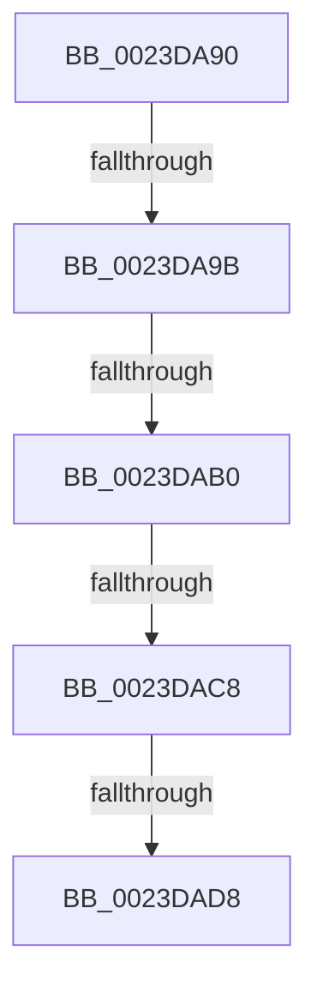

# sub_0023DA90

- RVA: `0x0023DA90`–`0x0023DAE8` (길이 `88` bytes)
- VA: `0x000000014023DA90`
- 실행 섹션: `.text`
- PDB 이름 있음: `아니요`; PDB Function 태그: `아니요`
- unwind 정보 RVA: `0x0006116C`
- 디코드: `19`개 명령, `88/88` bytes 표시
- 미해석 바이트: `0` (있으면 어셈블리에 `.byte`로 보존)

> 이 문서는 커널 이미지의 기계어와 PDB 기호를 분석해 생성했습니다. 4번과 5번은 함수 원형과 자료형을 바이너리 사용 방식에서 추정한 C 해석이며 원본 소스 복구 결과는 아닙니다.

## 1. Dependencies

- 직접 호출 지점: **2**; 고유 호출 대상: **2**
- 직접 호출자로 확인된 함수: **0**
- RIP 상대 이미지 참조: **1**

### Outgoing calls
- `0x0023DAA2` → [MiLocateCloneAddress](../3D/MiLocateCloneAddress_function_003D26B4.md) (function, `0x003D26B4`)
- `0x0023DACB` → [MiSplitReducedCommitClonePage](../4F/MiSplitReducedCommitClonePage_function_004FA808.md) (function, `0x004FA808`)

### Direct callers
- 이 함수 시작 RVA로 연결되는 직접 call은 확인되지 않았습니다. 간접 호출은 완전히 역산할 수 없습니다.

### Static image references
- `0x0023DAD8` → RVA `0x00E30230` (`.data`; read/write)

## 2. Other-region calls and transfers

- 다른 실행 섹션으로 향하는 call: **0**
- call이 아닌 외부 분기/꼬리 이동: **5**
  - `0x0023DA95` → [sub_0023D91C + 0x24](Unknown_function_0023D91C.md) (`tail-transfer`)
  - `0x0023DAAA` → [sub_0023D91C + 0x24](Unknown_function_0023D91C.md) (`tail-transfer`)
  - `0x0023DAC2` → [sub_0023DBF0](Unknown_function_0023DBF0.md) (`tail-transfer`)
  - `0x0023DAD2` → [sub_0023DB14 + 0x5D](Unknown_function_0023DB14.md) (`tail-transfer`)
  - `0x0023DAE3` → [sub_0023D67C + 0xB8](Unknown_function_0023D67C.md) (`tail-transfer`)

## 3. Assembly (complete function range)

```asm
0023DA90  8B 46 48                        mov eax, dword ptr [rsi + 0x48]
0023DA93  A8 10                           test al, 0x10
0023DA95  0F 84 A5 FE FF FF               je 0x14023d940
0023DA9B  48 8B 57 08                     mov rdx, qword ptr [rdi + 8]
0023DA9F  49 0B D0                        or rdx, r8
0023DAA2  E8 0D 4C 19 00                  call 0x1403d26b4
0023DAA7  48 85 C0                        test rax, rax
0023DAAA  0F 84 90 FE FF FF               je 0x14023d940
0023DAB0  48 8B 89 10 04 00 00            mov rcx, qword ptr [rcx + 0x410]
0023DAB7  48 8B 40 60                     mov rax, qword ptr [rax + 0x60]
0023DABB  48 39 81 28 04 00 00            cmp qword ptr [rcx + 0x428], rax
0023DAC2  0F 86 28 01 00 00               jbe 0x14023dbf0
0023DAC8  48 8B CE                        mov rcx, rsi
0023DACB  E8 38 CD 2B 00                  call 0x1404fa808
0023DAD0  85 C0                           test eax, eax
0023DAD2  0F 89 99 00 00 00               jns 0x14023db71
0023DAD8  FF 05 52 27 BF 00               inc dword ptr [rip + 0xbf2752]
0023DADE  4C 8B 64 24 30                  mov r12, qword ptr [rsp + 0x30]
0023DAE3  E9 4C FC FF FF                  jmp 0x14023d734
```

## 4. C-style interpretation (structured pseudocode)

```c
__int64 __fastcall sub_0023DA90(__int64 a1, __int64 a2, __int64 a3, __int64 a4, __int64 a5, __int64 a6)
{
    __int64 result;

    a2 = (*(unsigned __int64 *)(v_rdi + 8)) | (a3);
    result = MiLocateCloneAddress(a1, a2, a3, a4);
    result = MiSplitReducedCommitClonePage(v_rsi, a2, a3, a4);
}
```

## 5. (Beta) C Style

```c
int64_t sub_0023DA90(int64_t Arg1, int64_t Arg2, int64_t Arg3, int64_t Arg4, uint64_t Arg5, int64_t Arg6)
{
    int64_t result;

    Arg2 = (*(uint64_t *)(local_rdi + 0x8)) | (Arg3);
    result = MiLocateCloneAddress(Arg1, Arg2, Arg3, Arg4);
    result = MiSplitReducedCommitClonePage(local_rsi, Arg2, Arg3, Arg4);
}
```

## 6. Execution-region graph

[열기: 2D/3D 그래프와 함수 탐색 컨트롤 패널](../../../control-panel.html?section=text&rva=0x0023DA90&view=graph)

- 2D 그래프는 위에서 아래로 흐르고, 3D 그래프는 빈 공간을 드래그해 회전합니다. Shift+드래그는 이동, 휠은 확대·축소, 함수 노드 선택은 대상 보고서 이동입니다.

### Static fallback


