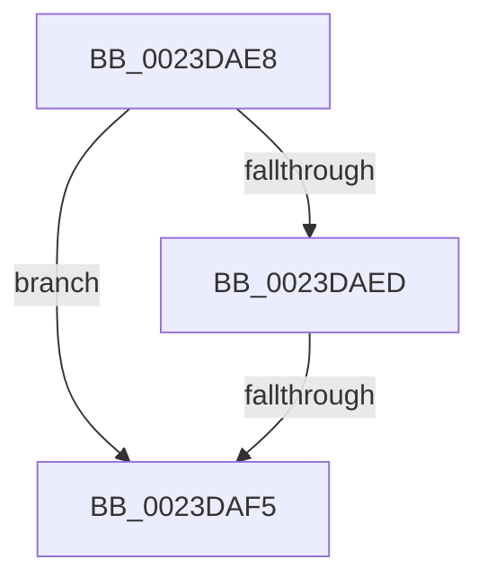

# sub_0023DAE8

- RVA: `0x0023DAE8`–`0x0023DB08` (길이 `32` bytes)
- VA: `0x000000014023DAE8`
- 실행 섹션: `.text`
- PDB 이름 있음: `아니요`; PDB Function 태그: `아니요`
- unwind 정보 RVA: `0x00061184`
- 디코드: `8`개 명령, `32/32` bytes 표시
- 미해석 바이트: `0` (있으면 어셈블리에 `.byte`로 보존)

> 이 문서는 커널 이미지의 기계어와 PDB 기호를 분석해 생성했습니다. 4번과 5번은 함수 원형과 자료형을 바이너리 사용 방식에서 추정한 C 해석이며 원본 소스 복구 결과는 아닙니다.

## 1. Dependencies

- 직접 호출 지점: **0**; 고유 호출 대상: **0**
- 직접 호출자로 확인된 함수: **0**
- RIP 상대 이미지 참조: **0**

### Outgoing calls
- 직접 디코드된 call 명령이 없습니다.

### Direct callers
- 이 함수 시작 RVA로 연결되는 직접 call은 확인되지 않았습니다. 간접 호출은 완전히 역산할 수 없습니다.

### Static image references
- 디코드된 RIP-relative 메모리 참조가 없습니다.

## 2. Other-region calls and transfers

- 다른 실행 섹션으로 향하는 call: **0**
- call이 아닌 외부 분기/꼬리 이동: **2**
  - `0x0023DAEF` → [sub_0023D83F + 0xA](Unknown_function_0023D83F.md) (`tail-transfer`)
  - `0x0023DB03` → [sub_0023D67C + 0xB8](Unknown_function_0023D67C.md) (`tail-transfer`)

## 3. Assembly (complete function range)

```asm
0023DAE8  83 FD 06                        cmp ebp, 6
0023DAEB  75 08                           jne 0x14023daf5
0023DAED  85 C9                           test ecx, ecx
0023DAEF  0F 85 54 FD FF FF               jne 0x14023d849
0023DAF5  4C 8B 64 24 30                  mov r12, qword ptr [rsp + 0x30]
0023DAFA  33 C0                           xor eax, eax
0023DAFC  41 C7 00 02 00 00 00            mov dword ptr [r8], 2
0023DB03  E9 2C FC FF FF                  jmp 0x14023d734
```

## 4. C-style interpretation (structured pseudocode)

```c
__int64 __fastcall sub_0023DAE8(int a1, __int64 a2, __int64 a3, __int64 a4, __int64 a5, __int64 a6)
{
    __int64 result;

    if (((unsigned int)(v_rbp)) != 6) goto loc_0023DAF5;
loc_0023DAF5:
    result = 0;
    *(unsigned int *)(a3) = 2;
}
```

## 5. (Beta) C Style

```c
int64_t sub_0023DAE8(int32_t Arg1, int64_t Arg2, void *Arg3, int64_t Arg4, uint64_t Arg5, int64_t Arg6)
{
    uint8_t *arg3 = (uint8_t *)Arg3;

    int64_t result;

    if (((uint32_t)(local_rbp)) != 6) goto loc_0023DAF5;
loc_0023DAF5:
    result = 0;
    *(uint32_t *)(arg3) = 2;
}
```

### 관측된 메모리 오프셋

구조체 형식이 확인되지 않은 접근은 인자 기준의 오프셋으로만 기록했습니다.

| 기준 인자 | 오프셋 표현 | 폭 (bit) | 접근 |
|---|---:|---:|---|
| `Arg3` | `+ 0x0` | `32` | `W` |

## 6. Execution-region graph

[열기: 2D/3D 그래프와 함수 탐색 컨트롤 패널](../../../control-panel.html?section=text&rva=0x0023DAE8&view=graph)

- 2D 그래프는 위에서 아래로 흐르고, 3D 그래프는 빈 공간을 드래그해 회전합니다. Shift+드래그는 이동, 휠은 확대·축소, 함수 노드 선택은 대상 보고서 이동입니다.

### Static fallback


