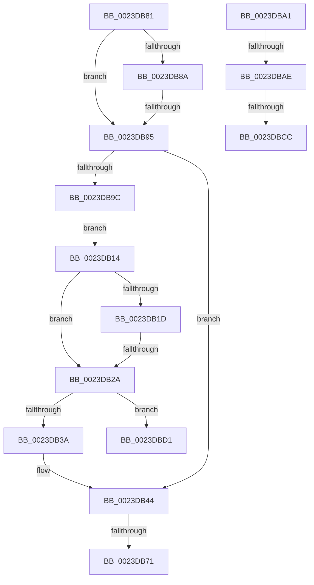

# sub_0023DB14

- RVA: `0x0023DB14`–`0x0023DBE0` (길이 `204` bytes)
- VA: `0x000000014023DB14`
- 실행 섹션: `.text`
- PDB 이름 있음: `아니요`; PDB Function 태그: `아니요`
- unwind 정보 RVA: `0x000611B0`
- 디코드: `47`개 명령, `204/204` bytes 표시
- 미해석 바이트: `0` (있으면 어셈블리에 `.byte`로 보존)

> 이 문서는 커널 이미지의 기계어와 PDB 기호를 분석해 생성했습니다. 4번과 5번은 함수 원형과 자료형을 바이너리 사용 방식에서 추정한 C 해석이며 원본 소스 복구 결과는 아닙니다.

## 1. Dependencies

- 직접 호출 지점: **2**; 고유 호출 대상: **2**
- 직접 호출자로 확인된 함수: **0**
- RIP 상대 이미지 참조: **0**

### Outgoing calls
- `0x0023DB2D` → [MiProcessCommitIntact](../40/MiProcessCommitIntact_function_004093C0.md) (function, `0x004093C0`)
- `0x0023DB62` → [MiCopyOnWrite](../36/MiCopyOnWrite_function_00362A0C.md) (function, `0x00362A0C`)

### Direct callers
- 이 함수 시작 RVA로 연결되는 직접 call은 확인되지 않았습니다. 간접 호출은 완전히 역산할 수 없습니다.

### Static image references
- 디코드된 RIP-relative 메모리 참조가 없습니다.

## 2. Other-region calls and transfers

- 다른 실행 섹션으로 향하는 call: **0**
- call이 아닌 외부 분기/꼬리 이동: **8**
  - `0x0023DB24` → [sub_0023DBF0 + 0x58](Unknown_function_0023DBF0.md) (`tail-transfer`)
  - `0x0023DB6B` → [sub_0023DBF0 + 0x6A](Unknown_function_0023DBF0.md) (`tail-transfer`)
  - `0x0023DB7C` → [sub_0023D7AA + 0x89](Unknown_function_0023D7AA.md) (`tail-transfer`)
  - `0x0023DB8F` → [sub_0023DBF0 + 0x26](Unknown_function_0023DBF0.md) (`tail-transfer`)
  - `0x0023DBA8` → [sub_0023D7AA + 0x80](Unknown_function_0023D7AA.md) (`tail-transfer`)
  - `0x0023DBC6` → [sub_0023D7AA + 0x89](Unknown_function_0023D7AA.md) (`tail-transfer`)
  - `0x0023DBCC` → [sub_0023D91C + 0x38](Unknown_function_0023D91C.md) (`tail-transfer`)
  - `0x0023DBDB` → [sub_0023D67C + 0xB8](Unknown_function_0023D67C.md) (`tail-transfer`)

## 3. Assembly (complete function range)

```asm
0023DB14  48 8B 47 28                     mov rax, qword ptr [rdi + 0x28]
0023DB18  49 85 C1                        test r9, rax
0023DB1B  75 0D                           jne 0x14023db2a
0023DB1D  48 8B 47 08                     mov rax, qword ptr [rdi + 8]
0023DB21  48 85 C0                        test rax, rax
0023DB24  0F 89 1E 01 00 00               jns 0x14023dc48
0023DB2A  49 8B CD                        mov rcx, r13
0023DB2D  E8 8E B8 1C 00                  call 0x1404093c0
0023DB32  85 C0                           test eax, eax
0023DB34  0F 84 97 00 00 00               je 0x14023dbd1
0023DB3A  48 FF 46 70                     inc qword ptr [rsi + 0x70]
0023DB3E  41 BE 01 00 00 00               mov r14d, 1
0023DB44  48 8B 56 18                     mov rdx, qword ptr [rsi + 0x18]
0023DB48  48 8D 44 24 70                  lea rax, [rsp + 0x70]
0023DB4D  41 B9 02 00 00 00               mov r9d, 2
0023DB53  48 89 44 24 20                  mov qword ptr [rsp + 0x20], rax
0023DB58  49 C7 C0 FF FF FF FF            mov r8, 0xffffffffffffffff
0023DB5F  49 8B CD                        mov rcx, r13
0023DB62  E8 A5 4E 12 00                  call 0x140362a0c
0023DB67  8B D8                           mov ebx, eax
0023DB69  85 C0                           test eax, eax
0023DB6B  0F 88 E9 00 00 00               js 0x14023dc5a
0023DB71  48 8B 44 24 78                  mov rax, qword ptr [rsp + 0x78]
0023DB76  C7 00 01 00 00 00               mov dword ptr [rax], 1
0023DB7C  E9 B2 FC FF FF                  jmp 0x14023d833
0023DB81  48 8B 4E 58                     mov rcx, qword ptr [rsi + 0x58]
0023DB85  48 85 C9                        test rcx, rcx
0023DB88  74 0B                           je 0x14023db95
0023DB8A  8B 46 48                        mov eax, dword ptr [rsi + 0x48]
0023DB8D  A8 10                           test al, 0x10
0023DB8F  0F 85 81 00 00 00               jne 0x14023dc16
0023DB95  48 0F BA E3 09                  bt rbx, 9
0023DB9A  72 A8                           jb 0x14023db44
0023DB9C  E9 73 FF FF FF                  jmp 0x14023db14
0023DBA1  48 8B 47 08                     mov rax, qword ptr [rdi + 8]
0023DBA5  48 85 C0                        test rax, rax
0023DBA8  0F 84 7C FC FF FF               je 0x14023d82a
0023DBAE  48 8B 47 08                     mov rax, qword ptr [rdi + 8]
0023DBB2  49 B8 00 00 00 00 00 00 00 80   movabs r8, 0x8000000000000000
0023DBBC  49 0B C0                        or rax, r8
0023DBBF  48 8B 40 10                     mov rax, qword ptr [rax + 0x10]
0023DBC3  49 85 C2                        test r10, rax
0023DBC6  0F 85 67 FC FF FF               jne 0x14023d833
0023DBCC  E9 83 FD FF FF                  jmp 0x14023d954
0023DBD1  4C 8B 64 24 30                  mov r12, qword ptr [rsp + 0x30]
0023DBD6  B8 05 00 00 C0                  mov eax, 0xc0000005
0023DBDB  E9 54 FB FF FF                  jmp 0x14023d734
```

## 4. C-style interpretation (structured pseudocode)

```c
__int64 __fastcall sub_0023DB14(__int64 a1, __int64 a2, __int64 a3, __int64 a4, __int64 a5, __int64 a6, __int64 a7, __int64 a8, __int64 a9, __int64 a10, __int64 a11, __int64 a12, __int64 a13, __int64 a14, __int64 a15)
{
    __int64 result;
    unsigned __int64 v_stack_p20;

    if (((a4) & (*(unsigned __int64 *)(v_rdi + 40))) != 0) goto loc_0023DB2A;
loc_0023DB2A:
    result = MiProcessCommitIntact(v_r13, a2, a3, a4);
    if ((unsigned int)(result) == 0) goto loc_0023DBD1;
loc_0023DB44:
    v_stack_p20 = a14;
    result = MiCopyOnWrite(v_r13, *(unsigned __int64 *)(v_rsi + 24), -1, 2);
    *(unsigned int *)(a15) = 1;
loc_0023DBD1:
}
```

## 5. (Beta) C Style

```c
int64_t sub_0023DB14(int64_t Arg1, int64_t Arg2, int64_t Arg3, int64_t Arg4, uint64_t Arg5, int64_t Arg6, uint64_t Arg7, uint64_t Arg8, uint64_t Arg9, uint64_t Arg10, uint64_t Arg11, uint64_t Arg12, uint64_t Arg13, int64_t Arg14, void *Arg15)
{
    uint8_t *arg15 = (uint8_t *)Arg15;

    int64_t result;
    uint64_t v_stack_p20;

    if (((Arg4) & (*(uint64_t *)(local_rdi + 0x28))) != 0) goto loc_0023DB2A;
loc_0023DB2A:
    result = MiProcessCommitIntact(local_r13, Arg2, Arg3, Arg4);
    if ((uint32_t)(result) == 0) goto loc_0023DBD1;
loc_0023DB44:
    v_stack_p20 = Arg14;
    result = MiCopyOnWrite(local_r13, *(uint64_t *)(local_rsi + 0x18), -1, 2);
    *(uint32_t *)(arg15) = 1;
loc_0023DBD1:
}
```

### 관측된 메모리 오프셋

구조체 형식이 확인되지 않은 접근은 인자 기준의 오프셋으로만 기록했습니다.

| 기준 인자 | 오프셋 표현 | 폭 (bit) | 접근 |
|---|---:|---:|---|
| `Arg15` | `+ 0x0` | `32` | `W` |

## 6. Execution-region graph

[열기: 2D/3D 그래프와 함수 탐색 컨트롤 패널](../../../control-panel.html?section=text&rva=0x0023DB14&view=graph)

- 2D 그래프는 위에서 아래로 흐르고, 3D 그래프는 빈 공간을 드래그해 회전합니다. Shift+드래그는 이동, 휠은 확대·축소, 함수 노드 선택은 대상 보고서 이동입니다.

### Static fallback


