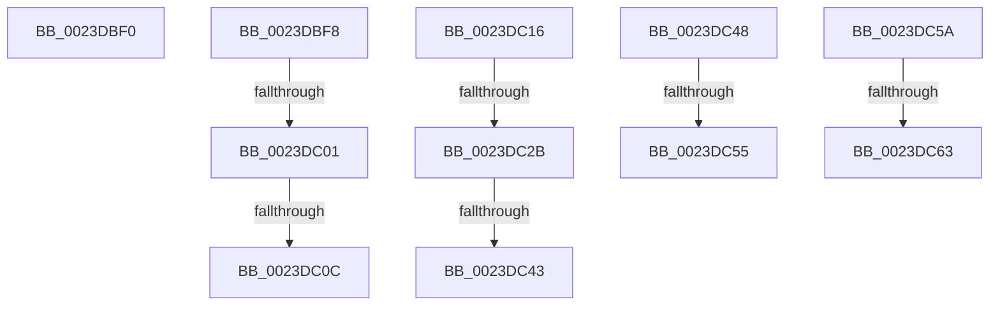

# sub_0023DBF0

- RVA: `0x0023DBF0`–`0x0023DC6C` (길이 `124` bytes)
- VA: `0x000000014023DBF0`
- 실행 섹션: `.text`
- PDB 이름 있음: `아니요`; PDB Function 태그: `아니요`
- unwind 정보 RVA: `0x000611F4`
- 디코드: `26`개 명령, `124/124` bytes 표시
- 미해석 바이트: `0` (있으면 어셈블리에 `.byte`로 보존)

> 이 문서는 커널 이미지의 기계어와 PDB 기호를 분석해 생성했습니다. 4번과 5번은 함수 원형과 자료형을 바이너리 사용 방식에서 추정한 C 해석이며 원본 소스 복구 결과는 아닙니다.

## 1. Dependencies

- 직접 호출 지점: **1**; 고유 호출 대상: **1**
- 직접 호출자로 확인된 함수: **0**
- RIP 상대 이미지 참조: **0**

### Outgoing calls
- `0x0023DC1D` → [MiLocateCloneAddress](../3D/MiLocateCloneAddress_function_003D26B4.md) (function, `0x003D26B4`)

### Direct callers
- 이 함수 시작 RVA로 연결되는 직접 call은 확인되지 않았습니다. 간접 호출은 완전히 역산할 수 없습니다.

### Static image references
- 디코드된 RIP-relative 메모리 참조가 없습니다.

## 2. Other-region calls and transfers

- 다른 실행 섹션으로 향하는 call: **0**
- call이 아닌 외부 분기/꼬리 이동: **11**
  - `0x0023DBF3` → [sub_0023D91C + 0x24](Unknown_function_0023D91C.md) (`tail-transfer`)
  - `0x0023DBFB` → [sub_0023D91C + 0x38](Unknown_function_0023D91C.md) (`tail-transfer`)
  - `0x0023DC06` → [sub_0023D7AA + 0x89](Unknown_function_0023D7AA.md) (`tail-transfer`)
  - `0x0023DC11` → [sub_0023DB14 + 0x30](Unknown_function_0023DB14.md) (`tail-transfer`)
  - `0x0023DC25` → [sub_0023DB14 + 0x81](Unknown_function_0023DB14.md) (`tail-transfer`)
  - `0x0023DC3D` → [sub_0023DB14 + 0x30](Unknown_function_0023DB14.md) (`tail-transfer`)
  - `0x0023DC43` → [sub_0023DA90 + 0x38](Unknown_function_0023DA90.md) (`tail-transfer`)
  - `0x0023DC4F` → [sub_0023DB14 + 0x30](Unknown_function_0023DB14.md) (`tail-transfer`)
  - `0x0023DC55` → [sub_0023DB14 + 0x16](Unknown_function_0023DB14.md) (`tail-transfer`)
  - `0x0023DC5D` → [sub_006D7AEE + 0x77](../6D/Unknown_function_006D7AEE.md) (`tail-transfer`)
  - `0x0023DC67` → [sub_006D7AEE + 0x77](../6D/Unknown_function_006D7AEE.md) (`tail-transfer`)

## 3. Assembly (complete function range)

```asm
0023DBF0  45 8B E3                        mov r12d, r11d
0023DBF3  E9 48 FD FF FF                  jmp 0x14023d940
0023DBF8  45 85 E4                        test r12d, r12d
0023DBFB  0F 85 53 FD FF FF               jne 0x14023d954
0023DC01  48 0F BA E3 09                  bt rbx, 9
0023DC06  0F 83 27 FC FF FF               jae 0x14023d833
0023DC0C  4C 89 74 24 70                  mov qword ptr [rsp + 0x70], r14
0023DC11  E9 2E FF FF FF                  jmp 0x14023db44
0023DC16  48 8B 57 08                     mov rdx, qword ptr [rdi + 8]
0023DC1A  49 0B D0                        or rdx, r8
0023DC1D  E8 92 4A 19 00                  call 0x1403d26b4
0023DC22  48 85 C0                        test rax, rax
0023DC25  0F 84 6A FF FF FF               je 0x14023db95
0023DC2B  48 8B 89 10 04 00 00            mov rcx, qword ptr [rcx + 0x410]
0023DC32  48 8B 40 60                     mov rax, qword ptr [rax + 0x60]
0023DC36  48 39 81 28 04 00 00            cmp qword ptr [rcx + 0x428], rax
0023DC3D  0F 86 01 FF FF FF               jbe 0x14023db44
0023DC43  E9 80 FE FF FF                  jmp 0x14023dac8
0023DC48  48 8B 47 08                     mov rax, qword ptr [rdi + 8]
0023DC4C  48 85 C0                        test rax, rax
0023DC4F  0F 85 EF FE FF FF               jne 0x14023db44
0023DC55  E9 D0 FE FF FF                  jmp 0x14023db2a
0023DC5A  45 85 F6                        test r14d, r14d
0023DC5D  0F 84 02 9F 49 00               je 0x1406d7b65
0023DC63  48 FF 4E 70                     dec qword ptr [rsi + 0x70]
0023DC67  E9 F9 9E 49 00                  jmp 0x1406d7b65
```

## 4. C-style interpretation (structured pseudocode)

```c
__int64 __fastcall sub_0023DBF0(__int64 a1, __int64 a2, __int64 a3)
{
    unsigned __int64 v_stack_p70;
}
```

## 5. (Beta) C Style

```c
int64_t sub_0023DBF0(int64_t Arg1, int64_t Arg2, int64_t Arg3)
{
    uint64_t v_stack_p70;
}
```

## 6. Execution-region graph

[열기: 2D/3D 그래프와 함수 탐색 컨트롤 패널](../../../control-panel.html?section=text&rva=0x0023DBF0&view=graph)

- 2D 그래프는 위에서 아래로 흐르고, 3D 그래프는 빈 공간을 드래그해 회전합니다. Shift+드래그는 이동, 휠은 확대·축소, 함수 노드 선택은 대상 보고서 이동입니다.

### Static fallback


