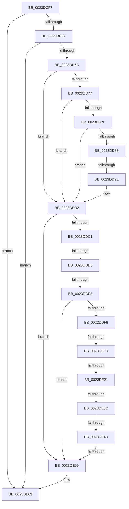

# sub_0023DCF7

- RVA: `0x0023DCF7`–`0x0023DE77` (길이 `384` bytes)
- VA: `0x000000014023DCF7`
- 실행 섹션: `.text`
- PDB 이름 있음: `아니요`; PDB Function 태그: `아니요`
- unwind 정보 RVA: `0x00061248`
- 디코드: `82`개 명령, `384/384` bytes 표시
- 미해석 바이트: `0` (있으면 어셈블리에 `.byte`로 보존)

> 이 문서는 커널 이미지의 기계어와 PDB 기호를 분석해 생성했습니다. 4번과 5번은 함수 원형과 자료형을 바이너리 사용 방식에서 추정한 C 해석이며 원본 소스 복구 결과는 아닙니다.

## 1. Dependencies

- 직접 호출 지점: **0**; 고유 호출 대상: **0**
- 직접 호출자로 확인된 함수: **0**
- RIP 상대 이미지 참조: **2**

### Outgoing calls
- 직접 디코드된 call 명령이 없습니다.

### Direct callers
- 이 함수 시작 RVA로 연결되는 직접 call은 확인되지 않았습니다. 간접 호출은 완전히 역산할 수 없습니다.

### Static image references
- `0x0023DDC8` → RVA `0x00E2DCE0` (`.data`; read)
- `0x0023DDFD` → RVA `0x00E375B8` (`.data`; read)

## 2. Other-region calls and transfers

- 다른 실행 섹션으로 향하는 call: **0**
- call이 아닌 외부 분기/꼬리 이동: **9**
  - `0x0023DD98` → [sub_0023DED5 + 0xC3](Unknown_function_0023DED5.md) (`tail-transfer`)
  - `0x0023DDCF` → [sub_0023DED5 + 0x134](Unknown_function_0023DED5.md) (`tail-transfer`)
  - `0x0023DDEC` → [sub_0023DED5 + 0x134](Unknown_function_0023DED5.md) (`tail-transfer`)
  - `0x0023DE07` → [sub_0023DED5 + 0x17](Unknown_function_0023DED5.md) (`tail-transfer`)
  - `0x0023DE1B` → [sub_0023DED5 + 0x17](Unknown_function_0023DED5.md) (`tail-transfer`)
  - `0x0023DE36` → [sub_0023DED5 + 0xD](Unknown_function_0023DED5.md) (`tail-transfer`)
  - `0x0023DE47` → [sub_0023E111](Unknown_function_0023E111.md) (`tail-transfer`)
  - `0x0023DE57` → [sub_0023DED5](Unknown_function_0023DED5.md) (`tail-transfer`)
  - `0x0023DE75` → [sub_0023DE77 + 0x42](Unknown_function_0023DE77.md) (`tail-transfer`)

## 3. Assembly (complete function range)

```asm
0023DCF7  48 89 74 24 40                  mov qword ptr [rsp + 0x40], rsi
0023DCFC  49 B9 FF 0F 00 00 00 00 F0 F0   movabs r9, 0xf0f0000000000fff
0023DD06  4C 89 64 24 30                  mov qword ptr [rsp + 0x30], r12
0023DD0B  49 23 F9                        and rdi, r9
0023DD0E  4C 89 7C 24 20                  mov qword ptr [rsp + 0x20], r15
0023DD13  45 33 E4                        xor r12d, r12d
0023DD16  4D 8B 7E 18                     mov r15, qword ptr [r14 + 0x18]
0023DD1A  49 BA 00 00 00 00 00 01 00 00   movabs r10, 0x10000000000
0023DD24  49 83 C7 08                     add r15, 8
0023DD28  49 BB F8 D7 BE 7D FB F6 FF FF   movabs r11, 0xfffff6fb7dbed7f8
0023DD32  48 BE 00 00 00 00 00 DE FF FF   movabs rsi, 0xffffde0000000000
0023DD3C  48 89 6C 24 48                  mov qword ptr [rsp + 0x48], rbp
0023DD41  49 B8 00 00 00 00 80 F6 FF FF   movabs r8, 0xfffff68000000000
0023DD4B  48 B8 00 D0 BE 7D FB F6 FF FF   movabs rax, 0xfffff6fb7dbed000
0023DD55  49 F7 C7 FF 0F 00 00            test r15, 0xfff
0023DD5C  0F 84 01 01 00 00               je 0x14023de63
0023DD62  4D 3B 7E 20                     cmp r15, qword ptr [r14 + 0x20]
0023DD66  0F 87 F7 00 00 00               ja 0x14023de63
0023DD6C  4D 8B 07                        mov r8, qword ptr [r15]
0023DD6F  48 8B C0                        mov rax, rax
0023DD72  4C 3B F8                        cmp r15, rax
0023DD75  72 3B                           jb 0x14023ddb2
0023DD77  49 8B C3                        mov rax, r11
0023DD7A  4C 3B F8                        cmp r15, rax
0023DD7D  77 33                           ja 0x14023ddb2
0023DD7F  49 8B C0                        mov rax, r8
0023DD82  41 F6 C0 01                     test r8b, 1
0023DD86  74 2A                           je 0x14023ddb2
0023DD88  41 F6 C0 42                     test r8b, 0x42
0023DD8C  0F 95 C2                        setne dl
0023DD8F  41 F6 C0 20                     test r8b, 0x20
0023DD93  0F 95 C1                        setne cl
0023DD96  84 D1                           test cl, dl
0023DD98  0F 84 FA 01 00 00               je 0x14023df98
0023DD9E  48 B9 28 00 00 00 00 DE FF FF   movabs rcx, 0xffffde0000000028
0023DDA8  48 BA FF FF FF FF FF 00 00 00   movabs rdx, 0xffffffffff
0023DDB2  49 8B C0                        mov rax, r8
0023DDB5  49 23 C1                        and rax, r9
0023DDB8  48 3B C7                        cmp rax, rdi
0023DDBB  0F 85 98 00 00 00               jne 0x14023de59
0023DDC1  49 C1 E8 0C                     shr r8, 0xc
0023DDC5  4C 23 C2                        and r8, rdx
0023DDC8  4C 3B 05 11 FF BE 00            cmp r8, qword ptr [rip + 0xbeff11]
0023DDCF  0F 87 34 02 00 00               ja 0x14023e009
0023DDD5  4F 8D 04 40                     lea r8, [r8 + r8*2]
0023DDD9  49 C1 E0 04                     shl r8, 4
0023DDDD  48 8B C1                        mov rax, rcx
0023DDE0  49 8B 04 00                     mov rax, qword ptr [r8 + rax]
0023DDE4  48 C1 E8 36                     shr rax, 0x36
0023DDE8  0F BA E0 00                     bt eax, 0
0023DDEC  0F 83 17 02 00 00               jae 0x14023e009
0023DDF2  85 DB                           test ebx, ebx
0023DDF4  74 63                           je 0x14023de59
0023DDF6  48 8B C6                        mov rax, rsi
0023DDF9  49 8D 2C 00                     lea rbp, [r8 + rax]
0023DDFD  48 8B 05 B4 97 BF 00            mov rax, qword ptr [rip + 0xbf97b4]
0023DE04  48 85 C0                        test rax, rax
0023DE07  0F 84 DF 00 00 00               je 0x14023deec
0023DE0D  48 8B 4D 28                     mov rcx, qword ptr [rbp + 0x28]
0023DE11  48 C1 E9 3C                     shr rcx, 0x3c
0023DE15  80 E1 07                        and cl, 7
0023DE18  80 F9 01                        cmp cl, 1
0023DE1B  0F 85 CB 00 00 00               jne 0x14023deec
0023DE21  49 C1 F8 04                     sar r8, 4
0023DE25  48 B9 AB AA AA AA AA AA AA AA   movabs rcx, 0xaaaaaaaaaaaaaaab
0023DE2F  4C 0F AF C1                     imul r8, rcx
0023DE33  48 85 C0                        test rax, rax
0023DE36  0F 84 A6 00 00 00               je 0x14023dee2
0023DE3C  0F 1F 40 00                     nop dword ptr [rax]
0023DE40  48 8B 50 18                     mov rdx, qword ptr [rax + 0x18]
0023DE44  4C 3B C2                        cmp r8, rdx
0023DE47  0F 82 C4 02 00 00               jb 0x14023e111
0023DE4D  49 8B C8                        mov rcx, r8
0023DE50  48 2B CA                        sub rcx, rdx
0023DE53  48 3B 48 20                     cmp rcx, qword ptr [rax + 0x20]
0023DE57  73 7C                           jae 0x14023ded5
0023DE59  49 B8 00 00 00 00 80 F6 FF FF   movabs r8, 0xfffff68000000000
0023DE63  4C 8B 7C 24 20                  mov r15, qword ptr [rsp + 0x20]
0023DE68  48 8B 74 24 40                  mov rsi, qword ptr [rsp + 0x40]
0023DE6D  48 8B 6C 24 48                  mov rbp, qword ptr [rsp + 0x48]
0023DE72  4D 85 E4                        test r12, r12
0023DE75  74 42                           je 0x14023deb9
```

## 4. C-style interpretation (structured pseudocode)

```c
__int64 __fastcall sub_0023DCF7(__int64 a1, __int64 a2, __int64 a3, __int64 a4, __int64 a5, __int64 a6, __int64 a7, __int64 a8, __int64 a9)
{
    __int64 result;
    __int64 v_r12;
    __int64 v_r15;
    __int64 v_rdi;
    unsigned __int64 v_stack_p20;
    unsigned __int64 v_stack_p30;
    unsigned __int64 v_stack_p40;
    unsigned __int64 v_stack_p48;

    v_stack_p40 = v_rsi;
    v_stack_p30 = v_r12;
    v_rdi = (v_rdi) & (a4);
    v_stack_p20 = v_r15;
    v_r12 = 0;
    v_r15 = (*(unsigned __int64 *)(v_r14 + 24)) + (8);
    v_stack_p48 = v_rbp;
    if (((v_r15) & (0xFFFULL)) == 0) goto loc_0023DE63;
    if (v_r15 > (*(unsigned __int64 *)(v_r14 + 32))) goto loc_0023DE63;
    if (v_r15 < result) goto loc_0023DDB2;
    if (v_r15 > v_r11) goto loc_0023DDB2;
    if ((((unsigned __int8)(*(unsigned __int64 *)(v_r15))) & (1)) == 0) goto loc_0023DDB2;
    a2 = ((((unsigned __int8)(*(unsigned __int64 *)(v_r15))) & (66)) != 0) ? 1 : 0;
    a1 = ((((unsigned __int8)(*(unsigned __int64 *)(v_r15))) & (32)) != 0) ? 1 : 0;
loc_0023DDB2:
    result = (*(unsigned __int64 *)(v_r15)) & (a4);
    if (result != v_rdi) goto loc_0023DE59;
    a3 = (*(unsigned __int64 *)(v_r15)) >> (12);
    a3 = (a3) & (a2);
    a3 = (a3 + a3 * 2) << (4);
    result = (*(unsigned __int64 *)(a3 + a1 * 1)) >> (54);
    if ((unsigned int)(v_rbx) == 0) goto loc_0023DE59;
    a1 = (*(unsigned __int64 *)(a3 + v_rsi * 1 + 40)) >> (60);
    a1 = (unsigned __int8)((a1) & (7));
    a3 = (a3) >> (4);
    a3 = (a3) * (a1);
    a1 = (a3) - (*(unsigned __int64 *)(*(unsigned __int64 *)(v_rip + 12556212) + 24));
loc_0023DE59:
loc_0023DE63:
}
```

## 5. (Beta) C Style

```c
int64_t sub_0023DCF7(int64_t Arg1, int64_t Arg2, int64_t Arg3, int64_t Arg4, uint64_t Arg5, uint64_t Arg6, uint64_t Arg7, int64_t Arg8, int64_t Arg9)
{
    int64_t result;
    int64_t local_r12;
    int64_t local_r15;
    int64_t local_rdi;
    uint64_t v_stack_p20;
    uint64_t v_stack_p30;
    uint64_t v_stack_p40;
    uint64_t v_stack_p48;

    v_stack_p40 = local_rsi;
    v_stack_p30 = local_r12;
    local_rdi = (local_rdi) & (Arg4);
    v_stack_p20 = local_r15;
    local_r12 = 0;
    local_r15 = (*(uint64_t *)(local_r14 + 0x18)) + (8);
    v_stack_p48 = local_rbp;
    if (((local_r15) & (0xFFFULL)) == 0) goto loc_0023DE63;
    if (local_r15 > (*(uint64_t *)(local_r14 + 0x20))) goto loc_0023DE63;
    if (local_r15 < result) goto loc_0023DDB2;
    if (local_r15 > local_r11) goto loc_0023DDB2;
    if ((((uint8_t)(*(uint64_t *)(local_r15))) & (1)) == 0) goto loc_0023DDB2;
    Arg2 = ((((uint8_t)(*(uint64_t *)(local_r15))) & (66)) != 0) ? 1 : 0;
    Arg1 = ((((uint8_t)(*(uint64_t *)(local_r15))) & (32)) != 0) ? 1 : 0;
loc_0023DDB2:
    result = (*(uint64_t *)(local_r15)) & (Arg4);
    if (result != local_rdi) goto loc_0023DE59;
    Arg3 = (*(uint64_t *)(local_r15)) >> (12);
    Arg3 = (Arg3) & (Arg2);
    Arg3 = (Arg3 + Arg3 * 2) << (4);
    result = (*(uint64_t *)(Arg3 + Arg1 * 1)) >> (54);
    if ((uint32_t)(local_rbx) == 0) goto loc_0023DE59;
    Arg1 = (*(uint64_t *)(Arg3 + local_rsi * 1 + 0x28)) >> (60);
    Arg1 = (uint8_t)((Arg1) & (7));
    Arg3 = (Arg3) >> (4);
    Arg3 = (Arg3) * (Arg1);
    Arg1 = (Arg3) - (*(uint64_t *)(*(uint64_t *)(v_rip + 0xBF97B4) + 0x18));
loc_0023DE59:
loc_0023DE63:
}
```

## 6. Execution-region graph

[열기: 2D/3D 그래프와 함수 탐색 컨트롤 패널](../../../control-panel.html?section=text&rva=0x0023DCF7&view=graph)

- 2D 그래프는 위에서 아래로 흐르고, 3D 그래프는 빈 공간을 드래그해 회전합니다. Shift+드래그는 이동, 휠은 확대·축소, 함수 노드 선택은 대상 보고서 이동입니다.

### Static fallback


