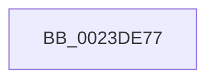

# sub_0023DE77

- RVA: `0x0023DE77`–`0x0023DEBE` (길이 `71` bytes)
- VA: `0x000000014023DE77`
- 실행 섹션: `.text`
- PDB 이름 있음: `아니요`; PDB Function 태그: `아니요`
- unwind 정보 RVA: `0x00061268`
- 디코드: `14`개 명령, `71/71` bytes 표시
- 미해석 바이트: `0` (있으면 어셈블리에 `.byte`로 보존)

> 이 문서는 커널 이미지의 기계어와 PDB 기호를 분석해 생성했습니다. 4번과 5번은 함수 원형과 자료형을 바이너리 사용 방식에서 추정한 C 해석이며 원본 소스 복구 결과는 아닙니다.

## 1. Dependencies

- 직접 호출 지점: **0**; 고유 호출 대상: **0**
- 직접 호출자로 확인된 함수: **0**
- RIP 상대 이미지 참조: **0**

### Outgoing calls
- 직접 디코드된 call 명령이 없습니다.

### Direct callers
- 이 함수 시작 RVA로 연결되는 직접 call은 확인되지 않았습니다. 간접 호출은 완전히 역산할 수 없습니다.

### Static image references
- 디코드된 RIP-relative 메모리 참조가 없습니다.

## 2. Other-region calls and transfers

- 다른 실행 섹션으로 향하는 call: **0**
- 별도 외부 분기/꼬리 이동을 확인하지 못했습니다.

## 3. Assembly (complete function range)

```asm
0023DE77  49 8B 4E 18                     mov rcx, qword ptr [r14 + 0x18]
0023DE7B  48 C1 E1 19                     shl rcx, 0x19
0023DE7F  49 8B C0                        mov rax, r8
0023DE82  48 C1 E0 19                     shl rax, 0x19
0023DE86  48 2B C8                        sub rcx, rax
0023DE89  49 C1 E4 0C                     shl r12, 0xc
0023DE8D  48 C1 F9 10                     sar rcx, 0x10
0023DE91  49 89 8E 98 00 00 00            mov qword ptr [r14 + 0x98], rcx
0023DE98  49 C7 86 A8 00 00 00 FF FF FF FF  mov qword ptr [r14 + 0xa8], 0xffffffffffffffff
0023DEA3  48 8D 81 FF 0F 00 00            lea rax, [rcx + 0xfff]
0023DEAA  49 03 C4                        add rax, r12
0023DEAD  41 83 4E 48 20                  or dword ptr [r14 + 0x48], 0x20
0023DEB2  49 89 86 A0 00 00 00            mov qword ptr [r14 + 0xa0], rax
0023DEB9  4C 8B 64 24 30                  mov r12, qword ptr [rsp + 0x30]
```

## 4. C-style interpretation (structured pseudocode)

```c
__int64 __fastcall sub_0023DE77(__int64 a1, __int64 a2, __int64 a3, __int64 a4, __int64 a5, __int64 a6)
{
    __int64 result;
    __int64 v_r12;

    a1 = (*(unsigned __int64 *)(v_r14 + 24)) << (25);
    result = (a3) << (25);
    a1 = (a1) - (result);
    v_r12 = (v_r12) << (12);
    a1 = (a1) >> (16);
    *(unsigned __int64 *)(v_r14 + 152) = a1;
    *(unsigned __int64 *)(v_r14 + 168) = -1;
    result = (a1 + 4095) + (v_r12);
    *(unsigned __int64 *)(v_r14 + 160) = result;
    return result;
}
```

## 5. (Beta) C Style

```c
int64_t sub_0023DE77(int64_t Arg1, int64_t Arg2, int64_t Arg3, int64_t Arg4, uint64_t Arg5, int64_t Arg6)
{
    int64_t result;
    int64_t local_r12;

    Arg1 = (*(uint64_t *)(local_r14 + 0x18)) << (25);
    result = (Arg3) << (25);
    Arg1 = (Arg1) - (result);
    local_r12 = (local_r12) << (12);
    Arg1 = (Arg1) >> (16);
    *(uint64_t *)(local_r14 + 0x98) = Arg1;
    *(uint64_t *)(local_r14 + 0xA8) = -1;
    result = (Arg1 + 4095) + (local_r12);
    *(uint64_t *)(local_r14 + 0xA0) = result;
    return result;
}
```

## 6. Execution-region graph

[열기: 2D/3D 그래프와 함수 탐색 컨트롤 패널](../../../control-panel.html?section=text&rva=0x0023DE77&view=graph)

- 2D 그래프는 위에서 아래로 흐르고, 3D 그래프는 빈 공간을 드래그해 회전합니다. Shift+드래그는 이동, 휠은 확대·축소, 함수 노드 선택은 대상 보고서 이동입니다.

### Static fallback


