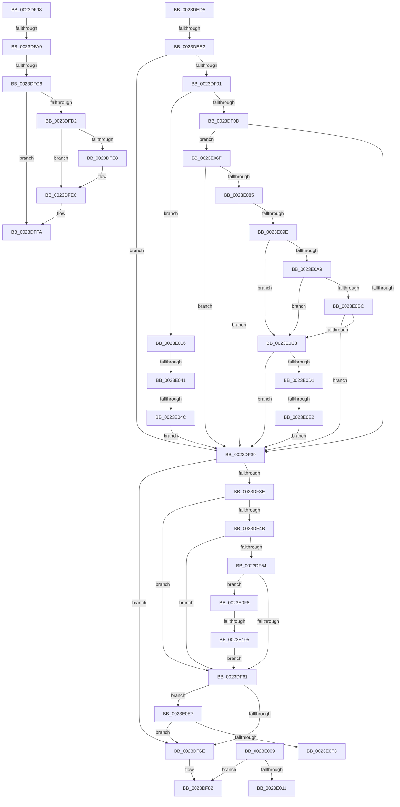

# sub_0023DED5

- RVA: `0x0023DED5`–`0x0023E10A` (길이 `565` bytes)
- VA: `0x000000014023DED5`
- 실행 섹션: `.text`
- PDB 이름 있음: `아니요`; PDB Function 태그: `아니요`
- unwind 정보 RVA: `0x000612A0`
- 디코드: `119`개 명령, `565/565` bytes 표시
- 미해석 바이트: `0` (있으면 어셈블리에 `.byte`로 보존)

> 이 문서는 커널 이미지의 기계어와 PDB 기호를 분석해 생성했습니다. 4번과 5번은 함수 원형과 자료형을 바이너리 사용 방식에서 추정한 C 해석이며 원본 소스 복구 결과는 아닙니다.

## 1. Dependencies

- 직접 호출 지점: **2**; 고유 호출 대상: **2**
- 직접 호출자로 확인된 함수: **0**
- RIP 상대 이미지 참조: **1**

### Outgoing calls
- `0x0023E033` → [MiGetPfnPageSizeIndexUnsynchronized](../46/MiGetPfnPageSizeIndexUnsynchronized_function_0046C008.md) (function, `0x0046C008`)
- `0x0023E0D4` → [MiGetPageTablePfnBuddyRaw](../2B/MiGetPageTablePfnBuddyRaw_function_002B4470.md) (function, `0x002B4470`)

### Direct callers
- 이 함수 시작 RVA로 연결되는 직접 call은 확인되지 않았습니다. 간접 호출은 완전히 역산할 수 없습니다.

### Static image references
- `0x0023DF98` → RVA `0x00FC6A88` (`ALMOSTRO`; read)

## 2. Other-region calls and transfers

- 다른 실행 섹션으로 향하는 call: **0**
- call이 아닌 외부 분기/꼬리 이동: **11**
  - `0x0023DEDC` → [sub_0023DCF7 + 0x149](Unknown_function_0023DCF7.md) (`tail-transfer`)
  - `0x0023DF93` → [sub_0023DCF7 + 0x4A](Unknown_function_0023DCF7.md) (`tail-transfer`)
  - `0x0023DFA3` → [sub_0023DCF7 + 0xA7](Unknown_function_0023DCF7.md) (`tail-transfer`)
  - `0x0023DFC0` → [sub_0023DCF7 + 0xA7](Unknown_function_0023DCF7.md) (`tail-transfer`)
  - `0x0023E004` → [sub_0023DCF7 + 0xA7](Unknown_function_0023DCF7.md) (`tail-transfer`)
  - `0x0023E011` → [sub_0023DCF7 + 0x162](Unknown_function_0023DCF7.md) (`tail-transfer`)
  - `0x0023E03B` → [sub_0023DCF7 + 0x162](Unknown_function_0023DCF7.md) (`tail-transfer`)
  - `0x0023E046` → [sub_0023DCF7 + 0x162](Unknown_function_0023DCF7.md) (`tail-transfer`)
  - `0x0023E0DC` → [sub_0023DCF7 + 0x16C](Unknown_function_0023DCF7.md) (`tail-transfer`)
  - `0x0023E0F3` → [sub_0023DCF7 + 0x162](Unknown_function_0023DCF7.md) (`tail-transfer`)
  - `0x0023E0FF` → [sub_0023DCF7 + 0x162](Unknown_function_0023DCF7.md) (`tail-transfer`)

## 3. Assembly (complete function range)

```asm
0023DED5  48 8B 40 08                     mov rax, qword ptr [rax + 8]
0023DED9  48 85 C0                        test rax, rax
0023DEDC  0F 85 5E FF FF FF               jne 0x14023de40
0023DEE2  48 BA FF FF FF FF FF 00 00 00   movabs rdx, 0xffffffffff
0023DEEC  48 8B C5                        mov rax, rbp
0023DEEF  B9 28 00 00 00                  mov ecx, 0x28
0023DEF4  48 8D 34 01                     lea rsi, [rcx + rax]
0023DEF8  48 8B 04 01                     mov rax, qword ptr [rcx + rax]
0023DEFC  48 85 C0                        test rax, rax
0023DEFF  78 38                           js 0x14023df39
0023DF01  48 8B 06                        mov rax, qword ptr [rsi]
0023DF04  49 85 C2                        test r10, rax
0023DF07  0F 85 09 01 00 00               jne 0x14023e016
0023DF0D  48 8B 4D 08                     mov rcx, qword ptr [rbp + 8]
0023DF11  48 C1 E1 19                     shl rcx, 0x19
0023DF15  49 B8 00 00 00 00 80 F6 FF FF   movabs r8, 0xfffff68000000000
0023DF1F  49 8B C0                        mov rax, r8
0023DF22  48 C1 E0 19                     shl rax, 0x19
0023DF26  48 2B C8                        sub rcx, rax
0023DF29  48 C1 F9 10                     sar rcx, 0x10
0023DF2D  49 8B C0                        mov rax, r8
0023DF30  48 3B C8                        cmp rcx, rax
0023DF33  0F 83 36 01 00 00               jae 0x14023e06f
0023DF39  45 85 ED                        test r13d, r13d
0023DF3C  75 30                           jne 0x14023df6e
0023DF3E  48 8B 06                        mov rax, qword ptr [rsi]
0023DF41  48 C1 E8 3C                     shr rax, 0x3c
0023DF45  24 07                           and al, 7
0023DF47  3C 01                           cmp al, 1
0023DF49  74 16                           je 0x14023df61
0023DF4B  48 8B 45 28                     mov rax, qword ptr [rbp + 0x28]
0023DF4F  49 85 C2                        test r10, rax
0023DF52  75 0D                           jne 0x14023df61
0023DF54  48 8B 45 08                     mov rax, qword ptr [rbp + 8]
0023DF58  48 85 C0                        test rax, rax
0023DF5B  0F 89 97 01 00 00               jns 0x14023e0f8
0023DF61  48 8B 45 28                     mov rax, qword ptr [rbp + 0x28]
0023DF65  48 85 C0                        test rax, rax
0023DF68  0F 88 79 01 00 00               js 0x14023e0e7
0023DF6E  48 BA FF FF FF FF FF 00 00 00   movabs rdx, 0xffffffffff
0023DF78  48 BE 00 00 00 00 00 DE FF FF   movabs rsi, 0xffffde0000000000
0023DF82  49 83 C7 08                     add r15, 8
0023DF86  48 B9 28 00 00 00 00 DE FF FF   movabs rcx, 0xffffde0000000028
0023DF90  49 FF C4                        inc r12
0023DF93  E9 A9 FD FF FF                  jmp 0x14023dd41
0023DF98  48 F7 05 E5 8A D8 00 00 00 60 00  test qword ptr [rip + 0xd88ae5], 0x600000
0023DFA3  0F 84 F5 FD FF FF               je 0x14023dd9e
0023DFA9  65 48 8B 0C 25 88 01 00 00      mov rcx, qword ptr gs:[0x188]
0023DFB2  48 8B 91 B8 00 00 00            mov rdx, qword ptr [rcx + 0xb8]
0023DFB9  80 BA 60 01 00 00 01            cmp byte ptr [rdx + 0x160], 1
0023DFC0  0F 84 D8 FD FF FF               je 0x14023dd9e
0023DFC6  4C 8B 8A 08 05 00 00            mov r9, qword ptr [rdx + 0x508]
0023DFCD  4D 85 C9                        test r9, r9
0023DFD0  74 28                           je 0x14023dffa
0023DFD2  49 8B CF                        mov rcx, r15
0023DFD5  48 C1 E9 03                     shr rcx, 3
0023DFD9  81 E1 FF 01 00 00               and ecx, 0x1ff
0023DFDF  49 8B 0C C9                     mov rcx, qword ptr [r9 + rcx*8]
0023DFE3  F6 C1 20                        test cl, 0x20
0023DFE6  74 04                           je 0x14023dfec
0023DFE8  48 83 C8 20                     or rax, 0x20
0023DFEC  4C 8B C0                        mov r8, rax
0023DFEF  49 83 C8 42                     or r8, 0x42
0023DFF3  F6 C1 42                        test cl, 0x42
0023DFF6  4C 0F 44 C0                     cmove r8, rax
0023DFFA  49 B9 FF 0F 00 00 00 00 F0 F0   movabs r9, 0xf0f0000000000fff
0023E004  E9 95 FD FF FF                  jmp 0x14023dd9e
0023E009  85 DB                           test ebx, ebx
0023E00B  0F 84 71 FF FF FF               je 0x14023df82
0023E011  E9 43 FE FF FF                  jmp 0x14023de59
0023E016  4C 8D 44 24 68                  lea r8, [rsp + 0x68]
0023E01B  C7 44 24 60 00 00 00 00         mov dword ptr [rsp + 0x60], 0
0023E023  48 8D 54 24 60                  lea rdx, [rsp + 0x60]
0023E028  C7 44 24 68 00 00 00 00         mov dword ptr [rsp + 0x68], 0
0023E030  48 8B CD                        mov rcx, rbp
0023E033  E8 D0 DF 22 00                  call 0x14046c008
0023E038  83 F8 03                        cmp eax, 3
0023E03B  0F 84 18 FE FF FF               je 0x14023de59
0023E041  83 7C 24 60 06                  cmp dword ptr [rsp + 0x60], 6
0023E046  0F 85 0D FE FF FF               jne 0x14023de59
0023E04C  49 B9 FF 0F 00 00 00 00 F0 F0   movabs r9, 0xf0f0000000000fff
0023E056  49 BB F8 D7 BE 7D FB F6 FF FF   movabs r11, 0xfffff6fb7dbed7f8
0023E060  49 BA 00 00 00 00 00 01 00 00   movabs r10, 0x10000000000
0023E06A  E9 CA FE FF FF                  jmp 0x14023df39
0023E06F  48 B8 FF FF FF FF FF F6 FF FF   movabs rax, 0xfffff6ffffffffff
0023E079  48 8B C0                        mov rax, rax
0023E07C  48 3B C8                        cmp rcx, rax
0023E07F  0F 87 B4 FE FF FF               ja 0x14023df39
0023E085  48 8B 06                        mov rax, qword ptr [rsi]
0023E088  48 B9 FE FF FF FF 3F 00 00 00   movabs rcx, 0x3ffffffffe
0023E092  48 23 C2                        and rax, rdx
0023E095  48 3B C1                        cmp rax, rcx
0023E098  0F 84 9B FE FF FF               je 0x14023df39
0023E09E  8B 4D 20                        mov ecx, dword ptr [rbp + 0x20]
0023E0A1  C1 E9 10                        shr ecx, 0x10
0023E0A4  F6 C1 20                        test cl, 0x20
0023E0A7  74 1F                           je 0x14023e0c8
0023E0A9  48 8B 45 18                     mov rax, qword ptr [rbp + 0x18]
0023E0AD  48 BA FF FF FF FF FF FF FF 3F   movabs rdx, 0x3fffffffffffffff
0023E0B7  48 85 C2                        test rdx, rax
0023E0BA  75 0C                           jne 0x14023e0c8
0023E0BC  8B 45 20                        mov eax, dword ptr [rbp + 0x20]
0023E0BF  66 85 C0                        test ax, ax
0023E0C2  0F 85 71 FE FF FF               jne 0x14023df39
0023E0C8  F6 C1 08                        test cl, 8
0023E0CB  0F 85 68 FE FF FF               jne 0x14023df39
0023E0D1  48 8B CD                        mov rcx, rbp
0023E0D4  E8 97 63 07 00                  call 0x1402b4470
0023E0D9  49 3B C2                        cmp rax, r10
0023E0DC  0F 85 81 FD FF FF               jne 0x14023de63
0023E0E2  E9 52 FE FF FF                  jmp 0x14023df39
0023E0E7  41 8B 46 48                     mov eax, dword ptr [r14 + 0x48]
0023E0EB  A8 10                           test al, 0x10
0023E0ED  0F 84 7B FE FF FF               je 0x14023df6e
0023E0F3  E9 61 FD FF FF                  jmp 0x14023de59
0023E0F8  48 8B 45 08                     mov rax, qword ptr [rbp + 8]
0023E0FC  48 85 C0                        test rax, rax
0023E0FF  0F 85 54 FD FF FF               jne 0x14023de59
0023E105  E9 57 FE FF FF                  jmp 0x14023df61
```

## 4. C-style interpretation (structured pseudocode)

```c
__int64 __fastcall sub_0023DED5(__int64 a1, __int64 a2, __int64 a3, __int64 a4, __int64 a5, __int64 a6, __int64 a7, __int64 a8, __int64 a9, __int64 a10, __int64 a11, unsigned int a12, __int64 a13)
{
    __int64 result;
    __int64 v_r12;
    __int64 v_r15;
    unsigned int v_stack_p60;
    unsigned int v_stack_p68;

    if (sign_flag) goto loc_0023DF39;
    if (((v_r10) & (*(unsigned __int64 *)(40 + v_rbp * 1))) != 0) goto loc_0023E016;
    a1 = (*(unsigned __int64 *)(v_rbp + 8)) << (25);
    result = (a3) << (25);
    a1 = (a1) - (result);
    a1 = (a1) >> (16);
    if (a1 >= a3) goto loc_0023E06F;
loc_0023DF39:
    if ((unsigned int)(v_r13) != 0) goto loc_0023DF6E;
    result = (*(unsigned __int64 *)(40 + v_rbp * 1)) >> (60);
    result = (unsigned __int8)((result) & (7));
    if (((unsigned __int8)(result)) == 1) goto loc_0023DF61;
    if (((v_r10) & (*(unsigned __int64 *)(v_rbp + 40))) != 0) goto loc_0023DF61;
    if (!sign_flag) goto loc_0023E0F8;
loc_0023DF61:
    if (sign_flag) goto loc_0023E0E7;
loc_0023DF6E:
loc_0023DF82:
    v_r15 = (v_r15) + (8);
    v_r12 = (v_r12) + 1;
loc_0023E016:
    v_stack_p60 = 0;
    v_stack_p68 = 0;
    result = MiGetPfnPageSizeIndexUnsynchronized(v_rbp, a12, a13, a4);
    goto loc_0023DF39;
loc_0023E06F:
    if (v_rbp > result) goto loc_0023DF39;
    result = (*(unsigned __int64 *)(40 + v_rbp * 1)) & (a12);
    if (result == v_rbp) goto loc_0023DF39;
    a1 = (unsigned int)(((unsigned int)(*(unsigned int *)(v_rbp + 32))) >> (16));
    if ((((unsigned __int8)(a1)) & (32)) == 0) goto loc_0023E0C8;
    if (((a12) & (*(unsigned __int64 *)(v_rbp + 24))) != 0) goto loc_0023E0C8;
    if ((unsigned __int16)((unsigned int)(*(unsigned int *)(v_rbp + 32))) != 0) goto loc_0023DF39;
loc_0023E0C8:
    if ((((unsigned __int8)(a1)) & (8)) != 0) goto loc_0023DF39;
    result = MiGetPageTablePfnBuddyRaw(v_rbp, a12, a13, a4);
    goto loc_0023DF39;
loc_0023E0E7:
    if ((((unsigned __int8)((unsigned int)(*(unsigned int *)(v_r14 + 72)))) & (16)) == 0) goto loc_0023DF6E;
loc_0023E0F8:
    goto loc_0023DF61;
}
```

## 5. (Beta) C Style

```c
int64_t sub_0023DED5(int64_t Arg1, int64_t Arg2, int64_t Arg3, int64_t Arg4, uint64_t Arg5, uint64_t Arg6, uint64_t Arg7, uint64_t Arg8, uint64_t Arg9, uint64_t Arg10, uint64_t Arg11, uint32_t Arg12, int64_t Arg13)
{
    int64_t result;
    int64_t local_r12;
    int64_t local_r15;
    uint32_t v_stack_p60;
    uint32_t v_stack_p68;

    if (sign_flag) goto loc_0023DF39;
    if (((local_r10) & (*(uint64_t *)(40 + local_rbp * 1))) != 0) goto loc_0023E016;
    Arg1 = (*(uint64_t *)(local_rbp + 0x8)) << (25);
    result = (Arg3) << (25);
    Arg1 = (Arg1) - (result);
    Arg1 = (Arg1) >> (16);
    if (Arg1 >= Arg3) goto loc_0023E06F;
loc_0023DF39:
    if ((uint32_t)(local_r13) != 0) goto loc_0023DF6E;
    result = (*(uint64_t *)(40 + local_rbp * 1)) >> (60);
    result = (uint8_t)((result) & (7));
    if (((uint8_t)(result)) == 1) goto loc_0023DF61;
    if (((local_r10) & (*(uint64_t *)(local_rbp + 0x28))) != 0) goto loc_0023DF61;
    if (!sign_flag) goto loc_0023E0F8;
loc_0023DF61:
    if (sign_flag) goto loc_0023E0E7;
loc_0023DF6E:
loc_0023DF82:
    local_r15 = (local_r15) + (8);
    local_r12 = (local_r12) + 1;
loc_0023E016:
    v_stack_p60 = 0;
    v_stack_p68 = 0;
    result = MiGetPfnPageSizeIndexUnsynchronized(local_rbp, Arg12, Arg13, Arg4);
    goto loc_0023DF39;
loc_0023E06F:
    if (local_rbp > result) goto loc_0023DF39;
    result = (*(uint64_t *)(40 + local_rbp * 1)) & (Arg12);
    if (result == local_rbp) goto loc_0023DF39;
    Arg1 = (uint32_t)(((uint32_t)(*(uint32_t *)(local_rbp + 0x20))) >> (16));
    if ((((uint8_t)(Arg1)) & (32)) == 0) goto loc_0023E0C8;
    if (((Arg12) & (*(uint64_t *)(local_rbp + 0x18))) != 0) goto loc_0023E0C8;
    if ((uint16_t)((uint32_t)(*(uint32_t *)(local_rbp + 0x20))) != 0) goto loc_0023DF39;
loc_0023E0C8:
    if ((((uint8_t)(Arg1)) & (8)) != 0) goto loc_0023DF39;
    result = MiGetPageTablePfnBuddyRaw(local_rbp, Arg12, Arg13, Arg4);
    goto loc_0023DF39;
loc_0023E0E7:
    if ((((uint8_t)((uint32_t)(*(uint32_t *)(local_r14 + 0x48)))) & (16)) == 0) goto loc_0023DF6E;
loc_0023E0F8:
    goto loc_0023DF61;
}
```

## 6. Execution-region graph

[열기: 2D/3D 그래프와 함수 탐색 컨트롤 패널](../../../control-panel.html?section=text&rva=0x0023DED5&view=graph)

- 2D 그래프는 위에서 아래로 흐르고, 3D 그래프는 빈 공간을 드래그해 회전합니다. Shift+드래그는 이동, 휠은 확대·축소, 함수 노드 선택은 대상 보고서 이동입니다.

### Static fallback


