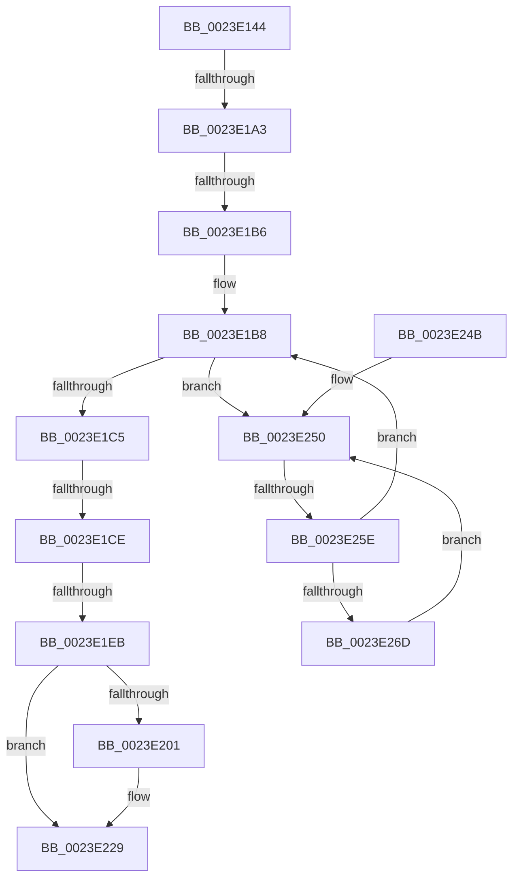

# sub_0023E144

- RVA: `0x0023E144`–`0x0023E26F` (길이 `299` bytes)
- VA: `0x000000014023E144`
- 실행 섹션: `.text`
- PDB 이름 있음: `아니요`; PDB Function 태그: `아니요`
- unwind 정보 RVA: `0x00061324`
- 디코드: `65`개 명령, `299/299` bytes 표시
- 미해석 바이트: `0` (있으면 어셈블리에 `.byte`로 보존)

> 이 문서는 커널 이미지의 기계어와 PDB 기호를 분석해 생성했습니다. 4번과 5번은 함수 원형과 자료형을 바이너리 사용 방식에서 추정한 C 해석이며 원본 소스 복구 결과는 아닙니다.

## 1. Dependencies

- 직접 호출 지점: **0**; 고유 호출 대상: **0**
- 직접 호출자로 확인된 함수: **0**
- RIP 상대 이미지 참조: **2**

### Outgoing calls
- 직접 디코드된 call 명령이 없습니다.

### Direct callers
- 이 함수 시작 RVA로 연결되는 직접 call은 확인되지 않았습니다. 간접 호출은 완전히 역산할 수 없습니다.

### Static image references
- `0x0023E170` → RVA `0x00E38D00` (`.data`; read)
- `0x0023E252` → RVA `0x00FC52AC` (`ALMOSTRO`; reference)

## 2. Other-region calls and transfers

- 다른 실행 섹션으로 향하는 call: **0**
- call이 아닌 외부 분기/꼬리 이동: **5**
  - `0x0023E19D` → [sub_0023E278 + 0x1A0](Unknown_function_0023E278.md) (`tail-transfer`)
  - `0x0023E1B0` → [sub_0023E278 + 0x12](Unknown_function_0023E278.md) (`tail-transfer`)
  - `0x0023E1C8` → [sub_0023E278 + 0x149](Unknown_function_0023E278.md) (`tail-transfer`)
  - `0x0023E1E5` → [sub_0023E278](Unknown_function_0023E278.md) (`tail-transfer`)
  - `0x0023E258` → [sub_0023E278 + 0x23E](Unknown_function_0023E278.md) (`tail-transfer`)

## 3. Assembly (complete function range)

```asm
0023E144  48 89 6C 24 78                  mov qword ptr [rsp + 0x78], rbp
0023E149  4C 8D 59 28                     lea r11, [rcx + 0x28]
0023E14D  4C 89 74 24 28                  mov qword ptr [rsp + 0x28], r14
0023E152  4C 89 7C 24 20                  mov qword ptr [rsp + 0x20], r15
0023E157  4C 89 5C 24 60                  mov qword ptr [rsp + 0x60], r11
0023E15C  0F 1F 40 00                     nop dword ptr [rax]
0023E160  41 BC 01 00 00 00               mov r12d, 1
0023E166  49 BD 00 00 00 00 00 DE FF FF   movabs r13, 0xffffde0000000000
0023E170  48 8D 15 89 AB BF 00            lea rdx, [rip + 0xbfab89]
0023E177  48 B9 FF FF FF FF FF 00 00 00   movabs rcx, 0xffffffffff
0023E181  49 B8 FF FF FF FF FF FF FF 3F   movabs r8, 0x3fffffffffffffff
0023E18B  49 BF FF FF FF FF FF FF FF 7F   movabs r15, 0x7fffffffffffffff
0023E195  45 8D 4C 24 03                  lea r9d, [r12 + 3]
0023E19A  41 3B F4                        cmp esi, r12d
0023E19D  0F 84 75 02 00 00               je 0x14023e418
0023E1A3  48 8B 43 18                     mov rax, qword ptr [rbx + 0x18]
0023E1A7  49 23 C0                        and rax, r8
0023E1AA  48 3D 00 00 01 00               cmp rax, 0x10000
0023E1B0  0F 82 D4 00 00 00               jb 0x14023e28a
0023E1B6  8B EF                           mov ebp, edi
0023E1B8  F0 48 0F BA 6B 18 3F            lock bts qword ptr [rbx + 0x18], 0x3f
0023E1BF  0F 82 8B 00 00 00               jb 0x14023e250
0023E1C5  41 3B F4                        cmp esi, r12d
0023E1C8  0F 84 F3 01 00 00               je 0x14023e3c1
0023E1CE  48 8B 43 18                     mov rax, qword ptr [rbx + 0x18]
0023E1D2  49 B8 FF FF FF FF FF FF FF 3F   movabs r8, 0x3fffffffffffffff
0023E1DC  49 23 C0                        and rax, r8
0023E1DF  48 3D 00 00 01 00               cmp rax, 0x10000
0023E1E5  0F 82 8D 00 00 00               jb 0x14023e278
0023E1EB  48 8B 43 18                     mov rax, qword ptr [rbx + 0x18]
0023E1EF  48 B9 FF FD FE FF FF FF FF 3F   movabs rcx, 0x3ffffffffffefdff
0023E1F9  49 23 C0                        and rax, r8
0023E1FC  48 3B C1                        cmp rax, rcx
0023E1FF  73 28                           jae 0x14023e229
0023E201  48 8B 43 18                     mov rax, qword ptr [rbx + 0x18]
0023E205  41 8B FC                        mov edi, r12d
0023E208  48 8D 88 00 00 01 00            lea rcx, [rax + 0x10000]
0023E20F  48 8B D1                        mov rdx, rcx
0023E212  48 33 D0                        xor rdx, rax
0023E215  48 B8 00 00 00 00 00 00 00 C0   movabs rax, 0xc000000000000000
0023E21F  48 23 D0                        and rdx, rax
0023E222  48 33 D1                        xor rdx, rcx
0023E225  48 89 53 18                     mov qword ptr [rbx + 0x18], rdx
0023E229  F0 4C 21 7B 18                  lock and qword ptr [rbx + 0x18], r15
0023E22E  8B C7                           mov eax, edi
0023E230  4C 8B 7C 24 20                  mov r15, qword ptr [rsp + 0x20]
0023E235  4C 8B 74 24 28                  mov r14, qword ptr [rsp + 0x28]
0023E23A  48 8B 6C 24 78                  mov rbp, qword ptr [rsp + 0x78]
0023E23F  48 83 C4 30                     add rsp, 0x30
0023E243  41 5D                           pop r13
0023E245  41 5C                           pop r12
0023E247  5F                              pop rdi
0023E248  5E                              pop rsi
0023E249  5B                              pop rbx
0023E24A  C3                              ret
0023E24B  CC                              int3
0023E24C  0F 1F 40 00                     nop dword ptr [rax]
0023E250  FF C5                           inc ebp
0023E252  85 2D 54 70 D8 00               test dword ptr [rip + 0xd87054], ebp
0023E258  0F 84 58 02 00 00               je 0x14023e4b6
0023E25E  F3 90                           pause
0023E260  48 8B 43 18                     mov rax, qword ptr [rbx + 0x18]
0023E264  48 85 C0                        test rax, rax
0023E267  0F 89 4B FF FF FF               jns 0x14023e1b8
0023E26D  EB E1                           jmp 0x14023e250
```

## 4. C-style interpretation (structured pseudocode)

```c
__int64 __fastcall sub_0023E144(__int64 a1, __int64 a2, __int64 a3, __int64 a4, __int64 a5, __int64 a6, __int64 a7, __int64 a8, __int64 a9, __int64 a10, __int64 a11, __int64 a12, __int64 a13, __int64 a14, __int64 a15)
{
    __int64 result;
    __int64 v_rbp;
    __int64 v_rdi;
    __int64 v_rsp;
    unsigned __int64 v_stack_p20;
    unsigned __int64 v_stack_p28;
    unsigned __int64 v_stack_p60;
    unsigned __int64 v_stack_p78;

    v_stack_p78 = v_rbp;
    v_stack_p28 = v_r14;
    v_stack_p20 = v_r15;
    v_stack_p60 = a1 + 40;
    result = (*(unsigned __int64 *)(v_rbx + 24)) & (a3);
loc_0023E1B8:
    if (result < 0x10000ULL) goto loc_0023E250;
    result = (*(unsigned __int64 *)(v_rbx + 24)) & (a3);
    result = (*(unsigned __int64 *)(v_rbx + 24)) & (a3);
    if (result < a1) {
        result = *(unsigned __int64 *)(v_rbx + 24);
        v_rdi = 1;
        a1 = result + 65536;
        a2 = a1;
        a2 = (a2) ^ (result);
        a2 = (a2) & (result);
        a2 = (a2) ^ (a1);
        *(unsigned __int64 *)(v_rbx + 24) = a2;
    }
    v_rsp = (v_rsp) + (48);
    return (unsigned int)((unsigned int)(v_rdi));
loc_0023E250:
    v_rbp = (unsigned int)((a15) + 1);
    if (!sign_flag) goto loc_0023E1B8;
    goto loc_0023E250;
}
```

## 5. (Beta) C Style

```c
int64_t sub_0023E144(void *Arg1, int64_t Arg2, int64_t Arg3, int64_t Arg4, int64_t Arg5, uint64_t Arg6, uint64_t Arg7, uint64_t Arg8, uint64_t Arg9, uint64_t Arg10, uint64_t Arg11, uint64_t Arg12, uint64_t Arg13, uint64_t Arg14, int64_t Arg15)
{
    uint8_t *arg1 = (uint8_t *)Arg1;

    int64_t result;
    int64_t local_rbp;
    int64_t local_rdi;
    int64_t local_rsp;
    uint64_t v_stack_p20;
    uint64_t v_stack_p28;
    uint64_t v_stack_p60;
    uint64_t v_stack_p78;

    v_stack_p78 = local_rbp;
    v_stack_p28 = local_r14;
    v_stack_p20 = local_r15;
    v_stack_p60 = Arg1 + 40;
    result = (*(uint64_t *)(local_rbx + 0x18)) & (Arg3);
loc_0023E1B8:
    if (result < 0x10000ULL) goto loc_0023E250;
    result = (*(uint64_t *)(local_rbx + 0x18)) & (Arg3);
    result = (*(uint64_t *)(local_rbx + 0x18)) & (Arg3);
    if (result < Arg1) {
        result = *(uint64_t *)(local_rbx + 0x18);
        local_rdi = 1;
        Arg1 = result + 65536;
        Arg2 = Arg1;
        Arg2 = (Arg2) ^ (result);
        Arg2 = (Arg2) & (result);
        Arg2 = (Arg2) ^ (Arg1);
        *(uint64_t *)(local_rbx + 0x18) = Arg2;
    }
    local_rsp = (local_rsp) + (48);
    return (uint32_t)((uint32_t)(local_rdi));
loc_0023E250:
    local_rbp = (uint32_t)((Arg15) + 1);
    if (!sign_flag) goto loc_0023E1B8;
    goto loc_0023E250;
}
```

### 관측된 메모리 오프셋

구조체 형식이 확인되지 않은 접근은 인자 기준의 오프셋으로만 기록했습니다.

| 기준 인자 | 오프셋 표현 | 폭 (bit) | 접근 |
|---|---:|---:|---|
| `Arg1` | `+ 0x28` | `64` | `R` |

## 6. Execution-region graph

[열기: 2D/3D 그래프와 함수 탐색 컨트롤 패널](../../../control-panel.html?section=text&rva=0x0023E144&view=graph)

- 2D 그래프는 위에서 아래로 흐르고, 3D 그래프는 빈 공간을 드래그해 회전합니다. Shift+드래그는 이동, 휠은 확대·축소, 함수 노드 선택은 대상 보고서 이동입니다.

### Static fallback


