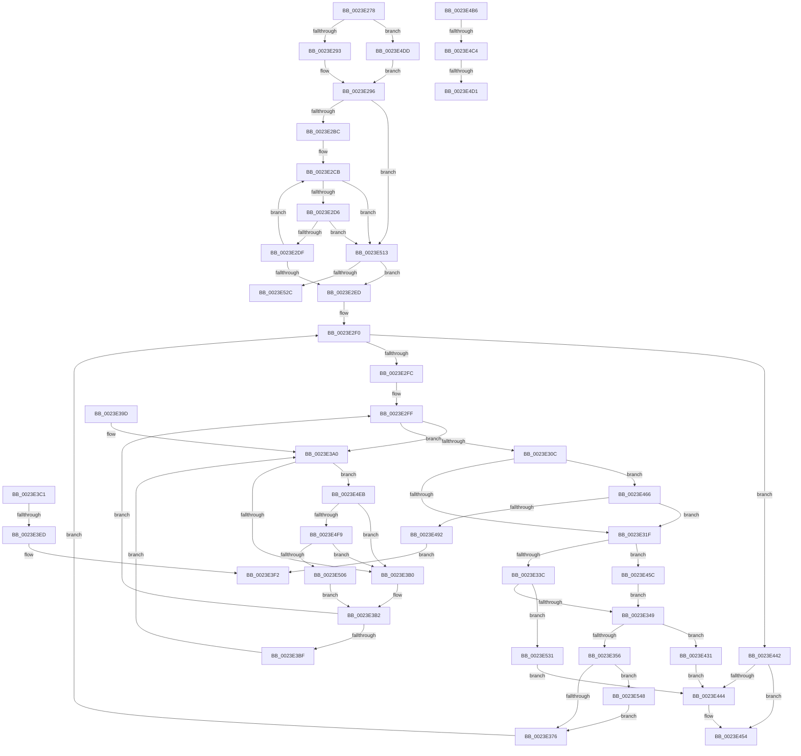

# sub_0023E278

- RVA: `0x0023E278`–`0x0023E55D` (길이 `741` bytes)
- VA: `0x000000014023E278`
- 실행 섹션: `.text`
- PDB 이름 있음: `아니요`; PDB Function 태그: `아니요`
- unwind 정보 RVA: `0x00061354`
- 디코드: `160`개 명령, `741/741` bytes 표시
- 미해석 바이트: `0` (있으면 어셈블리에 `.byte`로 보존)

> 이 문서는 커널 이미지의 기계어와 PDB 기호를 분석해 생성했습니다. 4번과 5번은 함수 원형과 자료형을 바이너리 사용 방식에서 추정한 C 해석이며 원본 소스 복구 결과는 아닙니다.

## 1. Dependencies

- 직접 호출 지점: **11**; 고유 호출 대상: **7**
- 직접 호출자로 확인된 함수: **0**
- RIP 상대 이미지 참조: **4**

### Outgoing calls
- `0x0023E33C` → [MiIncrementPageTableLockCheckWrap](../43/MiIncrementPageTableLockCheckWrap_function_004377B0.md) (function, `0x004377B0`)
- `0x0023E359` → [MiCaptureDirtyBitToPfn](../37/MiCaptureDirtyBitToPfn_function_00370DD0.md) (function, `0x00370DD0`)
- `0x0023E44F` → [MiReturnResident](../28/MiReturnResident_function_00286890.md) (function, `0x00286890`)
- `0x0023E45C` → [MiIncrementPageTableLockCheckWrap](../43/MiIncrementPageTableLockCheckWrap_function_004377B0.md) (function, `0x004377B0`)
- `0x0023E4AC` → [MiReturnResident](../28/MiReturnResident_function_00286890.md) (function, `0x00286890`)
- `0x0023E4C4` → [KiCheckVpBackingLongSpinWaitHypercall](../30/KiCheckVpBackingLongSpinWaitHypercall_function_0030F490.md) (function, `0x0030F490`)
- `0x0023E4D3` → [HvlNotifyLongSpinWait](../30/HvlNotifyLongSpinWait_function_0030F460.md) (function, `0x0030F460`)
- `0x0023E4F9` → [KiCheckVpBackingLongSpinWaitHypercall](../30/KiCheckVpBackingLongSpinWaitHypercall_function_0030F490.md) (function, `0x0030F490`)
- `0x0023E509` → [HvlNotifyLongSpinWait](../30/HvlNotifyLongSpinWait_function_0030F460.md) (function, `0x0030F460`)
- `0x0023E51F` → [MiChargePartitionResidentAvailable](../28/MiChargePartitionResidentAvailable_function_0028B000.md) (function, `0x0028B000`)
- `0x0023E553` → [MiReleasePageFileInfo](../28/MiReleasePageFileInfo_function_00283FD0.md) (function, `0x00283FD0`)

### Direct callers
- 이 함수 시작 RVA로 연결되는 직접 call은 확인되지 않았습니다. 간접 호출은 완전히 역산할 수 없습니다.

### Static image references
- `0x0023E27D` → RVA `0x00E38D00` (`.data`; read)
- `0x0023E29A` → RVA `0x00E30088` (`.data`; read)
- `0x0023E3A3` → RVA `0x00FC52AC` (`ALMOSTRO`; reference)
- `0x0023E4B6` → RVA `0x00FC6AB8` (`ALMOSTRO`; read)

## 2. Other-region calls and transfers

- 다른 실행 섹션으로 향하는 call: **0**
- call이 아닌 외부 분기/꼬리 이동: **7**
  - `0x0023E3E7` → [sub_0023E144 + 0x8A](Unknown_function_0023E144.md) (`tail-transfer`)
  - `0x0023E42C` → [sub_0023E144 + 0x5F](Unknown_function_0023E144.md) (`tail-transfer`)
  - `0x0023E457` → [sub_0023E144 + 0xEC](Unknown_function_0023E144.md) (`tail-transfer`)
  - `0x0023E4BE` → [sub_0023E144 + 0x11A](Unknown_function_0023E144.md) (`tail-transfer`)
  - `0x0023E4CB` → [sub_0023E144 + 0x11A](Unknown_function_0023E144.md) (`tail-transfer`)
  - `0x0023E4D8` → [sub_0023E144 + 0x11C](Unknown_function_0023E144.md) (`tail-transfer`)
  - `0x0023E52C` → [sub_0023E144 + 0xEC](Unknown_function_0023E144.md) (`tail-transfer`)

## 3. Assembly (complete function range)

```asm
0023E278  F0 4C 21 7B 18                  lock and qword ptr [rbx + 0x18], r15
0023E27D  48 8D 15 7C AA BF 00            lea rdx, [rip + 0xbfaa7c]
0023E284  41 B9 04 00 00 00               mov r9d, 4
0023E28A  83 FE 02                        cmp esi, 2
0023E28D  0F 85 4A 02 00 00               jne 0x14023e4dd
0023E293  8D 6E 01                        lea ebp, [rsi + 1]
0023E296  48 8B 43 28                     mov rax, qword ptr [rbx + 0x28]
0023E29A  48 8B 0D E7 1D BF 00            mov rcx, qword ptr [rip + 0xbf1de7]
0023E2A1  48 C1 E8 2B                     shr rax, 0x2b
0023E2A5  25 FF 03 00 00                  and eax, 0x3ff
0023E2AA  4C 8B 14 C1                     mov r10, qword ptr [rcx + rax*8]
0023E2AE  4C 89 54 24 70                  mov qword ptr [rsp + 0x70], r10
0023E2B3  4C 3B D2                        cmp r10, rdx
0023E2B6  0F 85 57 02 00 00               jne 0x14023e513
0023E2BC  65 48 8B 14 25 20 00 00 00      mov rdx, qword ptr gs:[0x20]
0023E2C5  8B 82 9C 8B 00 00               mov eax, dword ptr [rdx + 0x8b9c]
0023E2CB  8B C8                           mov ecx, eax
0023E2CD  48 3B E9                        cmp rbp, rcx
0023E2D0  0F 87 3D 02 00 00               ja 0x14023e513
0023E2D6  83 F8 FF                        cmp eax, -1
0023E2D9  0F 84 34 02 00 00               je 0x14023e513
0023E2DF  8B C8                           mov ecx, eax
0023E2E1  2B CD                           sub ecx, ebp
0023E2E3  F0 0F B1 8A 9C 8B 00 00         lock cmpxchg dword ptr [rdx + 0x8b9c], ecx
0023E2EB  75 DE                           jne 0x14023e2cb
0023E2ED  44 8B FF                        mov r15d, edi
0023E2F0  45 8B F7                        mov r14d, r15d
0023E2F3  4C 3B F5                        cmp r14, rbp
0023E2F6  0F 83 46 01 00 00               jae 0x14023e442
0023E2FC  44 8B EF                        mov r13d, edi
0023E2FF  F0 48 0F BA 6B 18 3F            lock bts qword ptr [rbx + 0x18], 0x3f
0023E306  0F 82 94 00 00 00               jb 0x14023e3a0
0023E30C  49 BD 00 00 00 00 00 DE FF FF   movabs r13, 0xffffde0000000000
0023E316  41 3B F4                        cmp esi, r12d
0023E319  0F 84 47 01 00 00               je 0x14023e466
0023E31F  4C 8B 4B 18                     mov r9, qword ptr [rbx + 0x18]
0023E323  48 B8 FF FF FF FF FF FF FF 3F   movabs rax, 0x3fffffffffffffff
0023E32D  4C 23 C8                        and r9, rax
0023E330  48 8B CB                        mov rcx, rbx
0023E333  45 85 FF                        test r15d, r15d
0023E336  0F 85 20 01 00 00               jne 0x14023e45c
0023E33C  E8 6F 94 1F 00                  call 0x1404377b0
0023E341  85 C0                           test eax, eax
0023E343  0F 84 E8 01 00 00               je 0x14023e531
0023E349  49 81 F9 00 00 01 00            cmp r9, 0x10000
0023E350  0F 83 DB 00 00 00               jae 0x14023e431
0023E356  48 8B CB                        mov rcx, rbx
0023E359  E8 72 2A 13 00                  call 0x140370dd0
0023E35E  49 BA FF FF FF FF FF FF FF 7F   movabs r10, 0x7fffffffffffffff
0023E368  F0 4C 21 53 18                  lock and qword ptr [rbx + 0x18], r10
0023E36D  48 85 C0                        test rax, rax
0023E370  0F 85 D2 01 00 00               jne 0x14023e548
0023E376  48 8B 43 28                     mov rax, qword ptr [rbx + 0x28]
0023E37A  48 B9 FF FF FF FF FF 00 00 00   movabs rcx, 0xffffffffff
0023E384  48 23 C1                        and rax, rcx
0023E387  48 8D 1C 40                     lea rbx, [rax + rax*2]
0023E38B  48 C1 E3 04                     shl rbx, 4
0023E38F  49 8B C5                        mov rax, r13
0023E392  48 03 D8                        add rbx, rax
0023E395  41 FF C7                        inc r15d
0023E398  E9 53 FF FF FF                  jmp 0x14023e2f0
0023E39D  0F 1F 00                        nop dword ptr [rax]
0023E3A0  41 FF C5                        inc r13d
0023E3A3  44 85 2D 02 6F D8 00            test dword ptr [rip + 0xd86f02], r13d
0023E3AA  0F 84 3B 01 00 00               je 0x14023e4eb
0023E3B0  F3 90                           pause
0023E3B2  48 8B 43 18                     mov rax, qword ptr [rbx + 0x18]
0023E3B6  48 85 C0                        test rax, rax
0023E3B9  0F 89 40 FF FF FF               jns 0x14023e2ff
0023E3BF  EB DF                           jmp 0x14023e3a0
0023E3C1  4C 8B 5C 24 60                  mov r11, qword ptr [rsp + 0x60]
0023E3C6  48 B9 FF FF FF FF FF 00 00 00   movabs rcx, 0xffffffffff
0023E3D0  49 8B 03                        mov rax, qword ptr [r11]
0023E3D3  48 23 C1                        and rax, rcx
0023E3D6  48 8D 0C 40                     lea rcx, [rax + rax*2]
0023E3DA  48 C1 E1 04                     shl rcx, 4
0023E3DE  49 8B C5                        mov rax, r13
0023E3E1  48 03 C8                        add rcx, rax
0023E3E4  48 3B D9                        cmp rbx, rcx
0023E3E7  0F 84 E1 FD FF FF               je 0x14023e1ce
0023E3ED  F0 4C 21 7B 18                  lock and qword ptr [rbx + 0x18], r15
0023E3F2  4C 89 5C 24 60                  mov qword ptr [rsp + 0x60], r11
0023E3F7  48 8D 15 02 A9 BF 00            lea rdx, [rip + 0xbfa902]
0023E3FE  48 B9 FF FF FF FF FF 00 00 00   movabs rcx, 0xffffffffff
0023E408  49 B8 FF FF FF FF FF FF FF 3F   movabs r8, 0x3fffffffffffffff
0023E412  41 B9 04 00 00 00               mov r9d, 4
0023E418  49 8B 03                        mov rax, qword ptr [r11]
0023E41B  48 23 C1                        and rax, rcx
0023E41E  48 8D 1C 40                     lea rbx, [rax + rax*2]
0023E422  48 C1 E3 04                     shl rbx, 4
0023E426  49 8B C5                        mov rax, r13
0023E429  48 03 D8                        add rbx, rax
0023E42C  E9 72 FD FF FF                  jmp 0x14023e1a3
0023E431  49 BF FF FF FF FF FF FF FF 7F   movabs r15, 0x7fffffffffffffff
0023E43B  F0 4C 21 7B 18                  lock and qword ptr [rbx + 0x18], r15
0023E440  EB 02                           jmp 0x14023e444
0023E442  74 10                           je 0x14023e454
0023E444  48 8B 4C 24 70                  mov rcx, qword ptr [rsp + 0x70]
0023E449  49 2B EE                        sub rbp, r14
0023E44C  48 8B D5                        mov rdx, rbp
0023E44F  E8 3C 84 04 00                  call 0x140286890
0023E454  41 8B C4                        mov eax, r12d
0023E457  E9 D4 FD FF FF                  jmp 0x14023e230
0023E45C  E8 4F 93 1F 00                  call 0x1404377b0
0023E461  E9 E3 FE FF FF                  jmp 0x14023e349
0023E466  4C 8B 5C 24 60                  mov r11, qword ptr [rsp + 0x60]
0023E46B  48 B9 FF FF FF FF FF 00 00 00   movabs rcx, 0xffffffffff
0023E475  49 8B 03                        mov rax, qword ptr [r11]
0023E478  48 23 C1                        and rax, rcx
0023E47B  48 8D 0C 40                     lea rcx, [rax + rax*2]
0023E47F  48 C1 E1 04                     shl rcx, 4
0023E483  49 8B C5                        mov rax, r13
0023E486  48 03 C8                        add rcx, rax
0023E489  48 3B D9                        cmp rbx, rcx
0023E48C  0F 84 8D FE FF FF               je 0x14023e31f
0023E492  49 BF FF FF FF FF FF FF FF 7F   movabs r15, 0x7fffffffffffffff
0023E49C  F0 4C 21 7B 18                  lock and qword ptr [rbx + 0x18], r15
0023E4A1  48 8B 4C 24 70                  mov rcx, qword ptr [rsp + 0x70]
0023E4A6  49 2B EE                        sub rbp, r14
0023E4A9  48 8B D5                        mov rdx, rbp
0023E4AC  E8 DF 83 04 00                  call 0x140286890
0023E4B1  E9 3C FF FF FF                  jmp 0x14023e3f2
0023E4B6  8B 05 FC 85 D8 00               mov eax, dword ptr [rip + 0xd885fc]
0023E4BC  A8 40                           test al, 0x40
0023E4BE  0F 84 9A FD FF FF               je 0x14023e25e
0023E4C4  E8 C7 0F 0D 00                  call 0x14030f490
0023E4C9  84 C0                           test al, al
0023E4CB  0F 84 8D FD FF FF               je 0x14023e25e
0023E4D1  8B CD                           mov ecx, ebp
0023E4D3  E8 88 0F 0D 00                  call 0x14030f460
0023E4D8  E9 83 FD FF FF                  jmp 0x14023e260
0023E4DD  85 F6                           test esi, esi
0023E4DF  49 8B EC                        mov rbp, r12
0023E4E2  49 0F 44 E9                     cmove rbp, r9
0023E4E6  E9 AB FD FF FF                  jmp 0x14023e296
0023E4EB  8B 05 C7 85 D8 00               mov eax, dword ptr [rip + 0xd885c7]
0023E4F1  A8 40                           test al, 0x40
0023E4F3  0F 84 B7 FE FF FF               je 0x14023e3b0
0023E4F9  E8 92 0F 0D 00                  call 0x14030f490
0023E4FE  84 C0                           test al, al
0023E500  0F 84 AA FE FF FF               je 0x14023e3b0
0023E506  41 8B CD                        mov ecx, r13d
0023E509  E8 52 0F 0D 00                  call 0x14030f460
0023E50E  E9 9F FE FF FF                  jmp 0x14023e3b2
0023E513  41 B8 00 02 00 00               mov r8d, 0x200
0023E519  48 8B D5                        mov rdx, rbp
0023E51C  49 8B CA                        mov rcx, r10
0023E51F  E8 DC CA 04 00                  call 0x14028b000
0023E524  85 C0                           test eax, eax
0023E526  0F 85 C1 FD FF FF               jne 0x14023e2ed
0023E52C  E9 FF FC FF FF                  jmp 0x14023e230
0023E531  49 BF FF FF FF FF FF FF FF 7F   movabs r15, 0x7fffffffffffffff
0023E53B  F0 4C 21 7B 18                  lock and qword ptr [rbx + 0x18], r15
0023E540  44 8B E7                        mov r12d, edi
0023E543  E9 FC FE FF FF                  jmp 0x14023e444
0023E548  48 8B 4C 24 70                  mov rcx, qword ptr [rsp + 0x70]
0023E54D  45 8B C4                        mov r8d, r12d
0023E550  48 8B D0                        mov rdx, rax
0023E553  E8 78 5A 04 00                  call 0x140283fd0
0023E558  E9 19 FE FF FF                  jmp 0x14023e376
```

## 4. C-style interpretation (structured pseudocode)

```c
__int64 __fastcall sub_0023E278(__int64 a1, __int64 a2, __int64 a3, __int64 a4, __int64 a5, __int64 a6, __int64 a7, __int64 a8, __int64 a9, __int64 a10, __int64 a11, __int64 a12, __int64 a13, __int64 a14)
{
    __int64 result;
    __int64 v_r13;
    __int64 v_r15;
    __int64 v_rbp;
    __int64 v_rbx;
    unsigned __int64 v_stack_p60;
    unsigned __int64 v_stack_p70;

    if (((unsigned int)(v_rsi)) != 2) goto loc_0023E4DD;
loc_0023E296:
    result = (*(unsigned __int64 *)(v_rbx + 40)) >> (43);
    result = (unsigned int)((result) & (0x3FFULL));
    v_stack_p70 = *(unsigned __int64 *)(*(unsigned __int64 *)(v_rip + 12525031) + result * 8);
    if ((*(unsigned __int64 *)(*(unsigned __int64 *)(v_rip + 12525031) + result * 8)) != (v_rip + 12561020)) goto loc_0023E513;
loc_0023E2CB:
    if ((v_rsi + 1) > ((unsigned int)((unsigned int)((unsigned int)(*(unsigned int *)(*(unsigned __int64 *)(gs_base + (0 + 32)) + 35740)))))) goto loc_0023E513;
    if (((unsigned int)((unsigned int)(*(unsigned int *)(*(unsigned __int64 *)(gs_base + (0 + 32)) + 35740)))) == -1) goto loc_0023E513;
    a1 = (unsigned int)(((unsigned int)((unsigned int)((unsigned int)(*(unsigned int *)(*(unsigned __int64 *)(gs_base + (0 + 32)) + 35740))))) - ((unsigned int)(v_rsi + 1)));
    if (condition_is_not_equal) goto loc_0023E2CB;
loc_0023E2ED:
loc_0023E2F0:
    if (((unsigned int)((unsigned int)((unsigned int)((unsigned int)(v_rdi))))) >= (v_rsi + 1)) goto loc_0023E442;
loc_0023E2FF:
    if (((unsigned int)((unsigned int)((unsigned int)((unsigned int)(v_rdi))))) < (v_rsi + 1)) goto loc_0023E3A0;
    if (((unsigned int)(v_rsi)) == ((unsigned int)(v_r12))) goto loc_0023E466;
loc_0023E31F:
    a4 = (*(unsigned __int64 *)(v_rbx + 24)) & ((unsigned int)(*(unsigned int *)(*(unsigned __int64 *)(gs_base + (0 + 32)) + 35740)));
    if ((unsigned int)((unsigned int)((unsigned int)(v_rdi))) != 0) goto loc_0023E45C;
    result = MiIncrementPageTableLockCheckWrap(v_rbx, *(unsigned __int64 *)(gs_base + (0 + 32)), a3, a4);
    if ((unsigned int)(result) == 0) goto loc_0023E531;
loc_0023E349:
    if (a4 >= 0x10000ULL) goto loc_0023E431;
    result = MiCaptureDirtyBitToPfn(v_rbx, *(unsigned __int64 *)(gs_base + (0 + 32)), a3, a4);
    if (result != 0) goto loc_0023E548;
loc_0023E376:
    result = (*(unsigned __int64 *)(v_rbx + 40)) & (v_rbx);
    v_rbx = (result + result * 2) << (4);
    v_rbx = (v_rbx) + ((unsigned int)((unsigned int)(v_rdi)));
    v_r15 = (unsigned int)(((unsigned int)((unsigned int)(v_rdi))) + 1);
    goto loc_0023E2F0;
loc_0023E3A0:
    v_r13 = (unsigned int)(((unsigned int)((unsigned int)(v_rdi))) + 1);
    if (((*(unsigned int *)(v_rip + 14184194)) & ((unsigned int)(v_r13))) == 0) goto loc_0023E4EB;
loc_0023E3B0:
loc_0023E3B2:
    if (!sign_flag) goto loc_0023E2FF;
    goto loc_0023E3A0;
loc_0023E3F2:
    v_stack_p60 = v_r11;
    result = (*(unsigned __int64 *)(v_r11)) & (v_rbx);
    v_rbx = (result + result * 2) << (4);
    v_rbx = (v_rbx) + (v_r13);
loc_0023E431:
    goto loc_0023E444;
loc_0023E442:
    result = v_r13;
    v_rbp = v_rsi + 1;
    if (!(condition_is_equal)) {
        a1 = a14;
        v_rbp = (v_rsi + 1) - ((unsigned int)((unsigned int)((unsigned int)((unsigned int)(v_rdi)))));
        a2 = v_rbp;
        result = MiReturnResident(a1, a2, a3, 4);
    }
loc_0023E45C:
    result = MiIncrementPageTableLockCheckWrap(a1, a2, a3, 4);
    goto loc_0023E349;
loc_0023E466:
    result = (*(unsigned __int64 *)(a12)) & (a1);
    a1 = (result + result * 2) << (4);
    a1 = (a1) + (v_r13);
    if (v_rbx == a1) goto loc_0023E31F;
    v_rbp = (v_rbp) - ((unsigned int)((unsigned int)((unsigned int)((unsigned int)(v_rdi)))));
    result = MiReturnResident(a14, v_rbp, a3, 4);
    goto loc_0023E3F2;
loc_0023E4DD:
    v_rbp = v_r12;
    if ((unsigned int)(v_rsi) == 0) { v_rbp = 4; }
    goto loc_0023E296;
loc_0023E4EB:
    if ((((unsigned __int8)((unsigned int)(*(unsigned int *)(v_rip + 14190023)))) & (64)) == 0) goto loc_0023E3B0;
    result = KiCheckVpBackingLongSpinWaitHypercall(a14, v_rbp, a3, 4);
    if ((unsigned __int8)(result) == 0) goto loc_0023E3B0;
    result = HvlNotifyLongSpinWait((unsigned int)((unsigned int)(v_r13)), v_rbp, a3, 4);
    goto loc_0023E3B2;
loc_0023E513:
    result = MiChargePartitionResidentAvailable(*(unsigned __int64 *)(*(unsigned __int64 *)(v_rip + 12525031) + result * 8), v_rbp, 512, 4);
    if ((unsigned int)(result) != 0) goto loc_0023E2ED;
loc_0023E531:
    goto loc_0023E444;
loc_0023E548:
    result = MiReleasePageFileInfo(a14, result, (unsigned int)((unsigned int)((unsigned int)((unsigned int)(v_rdi)))), 4);
    goto loc_0023E376;
}
```

## 5. (Beta) C Style

```c
int64_t sub_0023E278(int64_t Arg1, int64_t Arg2, int64_t Arg3, int64_t Arg4, uint64_t Arg5, uint64_t Arg6, uint64_t Arg7, uint64_t Arg8, uint64_t Arg9, uint64_t Arg10, uint64_t Arg11, void *Arg12, uint64_t Arg13, int64_t Arg14)
{
    uint8_t *arg12 = (uint8_t *)Arg12;

    int64_t result;
    int64_t local_r13;
    int64_t local_r15;
    int64_t local_rbp;
    int64_t local_rbx;
    uint64_t v_stack_p60;
    uint64_t v_stack_p70;

    if (((uint32_t)(local_rsi)) != 2) goto loc_0023E4DD;
loc_0023E296:
    result = (*(uint64_t *)(local_rbx + 0x28)) >> (43);
    result = (uint32_t)((result) & (0x3FFULL));
    v_stack_p70 = *(uint64_t *)(*(uint64_t *)(v_rip + 0xBF1DE7) + result * 8);
    if ((*(uint64_t *)(*(uint64_t *)(v_rip + 0xBF1DE7) + result * 8)) != (v_rip + 12561020)) goto loc_0023E513;
loc_0023E2CB:
    if ((local_rsi + 1) > ((uint32_t)((uint32_t)((uint32_t)(*(uint32_t *)(*(uint64_t *)(gs_base + (0 + 0x20)) + 0x8B9C)))))) goto loc_0023E513;
    if (((uint32_t)((uint32_t)(*(uint32_t *)(*(uint64_t *)(gs_base + (0 + 0x20)) + 0x8B9C)))) == -1) goto loc_0023E513;
    Arg1 = (uint32_t)(((uint32_t)((uint32_t)((uint32_t)(*(uint32_t *)(*(uint64_t *)(gs_base + (0 + 0x20)) + 0x8B9C))))) - ((uint32_t)(local_rsi + 1)));
    if (condition_is_not_equal) goto loc_0023E2CB;
loc_0023E2ED:
loc_0023E2F0:
    if (((uint32_t)((uint32_t)((uint32_t)((uint32_t)(local_rdi))))) >= (local_rsi + 1)) goto loc_0023E442;
loc_0023E2FF:
    if (((uint32_t)((uint32_t)((uint32_t)((uint32_t)(local_rdi))))) < (local_rsi + 1)) goto loc_0023E3A0;
    if (((uint32_t)(local_rsi)) == ((uint32_t)(local_r12))) goto loc_0023E466;
loc_0023E31F:
    Arg4 = (*(uint64_t *)(local_rbx + 0x18)) & ((uint32_t)(*(uint32_t *)(*(uint64_t *)(gs_base + (0 + 0x20)) + 0x8B9C)));
    if ((uint32_t)((uint32_t)((uint32_t)(local_rdi))) != 0) goto loc_0023E45C;
    result = MiIncrementPageTableLockCheckWrap(local_rbx, *(uint64_t *)(gs_base + (0 + 0x20)), Arg3, Arg4);
    if ((uint32_t)(result) == 0) goto loc_0023E531;
loc_0023E349:
    if (Arg4 >= 0x10000ULL) goto loc_0023E431;
    result = MiCaptureDirtyBitToPfn(local_rbx, *(uint64_t *)(gs_base + (0 + 0x20)), Arg3, Arg4);
    if (result != 0) goto loc_0023E548;
loc_0023E376:
    result = (*(uint64_t *)(local_rbx + 0x28)) & (local_rbx);
    local_rbx = (result + result * 2) << (4);
    local_rbx = (local_rbx) + ((uint32_t)((uint32_t)(local_rdi)));
    local_r15 = (uint32_t)(((uint32_t)((uint32_t)(local_rdi))) + 1);
    goto loc_0023E2F0;
loc_0023E3A0:
    local_r13 = (uint32_t)(((uint32_t)((uint32_t)(local_rdi))) + 1);
    if (((*(uint32_t *)(v_rip + 0xD86F02)) & ((uint32_t)(local_r13))) == 0) goto loc_0023E4EB;
loc_0023E3B0:
loc_0023E3B2:
    if (!sign_flag) goto loc_0023E2FF;
    goto loc_0023E3A0;
loc_0023E3F2:
    v_stack_p60 = local_r11;
    result = (*(uint64_t *)(local_r11)) & (local_rbx);
    local_rbx = (result + result * 2) << (4);
    local_rbx = (local_rbx) + (local_r13);
loc_0023E431:
    goto loc_0023E444;
loc_0023E442:
    result = local_r13;
    local_rbp = local_rsi + 1;
    if (!(condition_is_equal)) {
        Arg1 = Arg14;
        local_rbp = (local_rsi + 1) - ((uint32_t)((uint32_t)((uint32_t)((uint32_t)(local_rdi)))));
        Arg2 = local_rbp;
        result = MiReturnResident(Arg1, Arg2, Arg3, 4);
    }
loc_0023E45C:
    result = MiIncrementPageTableLockCheckWrap(Arg1, Arg2, Arg3, 4);
    goto loc_0023E349;
loc_0023E466:
    result = (*(uint64_t *)(arg12)) & (Arg1);
    Arg1 = (result + result * 2) << (4);
    Arg1 = (Arg1) + (local_r13);
    if (local_rbx == Arg1) goto loc_0023E31F;
    local_rbp = (local_rbp) - ((uint32_t)((uint32_t)((uint32_t)((uint32_t)(local_rdi)))));
    result = MiReturnResident(Arg14, local_rbp, Arg3, 4);
    goto loc_0023E3F2;
loc_0023E4DD:
    local_rbp = local_r12;
    if ((uint32_t)(local_rsi) == 0) { local_rbp = 4; }
    goto loc_0023E296;
loc_0023E4EB:
    if ((((uint8_t)((uint32_t)(*(uint32_t *)(v_rip + 0xD885C7)))) & (64)) == 0) goto loc_0023E3B0;
    result = KiCheckVpBackingLongSpinWaitHypercall(Arg14, local_rbp, Arg3, 4);
    if ((uint8_t)(result) == 0) goto loc_0023E3B0;
    result = HvlNotifyLongSpinWait((uint32_t)((uint32_t)(local_r13)), local_rbp, Arg3, 4);
    goto loc_0023E3B2;
loc_0023E513:
    result = MiChargePartitionResidentAvailable(*(uint64_t *)(*(uint64_t *)(v_rip + 0xBF1DE7) + result * 8), local_rbp, 512, 4);
    if ((uint32_t)(result) != 0) goto loc_0023E2ED;
loc_0023E531:
    goto loc_0023E444;
loc_0023E548:
    result = MiReleasePageFileInfo(Arg14, result, (uint32_t)((uint32_t)((uint32_t)((uint32_t)(local_rdi)))), 4);
    goto loc_0023E376;
}
```

### 관측된 메모리 오프셋

구조체 형식이 확인되지 않은 접근은 인자 기준의 오프셋으로만 기록했습니다.

| 기준 인자 | 오프셋 표현 | 폭 (bit) | 접근 |
|---|---:|---:|---|
| `Arg12` | `+ 0x0` | `64` | `R` |

## 6. Execution-region graph

[열기: 2D/3D 그래프와 함수 탐색 컨트롤 패널](../../../control-panel.html?section=text&rva=0x0023E278&view=graph)

- 2D 그래프는 위에서 아래로 흐르고, 3D 그래프는 빈 공간을 드래그해 회전합니다. Shift+드래그는 이동, 휠은 확대·축소, 함수 노드 선택은 대상 보고서 이동입니다.

### Static fallback


