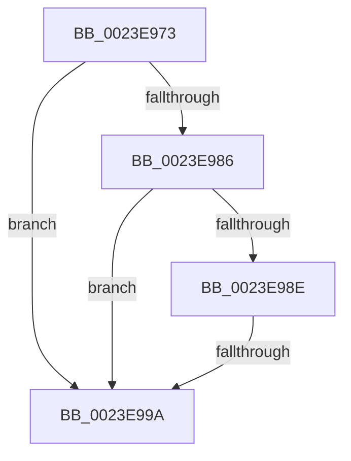

# sub_0023E973

- RVA: `0x0023E973`–`0x0023E99F` (길이 `44` bytes)
- VA: `0x000000014023E973`
- 실행 섹션: `.text`
- PDB 이름 있음: `아니요`; PDB Function 태그: `아니요`
- unwind 정보 RVA: `0x000613B0`
- 디코드: `13`개 명령, `44/44` bytes 표시
- 미해석 바이트: `0` (있으면 어셈블리에 `.byte`로 보존)

> 이 문서는 커널 이미지의 기계어와 PDB 기호를 분석해 생성했습니다. 4번과 5번은 함수 원형과 자료형을 바이너리 사용 방식에서 추정한 C 해석이며 원본 소스 복구 결과는 아닙니다.

## 1. Dependencies

- 직접 호출 지점: **0**; 고유 호출 대상: **0**
- 직접 호출자로 확인된 함수: **0**
- RIP 상대 이미지 참조: **0**

### Outgoing calls
- 직접 디코드된 call 명령이 없습니다.

### Direct callers
- 이 함수 시작 RVA로 연결되는 직접 call은 확인되지 않았습니다. 간접 호출은 완전히 역산할 수 없습니다.

### Static image references
- 디코드된 RIP-relative 메모리 참조가 없습니다.

## 2. Other-region calls and transfers

- 다른 실행 섹션으로 향하는 call: **0**
- call이 아닌 외부 분기/꼬리 이동: **1**
  - `0x0023E994` → [sub_0023EB7F](Unknown_function_0023EB7F.md) (`tail-transfer`)

## 3. Assembly (complete function range)

```asm
0023E973  48 89 7C 24 50                  mov qword ptr [rsp + 0x50], rdi
0023E978  4C 89 74 24 28                  mov qword ptr [rsp + 0x28], r14
0023E97D  4C 89 7C 24 20                  mov qword ptr [rsp + 0x20], r15
0023E982  A8 0F                           test al, 0xf
0023E984  74 14                           je 0x14023e99a
0023E986  49 8B C0                        mov rax, r8
0023E989  48 3B F0                        cmp rsi, rax
0023E98C  72 0C                           jb 0x14023e99a
0023E98E  49 8B C1                        mov rax, r9
0023E991  48 3B F0                        cmp rsi, rax
0023E994  0F 86 E5 01 00 00               jbe 0x14023eb7f
0023E99A  48 8B 1E                        mov rbx, qword ptr [rsi]
0023E99D  33 ED                           xor ebp, ebp
```

## 4. C-style interpretation (structured pseudocode)

```c
__int64 __fastcall sub_0023E973(__int64 a1, __int64 a2, __int64 a3, __int64 a4)
{
    __int64 v_rbp;
    unsigned __int64 v_stack_p20;
    unsigned __int64 v_stack_p28;
    unsigned __int64 v_stack_p50;

    v_stack_p50 = v_rdi;
    v_stack_p28 = v_r14;
    v_stack_p20 = v_r15;
    if ((((unsigned __int8)(result)) & (15)) == 0) goto loc_0023E99A;
    if (v_rsi < a3) goto loc_0023E99A;
loc_0023E99A:
    v_rbp = 0;
    return a4;
}
```

## 5. (Beta) C Style

```c
int64_t sub_0023E973(int64_t Arg1, int64_t Arg2, int64_t Arg3, int64_t Arg4)
{
    int64_t local_rbp;
    uint64_t v_stack_p20;
    uint64_t v_stack_p28;
    uint64_t v_stack_p50;

    v_stack_p50 = local_rdi;
    v_stack_p28 = local_r14;
    v_stack_p20 = local_r15;
    if ((((uint8_t)(result)) & (15)) == 0) goto loc_0023E99A;
    if (local_rsi < Arg3) goto loc_0023E99A;
loc_0023E99A:
    local_rbp = 0;
    return Arg4;
}
```

## 6. Execution-region graph

[열기: 2D/3D 그래프와 함수 탐색 컨트롤 패널](../../../control-panel.html?section=text&rva=0x0023E973&view=graph)

- 2D 그래프는 위에서 아래로 흐르고, 3D 그래프는 빈 공간을 드래그해 회전합니다. Shift+드래그는 이동, 휠은 확대·축소, 함수 노드 선택은 대상 보고서 이동입니다.

### Static fallback


