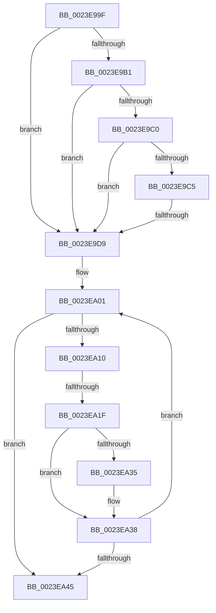

# sub_0023E99F

- RVA: `0x0023E99F`–`0x0023EA4F` (길이 `176` bytes)
- VA: `0x000000014023E99F`
- 실행 섹션: `.text`
- PDB 이름 있음: `아니요`; PDB Function 태그: `아니요`
- unwind 정보 RVA: `0x000613CC`
- 디코드: `39`개 명령, `176/176` bytes 표시
- 미해석 바이트: `0` (있으면 어셈블리에 `.byte`로 보존)

> 이 문서는 커널 이미지의 기계어와 PDB 기호를 분석해 생성했습니다. 4번과 5번은 함수 원형과 자료형을 바이너리 사용 방식에서 추정한 C 해석이며 원본 소스 복구 결과는 아닙니다.

## 1. Dependencies

- 직접 호출 지점: **0**; 고유 호출 대상: **0**
- 직접 호출자로 확인된 함수: **0**
- RIP 상대 이미지 참조: **1**

### Outgoing calls
- 직접 디코드된 call 명령이 없습니다.

### Direct callers
- 이 함수 시작 RVA로 연결되는 직접 call은 확인되지 않았습니다. 간접 호출은 완전히 역산할 수 없습니다.

### Static image references
- `0x0023EA28` → RVA `0x00FC6A88` (`ALMOSTRO`; read)

## 2. Other-region calls and transfers

- 다른 실행 섹션으로 향하는 call: **0**
- call이 아닌 외부 분기/꼬리 이동: **2**
  - `0x0023E9D3` → [sub_0023EA94](Unknown_function_0023EA94.md) (`tail-transfer`)
  - `0x0023EA19` → [sub_0023EB18](Unknown_function_0023EB18.md) (`tail-transfer`)

## 3. Assembly (complete function range)

```asm
0023E99F  4C 89 64 24 58                  mov qword ptr [rsp + 0x58], r12
0023E9A4  4C 89 6C 24 60                  mov qword ptr [rsp + 0x60], r13
0023E9A9  49 8B C0                        mov rax, r8
0023E9AC  48 3B F0                        cmp rsi, rax
0023E9AF  72 28                           jb 0x14023e9d9
0023E9B1  48 B8 F8 D7 BE 7D FB F6 FF FF   movabs rax, 0xfffff6fb7dbed7f8
0023E9BB  48 3B F0                        cmp rsi, rax
0023E9BE  77 19                           ja 0x14023e9d9
0023E9C0  F6 C3 01                        test bl, 1
0023E9C3  74 14                           je 0x14023e9d9
0023E9C5  F6 C3 42                        test bl, 0x42
0023E9C8  0F 95 C1                        setne cl
0023E9CB  F6 C3 20                        test bl, 0x20
0023E9CE  0F 95 C0                        setne al
0023E9D1  84 C8                           test al, cl
0023E9D3  0F 84 BB 00 00 00               je 0x14023ea94
0023E9D9  49 BE FF FF FF FF FF FF FF DF   movabs r14, 0xdfffffffffffffff
0023E9E3  49 BF 20 00 00 00 00 00 00 10   movabs r15, 0x1000000000000020
0023E9ED  49 B8 00 00 00 00 40 00 00 00   movabs r8, 0x4000000000
0023E9F7  48 BA 00 00 00 00 80 F6 FF FF   movabs rdx, 0xfffff68000000000
0023EA01  48 B9 00 00 00 00 00 00 00 20   movabs rcx, 0x2000000000000000
0023EA0B  F6 C3 01                        test bl, 1
0023EA0E  74 35                           je 0x14023ea45
0023EA10  48 8B C3                        mov rax, rbx
0023EA13  48 C1 E8 3C                     shr rax, 0x3c
0023EA17  A8 01                           test al, 1
0023EA19  0F 85 F9 00 00 00               jne 0x14023eb18
0023EA1F  48 8B CB                        mov rcx, rbx
0023EA22  49 23 CE                        and rcx, r14
0023EA25  49 0B CF                        or rcx, r15
0023EA28  48 F7 05 55 80 D8 00 00 00 00 02  test qword ptr [rip + 0xd88055], 0x2000000
0023EA33  74 03                           je 0x14023ea38
0023EA35  0F AE E8                        lfence
0023EA38  48 8B C3                        mov rax, rbx
0023EA3B  F0 48 0F B1 0E                  lock cmpxchg qword ptr [rsi], rcx
0023EA40  48 8B D8                        mov rbx, rax
0023EA43  75 BC                           jne 0x14023ea01
0023EA45  4C 8B 6C 24 60                  mov r13, qword ptr [rsp + 0x60]
0023EA4A  4C 8B 64 24 58                  mov r12, qword ptr [rsp + 0x58]
```

## 4. C-style interpretation (structured pseudocode)

```c
__int64 __fastcall sub_0023E99F(__int64 a1, __int64 a2, __int64 a3, __int64 a4, __int64 a5, __int64 a6, __int64 a7, __int64 a8, __int64 a9, __int64 a10, __int64 a11, __int64 a12)
{
    __int64 result;
    unsigned __int64 v_stack_p58;
    unsigned __int64 v_stack_p60;

    v_stack_p58 = v_r12;
    v_stack_p60 = v_r13;
    if (v_rsi < a3) goto loc_0023E9D9;
    if (v_rsi > a3) goto loc_0023E9D9;
    if ((((unsigned __int8)(v_rbx)) & (1)) == 0) goto loc_0023E9D9;
    a1 = ((((unsigned __int8)(v_rbx)) & (66)) != 0) ? 1 : 0;
    result = ((((unsigned __int8)(v_rbx)) & (32)) != 0) ? 1 : 0;
loc_0023E9D9:
loc_0023EA01:
    if ((((unsigned __int8)(v_rbx)) & (1)) == 0) goto loc_0023EA45;
    result = (v_rbx) >> (60);
    a1 = (v_rbx) & (v_r14);
    a1 = (a1) | (v_r15);
    if (((*(unsigned __int64 *)(v_rip + 14188629)) & (0x2000000ULL)) != 0) {
    }
    if (((*(unsigned __int64 *)(v_rip + 14188629)) & (0x2000000ULL)) != 0) goto loc_0023EA01;
loc_0023EA45:
    return v_rbx;
}
```

## 5. (Beta) C Style

```c
int64_t sub_0023E99F(int64_t Arg1, int64_t Arg2, int64_t Arg3, int64_t Arg4, uint64_t Arg5, uint64_t Arg6, uint64_t Arg7, uint64_t Arg8, uint64_t Arg9, uint64_t Arg10, int64_t Arg11, int64_t Arg12)
{
    int64_t result;
    uint64_t v_stack_p58;
    uint64_t v_stack_p60;

    v_stack_p58 = local_r12;
    v_stack_p60 = local_r13;
    if (local_rsi < Arg3) goto loc_0023E9D9;
    if (local_rsi > Arg3) goto loc_0023E9D9;
    if ((((uint8_t)(local_rbx)) & (1)) == 0) goto loc_0023E9D9;
    Arg1 = ((((uint8_t)(local_rbx)) & (66)) != 0) ? 1 : 0;
    result = ((((uint8_t)(local_rbx)) & (32)) != 0) ? 1 : 0;
loc_0023E9D9:
loc_0023EA01:
    if ((((uint8_t)(local_rbx)) & (1)) == 0) goto loc_0023EA45;
    result = (local_rbx) >> (60);
    Arg1 = (local_rbx) & (local_r14);
    Arg1 = (Arg1) | (local_r15);
    if (((*(uint64_t *)(v_rip + 0xD88055)) & (0x2000000ULL)) != 0) {
    }
    if (((*(uint64_t *)(v_rip + 0xD88055)) & (0x2000000ULL)) != 0) goto loc_0023EA01;
loc_0023EA45:
    return local_rbx;
}
```

## 6. Execution-region graph

[열기: 2D/3D 그래프와 함수 탐색 컨트롤 패널](../../../control-panel.html?section=text&rva=0x0023E99F&view=graph)

- 2D 그래프는 위에서 아래로 흐르고, 3D 그래프는 빈 공간을 드래그해 회전합니다. Shift+드래그는 이동, 휠은 확대·축소, 함수 노드 선택은 대상 보고서 이동입니다.

### Static fallback


