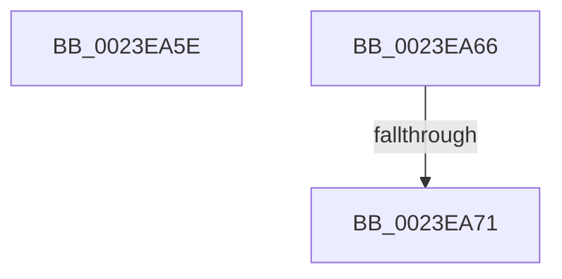

# sub_0023EA5E

- RVA: `0x0023EA5E`–`0x0023EA94` (길이 `54` bytes)
- VA: `0x000000014023EA5E`
- 실행 섹션: `.text`
- PDB 이름 있음: `아니요`; PDB Function 태그: `아니요`
- unwind 정보 RVA: `0x000613F4`
- 디코드: `17`개 명령, `54/54` bytes 표시
- 미해석 바이트: `0` (있으면 어셈블리에 `.byte`로 보존)

> 이 문서는 커널 이미지의 기계어와 PDB 기호를 분석해 생성했습니다. 4번과 5번은 함수 원형과 자료형을 바이너리 사용 방식에서 추정한 C 해석이며 원본 소스 복구 결과는 아닙니다.

## 1. Dependencies

- 직접 호출 지점: **0**; 고유 호출 대상: **0**
- 직접 호출자로 확인된 함수: **0**
- RIP 상대 이미지 참조: **1**

### Outgoing calls
- 직접 디코드된 call 명령이 없습니다.

### Direct callers
- 이 함수 시작 RVA로 연결되는 직접 call은 확인되지 않았습니다. 간접 호출은 완전히 역산할 수 없습니다.

### Static image references
- `0x0023EA7D` → RVA `0x00E2CB40` (`.data`; read)

## 2. Other-region calls and transfers

- 다른 실행 섹션으로 향하는 call: **0**
- call이 아닌 외부 분기/꼬리 이동: **2**
  - `0x0023EA6B` → [sub_0023EB55](Unknown_function_0023EB55.md) (`tail-transfer`)
  - `0x0023EA8F` → [MiLockNestedPageTable + 0x42](MiLockNestedPageTable_function_0023E890.md) (`tail-transfer`)

## 3. Assembly (complete function range)

```asm
0023EA5E  48 83 C4 30                     add rsp, 0x30
0023EA62  5E                              pop rsi
0023EA63  5D                              pop rbp
0023EA64  5B                              pop rbx
0023EA65  C3                              ret
0023EA66  CC                              int3
0023EA67  33 ED                           xor ebp, ebp
0023EA69  3C 07                           cmp al, 7
0023EA6B  0F 84 E4 00 00 00               je 0x14023eb55
0023EA71  3C 05                           cmp al, 5
0023EA73  BB 03 00 00 00                  mov ebx, 3
0023EA78  0F 44 DD                        cmove ebx, ebp
0023EA7B  8B D3                           mov edx, ebx
0023EA7D  48 8D 0D BC E0 BE 00            lea rcx, [rip + 0xbee0bc]
0023EA84  48 8D 89 80 32 00 00            lea rcx, [rcx + 0x3280]
0023EA8B  48 8D 14 D1                     lea rdx, [rcx + rdx*8]
0023EA8F  E9 3E FE FF FF                  jmp 0x14023e8d2
```

## 4. C-style interpretation (structured pseudocode)

```c
void __fastcall sub_0023EA5E(void)
{
    __int64 v_rsp;

    v_rsp = (v_rsp) + (48);
    return;
}
```

## 5. (Beta) C Style

```c
void sub_0023EA5E(void)
{
    int64_t local_rsp;

    local_rsp = (local_rsp) + (48);
    return;
}
```

## 6. Execution-region graph

[열기: 2D/3D 그래프와 함수 탐색 컨트롤 패널](../../../control-panel.html?section=text&rva=0x0023EA5E&view=graph)

- 2D 그래프는 위에서 아래로 흐르고, 3D 그래프는 빈 공간을 드래그해 회전합니다. Shift+드래그는 이동, 휠은 확대·축소, 함수 노드 선택은 대상 보고서 이동입니다.

### Static fallback


