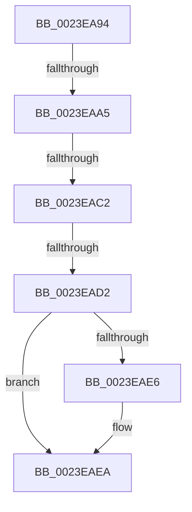

# sub_0023EA94

- RVA: `0x0023EA94`–`0x0023EAFC` (길이 `104` bytes)
- VA: `0x000000014023EA94`
- 실행 섹션: `.text`
- PDB 이름 있음: `아니요`; PDB Function 태그: `아니요`
- unwind 정보 RVA: `0x00061408`
- 디코드: `21`개 명령, `104/104` bytes 표시
- 미해석 바이트: `0` (있으면 어셈블리에 `.byte`로 보존)

> 이 문서는 커널 이미지의 기계어와 PDB 기호를 분석해 생성했습니다. 4번과 5번은 함수 원형과 자료형을 바이너리 사용 방식에서 추정한 C 해석이며 원본 소스 복구 결과는 아닙니다.

## 1. Dependencies

- 직접 호출 지점: **0**; 고유 호출 대상: **0**
- 직접 호출자로 확인된 함수: **0**
- RIP 상대 이미지 참조: **1**

### Outgoing calls
- 직접 디코드된 call 명령이 없습니다.

### Direct callers
- 이 함수 시작 RVA로 연결되는 직접 call은 확인되지 않았습니다. 간접 호출은 완전히 역산할 수 없습니다.

### Static image references
- `0x0023EA94` → RVA `0x00FC6A88` (`ALMOSTRO`; read)

## 2. Other-region calls and transfers

- 다른 실행 섹션으로 향하는 call: **0**
- call이 아닌 외부 분기/꼬리 이동: **4**
  - `0x0023EA9F` → [sub_0023E99F + 0x3A](Unknown_function_0023E99F.md) (`tail-transfer`)
  - `0x0023EABC` → [sub_0023E99F + 0x3A](Unknown_function_0023E99F.md) (`tail-transfer`)
  - `0x0023EACC` → [sub_0023E99F + 0x3A](Unknown_function_0023E99F.md) (`tail-transfer`)
  - `0x0023EAF7` → [sub_0023E99F + 0x3A](Unknown_function_0023E99F.md) (`tail-transfer`)

## 3. Assembly (complete function range)

```asm
0023EA94  48 F7 05 E9 7F D8 00 00 00 60 00  test qword ptr [rip + 0xd87fe9], 0x600000
0023EA9F  0F 84 34 FF FF FF               je 0x14023e9d9
0023EAA5  65 48 8B 04 25 88 01 00 00      mov rax, qword ptr gs:[0x188]
0023EAAE  48 8B 88 B8 00 00 00            mov rcx, qword ptr [rax + 0xb8]
0023EAB5  80 B9 60 01 00 00 01            cmp byte ptr [rcx + 0x160], 1
0023EABC  0F 84 17 FF FF FF               je 0x14023e9d9
0023EAC2  48 8B 91 08 05 00 00            mov rdx, qword ptr [rcx + 0x508]
0023EAC9  48 85 D2                        test rdx, rdx
0023EACC  0F 84 07 FF FF FF               je 0x14023e9d9
0023EAD2  48 8B C6                        mov rax, rsi
0023EAD5  48 C1 E8 03                     shr rax, 3
0023EAD9  25 FF 01 00 00                  and eax, 0x1ff
0023EADE  48 8B 04 C2                     mov rax, qword ptr [rdx + rax*8]
0023EAE2  A8 20                           test al, 0x20
0023EAE4  74 04                           je 0x14023eaea
0023EAE6  48 83 CB 20                     or rbx, 0x20
0023EAEA  48 8B CB                        mov rcx, rbx
0023EAED  48 83 CB 42                     or rbx, 0x42
0023EAF1  A8 42                           test al, 0x42
0023EAF3  48 0F 44 D9                     cmove rbx, rcx
0023EAF7  E9 DD FE FF FF                  jmp 0x14023e9d9
```

## 4. C-style interpretation (structured pseudocode)

```c
__int64 __fastcall sub_0023EA94(void)
{
    __int64 result;
    __int64 v_rbx;

    result = (v_rsi) >> (3);
    result = (unsigned int)((result) & (511));
    if ((((unsigned __int8)(*(unsigned __int64 *)(*(unsigned __int64 *)(*(unsigned __int64 *)(*(unsigned __int64 *)(gs_base + (0 + 392)) + 184) + 1288) + result * 8))) & (32)) != 0) {
        v_rbx = (v_rbx) | (32);
    }
    v_rbx = (v_rbx) | (66);
    if ((((unsigned __int8)(*(unsigned __int64 *)(*(unsigned __int64 *)(*(unsigned __int64 *)(*(unsigned __int64 *)(gs_base + (0 + 392)) + 184) + 1288) + result * 8))) & (66)) == 0) { v_rbx = v_rbx; }
}
```

## 5. (Beta) C Style

```c
void sub_0023EA94(void)
{
    int64_t result;
    int64_t local_rbx;

    result = (local_rsi) >> (3);
    result = (uint32_t)((result) & (511));
    if ((((uint8_t)(*(uint64_t *)(*(uint64_t *)(*(uint64_t *)(*(uint64_t *)(gs_base + (0 + 0x188)) + 0xB8) + 0x508) + result * 8))) & (32)) != 0) {
        local_rbx = (local_rbx) | (32);
    }
    local_rbx = (local_rbx) | (66);
    if ((((uint8_t)(*(uint64_t *)(*(uint64_t *)(*(uint64_t *)(*(uint64_t *)(gs_base + (0 + 0x188)) + 0xB8) + 0x508) + result * 8))) & (66)) == 0) { local_rbx = local_rbx; }
}
```

## 6. Execution-region graph

[열기: 2D/3D 그래프와 함수 탐색 컨트롤 패널](../../../control-panel.html?section=text&rva=0x0023EA94&view=graph)

- 2D 그래프는 위에서 아래로 흐르고, 3D 그래프는 빈 공간을 드래그해 회전합니다. Shift+드래그는 이동, 휠은 확대·축소, 함수 노드 선택은 대상 보고서 이동입니다.

### Static fallback


