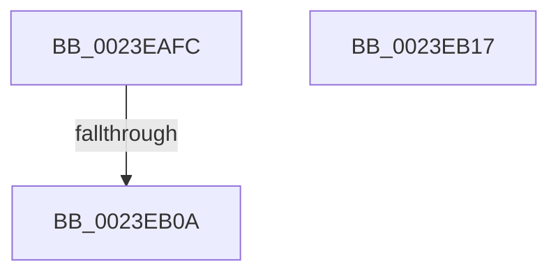

# sub_0023EAFC

- RVA: `0x0023EAFC`–`0x0023EB18` (길이 `28` bytes)
- VA: `0x000000014023EAFC`
- 실행 섹션: `.text`
- PDB 이름 있음: `아니요`; PDB Function 태그: `아니요`
- unwind 정보 RVA: `0x0006142C`
- 디코드: `10`개 명령, `28/28` bytes 표시
- 미해석 바이트: `0` (있으면 어셈블리에 `.byte`로 보존)

> 이 문서는 커널 이미지의 기계어와 PDB 기호를 분석해 생성했습니다. 4번과 5번은 함수 원형과 자료형을 바이너리 사용 방식에서 추정한 C 해석이며 원본 소스 복구 결과는 아닙니다.

## 1. Dependencies

- 직접 호출 지점: **1**; 고유 호출 대상: **1**
- 직접 호출자로 확인된 함수: **0**
- RIP 상대 이미지 참조: **1**

### Outgoing calls
- `0x0023EB0A` → [KiAcquireQueuedSpinLockInstrumented](../27/KiAcquireQueuedSpinLockInstrumented_function_00275850.md) (function, `0x00275850`)

### Direct callers
- 이 함수 시작 RVA로 연결되는 직접 call은 확인되지 않았습니다. 간접 호출은 완전히 역산할 수 없습니다.

### Static image references
- `0x0023EAFC` → RVA `0x00F0DE58` (`.data`; read)

## 2. Other-region calls and transfers

- 다른 실행 섹션으로 향하는 call: **0**
- call이 아닌 외부 분기/꼬리 이동: **1**
  - `0x0023EB04` → [MiLockNestedPageTable + 0x68](MiLockNestedPageTable_function_0023E890.md) (`tail-transfer`)

## 3. Assembly (complete function range)

```asm
0023EAFC  8B 05 56 F3 CC 00               mov eax, dword ptr [rip + 0xccf356]
0023EB02  85 C0                           test eax, eax
0023EB04  0F 85 EE FD FF FF               jne 0x14023e8f8
0023EB0A  E8 41 6D 03 00                  call 0x140275850
0023EB0F  48 83 C4 30                     add rsp, 0x30
0023EB13  5E                              pop rsi
0023EB14  5D                              pop rbp
0023EB15  5B                              pop rbx
0023EB16  C3                              ret
0023EB17  CC                              int3
```

## 4. C-style interpretation (structured pseudocode)

```c
__int64 __fastcall sub_0023EAFC(void)
{
    __int64 result;
    __int64 v_rsp;

    result = KiAcquireQueuedSpinLockInstrumented(a1, a2, a3, a4);
    v_rsp = (v_rsp) + (48);
    return result;
}
```

## 5. (Beta) C Style

```c
void sub_0023EAFC(void)
{
    int64_t result;
    int64_t local_rsp;

    result = KiAcquireQueuedSpinLockInstrumented(a1, a2, a3, a4);
    local_rsp = (local_rsp) + (48);
    return result;
}
```

## 6. Execution-region graph

[열기: 2D/3D 그래프와 함수 탐색 컨트롤 패널](../../../control-panel.html?section=text&rva=0x0023EAFC&view=graph)

- 2D 그래프는 위에서 아래로 흐르고, 3D 그래프는 빈 공간을 드래그해 회전합니다. Shift+드래그는 이동, 휠은 확대·축소, 함수 노드 선택은 대상 보고서 이동입니다.

### Static fallback


