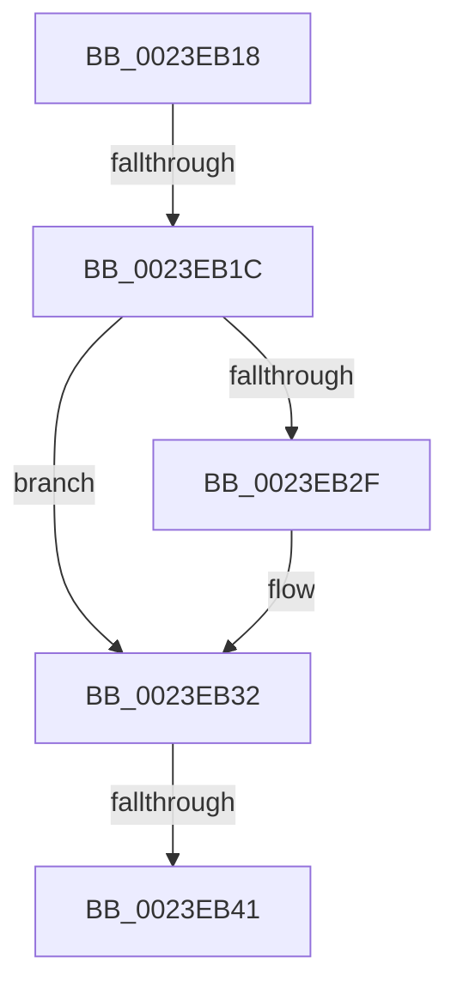

# sub_0023EB18

- RVA: `0x0023EB18`–`0x0023EB55` (길이 `61` bytes)
- VA: `0x000000014023EB18`
- 실행 섹션: `.text`
- PDB 이름 있음: `아니요`; PDB Function 태그: `아니요`
- unwind 정보 RVA: `0x00061440`
- 디코드: `14`개 명령, `61/61` bytes 표시
- 미해석 바이트: `0` (있으면 어셈블리에 `.byte`로 보존)

> 이 문서는 커널 이미지의 기계어와 PDB 기호를 분석해 생성했습니다. 4번과 5번은 함수 원형과 자료형을 바이너리 사용 방식에서 추정한 C 해석이며 원본 소스 복구 결과는 아닙니다.

## 1. Dependencies

- 직접 호출 지점: **0**; 고유 호출 대상: **0**
- 직접 호출자로 확인된 함수: **0**
- RIP 상대 이미지 참조: **1**

### Outgoing calls
- 직접 디코드된 call 명령이 없습니다.

### Direct callers
- 이 함수 시작 RVA로 연결되는 직접 call은 확인되지 않았습니다. 간접 호출은 완전히 역산할 수 없습니다.

### Static image references
- `0x0023EB22` → RVA `0x00FC6A88` (`ALMOSTRO`; read)

## 2. Other-region calls and transfers

- 다른 실행 섹션으로 향하는 call: **0**
- call이 아닌 외부 분기/꼬리 이동: **3**
  - `0x0023EB1A` → [sub_0023EB60](Unknown_function_0023EB60.md) (`tail-transfer`)
  - `0x0023EB3B` → [sub_0023EC2E](Unknown_function_0023EC2E.md) (`tail-transfer`)
  - `0x0023EB50` → [sub_0023E99F + 0x6C](Unknown_function_0023E99F.md) (`tail-transfer`)

## 3. Assembly (complete function range)

```asm
0023EB18  A8 02                           test al, 2
0023EB1A  75 44                           jne 0x14023eb60
0023EB1C  48 8B FB                        mov rdi, rbx
0023EB1F  48 0B F9                        or rdi, rcx
0023EB22  48 F7 05 5B 7F D8 00 00 00 00 02  test qword ptr [rip + 0xd87f5b], 0x2000000
0023EB2D  74 03                           je 0x14023eb32
0023EB2F  0F AE E8                        lfence
0023EB32  48 0F BA 25 4D 7F D8 00 24      bt qword ptr [rip + 0xd87f4d], 0x24
0023EB3B  0F 82 ED 00 00 00               jb 0x14023ec2e
0023EB41  48 8B C3                        mov rax, rbx
0023EB44  F0 48 0F B1 3E                  lock cmpxchg qword ptr [rsi], rdi
0023EB49  48 8B D8                        mov rbx, rax
0023EB4C  48 0F 44 DF                     cmove rbx, rdi
0023EB50  E9 B6 FE FF FF                  jmp 0x14023ea0b
```

## 4. C-style interpretation (structured pseudocode)

```c
__int64 __fastcall sub_0023EB18(__int64 a1)
{
    __int64 v_rbx;
    __int64 v_rdi;

    v_rdi = (v_rbx) | (a1);
    if (((*(unsigned __int64 *)(v_rip + 14188379)) & (0x2000000ULL)) != 0) {
    }
    if (((*(unsigned __int64 *)(v_rip + 14188379)) & (0x2000000ULL)) == 0) { v_rbx = v_rdi; }
}
```

## 5. (Beta) C Style

```c
int64_t sub_0023EB18(int64_t Arg1)
{
    int64_t local_rbx;
    int64_t local_rdi;

    local_rdi = (local_rbx) | (Arg1);
    if (((*(uint64_t *)(v_rip + 0xD87F5B)) & (0x2000000ULL)) != 0) {
    }
    if (((*(uint64_t *)(v_rip + 0xD87F5B)) & (0x2000000ULL)) == 0) { local_rbx = local_rdi; }
}
```

## 6. Execution-region graph

[열기: 2D/3D 그래프와 함수 탐색 컨트롤 패널](../../../control-panel.html?section=text&rva=0x0023EB18&view=graph)

- 2D 그래프는 위에서 아래로 흐르고, 3D 그래프는 빈 공간을 드래그해 회전합니다. Shift+드래그는 이동, 휠은 확대·축소, 함수 노드 선택은 대상 보고서 이동입니다.

### Static fallback


