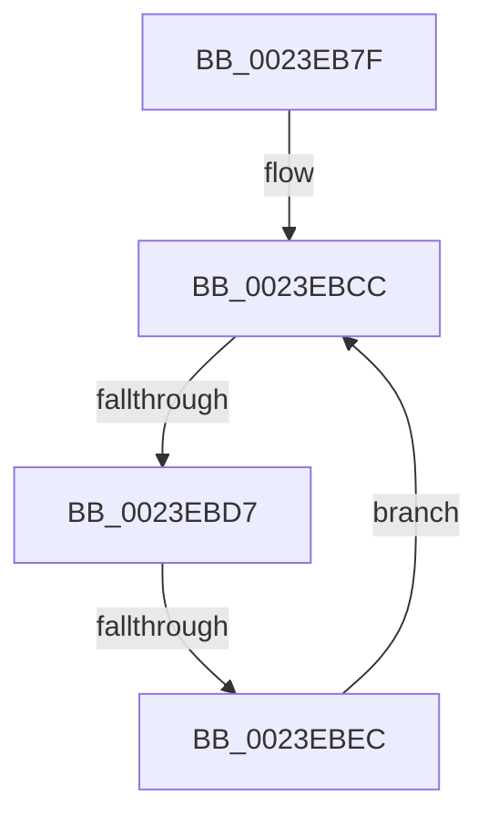

# sub_0023EB7F

- RVA: `0x0023EB7F`–`0x0023EBEE` (길이 `111` bytes)
- VA: `0x000000014023EB7F`
- 실행 섹션: `.text`
- PDB 이름 있음: `아니요`; PDB Function 태그: `아니요`
- unwind 정보 RVA: `0x00061498`
- 디코드: `34`개 명령, `111/111` bytes 표시
- 미해석 바이트: `0` (있으면 어셈블리에 `.byte`로 보존)

> 이 문서는 커널 이미지의 기계어와 PDB 기호를 분석해 생성했습니다. 4번과 5번은 함수 원형과 자료형을 바이너리 사용 방식에서 추정한 C 해석이며 원본 소스 복구 결과는 아닙니다.

## 1. Dependencies

- 직접 호출 지점: **0**; 고유 호출 대상: **0**
- 직접 호출자로 확인된 함수: **0**
- RIP 상대 이미지 참조: **1**

### Outgoing calls
- 직접 디코드된 call 명령이 없습니다.

### Direct callers
- 이 함수 시작 RVA로 연결되는 직접 call은 확인되지 않았습니다. 간접 호출은 완전히 역산할 수 없습니다.

### Static image references
- `0x0023EB87` → RVA `0x00E2CB40` (`.data`; read)

## 2. Other-region calls and transfers

- 다른 실행 섹션으로 향하는 call: **0**
- call이 아닌 외부 분기/꼬리 이동: **2**
  - `0x0023EBD5` → [sub_0023EC15](Unknown_function_0023EC15.md) (`tail-transfer`)
  - `0x0023EBE6` → [sub_0023EA4F](Unknown_function_0023EA4F.md) (`tail-transfer`)

## 3. Assembly (complete function range)

```asm
0023EB7F  33 ED                           xor ebp, ebp
0023EB81  49 8B C0                        mov rax, r8
0023EB84  48 2B F0                        sub rsi, rax
0023EB87  48 8D 0D B2 DF BE 00            lea rcx, [rip + 0xbedfb2]
0023EB8E  8B 82 B8 00 00 00               mov eax, dword ptr [rdx + 0xb8]
0023EB94  48 8D 89 6C 26 00 00            lea rcx, [rcx + 0x266c]
0023EB9B  48 C1 FE 03                     sar rsi, 3
0023EB9F  41 BF 01 00 00 00               mov r15d, 1
0023EBA5  03 F6                           add esi, esi
0023EBA7  BB 02 00 00 00                  mov ebx, 2
0023EBAC  8B FE                           mov edi, esi
0023EBAE  44 8B F6                        mov r14d, esi
0023EBB1  48 C1 EF 05                     shr rdi, 5
0023EBB5  41 83 E6 1F                     and r14d, 0x1f
0023EBB9  8B 14 B9                        mov edx, dword ptr [rcx + rdi*4]
0023EBBC  48 8D 3C B9                     lea rdi, [rcx + rdi*4]
0023EBC0  41 8B CE                        mov ecx, r14d
0023EBC3  41 D3 E7                        shl r15d, cl
0023EBC6  D3 E3                           shl ebx, cl
0023EBC8  8B F3                           mov esi, ebx
0023EBCA  F7 D6                           not esi
0023EBCC  41 8B CE                        mov ecx, r14d
0023EBCF  8B C2                           mov eax, edx
0023EBD1  D3 E8                           shr eax, cl
0023EBD3  A8 01                           test al, 1
0023EBD5  75 3E                           jne 0x14023ec15
0023EBD7  41 8B CF                        mov ecx, r15d
0023EBDA  8B C2                           mov eax, edx
0023EBDC  0B CA                           or ecx, edx
0023EBDE  23 CE                           and ecx, esi
0023EBE0  F0 0F B1 0F                     lock cmpxchg dword ptr [rdi], ecx
0023EBE4  8B D0                           mov edx, eax
0023EBE6  0F 84 63 FE FF FF               je 0x14023ea4f
0023EBEC  EB DE                           jmp 0x14023ebcc
```

## 4. C-style interpretation (structured pseudocode)

```c
__int64 __fastcall sub_0023EB7F(__int64 a1, __int64 a2, __int64 a3)
{
    __int64 result;
    __int64 v_r14;
    __int64 v_r15;
    __int64 v_rbp;
    __int64 v_rbx;
    __int64 v_rdi;
    __int64 v_rsi;

    v_rbp = 0;
    v_rsi = (v_rsi) - (a3);
    v_rsi = (v_rsi) >> (3);
    v_rsi = (unsigned int)((v_rsi) + ((unsigned int)(v_rsi)));
    v_rdi = ((unsigned int)((unsigned int)(v_rsi))) >> (5);
    v_r14 = (unsigned int)(((unsigned int)((unsigned int)(v_rsi))) & (31));
    v_r15 = (unsigned int)((1) << ((unsigned __int8)((unsigned int)((unsigned int)(v_r14)))));
    v_rbx = (unsigned int)((2) << ((unsigned __int8)((unsigned int)((unsigned int)(v_r14)))));
    v_rsi = (unsigned int)(~((unsigned int)((unsigned int)(v_rbx))));
loc_0023EBCC:
    result = (unsigned int)(((unsigned int)((unsigned int)((unsigned int)(*(unsigned int *)(v_rip + 12509106 + 9836 + v_rdi * 4))))) >> ((unsigned __int8)((unsigned int)((unsigned int)(v_r14)))));
    a1 = (unsigned int)(((unsigned int)((unsigned int)(v_r15))) | ((unsigned int)((unsigned int)(*(unsigned int *)(v_rip + 12509106 + 9836 + v_rdi * 4)))));
    a1 = (unsigned int)((a1) & ((unsigned int)(v_rsi)));
    goto loc_0023EBCC;
}
```

## 5. (Beta) C Style

```c
int64_t sub_0023EB7F(int64_t Arg1, void *Arg2, int64_t Arg3)
{
    uint8_t *arg2 = (uint8_t *)Arg2;

    int64_t result;
    int64_t local_r14;
    int64_t local_r15;
    int64_t local_rbp;
    int64_t local_rbx;
    int64_t local_rdi;
    int64_t local_rsi;

    local_rbp = 0;
    local_rsi = (local_rsi) - (Arg3);
    local_rsi = (local_rsi) >> (3);
    local_rsi = (uint32_t)((local_rsi) + ((uint32_t)(local_rsi)));
    local_rdi = ((uint32_t)((uint32_t)(local_rsi))) >> (5);
    local_r14 = (uint32_t)(((uint32_t)((uint32_t)(local_rsi))) & (31));
    local_r15 = (uint32_t)((1) << ((uint8_t)((uint32_t)((uint32_t)(local_r14)))));
    local_rbx = (uint32_t)((2) << ((uint8_t)((uint32_t)((uint32_t)(local_r14)))));
    local_rsi = (uint32_t)(~((uint32_t)((uint32_t)(local_rbx))));
loc_0023EBCC:
    result = (uint32_t)(((uint32_t)((uint32_t)((uint32_t)(*(uint32_t *)(v_rip + 0xBEDFB2 + 0x266C + local_rdi * 4))))) >> ((uint8_t)((uint32_t)((uint32_t)(local_r14)))));
    Arg1 = (uint32_t)(((uint32_t)((uint32_t)(local_r15))) | ((uint32_t)((uint32_t)(*(uint32_t *)(v_rip + 0xBEDFB2 + 0x266C + local_rdi * 4)))));
    Arg1 = (uint32_t)((Arg1) & ((uint32_t)(local_rsi)));
    goto loc_0023EBCC;
}
```

### 관측된 메모리 오프셋

구조체 형식이 확인되지 않은 접근은 인자 기준의 오프셋으로만 기록했습니다.

| 기준 인자 | 오프셋 표현 | 폭 (bit) | 접근 |
|---|---:|---:|---|
| `Arg2` | `+ 0xB8` | `32` | `R` |

## 6. Execution-region graph

[열기: 2D/3D 그래프와 함수 탐색 컨트롤 패널](../../../control-panel.html?section=text&rva=0x0023EB7F&view=graph)

- 2D 그래프는 위에서 아래로 흐르고, 3D 그래프는 빈 공간을 드래그해 회전합니다. Shift+드래그는 이동, 휠은 확대·축소, 함수 노드 선택은 대상 보고서 이동입니다.

### Static fallback


