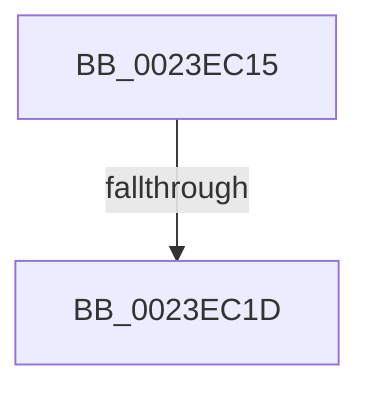

# sub_0023EC15

- RVA: `0x0023EC15`–`0x0023EC2E` (길이 `25` bytes)
- VA: `0x000000014023EC15`
- 실행 섹션: `.text`
- PDB 이름 있음: `아니요`; PDB Function 태그: `아니요`
- unwind 정보 RVA: `0x000614D8`
- 디코드: `9`개 명령, `25/25` bytes 표시
- 미해석 바이트: `0` (있으면 어셈블리에 `.byte`로 보존)

> 이 문서는 커널 이미지의 기계어와 PDB 기호를 분석해 생성했습니다. 4번과 5번은 함수 원형과 자료형을 바이너리 사용 방식에서 추정한 C 해석이며 원본 소스 복구 결과는 아닙니다.

## 1. Dependencies

- 직접 호출 지점: **0**; 고유 호출 대상: **0**
- 직접 호출자로 확인된 함수: **0**
- RIP 상대 이미지 참조: **0**

### Outgoing calls
- 직접 디코드된 call 명령이 없습니다.

### Direct callers
- 이 함수 시작 RVA로 연결되는 직접 call은 확인되지 않았습니다. 간접 호출은 완전히 역산할 수 없습니다.

### Static image references
- 디코드된 RIP-relative 메모리 참조가 없습니다.

## 2. Other-region calls and transfers

- 다른 실행 섹션으로 향하는 call: **0**
- call이 아닌 외부 분기/꼬리 이동: **2**
  - `0x0023EC17` → [sub_0023ECA0](Unknown_function_0023ECA0.md) (`tail-transfer`)
  - `0x0023EC2C` → [sub_0023EB7F + 0x4D](Unknown_function_0023EB7F.md) (`tail-transfer`)

## 3. Assembly (complete function range)

```asm
0023EC15  A8 02                           test al, 2
0023EC17  0F 85 83 00 00 00               jne 0x14023eca0
0023EC1D  8B CB                           mov ecx, ebx
0023EC1F  8B C2                           mov eax, edx
0023EC21  0B CA                           or ecx, edx
0023EC23  F0 0F B1 0F                     lock cmpxchg dword ptr [rdi], ecx
0023EC27  8B D0                           mov edx, eax
0023EC29  0F 44 D1                        cmove edx, ecx
0023EC2C  EB 9E                           jmp 0x14023ebcc
```

## 4. C-style interpretation (structured pseudocode)

```c
__int64 __fastcall sub_0023EC15(__int64 a1, int a2)
{
    a1 = (unsigned int)(((unsigned int)((unsigned int)(v_rbx))) | (a2));
    a2 = (unsigned int)((unsigned int)((unsigned int)(a2)));
    if (condition_is_equal) { a2 = (unsigned int)(a1); }
}
```

## 5. (Beta) C Style

```c
int64_t sub_0023EC15(int64_t Arg1, int32_t Arg2)
{
    Arg1 = (uint32_t)(((uint32_t)((uint32_t)(local_rbx))) | (Arg2));
    Arg2 = (uint32_t)((uint32_t)((uint32_t)(Arg2)));
    if (condition_is_equal) { Arg2 = (uint32_t)(Arg1); }
}
```

## 6. Execution-region graph

[열기: 2D/3D 그래프와 함수 탐색 컨트롤 패널](../../../control-panel.html?section=text&rva=0x0023EC15&view=graph)

- 2D 그래프는 위에서 아래로 흐르고, 3D 그래프는 빈 공간을 드래그해 회전합니다. Shift+드래그는 이동, 휠은 확대·축소, 함수 노드 선택은 대상 보고서 이동입니다.

### Static fallback


